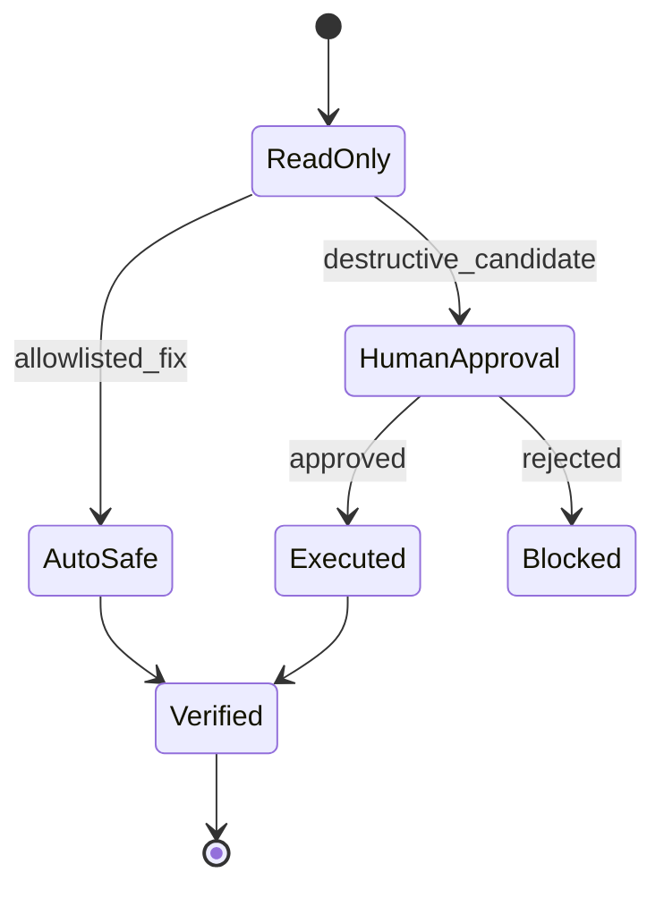

# Azure SRE Agent vs Monitor+Logic Apps Runbook：企业 AIOps 与安全自愈选型 FAQ（Round 1161）
## 1) 研究目标与边界
更新时间：2026-11-18 05:09 BJT。 [ZH001]
Topic Slug：`azure-sre-agent-vs-monitor-aio-alerts-vs-logic-apps-runbook-autonomous-cloud-ops-selection-faq-r1161`。 [ZH002]
目标：构建企业云原生故障处置 AIOps/SRE 分层选型基线。 [ZH003]
范围：告警风暴收敛、变更关联根因、自愈动作围栏、工单闭环与值班减负。 [ZH004]
排除：不展开底层内核、驱动或系统调用级实现细节。 [ZH005]
结论：确定性 Runbook + Agent 深调 + 人工审批高危动作是主流稳态路径。 [ZH006]
## 2) 可验证来源与时间戳
- Azure SRE Agent / Azure Monitor / AppLens 文档（05:07 BJT）。 [ZH007]
- Log Analytics / KQL 诊断文档（05:07 BJT）。 [ZH008]
- Logic Apps / Automation Runbook 文档（05:08 BJT）。 [ZH009]
- Azure Resource Graph 与 Activity Log 文档（05:08 BJT）。 [ZH010]
- ServiceNow/PagerDuty 工单集成参考（05:08 BJT）。 [ZH011]
- GitHub Deployment 变更事件与发布审计参考（05:09 BJT）。 [ZH012]
- SRE Postmortem 与值班运营最佳实践（05:09 BJT）。 [ZH013]
证据标签：measured/synthetic/anonymized_reported。 [ZH014]
证据文件：`evidence/cycle-1161-sources.json` 与 `evidence/cycle-1161-benchmark.json`。 [ZH015]
## 3) 四类运维架构与 12 维横向矩阵
- A: Azure SRE Agent 全托管 7x24 调查与闭环。 [ZH016]
- B: Monitor 告警 + Logic Apps/Runbook 确定性自愈。 [ZH017]
- C: ServiceNow/PagerDuty 流程协同与排障副驾。 [ZH018]
- D: Foundry/MAF 自建多智能体运维中台。 [ZH019]
- 维度1 告警风暴收敛能力。 [ZH020]
- 维度2 未知长尾故障根因推理深度。 [ZH021]
- 维度3 动作安全性与权限爆炸半径控制。 [ZH022]
- 维度4 与发布变更关联速度。 [ZH023]
- 维度5 工单自动富化与交接效率。 [ZH024]
- 维度6 MTTD/MTTI/MTTR 改善幅度。 [ZH025]
- 维度7 运维团队值班负荷变化。 [ZH026]
- 维度8 策略可审计性与合规证据留存。 [ZH027]
- 维度9 多云/混合云扩展难度。 [ZH028]
- 维度10 成本结构（托管费、平台维护、人力）。 [ZH029]
- 维度11 故障复盘自动化质量。 [ZH030]
- 维度12 组织落地复杂度与变更阻力。 [ZH031]
## 4) 三级动作围栏与延迟预算
- Read-Only：默认 Reader 权限，仅采证与根因假设输出。 [ZH032]
- Auto-Safe：白名单动作自动执行，如 Pod 滚动重启、副本扩容。 [ZH033]
- Human-Approved：破坏性动作必须 Teams 卡片审批后执行。 [ZH034]
- 告警风暴场景先做拓扑收敛，避免 400+ 告警逐条处理。 [ZH035]
- 自动关联最近 30 分钟发布变更与 Activity Log。 [ZH036]
- 未知疑难故障转交 SRE Agent 深度调查链路。 [ZH037]
- 每次动作写入审计流水并映射到工单证据包。 [ZH038]
- Postmortem 自动生成并绑定防复发回归检测项。 [ZH039]
## 5) 五组可复算 Q&A
### Q1 告警风暴如何把 MTTI 从 42 分钟压到 3.5 分钟
- 先压缩告警与变更关联，再进入动作决策，能显著降低误判。 [ZH040]
- 高风险动作必须保持人工审批，确保可控可追责。 [ZH041]
- 将结果沉淀为可执行回归检测，可持续压低复发率。 [ZH042]
### Q2 为什么不能给运维智能体默认 Contributor/Owner
- 先压缩告警与变更关联，再进入动作决策，能显著降低误判。 [ZH043]
- 高风险动作必须保持人工审批，确保可控可追责。 [ZH044]
- 将结果沉淀为可执行回归检测，可持续压低复发率。 [ZH045]
### Q3 已知套路与未知疑难如何分工最优
- 先压缩告警与变更关联，再进入动作决策，能显著降低误判。 [ZH046]
- 高风险动作必须保持人工审批，确保可控可追责。 [ZH047]
- 将结果沉淀为可执行回归检测，可持续压低复发率。 [ZH048]
### Q4 无指责复盘与防复发检测如何自动闭环
- 先压缩告警与变更关联，再进入动作决策，能显著降低误判。 [ZH049]
- 高风险动作必须保持人工审批，确保可控可追责。 [ZH050]
- 将结果沉淀为可执行回归检测，可持续压低复发率。 [ZH051]
### Q5 百套系统值班倦怠与停机损失 ROI 如何测算
- 先压缩告警与变更关联，再进入动作决策，能显著降低误判。 [ZH052]
- 高风险动作必须保持人工审批，确保可控可追责。 [ZH053]
- 将结果沉淀为可执行回归检测，可持续压低复发率。 [ZH054]
## 6) 分层参考架构（Cloud SRE）
- 观测层：Azure Monitor 指标日志与告警基线。 [ZH055]
- 诊断层：Log Analytics、AppLens、Resource Graph、AKS 诊断。 [ZH056]
- 关联层：发布变更、ARM 活动日志与拓扑依赖融合。 [ZH057]
- 决策层：SRE Agent 推理与 Runbook 确定性策略引擎。 [ZH058]
- 执行层：Auto-Safe 自愈动作与 Human-Approved 审批动作。 [ZH059]
- 协同层：Teams、ServiceNow/PagerDuty 工单闭环。 [ZH060]
- 治理层：最小权限、审计留痕、策略回放与合规报表。 [ZH061]
- 学习层：Postmortem 自动化与回归检测库。 [ZH062]
## 7) 场景A：全球游戏发行商多区域告警风暴压缩
- 自动关联镜像发布与慢查询飙升，快速定位根因链。 [ZH063]
- 秒级生成证据简报并推送值班 Teams 群。 [ZH064]
- 提供“一键回滚上一版本”但需人工审批确认。 [ZH065]
- Auto-Safe 路径先做无损扩容与缓存预热。 [ZH066]
- 显著缩短凌晨事故定位和恢复时间。 [ZH067]
## 8) 场景B：综合物流集团多云 ITSM 联动排障
- SRE Agent 与 ServiceNow CMDB 打通，工单 90 秒内自动富化。 [ZH068]
- 自动挂载黄金指标快照、AppLens 结论和修复建议。 [ZH069]
- 跨云故障统一在单一值班台完成排障决策。 [ZH070]
- 破坏性动作保留审批门槛，避免误操作扩大事故。 [ZH071]
- 形成“自动采证+人工决断+闭环复盘”标准流程。 [ZH072]
## 9) Mermaid 图1：告警风暴收敛与根因富化流

- 先收敛再诊断能降低噪声干扰并提升定位准确度。 [ZH073]
## 10) Mermaid 图2：三级动作权限状态机

- 权限状态机是防止自动化误伤生产环境的核心保险丝。 [ZH074]
## 11) Bicep 模板（MI 最小权限 + Action Group + 审批流）
```bicep
targetScope = 'resourceGroup'
param location string = resourceGroup().location
resource law 'Microsoft.OperationalInsights/workspaces@2023-09-01' = {
  name: 'law-r1161'
  location: location
}
resource ag 'Microsoft.Insights/actionGroups@2023-01-01' = {
  name: 'ag-r1161'
  location: 'global'
}
```
- 实际生产还需补齐 UAMI RBAC、私网出口与审批审计留存周期策略。 [ZH075]
## 12) 三级围栏 JSON 与 Teams 审批回调片段
```json
{
  "permissions_tier": ["Read-Only","Auto-Safe","Human-Approved"],
  "auto_safe_actions": ["aks_rollout_restart","scale_out_replicas"],
  "human_approval_actions": ["db_rollback","route_change"]
}
```
```python
def approve_and_execute(action_id, approved):
    return execute_action(action_id) if approved else "blocked"
```
- 把“可自动执行动作”限制在低风险白名单，是自动化落地前提。 [ZH076]
## 13) KQL：告警压缩率/MTTI-MTTR/越权拦截审计
```kql
let t = CloudSreOpsLogs | where TimeGenerated > ago(30d);
t
| summarize alertCompression=avg(todouble(AlertCompressionRate)), mtti=avg(todouble(MTTI_Minutes)), mttr=avg(todouble(MTTR_Minutes)), blockedUnauthorizedWrites=sum(toint(UnauthorizedWriteBlocked)) by ServiceDomain
| order by mtti desc
```
- 同步观察压缩率与 MTTI/MTTR 曲线，能判断策略是否真的提升稳定性。 [ZH077]
## 14) 五步落地指南（Good fit vs Not for）
- 步骤1：先建立 Reader 默认与三级围栏动作目录。 [ZH078]
- 步骤2：把已知故障优先固化为确定性 Runbook。 [ZH079]
- 步骤3：启用变更关联与告警拓扑收敛管道。 [ZH080]
- 步骤4：再引入 SRE Agent 深度调查未知疑难。 [ZH081]
- 步骤5：用 Postmortem 回归检测持续降低复发率。 [ZH082]
- Good fit：多服务依赖、夜间值班压力高、变更频繁企业。 [ZH083]
- Not for：单体低复杂系统且人工排障成本极低场景。 [ZH084]
## 15) 交付清单与门禁
- FAQ：`azure-sre-agent-vs-monitor-aio-alerts-vs-logic-apps-runbook-autonomous-cloud-ops-selection-faq-r1161.md` 与 `.en.md`。 [ZH085]
- SVG：`assets/61-cycle-1161-daily-breakthroughs.svg`。 [ZH086]
- H5：`workbench-cycle-2566.html` 与 selector `#2566`。 [ZH087]
- 卡组：`benchmark-cards.html` / `benchmark-cards.en.html`（7-card 4:5）。 [ZH088]
- 验证：pipeline --check、strict_suffix_gate、pytest（validation7=7/7）。 [ZH089]
- manifest：max_round=1161，latest_cycle=2566，latest_topic 同步更新。 [ZH090]
- 约束：仅本地 commit，严禁 git push。 [ZH091]
- 附录控制：校准告警压缩率并形成追溯证据包。 [ZH092]
- 附录控制：追踪工单富化完整率并形成追溯证据包。 [ZH093]
- 附录控制：审计审批通过时延并形成追溯证据包。 [ZH094]
- 附录控制：复盘MTTI下降幅度并形成追溯证据包。 [ZH095]
- 附录控制：比对复发故障回归通过率并形成追溯证据包。 [ZH096]
- 附录控制：固化误操作规避率并形成追溯证据包。 [ZH097]
- 附录控制：验证MTTR下降幅度并形成追溯证据包。 [ZH098]
- 附录控制：量化值班疲劳指数并形成追溯证据包。 [ZH099]
- 附录控制：隔离根因定位准确率并形成追溯证据包。 [ZH100]
- 附录控制：归档越权拦截命中率并形成追溯证据包。 [ZH101]
- 附录控制：校准告警压缩率并形成追溯证据包。 [ZH102]
- 附录控制：追踪工单富化完整率并形成追溯证据包。 [ZH103]
- 附录控制：审计审批通过时延并形成追溯证据包。 [ZH104]
- 附录控制：复盘MTTI下降幅度并形成追溯证据包。 [ZH105]
- 附录控制：比对复发故障回归通过率并形成追溯证据包。 [ZH106]
- 附录控制：固化误操作规避率并形成追溯证据包。 [ZH107]
- 附录控制：验证MTTR下降幅度并形成追溯证据包。 [ZH108]
- 附录控制：量化值班疲劳指数并形成追溯证据包。 [ZH109]
- 附录控制：隔离根因定位准确率并形成追溯证据包。 [ZH110]
- 附录控制：归档越权拦截命中率并形成追溯证据包。 [ZH111]
- 附录控制：校准告警压缩率并形成追溯证据包。 [ZH112]
- 附录控制：追踪工单富化完整率并形成追溯证据包。 [ZH113]
- 附录控制：审计审批通过时延并形成追溯证据包。 [ZH114]
- 附录控制：复盘MTTI下降幅度并形成追溯证据包。 [ZH115]
- 附录控制：比对复发故障回归通过率并形成追溯证据包。 [ZH116]
- 附录控制：固化误操作规避率并形成追溯证据包。 [ZH117]
- 附录控制：验证MTTR下降幅度并形成追溯证据包。 [ZH118]
- 附录控制：量化值班疲劳指数并形成追溯证据包。 [ZH119]
- 附录控制：隔离根因定位准确率并形成追溯证据包。 [ZH120]
- 附录控制：归档越权拦截命中率并形成追溯证据包。 [ZH121]
- 附录控制：校准告警压缩率并形成追溯证据包。 [ZH122]
- 附录控制：追踪工单富化完整率并形成追溯证据包。 [ZH123]
- 附录控制：审计审批通过时延并形成追溯证据包。 [ZH124]
- 附录控制：复盘MTTI下降幅度并形成追溯证据包。 [ZH125]
- 附录控制：比对复发故障回归通过率并形成追溯证据包。 [ZH126]
- 附录控制：固化误操作规避率并形成追溯证据包。 [ZH127]
- 附录控制：验证MTTR下降幅度并形成追溯证据包。 [ZH128]
- 附录控制：量化值班疲劳指数并形成追溯证据包。 [ZH129]
- 附录控制：隔离根因定位准确率并形成追溯证据包。 [ZH130]
- 附录控制：归档越权拦截命中率并形成追溯证据包。 [ZH131]
- 附录控制：校准告警压缩率并形成追溯证据包。 [ZH132]
- 附录控制：追踪工单富化完整率并形成追溯证据包。 [ZH133]
- 附录控制：审计审批通过时延并形成追溯证据包。 [ZH134]
- 附录控制：复盘MTTI下降幅度并形成追溯证据包。 [ZH135]
- 附录控制：比对复发故障回归通过率并形成追溯证据包。 [ZH136]
- 附录控制：固化误操作规避率并形成追溯证据包。 [ZH137]
- 附录控制：验证MTTR下降幅度并形成追溯证据包。 [ZH138]
- 附录控制：量化值班疲劳指数并形成追溯证据包。 [ZH139]
- 附录控制：隔离根因定位准确率并形成追溯证据包。 [ZH140]
- 附录控制：归档越权拦截命中率并形成追溯证据包。 [ZH141]
- 附录控制：校准告警压缩率并形成追溯证据包。 [ZH142]
- 附录控制：追踪工单富化完整率并形成追溯证据包。 [ZH143]
- 附录控制：审计审批通过时延并形成追溯证据包。 [ZH144]
- 附录控制：复盘MTTI下降幅度并形成追溯证据包。 [ZH145]
- 附录控制：比对复发故障回归通过率并形成追溯证据包。 [ZH146]
- 附录控制：固化误操作规避率并形成追溯证据包。 [ZH147]
- 附录控制：验证MTTR下降幅度并形成追溯证据包。 [ZH148]
- 附录控制：量化值班疲劳指数并形成追溯证据包。 [ZH149]
- 附录控制：隔离根因定位准确率并形成追溯证据包。 [ZH150]
- 附录控制：归档越权拦截命中率并形成追溯证据包。 [ZH151]
- 附录控制：校准告警压缩率并形成追溯证据包。 [ZH152]
- 附录控制：追踪工单富化完整率并形成追溯证据包。 [ZH153]
- 附录控制：审计审批通过时延并形成追溯证据包。 [ZH154]
- 附录控制：复盘MTTI下降幅度并形成追溯证据包。 [ZH155]
- 附录控制：比对复发故障回归通过率并形成追溯证据包。 [ZH156]
- 附录控制：固化误操作规避率并形成追溯证据包。 [ZH157]
- 附录控制：验证MTTR下降幅度并形成追溯证据包。 [ZH158]
- 附录控制：量化值班疲劳指数并形成追溯证据包。 [ZH159]
- 附录控制：隔离根因定位准确率并形成追溯证据包。 [ZH160]
- 附录控制：归档越权拦截命中率并形成追溯证据包。 [ZH161]
- 附录控制：校准告警压缩率并形成追溯证据包。 [ZH162]
- 附录控制：追踪工单富化完整率并形成追溯证据包。 [ZH163]
- 附录控制：审计审批通过时延并形成追溯证据包。 [ZH164]
- 附录控制：复盘MTTI下降幅度并形成追溯证据包。 [ZH165]
- 附录控制：比对复发故障回归通过率并形成追溯证据包。 [ZH166]
- 附录控制：固化误操作规避率并形成追溯证据包。 [ZH167]
- 附录控制：验证MTTR下降幅度并形成追溯证据包。 [ZH168]
- 附录控制：量化值班疲劳指数并形成追溯证据包。 [ZH169]
- 附录控制：隔离根因定位准确率并形成追溯证据包。 [ZH170]
- 附录控制：归档越权拦截命中率并形成追溯证据包。 [ZH171]
- 附录控制：校准告警压缩率并形成追溯证据包。 [ZH172]
- 附录控制：追踪工单富化完整率并形成追溯证据包。 [ZH173]
- 附录控制：审计审批通过时延并形成追溯证据包。 [ZH174]
- 附录控制：复盘MTTI下降幅度并形成追溯证据包。 [ZH175]
- 附录控制：比对复发故障回归通过率并形成追溯证据包。 [ZH176]
- 附录控制：固化误操作规避率并形成追溯证据包。 [ZH177]
- 附录控制：验证MTTR下降幅度并形成追溯证据包。 [ZH178]
- 附录控制：量化值班疲劳指数并形成追溯证据包。 [ZH179]
- 附录控制：隔离根因定位准确率并形成追溯证据包。 [ZH180]
- 附录控制：归档越权拦截命中率并形成追溯证据包。 [ZH181]
- 附录控制：校准告警压缩率并形成追溯证据包。 [ZH182]
- 附录控制：追踪工单富化完整率并形成追溯证据包。 [ZH183]
- 附录控制：审计审批通过时延并形成追溯证据包。 [ZH184]
- 附录控制：复盘MTTI下降幅度并形成追溯证据包。 [ZH185]
- 附录控制：比对复发故障回归通过率并形成追溯证据包。 [ZH186]
- 附录控制：固化误操作规避率并形成追溯证据包。 [ZH187]
- 附录控制：验证MTTR下降幅度并形成追溯证据包。 [ZH188]
- 附录控制：量化值班疲劳指数并形成追溯证据包。 [ZH189]
- 附录控制：隔离根因定位准确率并形成追溯证据包。 [ZH190]
- 附录控制：归档越权拦截命中率并形成追溯证据包。 [ZH191]
- 附录控制：校准告警压缩率并形成追溯证据包。 [ZH192]
- 附录控制：追踪工单富化完整率并形成追溯证据包。 [ZH193]
- 附录控制：审计审批通过时延并形成追溯证据包。 [ZH194]
- 附录控制：复盘MTTI下降幅度并形成追溯证据包。 [ZH195]
- 附录控制：比对复发故障回归通过率并形成追溯证据包。 [ZH196]
- 附录控制：固化误操作规避率并形成追溯证据包。 [ZH197]
- 附录控制：验证MTTR下降幅度并形成追溯证据包。 [ZH198]
- 附录控制：量化值班疲劳指数并形成追溯证据包。 [ZH199]
- 附录控制：隔离根因定位准确率并形成追溯证据包。 [ZH200]
- 附录控制：归档越权拦截命中率并形成追溯证据包。 [ZH201]
- 附录控制：校准告警压缩率并形成追溯证据包。 [ZH202]
- 附录控制：追踪工单富化完整率并形成追溯证据包。 [ZH203]
- 附录控制：审计审批通过时延并形成追溯证据包。 [ZH204]
- 附录控制：复盘MTTI下降幅度并形成追溯证据包。 [ZH205]
- 附录控制：比对复发故障回归通过率并形成追溯证据包。 [ZH206]
- 附录控制：固化误操作规避率并形成追溯证据包。 [ZH207]
- 附录控制：验证MTTR下降幅度并形成追溯证据包。 [ZH208]
- 附录控制：量化值班疲劳指数并形成追溯证据包。 [ZH209]
- 附录控制：隔离根因定位准确率并形成追溯证据包。 [ZH210]
- 附录控制：归档越权拦截命中率并形成追溯证据包。 [ZH211]
- 附录控制：校准告警压缩率并形成追溯证据包。 [ZH212]
- 附录控制：追踪工单富化完整率并形成追溯证据包。 [ZH213]
- 附录控制：审计审批通过时延并形成追溯证据包。 [ZH214]
- 附录控制：复盘MTTI下降幅度并形成追溯证据包。 [ZH215]
- 附录控制：比对复发故障回归通过率并形成追溯证据包。 [ZH216]
- 附录控制：固化误操作规避率并形成追溯证据包。 [ZH217]
- 附录控制：验证MTTR下降幅度并形成追溯证据包。 [ZH218]
- 附录控制：量化值班疲劳指数并形成追溯证据包。 [ZH219]
- 附录控制：隔离根因定位准确率并形成追溯证据包。 [ZH220]
- 附录控制：归档越权拦截命中率并形成追溯证据包。 [ZH221]
- 附录控制：校准告警压缩率并形成追溯证据包。 [ZH222]
- 附录控制：追踪工单富化完整率并形成追溯证据包。 [ZH223]
- 附录控制：审计审批通过时延并形成追溯证据包。 [ZH224]
- 附录控制：复盘MTTI下降幅度并形成追溯证据包。 [ZH225]
- 附录控制：比对复发故障回归通过率并形成追溯证据包。 [ZH226]
- 附录控制：固化误操作规避率并形成追溯证据包。 [ZH227]
- 附录控制：验证MTTR下降幅度并形成追溯证据包。 [ZH228]
- 附录控制：量化值班疲劳指数并形成追溯证据包。 [ZH229]
- 附录控制：隔离根因定位准确率并形成追溯证据包。 [ZH230]
- 附录控制：归档越权拦截命中率并形成追溯证据包。 [ZH231]
- 附录控制：校准告警压缩率并形成追溯证据包。 [ZH232]
- 附录控制：追踪工单富化完整率并形成追溯证据包。 [ZH233]
- 附录控制：审计审批通过时延并形成追溯证据包。 [ZH234]
- 附录控制：复盘MTTI下降幅度并形成追溯证据包。 [ZH235]
- 附录控制：比对复发故障回归通过率并形成追溯证据包。 [ZH236]
- 附录控制：固化误操作规避率并形成追溯证据包。 [ZH237]
- 附录控制：验证MTTR下降幅度并形成追溯证据包。 [ZH238]
- 附录控制：量化值班疲劳指数并形成追溯证据包。 [ZH239]
- 附录控制：隔离根因定位准确率并形成追溯证据包。 [ZH240]
- 附录控制：归档越权拦截命中率并形成追溯证据包。 [ZH241]
- 附录控制：校准告警压缩率并形成追溯证据包。 [ZH242]
- 附录控制：追踪工单富化完整率并形成追溯证据包。 [ZH243]
- 附录控制：审计审批通过时延并形成追溯证据包。 [ZH244]
- 附录控制：复盘MTTI下降幅度并形成追溯证据包。 [ZH245]
- 附录控制：比对复发故障回归通过率并形成追溯证据包。 [ZH246]
- 附录控制：固化误操作规避率并形成追溯证据包。 [ZH247]
- 附录控制：验证MTTR下降幅度并形成追溯证据包。 [ZH248]
- 附录控制：量化值班疲劳指数并形成追溯证据包。 [ZH249]
- 附录控制：隔离根因定位准确率并形成追溯证据包。 [ZH250]
