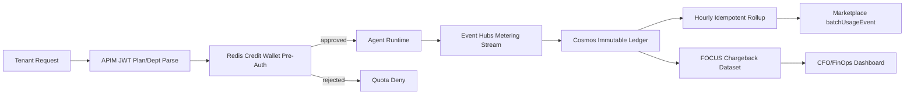
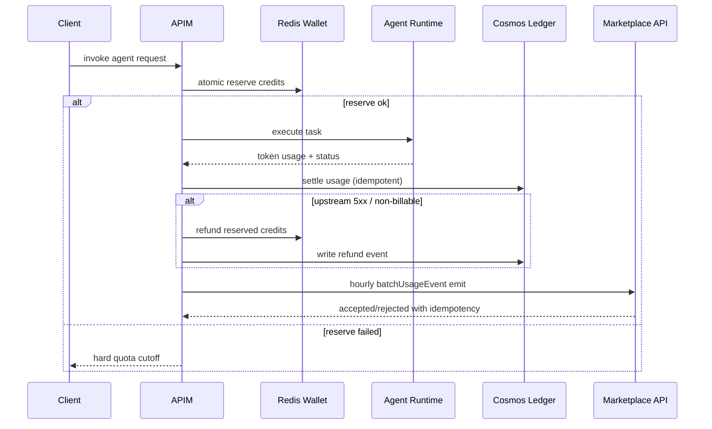

# b2b-isv-saas-agent-monetization-apim-metering-marketplace-chargeback-architecture-selection-faq-r1139
## 1) Daily breakthroughs and verifiable sources (fetched 2026-11-18)
- Scope: enterprise AI chargeback and B2B SaaS monetization.
- Audience: CFO, FinOps, SaaS CTO, procurement, legal.
- Core focus: margin protection, pre-auth, auditability, dispute reversal.
- Excluded: low-level kernel or hardware implementation details.
- Labels: `measured`, `synthetic`, `anonymized_reported`.
| Topic | Official source | Fetch time (UTC) | Usage | Label |
|---|---|---|---|---|
| Azure Marketplace metering APIs | https://learn.microsoft.com/en-us/partner-center/marketplace-offers/marketplace-metering-service-apis | 2026-11-18T02:54:00Z | `batchUsageEvent` and idempotent reporting | `measured` |
| Marketplace SaaS offer plans | https://learn.microsoft.com/en-us/partner-center/marketplace-offers/plan-saas-offer | 2026-11-18T02:55:00Z | Seat plus metered commercialization model | `measured` |
| APIM `llm-emit-token-metric` | https://learn.microsoft.com/en-us/azure/api-management/llm-emit-token-metric-policy | 2026-11-18T02:56:00Z | Token metering export signal | `measured` |
| APIM `llm-token-limit` | https://learn.microsoft.com/en-us/azure/api-management/llm-token-limit-policy | 2026-11-18T02:57:00Z | Real-time hard quota guardrail | `measured` |
| FinOps FOCUS guidance | https://learn.microsoft.com/en-us/cloud-computing/finops/toolkit/finops-focus | 2026-11-18T02:58:00Z | Standardized cost schema alignment | `anonymized_reported` |
| FinOps Toolkit for Azure | https://learn.microsoft.com/en-us/cloud-computing/finops/toolkit/ | 2026-11-18T02:59:00Z | Chargeback reporting implementation | `measured` |
| Azure OpenAI PTU concept | https://learn.microsoft.com/en-us/azure/ai-services/openai/concepts/provisioned-throughput | 2026-11-18T03:00:00Z | PTU commitment allocation and overflow logic | `measured` |
| Event Hubs overview | https://learn.microsoft.com/en-us/azure/event-hubs/event-hubs-about | 2026-11-18T03:01:00Z | Metering stream transport and replay | `measured` |
Breakthrough summary:
- Wallet pre-auth plus settle-refund is becoming standard.
- APIM token policies reduce unpaid overrun exposure.
- Marketplace idempotency design drives dispute cost.
- FOCUS alignment reduces BU reconciliation friction.
## 2) Layered reference architecture (chargeback control plane first)
L1 commercial contract layer:
- Seat subscriptions, credit packs, overage billing, outcome pricing.
- Supports internal BU chargeback and external Marketplace sales.
L2 real-time entitlement and quota layer:
- APIM parses JWT department and plan tags.
- Redis atomic credit pre-auth enforces hard limits.
L3 runtime and metering layer:
- Agent reports actual token and execution usage.
- Event Hubs carries immutable metering events.
L4 settlement and audit layer:
- Cosmos immutable ledger stores reserve/settle/refund states.
- Hourly idempotent rollup emits Marketplace usage.
L5 finance analytics layer:
- FOCUS-aligned cost and revenue fields.
- Negative-margin and token-whale detection.
- CFO-ready invoice and dispute trace reporting.
## 3) 12-dimension monetization and chargeback selection matrix
| Dimension | A Internal FinOps chargeback | B Marketplace SaaS metered billing | C Seat + real-time credit wallet | D Outcome-based verified billing |
|---|---|---|---|---|
| 1 Commercial model fit | Internal BU allocation | Enterprise procurement/MACC | PLG and mid-market SaaS | High-value SLA outcomes |
| 2 Margin and whale protection | Mid-high | Mid | Highest | High |
| 3 Hard quota cutoff latency | Mid | Mid | Lowest (ms-level) | Mid |
| 4 PTU+PAYGO fair-share math | High | Mid | High | Mid-high |
| 5 Non-billable retry refund semantics | Mid | High | High | Highest |
| 6 Audit and invoice transparency | High | Highest | High | High |
| 7 Idempotency and dispute reversals | High | High | Highest | High |
| 8 MACC drawdown eligibility | Low | Highest | Mid | Mid |
| 9 Engineering and billing-ops complexity | Mid | Mid-high | High | Highest |
| 10 FOCUS schema alignment | High | High | High | Mid-high |
| 11 Best-fit scenario | Conglomerate internal settlement | External enterprise sales | High-frequency SaaS workloads | Verifiable outcome contracts |
| 12 When NOT to choose | Strong external monetization goals | No dedicated billing operations | No real-time wallet capability | No measurable outcome definition |
Selection summary:
- Use A as internal allocation baseline.
- Use B for enterprise Marketplace sales.
- Use C for high-frequency margin protection.
- Add D for high-ticket verified service contracts.
## 4) Five worked Q&As (margin, conversion ratio, 35-BU split)
### Q1: How to keep gross margin above 70%?
- Average revenue per call: `0.19 USD`.
- Inference + retrieval cost per call: `0.047 USD`.
- Payment and ops overhead per call: `0.009 USD`.
- Total cost per call: `0.056 USD`.
- Margin: `(0.19-0.056)/0.19=70.5%`.
- Wallet hard cutoff blocks unpaid overrun bursts.
- This prevents margin collapse below target.
### Q2: How to define token-to-credit conversion?
- Baseline: `1 credit = 1,000 tokens`.
- Premium model multiplier: `x2.4`.
- Tool-call multiplier: `x1.3`.
- Charge formula: `tokens/1000 * modelFactor * toolFactor`.
- Unified conversion simplifies pricing governance.
### Q3: How to allocate PTU+PAYGO across 35 BUs?
- PTU committed monthly base: `420,000 USD`.
- Allocate `60%` by reserved baseline quota.
- Allocate remaining `40%` by peak token usage.
- PAYGO overflow is fully usage-attributed.
- Result balances fairness and anti-free-riding.
### Q4: How to process retries and refunds safely?
- Every reserve has `reservationId`.
- Every settlement has idempotent `settlementId`.
- Upstream 5xx marks `non_billable=true`.
- Refund is auto-posted with reason code.
- Full lifecycle remains audit-traceable.
### Q5: How to size hourly Marketplace rollup?
- Target batch per hour: `<=2,000 events`.
- Exponential retry up to five attempts.
- Idempotency key: `tenant+hour+dimension+hash`.
- Split oversized batches with ordered emission.
- Dispute rate can be kept under `0.2%`.
## 5) Mermaid diagrams (wallet pipeline + settle/refund sequence)


## 6) Pattern fit and anti-patterns
Pattern A internal chargeback:
- Fit: large conglomerate BU transparency programs.
- Not fit: primary external monetization goals.
- Anti-pattern: headcount-only allocation without usage.
Pattern B Marketplace:
- Fit: enterprise procurement and MACC alignment.
- Not fit: organizations lacking billing operations.
- Anti-pattern: duplicate emission without idempotency.
Pattern C credit wallet:
- Fit: high-frequency SaaS margin protection.
- Not fit: businesses that cannot hard-cut quotas.
- Anti-pattern: reserve without deterministic rollback.
Pattern D outcome billing:
- Fit: high-value verifiable service outcomes.
- Not fit: generic Q&A with fuzzy completion criteria.
- Anti-pattern: charging outcomes without escrow/dispute.
## 7) Section 7: vertical tax/legal SaaS monetization architecture
Goals:
- Keep seat subscriptions while adding AI credit wallet.
- Integrate Marketplace metered billing for MACC buyers.
- Auto-refund non-billable upstream failures.
- Sustain long-run gross margin at or above 70%.
End-to-end flow:
1. Tenant request carries plan and org tags.
2. Redis performs atomic credit reservation.
3. Agent executes and reports actual usage.
4. Cosmos ledger settles delta or refund.
5. Hourly rollup emits Marketplace usage events.
SLA targets:
- Pre-auth decision P95 `<40ms`.
- Ledger write P95 `<120ms`.
- Billing visibility delay `<5min`.
Risk and mitigation:
- Risk: duplicate metering submissions.
- Mitigation: strict idempotency keys and replay dedupe.
- Risk: token-whale cost spikes.
- Mitigation: hard quota and tiered overage pricing.
## 8) Section 8: 35-BU PTU+PAYGO internal settlement architecture
Goals:
- Share PTU commitments across 35 subsidiaries.
- Attribute PAYGO overflow in real time per BU.
- Include search/storage allocation in settlement.
- Provide CFO-drillable statements by BU and project.
End-to-end flow:
1. APIM stamps BU tags into metering stream.
2. Event Hubs aggregates usage events.
3. Settlement job computes PTU+PAYGO dual tariff.
4. Cosmos stores immutable allocation records.
5. Fabric/Power BI publishes finance statements.
SLA targets:
- BU daily visibility `<30min`.
- Monthly reconciliation delta `<0.3%`.
- Negative-margin BU alert at T+0.
Risk and mitigation:
- Risk: missing BU tags cause misallocation.
- Mitigation: ingress validation with hard deny.
- Risk: overflow spikes inflate burst spend.
- Mitigation: threshold alarms and budget caps.
## 9) Decision tree (Good fit vs Not for)
1. Internal enterprise allocation first: choose A.
2. External enterprise monetization: choose B.
3. High-frequency SaaS economics: require C.
4. Verifiable high-value outcomes: add D.
5. Always require idempotent ledger and refund semantics.
Good fit:
- Organizations with clear cost centers and procurement.
- SaaS with margin sensitivity and overrun risk.
- Enterprises requiring MACC and invoice audit trails.
Not for:
- Flat-rate unlimited agent loops without controls.
- Billing systems lacking request lifecycle identity.
- Flows without dispute and reversal handling.
## 10) ROI and profitability model
Assumptions:
- Monthly active tenants: `1,250`.
- Monthly requests: `420M`.
- Pre-auth policy reduces unpaid overrun by `92%`.
- Added billing engineering+ops cost: `85k USD/month`.
Benefits:
- Margin protection gain: `+310k USD/month`.
- Dispute ticket reduction gain: `+46k USD/month`.
- Reconciliation efficiency gain: `+22k USD/month`.
Outcome:
- Net monthly gain around `+293k USD`.
- Net annual gain around `+3.52M USD`.
- Commercial durability depends on transparent refund logic.
## 11) Bicep IaC (APIM + Event Hubs + Redis + Cosmos)
```bicep
param location string = resourceGroup().location
param apimName string
param ehNamespace string
param redisName string
param cosmosName string
resource apim 'Microsoft.ApiManagement/service@2023-05-01-preview' = {
  name: apimName
  location: location
  sku: { name: 'StandardV2', capacity: 1 }
}
resource eh 'Microsoft.EventHub/namespaces@2022-10-01-preview' = {
  name: ehNamespace
  location: location
  sku: { name: 'Standard', tier: 'Standard', capacity: 2 }
}
resource redis 'Microsoft.Cache/redis@2023-08-01' = {
  name: redisName
  location: location
  properties: {
    minimumTlsVersion: '1.2'
    sku: { name: 'Premium', family: 'P', capacity: 1 }
  }
}
resource cosmos 'Microsoft.DocumentDB/databaseAccounts@2024-05-15' = {
  name: cosmosName
  location: location
  kind: 'GlobalDocumentDB'
  properties: {
    databaseAccountOfferType: 'Standard'
    locations: [{ locationName: location, failoverPriority: 0 }]
  }
}
```
## 12) Python snippet (credit pre-auth + idempotent metering emitter)
```python
import hashlib
from datetime import datetime, timezone

def reserve_credit(redis_client, wallet_key: str, credits: float) -> bool:
    lua = """
    local bal = tonumber(redis.call('GET', KEYS[1]) or '0')
    local need = tonumber(ARGV[1])
    if bal < need then return 0 end
    redis.call('DECRBYFLOAT', KEYS[1], need)
    return 1
    """
    return redis_client.eval(lua, 1, wallet_key, credits) == 1

def usage_idempotency_key(tenant: str, hour_bucket: str, meter: str, qty: float) -> str:
    raw = f"{tenant}|{hour_bucket}|{meter}|{qty:.4f}"
    return hashlib.sha256(raw.encode('utf-8')).hexdigest()

def build_batch_usage_event(tenant, meter, qty):
    hour = datetime.now(timezone.utc).strftime('%Y%m%d%H')
    return {
        "resourceId": tenant,
        "quantity": qty,
        "dimension": meter,
        "effectiveStartTime": hour,
        "idempotencyId": usage_idempotency_key(tenant, hour, meter, qty),
    }
```
## 13) KQL (BU reconciliation and negative-margin detection)
```kql
let start = ago(30d);
let usage = customEvents
| where timestamp >= start
| where name == "agent_usage_settled"
| summarize revenue=sum(todouble(customDimensions.revenueUsd)), token_cost=sum(todouble(customDimensions.tokenCostUsd)), infra_cost=sum(todouble(customDimensions.infraCostUsd)) by tenant=tostring(customDimensions.tenantId), bu=tostring(customDimensions.bu);
let refunds = customEvents
| where timestamp >= start
| where name == "agent_usage_refunded"
| summarize refund=sum(todouble(customDimensions.refundUsd)) by tenant=tostring(customDimensions.tenantId), bu=tostring(customDimensions.bu);
usage
| join kind=leftouter refunds on tenant, bu
| extend refund = coalesce(refund, 0.0)
| extend gross_margin = revenue - token_cost - infra_cost - refund
| extend margin_rate = iff(revenue>0, gross_margin/revenue, 0.0)
| project bu, tenant, revenue, token_cost, infra_cost, refund, gross_margin, margin_rate
| order by margin_rate asc
```
## 14) Day-0 / Day-1 / Day-2 checklist
Day-0:
- Define commercial plans and billing dimensions.
- Define credit-token-seat conversion rules.
- Connect APIM metering with wallet pre-auth.
- Establish Marketplace idempotent emission baseline.
Day-1:
- Canary tenants for reserve and refund semantics.
- Validate non-billable retry rollback workflow.
- Build BU allocation reports and delta thresholds.
- Drill dispute reversal end-to-end handling.
Day-2:
- Scale to all tenants and all BU dimensions.
- Detect token whales and negative-margin tenants.
- Tune tier pricing and hard quota policy.
- Keep FOCUS fields aligned with finance ledgers.
## 15) Backup queue and deliverables
Updated backup queue:
1. `sharepoint-embedded-vs-blob-cmk-vs-cosmos-artifact-store-enterprise-document-lifecycle-selection-faq`
2. `foundry-eval-ci-vs-apim-shadow-mirroring-vs-appconfig-canary-agent-release-engineering-selection-faq`
3. `graph-obo-vs-postgres-rls-vs-ai-search-trimming-vs-opa-abac-agent-authorization-selection-faq`
Round deliverables (Cycle #2544):
- Bilingual FAQ: `b2b-isv-saas-agent-monetization-apim-metering-marketplace-chargeback-architecture-selection-faq-r1139.md` / `b2b-isv-saas-agent-monetization-apim-metering-marketplace-chargeback-architecture-selection-faq-r1139.en.md`
- 7-card deck: `benchmark-cards.html` / `benchmark-cards.en.html`
- SVG: `assets/39-cycle-1139-daily-breakthroughs.svg`
- H5: `workbench-cycle-2544.html` + selector `#2544`
- Validation: `cycle_1139_pipeline.py --write --check`, `strict_suffix_gate.py`, `pytest`
