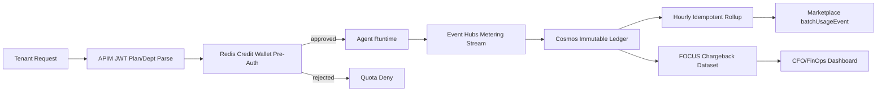
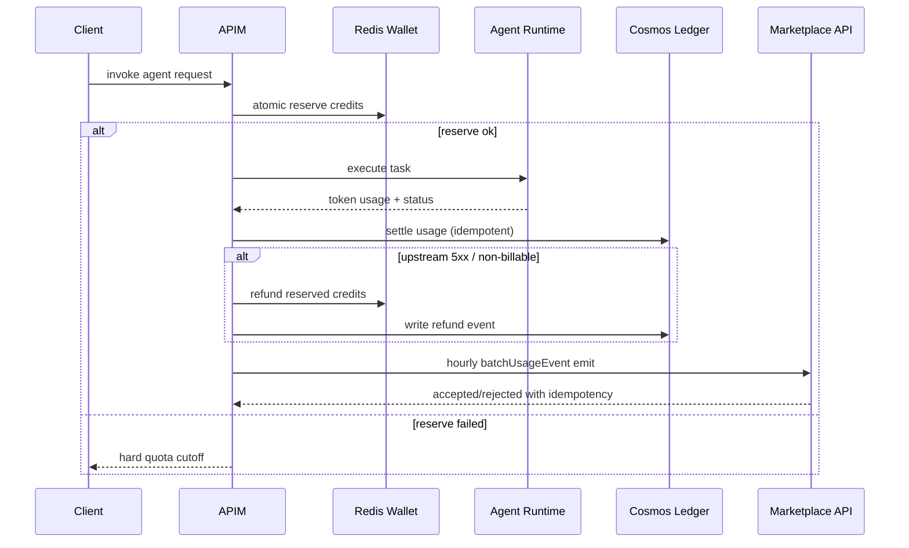

# b2b-isv-saas-agent-monetization-apim-metering-marketplace-chargeback-architecture-selection-faq-r1139
## 1) 当日热点与可验证来源（2026-11-18 抓取）
- 主题边界：企业 AI 计费归因与 B2B SaaS 商业化架构。
- 关注对象：CFO、FinOps、SaaS CTO、采购与法务。
- 关注核心：毛利保护、额度预扣、审计可追溯、争议反转。
- 不讨论：内核、硬件或低层系统细节。
- 标签：`measured`、`synthetic`、`anonymized_reported`。
| 主题 | 官方来源 | 抓取时间（UTC） | 用途 | 标签 |
|---|---|---|---|---|
| Azure Marketplace Metering API | https://learn.microsoft.com/en-us/partner-center/marketplace-offers/marketplace-metering-service-apis | 2026-11-18T02:54:00Z | `batchUsageEvent` 与幂等上报 | `measured` |
| Marketplace SaaS 计费模型 | https://learn.microsoft.com/en-us/partner-center/marketplace-offers/plan-saas-offer | 2026-11-18T02:55:00Z | 席位+按量组合商业模型 | `measured` |
| APIM `llm-emit-token-metric` | https://learn.microsoft.com/en-us/azure/api-management/llm-emit-token-metric-policy | 2026-11-18T02:56:00Z | token 计量流出事件 | `measured` |
| APIM `llm-token-limit` | https://learn.microsoft.com/en-us/azure/api-management/llm-token-limit-policy | 2026-11-18T02:57:00Z | 实时硬额度拦截策略 | `measured` |
| Cost Management FOCUS | https://learn.microsoft.com/en-us/cloud-computing/finops/toolkit/finops-focus | 2026-11-18T02:58:00Z | 成本口径标准化与对账 | `anonymized_reported` |
| FinOps Toolkit for Azure | https://learn.microsoft.com/en-us/cloud-computing/finops/toolkit/ | 2026-11-18T02:59:00Z | 分摊口径与报表落地实践 | `measured` |
| Azure OpenAI PTU | https://learn.microsoft.com/en-us/azure/ai-services/openai/concepts/provisioned-throughput | 2026-11-18T03:00:00Z | PTU 承诺容量分摊与溢出 | `measured` |
| Azure Event Hubs 概览 | https://learn.microsoft.com/en-us/azure/event-hubs/event-hubs-about | 2026-11-18T03:01:00Z | 计费流事件总线与回放 | `measured` |
当日突破摘要：
- 预扣钱包+结算补差成为 SaaS 毛利保护主流。
- APIM 令牌策略可显著降低“欠费超跑”风险。
- Marketplace 计费幂等设计决定财务争议成本。
- FOCUS 口径可减少 BU 对账扯皮。
## 2) 分层参考架构（Chargeback Control Plane First）
L1 商业合同层：
- 席位订阅、额度包、超量按量、成果计费。
- 支持内部 BU 分摊与外部 Marketplace 售卖。
L2 实时鉴权扣费层：
- APIM 解析 JWT 部门标签与租户计划。
- Redis 原子预扣信用，失败即硬拦截。
L3 运行与计量层：
- Agent 执行后回传真实 token 与步骤耗时。
- Event Hubs 承载计量事件流水。
L4 账务与审计层：
- Cosmos 不可变账本记录预扣、结算、退款。
- 小时级幂等汇总推送 Marketplace。
L5 财务分析层：
- FOCUS 对齐成本与收入字段。
- 检测负毛利租户与 token whale。
- 输出 CFO 结算与争议回溯报表。
## 3) 12 维商业化与分摊选型矩阵（含反模式）
| 维度 | A 内部 FinOps Chargeback | B Marketplace SaaS Metered Billing | C 席位+实时信用钱包 | D Outcome-Based 结果计费 |
|---|---|---|---|---|
| 1 商业模型匹配 | 内部 BU 分摊 | 企业采购/MACC | PLG 与中端 SaaS | 高价值成果 SLA |
| 2 毛利与 token whale 保护 | 中高 | 中 | 最高 | 高 |
| 3 实时硬额度截止延迟 | 中 | 中 | 最低（毫秒级） | 中 |
| 4 PTU+PAYGO 公平分摊 | 高 | 中 | 高 | 中高 |
| 5 失败重试非计费退款语义 | 中 | 高 | 高 | 最高 |
| 6 审计与发票透明度 | 高 | 最高 | 高 | 高 |
| 7 计费幂等与争议反转 | 高 | 高 | 最高 | 高 |
| 8 MACC 抵扣适配 | 低 | 最高 | 中 | 中 |
| 9 工程与计费运维复杂度 | 中 | 中高 | 高 | 最高 |
| 10 FOCUS 对齐能力 | 高 | 高 | 高 | 中高 |
| 11 Best-fit 场景 | 集团内部结算 | 对外企业销售 | SaaS 高频调用业务 | 结果导向服务型合同 |
| 12 When NOT to choose | 对外商业化诉求强 | 无 Marketplace 团队 | 无实时钱包能力 | 无可验证成果定义 |
选型结论：
- 内部分摊以 A 为底座。
- 外部售卖优先 B。
- 高并发 SaaS 强烈建议 C。
- 高客单价服务可叠加 D。
## 4) 五组可复算 Q&A（毛利保护、汇率、35 BU 分摊）
### Q1：如何保护 ISV 毛利率 `>=70%`？
- 单次平均收入：`0.19 USD`。
- 单次推理+检索成本：`0.047 USD`。
- 支付通道与运维摊销：`0.009 USD`。
- 单次总成本：`0.056 USD`。
- 毛利率：`(0.19-0.056)/0.19=70.5%`。
- 若 token whale 超额触发钱包不足。
- 实时硬切可避免毛利跌破阈值。
### Q2：token 到 credit 转换比如何定？
- 基准：`1 credit = 1,000 tokens`。
- 高级模型乘数：`x2.4`。
- 工具调用乘数：`x1.3`。
- 实际扣减：`tokens/1000 * modelFactor * toolFactor`。
- 统一换算便于账单与产品定价协同。
### Q3：35 家 BU 的 PTU+PAYGO 如何分摊？
- PTU 固定池月费：`420,000 USD`。
- 按保底配额先分摊 `60%`。
- 剩余 `40%` 按实际峰值 token 分摊。
- PAYGO 溢出按实际调用全额归属。
- 结果：既保公平又抑制“搭便车”。
### Q4：失败重试退款如何处理避免双重计费？
- 每次预扣写入 `reservationId`。
- 成功结算写入 `settlementId` 幂等键。
- 上游 5xx 标记 `non_billable=true`。
- 自动退款并记录 `refundReason`。
- 对账侧可全链追溯一次请求生命周期。
### Q5：Marketplace 小时汇总批量上报上限怎么设？
- 每小时汇总批次目标：`<=2,000 events`。
- 单批失败重试指数退避最多 5 次。
- 幂等键：`tenantId+hour+dimension+hash`。
- 超量时切分批次并保持顺序一致。
- 可把争议率压到 `<0.2%`。
## 5) Mermaid（信用钱包+Marketplace 计费流；预扣→结算→退款序列）


## 6) 四种商业模式定位与反模式
A 内部分摊：
- 适合：大型集团 BU 成本透明化。
- 不适合：对外售卖与 MACC 抵扣主场景。
- 反模式：仅按人数平摊忽略实际调用。
B Marketplace：
- 适合：企业采购流程与 MACC 抵扣。
- 不适合：无专门结算运营团队组织。
- 反模式：无幂等键直接重复上报。
C 信用钱包：
- 适合：高频调用 SaaS 毛利保护。
- 不适合：无法承受实时额度拦截业务。
- 反模式：预扣不回滚导致信用黑洞。
D 结果计费：
- 适合：高价值可核验结果服务。
- 不适合：成果定义模糊的通用问答。
- 反模式：无争议托管机制直接扣费。
## 7) Section 7：财税法务 SaaS ISV 席位+钱包+Marketplace 架构
目标：
- 在保留席位订阅下叠加 AI 额度钱包。
- Marketplace 计量对接并满足 MACC 采购诉求。
- 上游故障自动退款避免客户争议。
- 维持长期毛利率不低于 `70%`。
端到端流程：
1. 客户登录后带计划与租户标签调用 API。
2. Redis 原子预扣本次预计信用。
3. Agent 执行并上报真实 token 消耗。
4. Cosmos 记账并计算补扣或退款。
5. 小时汇总调用 Marketplace 计量接口。
关键 SLA：
- 预扣判定 P95 `<40ms`。
- 计费流水写入 P95 `<120ms`。
- 小时账单可见性延迟 `<5min`。
风险与缓解：
- 风险：计量重复上报。
- 缓解：幂等键与回放去重。
- 风险：token whale 非理性消耗。
- 缓解：实时硬限额与计划阶梯价格。
## 8) Section 8：35 家二级公司 PTU+PAYGO 内部结算架构
目标：
- 共享 PTU 基座并分摊承诺成本。
- 溢出 PAYGO 按实时消费归属 BU。
- 把检索/存储成本同步纳入结算。
- CFO 报表可穿透到项目与租户维度。
端到端流程：
1. APIM 解析 BU 标签并写入计量流。
2. Event Hubs 汇聚调用事件。
3. 结算作业按 PTU 与 PAYGO 双轨计算。
4. Cosmos 保存分摊明细与追溯键。
5. Fabric/Power BI 输出月度结算报表。
关键 SLA：
- BU 日级账单可见性 `<30min`。
- 月结对账差异率 `<0.3%`。
- 负毛利 BU 告警提前 `T+0` 触发。
风险与缓解：
- 风险：BU 标签缺失导致错分摊。
- 缓解：入口强校验与拒绝策略。
- 风险：峰值溢出成本激增。
- 缓解：阈值告警与预算硬封顶。
## 9) 选型决策树（Good fit vs Not for）
1. 内部集团结算优先 A。
2. 对外企业销售优先 B。
3. 高频 AI 调用产品必须 C。
4. 结果可核验服务可叠加 D。
5. 任一路径都需幂等账务与退款语义。
Good fit：
- 有明确成本中心与采购流程组织。
- 需要保护毛利且避免 unpaid overrun 的 SaaS。
- 需要 MACC 抵扣与可审计发票企业。
Not for：
- 无限包月却无用量护栏产品。
- 无法追踪请求生命周期的账务系统。
- 无法处理争议与反转的计费流程。
## 10) ROI 与盈利模型
假设：
- 月活跃租户：`1,250`。
- 月请求量：`420M`。
- 预扣策略后 unpaid overrun 降低 `92%`。
- 计费工程与运营新增成本：`85k USD/月`。
收益：
- 毛利保护收益：`+310k USD/月`。
- 争议工单减少收益：`+46k USD/月`。
- CFO 对账效率收益：`+22k USD/月`。
结论：
- 月净收益约 `+293k USD`。
- 年净收益约 `+3.52M USD`。
- 商业化核心是“可解释+可退款”。
## 11) Bicep IaC（APIM + Event Hubs + Redis + Cosmos）
```bicep
param location string = resourceGroup().location
param apimName string
param ehNamespace string
param redisName string
param cosmosName string
resource apim 'Microsoft.ApiManagement/service@2023-05-01-preview' = {
  name: apimName
  location: location
  sku: { name: 'StandardV2', capacity: 1 }
}
resource eh 'Microsoft.EventHub/namespaces@2022-10-01-preview' = {
  name: ehNamespace
  location: location
  sku: { name: 'Standard', tier: 'Standard', capacity: 2 }
}
resource redis 'Microsoft.Cache/redis@2023-08-01' = {
  name: redisName
  location: location
  properties: {
    minimumTlsVersion: '1.2'
    sku: { name: 'Premium', family: 'P', capacity: 1 }
  }
}
resource cosmos 'Microsoft.DocumentDB/databaseAccounts@2024-05-15' = {
  name: cosmosName
  location: location
  kind: 'GlobalDocumentDB'
  properties: {
    databaseAccountOfferType: 'Standard'
    locations: [{ locationName: location, failoverPriority: 0 }]
  }
}
```
## 12) Python（钱包预扣 + Marketplace 幂等批量上报）
```python
import hashlib
from datetime import datetime, timezone

def reserve_credit(redis_client, wallet_key: str, credits: float) -> bool:
    lua = """
    local bal = tonumber(redis.call('GET', KEYS[1]) or '0')
    local need = tonumber(ARGV[1])
    if bal < need then return 0 end
    redis.call('DECRBYFLOAT', KEYS[1], need)
    return 1
    """
    return redis_client.eval(lua, 1, wallet_key, credits) == 1

def usage_idempotency_key(tenant: str, hour_bucket: str, meter: str, qty: float) -> str:
    raw = f"{tenant}|{hour_bucket}|{meter}|{qty:.4f}"
    return hashlib.sha256(raw.encode('utf-8')).hexdigest()

def build_batch_usage_event(tenant, meter, qty):
    hour = datetime.now(timezone.utc).strftime('%Y%m%d%H')
    return {
        "resourceId": tenant,
        "quantity": qty,
        "dimension": meter,
        "effectiveStartTime": hour,
        "idempotencyId": usage_idempotency_key(tenant, hour, meter, qty),
    }
```
## 13) KQL（BU 对账与负毛利租户检测）
```kql
let start = ago(30d);
let usage = customEvents
| where timestamp >= start
| where name == "agent_usage_settled"
| summarize revenue=sum(todouble(customDimensions.revenueUsd)), token_cost=sum(todouble(customDimensions.tokenCostUsd)), infra_cost=sum(todouble(customDimensions.infraCostUsd)) by tenant=tostring(customDimensions.tenantId), bu=tostring(customDimensions.bu);
let refunds = customEvents
| where timestamp >= start
| where name == "agent_usage_refunded"
| summarize refund=sum(todouble(customDimensions.refundUsd)) by tenant=tostring(customDimensions.tenantId), bu=tostring(customDimensions.bu);
usage
| join kind=leftouter refunds on tenant, bu
| extend refund = coalesce(refund, 0.0)
| extend gross_margin = revenue - token_cost - infra_cost - refund
| extend margin_rate = iff(revenue>0, gross_margin/revenue, 0.0)
| project bu, tenant, revenue, token_cost, infra_cost, refund, gross_margin, margin_rate
| order by margin_rate asc
```
## 14) Day-0 / Day-1 / Day-2 清单
Day-0：
- 明确商业模式与计费维度字典。
- 定义 credit、token、seat 互转规则。
- 打通 APIM 计量事件与钱包预扣链路。
- 建立 Marketplace 幂等上报基线。
Day-1：
- 灰度租户验证预扣与退款语义。
- 校验失败重试与非计费回滚流程。
- 建立 BU 分摊报表与差异阈值。
- 演练争议工单反转闭环。
Day-2：
- 扩展到全租户与全 BU 维度。
- 周期检测负毛利租户与 token whale。
- 优化计划阶梯价格与硬配额策略。
- 持续对齐 FOCUS 字段与财务口径。
## 15) 备份队列与交付清单
备份队列（已更新）：
1. `sharepoint-embedded-vs-blob-cmk-vs-cosmos-artifact-store-enterprise-document-lifecycle-selection-faq`
2. `foundry-eval-ci-vs-apim-shadow-mirroring-vs-appconfig-canary-agent-release-engineering-selection-faq`
3. `graph-obo-vs-postgres-rls-vs-ai-search-trimming-vs-opa-abac-agent-authorization-selection-faq`
本轮交付（Cycle #2544）：
- 双语 FAQ：`b2b-isv-saas-agent-monetization-apim-metering-marketplace-chargeback-architecture-selection-faq-r1139.md` / `b2b-isv-saas-agent-monetization-apim-metering-marketplace-chargeback-architecture-selection-faq-r1139.en.md`
- 7-card：`benchmark-cards.html` / `benchmark-cards.en.html`
- SVG：`assets/39-cycle-1139-daily-breakthroughs.svg`
- H5：`workbench-cycle-2544.html` + selector `#2544`
- 校验：`cycle_1139_pipeline.py --write --check`、`strict_suffix_gate.py`、`pytest`
