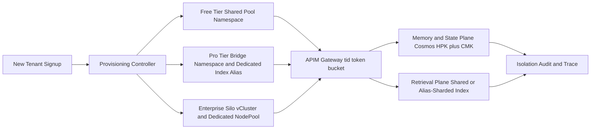

# Zero-Trust B2B SaaS Multi-Tenant Isolation Models for Agent Platforms FAQ (Cycle 2411)

## 1) Executive summary
This round designs tenant isolation for enterprise B2B agent platforms across three patterns: shared pool, hybrid bridge, and enterprise silo. The architecture covers compute isolation, retrieval isolation, state/encryption isolation, and gateway quota fairness under noisy-neighbor pressure.

## 2) Core architecture Q and A
Q1: How to prevent cross-tenant context bleed in pooled and bridge models?  
A1: Use strict tenant-scoped identity claims (`tid`), query filters, and per-tenant memory namespaces with policy-verified boundaries at gateway and runtime.
Q2: How to support CMK tenant offboarding with cryptographic erasure guarantees?  
A2: Store tenant key references per partition and enforce CMK revocation + key-version tombstone workflow so detached tenants become cryptographically unreadable.
Q3: How to balance PTU/PAYG spillover fairness under tenant bursts?  
A3: Apply APIM token-bucket throttling by tenant tier and route to bounded spillover pools with strict per-tenant quota ceilings.

## 3) Free/Pro/Enterprise hybrid bridge and onboarding flow

## 4) Silo vs Bridge vs Pool decision matrix
| Model | Per-tenant COGS/month | Noisy-neighbor p99 inflation | Compliance strength | Blast radius | Scale efficiency |
|---|---:|---:|---|---|---|
| Pool (Free) | 38 USD | 72% | Medium-low | Broad | Highest |
| Bridge (Pro) | 74 USD | 23% | High | Moderate | High |
| Silo (Enterprise) | 182 USD | 6% | Very high | Minimal | Medium |
| Legacy flat tenancy | 29 USD | 130% | Low | Very broad | Medium |

## 5) SaaS multi-tenant isolation audit checklist
- Verify `tid` propagation from gateway to runtime and retrieval planes.
- Enforce network policy and namespace isolation boundaries by tier.
- Validate Cosmos HPK partitioning `[TenantId, SessionId]` and row-level filters.
- Audit AI Search index scoping (security-trimmed shared vs tenant alias sharded).
- Test CMK revocation offboarding and cryptographic erasure replay.
- Confirm APIM quota fairness and spillover budget controls.

## 6) Good fit vs Not for and percentage contract bindings
Good fit:
1. Enterprise SaaS platforms needing tiered isolation economics with compliance progression.  
2. Teams requiring auditable anti-bleed controls and tenant cryptographic offboarding.

Not for:
1. Single-tenant systems where isolation complexity is unnecessary.  
2. Teams without ownership for key lifecycle and quota policy operations.

Percentage contract bindings:
- `percentage_contract.cross_tenant_context_bleed_prevention_rate`
- `percentage_contract.cmk_offboarding_crypto_erase_success_rate`
- `percentage_contract.isolation_audit_pass_rate`

These keys are bound to `cycle-2411-benchmark.json` with `production_validation=not_measured`.
