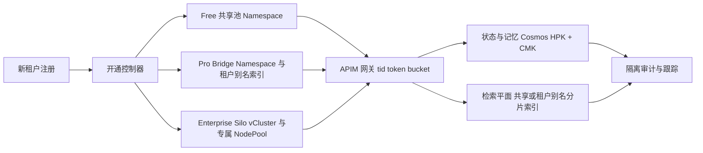

# Azure 企业级 Agent 平台零信任 B2B SaaS 多租户隔离模型 FAQ（Cycle 2411）

## 1) 执行摘要
本轮围绕 B2B SaaS Agent 平台的三类租户隔离模型：共享池（Pool）、混合桥接（Bridge）、专属孤岛（Silo）。架构覆盖计算隔离、检索隔离、状态与加密隔离、以及网关配额公平性，目标是抑制 noisy-neighbor 并满足 CMK 合规要求。

## 2) 核心架构问答
Q1：如何在 Pool/Bridge 模型中防止跨租户上下文串扰？  
A1：在网关与运行时全链路执行 `tid` 身份约束、租户级检索过滤、租户命名空间记忆隔离，并做策略校验审计。
Q2：如何实现租户下线后的 CMK 加密擦除？  
A2：按租户分区记录密钥引用，执行 CMK 撤销与密钥版本墓碑流程，使下线租户数据在密码学层面不可读。
Q3：如何在租户突发时维持 PTU/PAYG 溢出公平？  
A3：按租户层级执行 APIM token-bucket，结合有上限的 spillover 池，避免单租户抢占全局容量。

## 3) Free/Pro/Enterprise 混合桥接路由与租户开通流程

## 4) Silo vs Bridge vs Pool 决策矩阵（成本/爆炸半径/合规/规模）
| 模型 | 单租户 COGS/月 | noisy-neighbor p99 膨胀 | 合规强度 | 爆炸半径 | 规模效率 |
|---|---:|---:|---|---|---|
| Pool（Free） | 38 USD | 72% | 中低 | 大 | 最高 |
| Bridge（Pro） | 74 USD | 23% | 高 | 中 | 高 |
| Silo（Enterprise） | 182 USD | 6% | 极高 | 最小 | 中 |
| 传统扁平多租户 | 29 USD | 130% | 低 | 极大 | 中 |

## 5) SaaS 多租户隔离审计清单
- 校验 `tid` 从网关到运行时/检索平面的全链路透传。
- 按租户层级执行 namespace 与 network policy 边界。
- 验证 Cosmos HPK `[TenantId, SessionId]` 分区与过滤策略。
- 审计 AI Search 索引作用域（共享安全裁剪 vs 租户别名分片）。
- 演练 CMK 撤销下线与密码学擦除回放。
- 验证 APIM 配额公平与 spillover 预算上限。

## 6) Good fit vs Not for 与百分比合约绑定
Good fit：
1. 需要按层级平衡隔离强度与单位经济性的企业 SaaS 平台。  
2. 需要可审计防串租与租户密码学下线能力的团队。

Not for：
1. 单租户系统，不需要复杂多租户隔离编排。  
2. 无法运维密钥生命周期与网关配额策略的团队。

百分比合约绑定：
- `percentage_contract.cross_tenant_context_bleed_prevention_rate`
- `percentage_contract.cmk_offboarding_crypto_erase_success_rate`
- `percentage_contract.isolation_audit_pass_rate`

以上键绑定 `cycle-2411-benchmark.json`，并标注 `production_validation=not_measured`。
