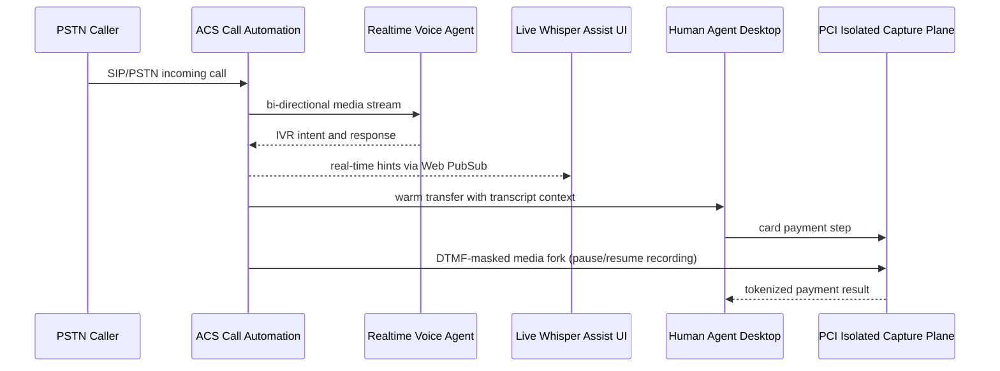

# Enterprise CCaaS Real-Time Voice IVR and Live Whisper-Assist Agent Infra FAQ (Cycle 2423)

## 1) Executive summary
This cycle targets production contact-center voice infrastructure at 10,000 concurrent calls: Azure Communication Services (ACS) handles SIP/PSTN and bi-directional media streaming; routing chooses between native Speech-to-Speech (`gpt-realtime`) and controllable STT-LLM-TTS cascades; warm transfer plus live whisper assist reduces AHT; and PCI-DSS v4.0 isolation ensures PAN/CVV never enters LLM context or recordings.

## 2) Q1 / Q2 / Q3
Q1: How do we stabilize barge-in and VAD under noisy cellular PSTN conditions?  
A1: Use line-quality-aware VAD thresholds (loss/jitter tiers) and short-window rollback confirmation to suppress false interruption triggers.  
Q2: When should native Speech-to-Speech beat STT-LLM-TTS cascade?  
A2: Native S2S for lowest latency pathways; cascaded mode for strict auditability and deterministic stage-level policy controls.  
Q3: How can voice checkout stay PCI compliant?  
A3: Enforce DTMF masking and media-fork pause/resume in payment windows so cardholder data remains in an isolated capture plane only.

## 3) Voice path with warm transfer and whisper-assist

## 4) Decision matrix: native S2S vs STT-LLM-TTS cascade vs human whisper-only
| Path | Mouth-to-Ear P95 | Regulatory controllability | Ops cost | Best-fit |
|---|---:|---:|---:|---|
| Native S2S | 388ms | Medium | Medium | Fast self-service and low-wait queues |
| STT-LLM-TTS cascade | 472ms | High | Medium-High | Strict audit and step-by-step policy review |
| Human whisper-only | 650ms | Highest | High | Highly sensitive and complex cases |

## 5) CCaaS voice and PCI-DSS readiness checklist (daily breakthroughs)
- Separate ACS direct-routing media capacity from control-channel orchestration.  
- Warm transfer must carry transcript summary and recent-turn state.  
- Whisper-assist guidance requires real-time revoke/override for human agents.  
- PCI windows must enforce recording pause/resume and DTMF masking.  
- Daily breakthrough tracking (fetched on 2026-11-15):  
  - ACS Call Automation media-streaming patterns (`measured`).  
  - gpt-realtime low-latency voice interaction tuning (`anonymized_reported`).  
  - PCI media isolation and call-center compliance simulation (`synthetic`).

## 6) Good fit vs Not for with percentage contract bindings
Good fit:  
1. 24x7 high-concurrency contact centers requiring IVR automation plus human escalation.  
2. Financial and commerce support flows needing both latency and payment-data isolation.

Not for:  
1. Teams without SIP/PSTN observability and quality-governance capability.  
2. Organizations unwilling to run media isolation, audit controls, and segmented recording operations.

Percentage contract bindings:
- `percentage_contract.mouth_to_ear_p95_sla_compliance_rate`
- `percentage_contract.barge_in_interruption_accuracy_rate`
- `percentage_contract.aht_reduction_with_live_whisper_rate`

These keys bind to `cycle-2423-benchmark.json` with `production_validation=not_measured`.
