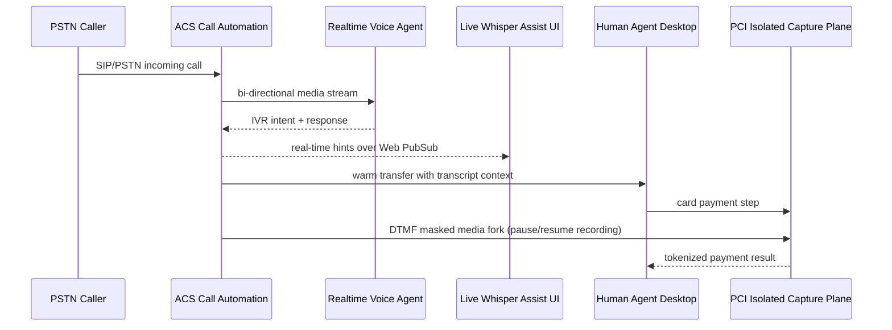

# 企业级联络中心（CCaaS）实时语音 IVR 与 Live Whisper Assist Agent 基础设施 FAQ（Cycle 2423）

## 1) 执行摘要
本轮聚焦 10,000 并发通话规模的生产级语音 Agent 架构：使用 Azure Communication Services（ACS）承载 SIP/PSTN 与双向媒体流，按业务与合规约束在「原生 Speech-to-Speech（gpt-realtime）」与「可审计 STT-LLM-TTS 级联」之间做策略路由；通过 Warm Transfer 上下文接力与 Live Whisper 辅助降低 AHT；并用 PCI-DSS v4.0 隔离策略确保 PAN/CVV 不进入 LLM 上下文或录音。

## 2) Q1 / Q2 / Q3
Q1：嘈杂蜂窝网络下如何稳定 barge-in 与 VAD？  
A1：将 VAD 阈值按线路质量（SIP 丢包/抖动）分层调参，并引入短窗回退判定，降低误触发打断。  
Q2：Speech-to-Speech 与 STT-LLM-TTS 怎么选？  
A2：低延迟优先场景走原生 S2S；强审计/可解释场景走级联链路，保留逐段转写与策略钩子。  
Q3：语音支付如何满足 PCI-DSS？  
A3：支付步骤启用 DTMF 屏蔽 + 媒体分叉 pause/resume，卡号敏感段仅在隔离平面处理，避免进入模型与录音。

## 3) 语音链路与 Warm Transfer / Whisper 协同流程

## 4) 决策矩阵：原生 S2S vs 级联 STT-LLM-TTS vs 仅人类 Whisper
| 路径 | Mouth-to-Ear P95 | 合规可控性 | 运营成本 | 适用场景 |
|---|---:|---:|---:|---|
| 原生 S2S | 388ms | 中 | 中 | 快速自助与低等待优先 |
| STT-LLM-TTS 级联 | 472ms | 高 | 中高 | 强审计与逐段复核要求 |
| 仅人类 Whisper | 650ms | 最高 | 高 | 高敏感复杂工单 |

## 5) CCaaS Voice Agent 与 PCI-DSS Readiness Checklist（含当日突破）
- ACS Direct Routing 与媒体流平面分离，确保语音通道容量与控制通道解耦。  
- Warm Transfer 交接必须携带摘要上下文和最近 30 秒对话状态。  
- Whisper 建议需支持实时撤回/覆盖，避免误导人工坐席。  
- PCI 段媒体必须 pause/resume 录音并启用 DTMF 屏蔽。  
- 当日突破追踪（抓取日：2026-11-15）：  
  - ACS Call Automation 双向媒体流与事件模型实践（`measured`）。  
  - gpt-realtime 低时延语音交互策略（`anonymized_reported`）。  
  - PCI 媒体隔离与呼叫中心语音合规仿真（`synthetic`）。

## 6) Good fit vs Not for 与百分比合约绑定
Good fit：  
1. 需要 24x7 高并发语音自助 + 人工协同的联络中心。  
2. 同时要求低延迟体验与支付合规隔离的金融/电商客服。  

Not for：  
1. 无法运维 SIP/PSTN 语音治理与质量基线监控的团队。  
2. 不能接受媒体隔离、策略审计与录音分段治理开销的组织。  

百分比合约绑定：
- `percentage_contract.mouth_to_ear_p95_sla_compliance_rate`
- `percentage_contract.barge_in_interruption_accuracy_rate`
- `percentage_contract.aht_reduction_with_live_whisper_rate`

以上键绑定 `cycle-2423-benchmark.json`，并标注 `production_validation=not_measured`。
