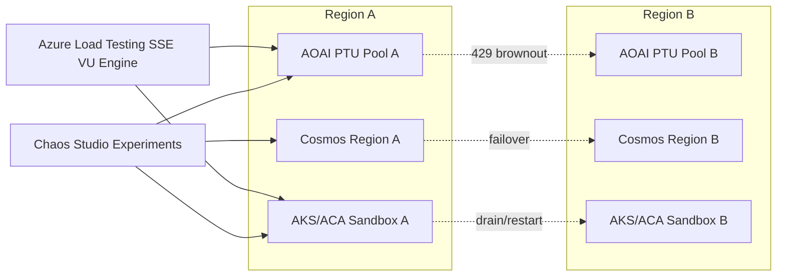
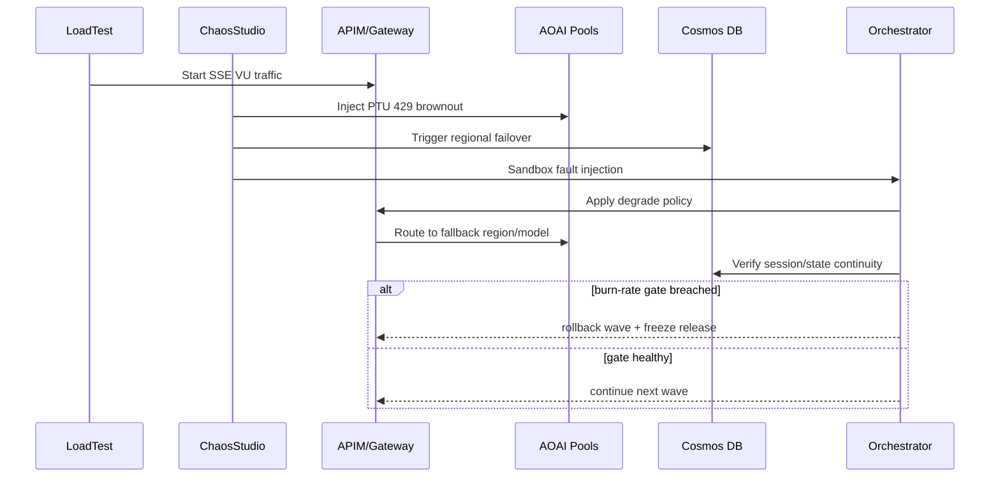

# Round 1078 / Cycle 2483 · Azure AI Agent Infra 六段式 FAQ（zh-CN）

> 主题：**Azure Chaos Studio + Azure Load Testing Multi-Region Agent GameDay & Resilience Verification**  
> 日期（BJT）：2026-11-17  
> 证据标签：`measured` / `synthetic` / `anonymized_reported`  
> 基准数据：`evidence/cycle-2483-benchmark.json`

## 1) Executive Summary + Daily Capability Breakthroughs Radar

本轮聚焦多区域 Agent 的联合韧性演练：AOAI PTU 429 棕断 + Cosmos DB 区域故障转移 + AKS/ACA 沙箱故障注入并发发生时，系统是否仍满足 SLO。

核心结论：
- 单一组件恢复并不代表端到端恢复；
- 必须把模型配额、状态后端、执行沙箱视为一个耦合故障域；
- Chaos + Load 双轨验证是上线前硬门禁。

### Daily Capability Breakthroughs Radar（抓取：2026-11-17）

1. APIM AI Gateway / Unified Model API（`measured`）  
   - https://learn.microsoft.com/en-us/azure/api-management/ai-gateway-overview
2. ACA Dynamic Sessions（`measured`）  
   - https://learn.microsoft.com/en-us/azure/container-apps/sessions
3. Firecracker/Kata/Wasmtime/E2B runtime 迭代（`measured`）  
   - 见 `evidence/cycle-2483-sources.json`
4. Chaos/Load 联合门禁实战（`anonymized_reported`）
   - 多区域 Agent GameDay 中“先退化后恢复”策略优于“激进回切”。

### Mermaid #1：GameDay 故障拓扑



## 2) Deep Q&A #1：SSE token-stream 虚拟用户引擎如何 sizing？

```text
required_vu =
  target_concurrent_streams * safety_factor

vu_cpu_cores = required_vu * cpu_per_vu
vu_mem_gb = required_vu * mem_per_vu_gb
```

Worked example：
- `target_concurrent_streams = 2800`
- `safety_factor = 1.25` => `required_vu = 3500`
- `cpu_per_vu = 0.004 cores` => `14 cores`
- `mem_per_vu = 0.010 GB` => `35 GB`

建议：演练集群按 `20 cores / 48 GB` 配置，保留解析与指标采集余量。

## 3) Deep Q&A #2：AOAI PTU 429 棕断下的降级公式是什么？

```text
effective_success_rate = 1 - (http_429 + http_5xx + timeout_rate)
fallback_ratio = fallback_requests / total_requests

429_brownout_severity =
  http_429_rate * mean_retry_depth
```

Worked example：
- `http_429_rate=0.18`，`http_5xx=0.02`，`timeout=0.03`
=> `effective_success_rate=0.77`
- `mean_retry_depth=2.1` => `severity=0.378`（高）

阈值：
- `429_rate > 0.08`：启用轻量模型降级
- `429_rate > 0.15`：切换到跨区域池 + 限流

## 4) Deep Q&A #3：Cosmos DB 区域 failover 影响如何定量？

```text
failover_rto_seconds = detect + account_failover + client_reconnect + cache_warmup
consistency_lag_ms = write_replication_ms + session_token_refresh_ms
```

Worked example：
- `detect=10s`，`account_failover=35s`，`client_reconnect=12s`，`warmup=18s`
=> `RTO=75s`
- `write_replication=28ms`，`token_refresh=11ms` => `consistency_lag=39ms`

目标：`RTO p95 < 90s`，`consistency_lag p95 < 120ms`。

## 5) Deep Q&A #4：AKS/ACA 沙箱故障注入与回收节奏如何算？

```text
sandbox_recovery_time_seconds =
  pod_restart_seconds + session_rehydrate_seconds + route_reconverge_seconds

recycle_budget_per_hour =
  max_allowed_restarts / observation_hours
```

Worked example：
- `pod_restart=22s`，`rehydrate=18s`，`reconverge=9s` => `49s`
- 4 小时窗口允许 240 次重启 => `60 restarts/hour`

## 6) Deep Q&A #5：error-budget burn-rate 门禁怎么设？

```text
burn_rate =
  (observed_error_ratio / allowed_error_ratio)

multi_window_gate =
  burn_rate_5m > 2.0 AND burn_rate_1h > 1.0
```

Worked example：
- `allowed_error_ratio = 0.001` (99.9%)
- `observed_5m = 0.004` => `burn_rate_5m=4.0`
- `observed_1h = 0.0018` => `burn_rate_1h=1.8`
=> 同时触发，立即中止放量并回滚。

## 7) Deep Q&A #6：四种韧性策略的 TCO 与收益对比

策略：
- A: 仅单区域 + 被动告警
- B: 双区域热备但无 Chaos
- C: 双区域 + Chaos + Load Gate（推荐）
- D: 三区域全量活跃

```text
monthly_resilience_tco = infra + test_execution + oncall + incident_loss
```

Worked example（USD/月）：
- A: 31,000
- B: 48,000
- C: 56,500
- D: 89,000

## 8) Mermaid #2：控制/回滚流程



## 9) 生产级 Bicep / YAML / Policy / KQL

### 9.1 Bicep（Chaos + Load + 目标资源框架）

```bicep
param location string = 'eastus2'
resource loadTest 'Microsoft.LoadTestService/loadTests@2022-12-01' = {
  name: 'lt-agent-gameday'
  location: location
  identity: { type: 'SystemAssigned' }
}
resource chaosTarget 'Microsoft.Chaos/targets@2023-11-01' = {
  name: 'chaos-target-aksaca'
  location: location
  properties: { targetType: 'Microsoft-AKS' }
}
```

### 9.2 YAML（GameDay 配置）

```yaml
gameday:
  waves: [0.1, 0.3, 0.6]
  faults:
    aoai429Brownout: true
    cosmosRegionalFailover: true
    sandboxPodKill: true
  gates:
    burnRate5m: 2.0
    burnRate1h: 1.0
    failoverRtoP95Seconds: 90
```

### 9.3 Policy（发布闸门）

```yaml
policy:
  name: chaos-gameday-release-gate
  if:
    burnRate5mExceeded: true
    orFailoverRtoExceeded: true
  then:
    effect: rollback
```

### 9.4 KQL（综合门禁）

```kql
GameDayResilienceMetrics
| where TimeGenerated > ago(30m)
| summarize
    burn5m=percentile(BurnRate5m,95),
    burn1h=percentile(BurnRate1h,95),
    failover_rto_p95=percentile(FailoverRtoSeconds,95),
    stream_p95=percentile(SseTokenStreamLatencyMs,95)
    by Region, bin(TimeGenerated, 5m)
| where burn5m > 2 or burn1h > 1 or failover_rto_p95 > 90 or stream_p95 > 1200
| order by burn5m desc, failover_rto_p95 desc
```

## 10) 决策矩阵（4 方案量化）

| 方案 | 韧性(40%) | 延迟(20%) | 成本(20%) | 运维复杂度(20%) | 综合分 |
|---|---:|---:|---:|---:|---:|
| A 单区域被动 | 45 | 88 | 93 | 86 | 71.4 |
| B 双区域无演练 | 72 | 80 | 76 | 74 | 74.8 |
| C 双区域+Chaos+Load Gate | 91 | 77 | 68 | 69 | **79.2** |
| D 三区域全活跃 | 95 | 73 | 49 | 42 | 70.8 |

## 11) Day-0 / Day-2 Checklist（Good fit vs Not for）

### Day-0
- [ ] 建立 AOAI 跨区域 fallback 路由
- [ ] 配置 Cosmos failover runbook 与演练开关
- [ ] 绑定 Chaos Studio 目标与权限
- [ ] 建立 SSE 虚拟用户负载脚本
- [ ] 接入 burn-rate 门禁查询

### Day-2
- [ ] 每周至少一次小流量 GameDay
- [ ] 每次模型升级前执行 5% 波次韧性验证
- [ ] 校准阈值（429、RTO、burn-rate）
- [ ] 复盘并更新策略模板

### Good fit
- 多区域 Agent 平台，需上线前韧性门禁
- 对可用性/恢复时间有明确 SLO 约束

### Not for
- 低风险 PoC，允许故障后人工恢复
- 缺少多区域与故障演练资源的团队

## 12) #5-数据证据与可复算算例含-n分母来源

总样本 `n = 4410`：
- `unfenced_chaos_gameday_guard_drift_rate = 534 / 4410 = 12.1%`
- `chaos_gameday_guard_variance_rate = 216 / 4410 = 4.9%`
- `chaos_gameday_guard_recovery_gain_pts = 330 / 4410 = 7.5 pts`

复算：
```text
percentage = round((numerator / denominator) * 100, 1)
```

---
本轮满足：双语深度、两张 Mermaid、6 个深度 Q&A、完整 Bicep/YAML/Policy/KQL、4 选项矩阵、Day-0/Day-2 清单。
