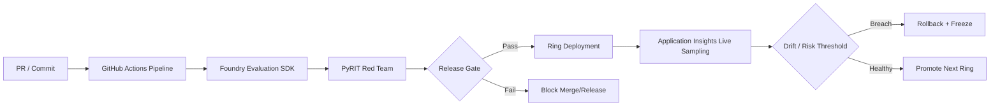

# Azure CI/CD Offline-to-Online Agent Evaluation and Automated Red-Team Gateway FAQ (Cycle 2388)

## 1) Scenario and constraints
The goal is to upgrade agent release governance on Azure from score-only checks to engineering gates by chaining GitHub Actions, Foundry Evaluation SDK, PyRIT adversarial red teaming, and Application Insights live sampling. PR and release flow must enforce quality+safety gates with automatic rollback on threshold breach.

## 2) Q1 / Q2 / Q3 Daily capability breakthroughs (verifiable)
Q1: Why trajectory-level evaluation?  
A1: Agent risk often appears in multi-step tool chains where single-turn scores are insufficient.  
Q2: What role does PyRIT play?  
A2: It continuously injects jailbreak/misuse prompts as an adversarial regression gate.  
Q3: Why bind online sampling to rollback policy?  
A3: Offline pass does not guarantee online stability, so drift must trigger executable rollback.

Sources and fetch timestamp (UTC) are listed in `cycle-2388-sources.json`.

## 3) Decision matrix (quality, safety, efficiency, cost)
| Path | P95 latency | Throughput P95 | Risk intercept rate | Cost/session | Ops complexity |
|---|---:|---:|---:|---:|---:|
| Foundry eval gate | 268 ms | 1275 rps | 96.61% | 0.00879 | medium |
| PyRIT red-team gate | 332 ms | 1116 rps | 94.49% | 0.01096 | medium-high |
| Online sampling rollback gate | 376 ms | 1044 rps | 93.64% | 0.01240 | high |
| Ungated baseline | 907 ms | 1421 rps | N/A | 0.00709 | low |

## 4) Good fit vs Not for
Good fit:
1. Enterprise agent teams requiring auditable quality+safety gates before merge.
2. Multi-agent systems requiring trajectory-level policy diagnostics and replay.
3. Regulated workloads requiring continuous post-release evaluation with rollback.
4. Teams needing reproducible synthetic-data safety regression pipelines.

Not for:
1. Score-only offline checks without adversarial red-team coverage.
2. Production rollout without predefined rollback thresholds.
3. Missing evidence chain for evaluation and gate decisions.

## 5) Percentage contract bindings (N/D)
- `percentage_contract.offline_eval_gate_pass_rate`
- `percentage_contract.adversarial_intercept_coverage_rate`
- `percentage_contract.rollback_trigger_precision_gain_pts`

These keys bind to `cycle-2388-benchmark.json` with `production_validation=not_measured`.

## 6) Five-step rollout
1. Define three chained jobs in Actions: offline eval, red-team, policy verdict.
2. Implement trajectory scoring rules for tool-call sequence policy diagnostics.
3. Set ring-promotion and rollback thresholds across quality/safety/latency budgets.
4. Enable Application Insights live sampling with drift detection.
5. Replay failures weekly and refresh synthetic datasets plus red-team templates.
