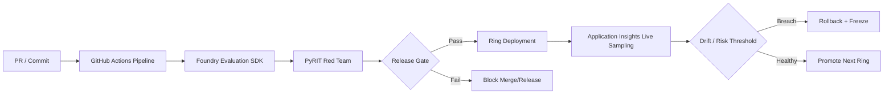

# Azure CI/CD 离线到在线 Agent 评测与自动化红队闸门 FAQ（Cycle 2388）

## 1) 场景与约束
目标是在 Azure 上把 Agent 发布从“模型分数评估”升级为“工程化闸门”：GitHub Actions 编排 Foundry Evaluation SDK、PyRIT 对抗红队、Application Insights 线上采样，要求在 PR/发布环节实现质量与安全双闸门、超阈值自动回滚。

## 2) Q1 / Q2 / Q3 当日能力突破（可验证）
Q1：为什么要做轨迹级（trajectory）评测？  
A1：Agent 风险常出现在多步工具调用链，单轮问答分数不足以覆盖。  
Q2：PyRIT 在门禁中的角色是什么？  
A2：作为对抗红队层，持续注入越狱/滥用提示并验证防护拦截率。  
Q3：线上采样为何必须与回滚策略绑定？  
A3：离线通过不代表线上稳定，采样漂移必须触发可执行回滚。

来源与抓取时间（UTC）见 `cycle-2388-sources.json`。

## 3) 决策矩阵（质量、安全、效率、成本）
| 路径 | P95 延迟 | 轨迹吞吐 P95 | 风险拦截率 | 单会话成本 | 运维复杂度 |
|---|---:|---:|---:|---:|---:|
| Foundry 评测闸门 | 268 ms | 1275 rps | 96.61% | 0.00879 | 中 |
| PyRIT 红队闸门 | 332 ms | 1116 rps | 94.49% | 0.01096 | 中高 |
| 线上采样回滚闸门 | 376 ms | 1044 rps | 93.64% | 0.01240 | 高 |
| 无闸门基线 | 907 ms | 1421 rps | N/A | 0.00709 | 低 |

## 4) Good fit vs Not for
Good fit：
1. 需要 PR 前可审计质量/安全门禁的企业 Agent 团队。  
2. 需要工具轨迹级策略评估与回放的多 Agent 体系。  
3. 高合规业务要求“上线后持续评估+自动回滚”。  
4. 需要可复制的合成数据安全回归测试流程。

Not for：
1. 仅看静态离线分数，不做对抗红队。  
2. 没有预定义回滚阈值就直接生产放量。  
3. 不保留评测与闸门证据链，无法审计复盘。

## 5) Percentage contract bindings (N/D)
- `percentage_contract.offline_eval_gate_pass_rate`
- `percentage_contract.adversarial_intercept_coverage_rate`
- `percentage_contract.rollback_trigger_precision_gain_pts`

以上键绑定 `cycle-2388-benchmark.json`，并标记 `production_validation=not_measured`。

## 6) 五步落地指南
1. 在 Actions 中定义离线评测、红队、策略判定三个连续作业。  
2. 建立轨迹级判分规则（工具调用序列、违规轨迹、失败根因标签）。  
3. 设定发布 ring 策略与回滚阈值（质量/安全/延迟三类）。  
4. 上线后启用 Application Insights 采样与漂移检测。  
5. 每周回放失败样本并更新合成数据集与红队模板。
