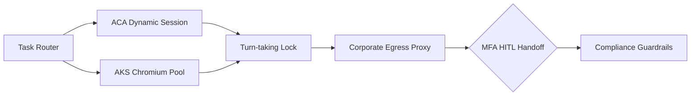

# Azure Computer-Use and Headless Browser Agent Infrastructure FAQ (Cycle 2385)

## 1) Scenario and constraints
The goal is enterprise browser-agent runtime governance: route between ACA Dynamic Sessions and AKS Chromium pools with corporate egress proxy and HITL MFA handoff for low latency, lower token cost, and strong isolation.

## 2) Q1 / Q2 / Q3 Daily capability breakthroughs (verifiable)
Q1: Why A11y-first mode?  
A1: It materially lowers vision-token cost on most structured pages.  
Q2: How to split dynamic sessions vs pooled browsers?  
A2: High-risk tasks use dynamic sessions; batch throughput tasks use pooled browsers.  
Q3: Why must MFA stay HITL?  
A3: Full automation bypass breaks zero-trust audit lineage.

Source links and fetch timestamp (UTC) are listed in `cycle-2385-sources.json`.

## 3) Decision matrix (latency, isolation, cost, compliance)
| Path | P95 step latency | Session isolation strength | Token-cost efficiency | Compliance auditability | Ops complexity |
|---|---:|---:|---:|---:|---:|
| ACA Dynamic Sessions | 221 ms | high | high | high | medium |
| AKS Chromium Pools | 239 ms | medium-high | medium-high | medium-high | medium-high |
| Proxy + MFA Handoff | 289 ms | high | medium | high | medium-high |
| Unmanaged baseline | 915 ms | low | low | low | low |

## 4) Good fit vs Not for
Good fit:
1. Coding-agent browser tasks requiring strong isolation and teardown.
2. Enterprise automation requiring policy-aware egress and audit logs.
3. Multi-tenant SaaS requiring A11y-first token efficiency.
4. Regulated finance requiring explicit human MFA handoff.

Not for:
1. Weakly isolated shared pools without cleanup contracts.
2. Screenshot-only loops without A11y fallback.
3. Attempts to bypass MFA human approval.

## 5) Percentage contract bindings (N/D)
- `percentage_contract.session_isolation_sla_rate`
- `percentage_contract.mfa_handoff_precision_rate`
- `percentage_contract.a11y_token_savings_gain_pts`

These keys bind to `cycle-2385-benchmark.json` with `production_validation=not_measured`.

## 6) Five-step rollout
1. Define task tiers and route policy for dynamic sessions vs pooled browsers.
2. Add turn-taking locks and timeout recovery.
3. Configure corporate proxy governance and logging.
4. Enforce MFA HITL handoff with deny-by-default fallback.
5. Review P95 step latency and token efficiency weekly.
