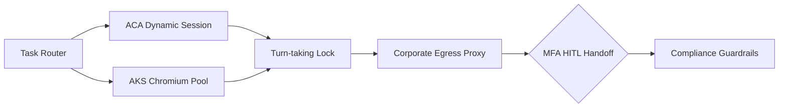

# Azure Computer-Use 与 Headless Browser Agent 基础设施 FAQ（Cycle 2385）

## 1) 场景与约束
目标是建设企业级浏览器 Agent 运行平台：在 ACA Dynamic Sessions 与 AKS Chromium 池之间做路由，结合企业出口代理与 HITL MFA 交接，实现低延迟、低 token 成本和高隔离。

## 2) Q1 / Q2 / Q3 当日能力突破（可验证）
Q1：为何采用 A11y-first？  
A1：在多数可结构化页面上显著降低视觉 token 成本。  
Q2：动态会话与浏览器池如何分工？  
A2：高风险任务走动态会话，批量任务走池化浏览器。  
Q3：MFA 为什么必须 HITL？  
A3：自动化绕过会破坏零信任审计链。

来源与抓取时间（UTC）写入 `cycle-2385-sources.json`。

## 3) 决策矩阵（延迟、隔离、成本、合规）
| 路径 | P95 步骤延迟 | 会话隔离强度 | token 成本效率 | 合规可审计性 | 运维复杂度 |
|---|---:|---:|---:|---:|---:|
| ACA Dynamic Sessions | 221 ms | 高 | 高 | 高 | 中 |
| AKS Chromium Pools | 239 ms | 中高 | 中高 | 中高 | 中高 |
| Proxy + MFA Handoff | 289 ms | 高 | 中 | 高 | 中高 |
| 未治理基线 | 915 ms | 低 | 低 | 低 | 低 |

## 4) Good fit vs Not for
Good fit：
1. Coding Agent 浏览器任务：要求强隔离与可回收会话。  
2. 企业流程自动化：需要代理出口和审计日志。  
3. 多租户 SaaS：A11y-first 控制 token 成本。  
4. 金融合规：MFA 必须人工接管确认。

Not for：
1. 共享池无清理策略的弱隔离部署。  
2. 仅截图视觉循环，无 A11y 回退。  
3. 尝试自动完成 MFA 绕过人审。

## 5) Percentage contract bindings (N/D)
- `percentage_contract.session_isolation_sla_rate`
- `percentage_contract.mfa_handoff_precision_rate`
- `percentage_contract.a11y_token_savings_gain_pts`

以上键绑定 `cycle-2385-benchmark.json`，并标注 `production_validation=not_measured`。

## 6) 五步落地指南
1. 任务分级并定义动态会话/池化浏览器路由规则。  
2. 引入 turn-taking 锁和超时恢复策略。  
3. 配置企业代理出口策略与审计。  
4. 设置 MFA HITL 交接与拒绝默认。  
5. 周度复盘 P95 步骤延迟与 token 成本效率。
