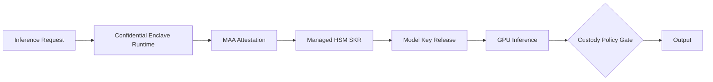

# Azure Confidential GPU and Hardware-Attested Agent Enclave FAQ (Cycle 2387)

## 1) Scenario and constraints
The objective is zero-operator-visibility inference for regulated banking/healthcare agents by comparing NCC H100 v5 confidential compute, AKS Kata confidential containers, MAA attestation, Managed HSM SKR, and standard ND H100 v5 trade-offs.

## 2) Q1 / Q2 / Q3 Daily capability breakthroughs (verifiable)
Q1: Why emphasize attestation-first?  
A1: It verifies hardware/software measurements before key release to block out-of-bound execution.  
Q2: What is the primary cost of confidential mode?  
A2: TDX/SEV-SNP + Hopper CC introduces measurable performance overhead.  
Q3: When keep standard ND lanes?  
A3: Lower-regulation workloads can use standard lanes for better cost/throughput.

Source links and fetch timestamp (UTC) are listed in `cycle-2387-sources.json`.

## 3) Decision matrix (security, overhead, cost)
| Path | P95 latency | Confidential overhead | Attestation-chain integrity | Cost/session | Ops complexity |
|---|---:|---:|---:|---:|---:|
| NCC H100 confidential | 258 ms | +12.7% | high | 0.04796 | medium-high |
| AKS Kata confidential | 301 ms | +15.9% | high | 0.05439 | high |
| MAA+SKR lane | 329 ms | +18.4% | high | 0.05796 | high |
| Standard ND H100 | 934 ms | baseline | low-medium | 0.04035 | medium |

## 4) Good fit vs Not for
Good fit:
1. Banking/healthcare agents requiring zero-visibility execution.
2. Multi-tenant regulated platforms requiring attestation-first key release.
3. Enterprise tool-calling agents requiring custody-audit lineage.
4. Data sovereignty workloads requiring strict confidential/standard separation.

Not for:
1. Releasing keys without verified attestation.
2. Reusing standard sizing without confidential-overhead budgeting.
3. Shared key domains across confidential and non-confidential lanes.

## 5) Percentage contract bindings (N/D)
- `percentage_contract.attested_key_release_success_rate`
- `percentage_contract.confidential_overhead_budget_sla_rate`
- `percentage_contract.zero_visibility_custody_gain_pts`

These keys bind to `cycle-2387-benchmark.json` with `production_validation=not_measured`.

## 6) Five-step rollout
1. Define MAA attestation policy and measurement allowlists.
2. Configure SKR to release keys only after attestation passes.
3. Separate confidential and standard inference/key domains.
4. Recalculate capacity and cost with overhead model.
5. Replay attestation failures and custody boundary violations weekly.
