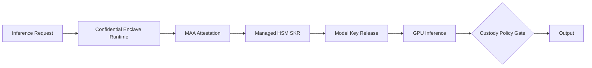

# Azure 机密 GPU 与硬件证明 Agent Enclave FAQ（Cycle 2387）

## 1) 场景与约束
目标是在金融/医疗等高合规场景实现零运维可见性推理：比较 NCC H100 v5 机密计算、AKS Kata 机密容器、MAA 证明、Managed HSM SKR 放钥，与标准 ND H100 v5 的延迟/成本权衡。

## 2) Q1 / Q2 / Q3 当日能力突破（可验证）
Q1：为什么强调 Attestation-first？  
A1：可在放钥前验证硬件/软件测量值，阻断越界执行。  
Q2：机密模式的主要代价？  
A2：TDX/SEV-SNP + Hopper CC 带来一定性能开销。  
Q3：何时仍保留标准 ND 路径？  
A3：低合规任务可走标准路径以优化成本与吞吐。

来源与抓取时间（UTC）写入 `cycle-2387-sources.json`。

## 3) 决策矩阵（安全、开销、成本）
| 路径 | P95 延迟 | 机密开销 | 证明链完整性 | 单会话成本 | 运维复杂度 |
|---|---:|---:|---:|---:|---:|
| NCC H100 机密 | 258 ms | +12.7% | 高 | 0.04796 | 中高 |
| AKS Kata 机密容器 | 301 ms | +15.9% | 高 | 0.05439 | 高 |
| MAA+SKR 放钥通道 | 329 ms | +18.4% | 高 | 0.05796 | 高 |
| 标准 ND H100 | 934 ms | 基线 | 低中 | 0.04035 | 中 |

## 4) Good fit vs Not for
Good fit：
1. 金融/医疗 Agent：需要零可见性执行。  
2. 多租户高合规平台：需证明先行放钥。  
3. 企业 Tool-Calling Agent：需强托管审计链。  
4. 数据主权场景：需机密路径与标准路径严格隔离。

Not for：
1. 未验证证明就直接放钥。  
2. 忽视机密开销，直接复用标准容量规划。  
3. 机密与非机密路径共用密钥域。

## 5) Percentage contract bindings (N/D)
- `percentage_contract.attested_key_release_success_rate`
- `percentage_contract.confidential_overhead_budget_sla_rate`
- `percentage_contract.zero_visibility_custody_gain_pts`

以上键绑定 `cycle-2387-benchmark.json`，并标注 `production_validation=not_measured`。

## 6) 五步落地指南
1. 建立 MAA 证明策略与测量白名单。  
2. 配置 SKR 仅在证明通过后放钥。  
3. 分离机密/标准推理路径与密钥域。  
4. 基于开销模型重算容量与成本。  
5. 周度回放证明失败与边界违规样本。
