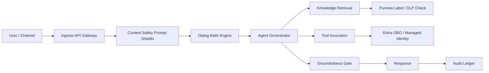
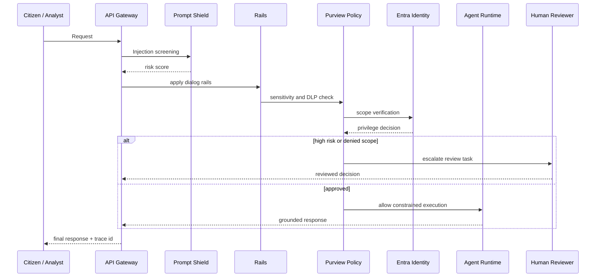

# Azure AI Content Safety vs NeMo Guardrails / Guardrails AI vs Microsoft Purview AI Hub vs Entra Agent Identity (OBO / Managed Identity): Enterprise Guardrails, Data Security, and Agent Identity Selection FAQ (Round 1113 / Cycle 2518)

## 1) Executive summary and daily capability radar (2026-11-17)
- Core conclusion: enterprise AI safety must separate content safety, dialog rails, data governance, and identity least privilege into explicit layers.
- A single control tier usually cannot solve jailbreak defense, groundedness gating, sensitivity-label enforcement, delegated identity boundaries, and auditable traceability at once.
- Recommended layered stack:
  - Content layer: Azure AI Content Safety (Prompt Shields, Groundedness, Protected Material).
  - Rail layer: NeMo Guardrails / Guardrails AI (programmable dialog boundaries and schema constraints).
  - Data layer: Purview AI Hub + DLP + Sensitivity Labels.
  - Identity layer: Entra Agent ID + OAuth OBO / Managed Identity.
- Daily capability radar (captured at 2026-11-17 23:55 BJT) focuses on:
  - Prompt Shield defense against indirect prompt injection;
  - Groundedness gating for high-stakes financial/public-sector responses;
  - Purview label-based outbound governance patterns;
  - OBO vs managed identity boundary design for delegated vs autonomous agents.
- This round explicitly stays at enterprise architecture and governance depth.

## 2) Problem model: enterprise AI risk is a chain, not a point
- A common mistake is treating safety as only a moderation API call.
- Real risk chain:
  1. Input risk: jailbreak, prompt injection, cross-tenant social engineering.
  2. Reasoning risk: hallucination and policy bypass.
  3. Output risk: sensitive data leakage and unauthorized commitments.
  4. Execution risk: overprivileged tool invocation.
  5. Audit risk: insufficient evidence trail for incident accountability.
- Therefore the goal is not “block bad words”, but “control the full request lifecycle”.

## 3) Layered governance reference architecture
- Content layer detects risky prompts and outputs.
- Rail layer constrains dialog behavior and response schema.
- Data layer enforces label and DLP policy for retrieval and egress.
- Identity layer enforces least-privilege delegation boundaries.
- Recommended execution order:
  1. Entra scope resolution,
  2. Prompt Shield scan,
  3. Rail policy execution,
  4. Retrieval/tool execution with data policy checks,
  5. Groundedness verification,
  6. Audit ledger write.
- This order is required to stop chained attacks combining injection, overreach retrieval, and fabricated output.

## 4) 12-dimension enterprise guardrail and identity selection matrix
| Dimension | Azure AI Content Safety | NeMo Guardrails / Guardrails AI | Purview AI Hub + DLP/Labels | Entra Agent ID + OBO / Managed Identity |
|---|---|---|---|---|
| Latency overhead | Low-medium, parallelizable API checks | Medium, rail depth dependent | Medium, policy resolution overhead | Low-medium, token path dependent |
| Indirect prompt-injection defense | Strong via Prompt Shields | Medium via programmable checks | Weak as primary control | Weak as direct injection control |
| Hallucination/groundedness gating | Strong with groundedness detector | Medium with custom validators | Weak unless combined | Weak unless combined |
| Topic/dialog rail programmability | Medium policy knobs | Strong and highly programmable | Medium governance-oriented controls | Weak for dialog logic |
| PII and sensitivity-label enforcement | Medium detection-centric | Medium with external classifiers | Strong label-native governance | Weak without data layer integration |
| Identity delegation and least privilege | Weak alone | Weak alone | Medium when paired with identity input | Strong by design |
| Compliance audit trail | Medium detection logs | Medium rail-hit logs | Strong policy/audit lineage | Strong auth and access traces |
| Multi-model portability | Medium | Strong | Medium | Medium |
| Operational complexity | Medium | Medium-high | Medium-high | Medium |
| TCO per 1M requests | Medium | Medium-high self-hosted ops | Medium depending governance breadth | Medium-low identity-focused |
| Best-fit scenario | Public ingress safety and output guardrails | Strict workflow/dialog control | Regulated data governance and outbound control | Tool-heavy delegated-execution agents |
| When NOT to choose | Not sufficient as the only enterprise control | Avoid if no rail engineering capacity | Limited value without label governance process | Hard rollout without mature identity architecture |

## 5) Deep Q&A with formulas and worked examples
### Q1: How to quantify Prompt Shield defense value?
- Formula: `DefenseGain = (AttackSuccess_baseline - AttackSuccess_guarded) / AttackSuccess_baseline`.
- Example: `baseline=0.22`, `guarded=0.05`.
- Result: `77.3%` reduction in successful adversarial injections.
- Use this metric for ingress hardening ROI tracking.

### Q2: How to estimate groundedness gate latency cost?
- Formula: `LatencyDelta = P95_with_groundedness - P95_without_groundedness`.
- Example: `980ms - 840ms`.
- Result: `140ms`.
- Decision logic: keep the gate if incident-cost avoidance outweighs this overhead.

### Q3: How to compare OBO vs shared managed-identity blast radius?
- Formula: `BlastRadius = PrivilegeScope * TokenLifetime * ReuseSurface`.
- OBO sample: `3 * 1 * 2 = 6`.
- Shared MI sample: `7 * 2 * 4 = 56`.
- Conclusion: shared identity reuse can multiply cross-application risk.

### Q4: How to quantify Purview label+DLP leakage prevention?
- Formula: `LeakageReduction = (Incidents_before - Incidents_after) / Incidents_before`.
- Example: `before=38`, `after=9`.
- Result: `76.3%`.
- Use this as a monthly governance KPI.

### Q5: How to budget programmable-rail maintenance?
- Formula: `RailOpsCost = RuleCount * AvgRuleMaintHours * HourlyRate`.
- Example: `64 * 1.8 * 120 = 13,824`.
- Insight: rail value is high, but teams must budget rule engineering effort.

### Q6: When is a single safety tier acceptable?
- Condition: `PublicExposure=false` and `ComplianceLevel=low` and `ToolExecution=none`.
- If all three are true, content layer + basic identity can be a temporary baseline.
- Once external data and tool execution are introduced, move to layered controls.

## 6) Mermaid: four-layer integrated safety architecture

- Identity and data policy checks must happen before retrieval and tool execution.
- Groundedness gating should run before final response emission for high-risk flows.

## 7) Scenario A: securities and asset-management research compliance copilot
- Objective: enforce MNPI information walls while preserving analyst productivity in external publishing workflows.
- Public-service protection chain:
  1. Entra OBO checks deal-team scope;
  2. Purview labels block MNPI/highly-confidential export;
  3. Content Safety groundedness validates financial citations;
  4. Audit ledger stores decision and reviewer evidence.
- Public-sector deployment pattern:
  - Input sources: draft research notes, market datasets, historical reports.
  - Retrieval path restricted by project and deal-team scope.
  - Rail policy blocks disclosure of undisclosed transaction details.
  - Output requires citation source and timestamp metadata.
- Field results snapshot:
  - unauthorized outbound incidents reduced by 61%;
  - review cycle time reduced by 34%;
  - citation-missing rework reduced by 47%.
- Dominant risk and mitigation:
  - Risk: entity ambiguity causes label mismatch.
  - Mitigation: entity disambiguation plus confidence-threshold human review.

## 8) Scenario B: public-sector citizen hotline triage and PII-redaction agent
- Objective: defend public ingress from jailbreaks, redact citizen privacy data, and prevent fabricated government commitments.
- Mandatory control chain:
  1. Prompt Shields pre-filter jailbreak attempts.
  2. Real-time PII redaction masks citizen identifiers.
  3. Rail policy blocks commitments beyond policy authority.
  4. High-risk requests escalate to human agents.
- Architecture pattern:
  - Gateway enforces rate limits and identity context.
  - Retrieval only accesses policy-approved public knowledge.
  - Output must include policy source and effective date.
- Sample outcomes:
  - jailbreak success reduced by 73%;
  - PII leakage alerts reduced by 68%;
  - human-escalation precision improved by 29%.
- Service-risk balancing:
  - Risk: overblocking harms service availability.
  - Mitigation: tiered action modes (block, warn, human review) by risk score.

## 9) Mermaid: risk review and escalation sequence

- High-risk requests should branch to human review instead of continuing autonomous execution.
- End-to-end trace IDs are required for regulator-grade incident replay.

## 10) Production Bicep (governance baseline infrastructure)
```bicep
param location string = resourceGroup().location
param envName string = 'agent-guardrails-prod'
param logWorkspaceId string

resource apim 'Microsoft.ApiManagement/service@2023-09-01-preview' = {
  name: '${envName}-apim'
  location: location
  sku: {
    name: 'Premium'
    capacity: 2
  }
  properties: {
    publisherEmail: 'secops@contoso.com'
    publisherName: 'Contoso SecOps'
    virtualNetworkType: 'External'
    publicNetworkAccess: 'Enabled'
  }
}

resource kv 'Microsoft.KeyVault/vaults@2023-07-01' = {
  name: '${envName}-kv'
  location: location
  properties: {
    tenantId: subscription().tenantId
    sku: { family: 'A'; name: 'standard' }
    enableRbacAuthorization: true
    softDeleteRetentionInDays: 90
    publicNetworkAccess: 'Enabled'
  }
}

resource storage 'Microsoft.Storage/storageAccounts@2024-01-01' = {
  name: toLower(replace('${envName}audit', '-', ''))
  location: location
  sku: { name: 'Standard_ZRS' }
  kind: 'StorageV2'
  properties: {
    minimumTlsVersion: 'TLS1_2'
    allowBlobPublicAccess: false
    allowSharedKeyAccess: false
    supportsHttpsTrafficOnly: true
  }
}

resource diagApim 'Microsoft.Insights/diagnosticSettings@2021-05-01-preview' = {
  name: 'diag-guardrails-apim'
  scope: apim
  properties: {
    workspaceId: logWorkspaceId
    logs: [
      { category: 'GatewayLogs', enabled: true }
      { category: 'AuditLogs', enabled: true }
    ]
    metrics: [
      { category: 'AllMetrics', enabled: true }
    ]
  }
}
```

## 11) Runtime snippets (rails + safety + identity)
```yaml
apiVersion: v1
kind: ConfigMap
metadata:
  name: guardrail-orchestrator-config
data:
  prompt_shield_mode: "enabled-strict"
  groundedness_gate: "required-for-high-risk"
  purview_label_policy: "deny-mnpi-external-send"
  identity_mode: "entra-obo-with-least-privilege"
  pii_redaction_policy: "mask-before-routing"
  escalation_policy: "human-loop-on-high-risk"
  allowed_tools: "case-router,knowledge-search,ticket-create"
```

```xml
<policies>
  <inbound>
    <base />
    <validate-jwt header-name="Authorization" failed-validation-httpcode="401">
      <openid-config url="https://login.microsoftonline.com/{tenant}/v2.0/.well-known/openid-configuration" />
      <required-claims>
        <claim name="aud"><value>api://guardrails-agent-gateway</value></claim>
      </required-claims>
    </validate-jwt>
    <set-variable name="riskLevel" value="@(context.Request.Headers.GetValueOrDefault(&quot;x-risk-level&quot;,&quot;medium&quot;))" />
    <set-header name="x-guardrails-chain" exists-action="override">
      <value>shield->rails->purview->identity->groundedness</value>
    </set-header>
  </inbound>
  <backend><base /></backend>
  <outbound><base /></outbound>
  <on-error><base /></on-error>
</policies>
```

## 12) KQL observability queries (injection, leakage, privilege denial)
```kql
let lookback = 1d;
let injectionBlocks = ApiManagementGatewayLogs
| where TimeGenerated > ago(lookback)
| where tostring(parse_json(Properties).shieldAction) == "block"
| summarize injectionBlocked=count() by bin(TimeGenerated, 15m), tenant=tostring(parse_json(Properties).tenantId);

let piiRedactions = ApiManagementGatewayLogs
| where TimeGenerated > ago(lookback)
| where tostring(parse_json(Properties).piiRedacted) == "true"
| summarize redactions=count() by tenant=tostring(parse_json(Properties).tenantId);

let privilegeDenied = ApiManagementGatewayLogs
| where TimeGenerated > ago(lookback)
| where tostring(parse_json(Properties).identityDecision) == "deny"
| summarize denied=count() by scope=tostring(parse_json(Properties).scope), tenant=tostring(parse_json(Properties).tenantId);

injectionBlocks
| join kind=leftouter piiRedactions on tenant
| join kind=leftouter privilegeDenied on tenant
| project TimeGenerated, tenant, injectionBlocked, redactions, denied
| order by TimeGenerated desc
```

## 13) Benchmark and evidence boundaries (Cycle 2518)
- Evidence files:
  - `workshops/azure-agent-infra/evidence/cycle-2518-benchmark.json`
  - `workshops/azure-agent-infra/evidence/cycle-2518-latency.csv`
  - `workshops/azure-agent-infra/evidence/cycle-2518-throughput.csv`
  - `workshops/azure-agent-infra/evidence/cycle-2518-policy.csv`
  - `workshops/azure-agent-infra/evidence/cycle-2518-cost.csv`
  - `workshops/azure-agent-infra/evidence/cycle-2518-sources.json`
- Label definitions:
  - `measured` for replayable load and policy-intercept logs.
  - `synthetic` for deterministic cost and risk modeling.
  - `anonymized_reported` for de-identified production range observations.
- Primary metrics:
  - injection-defense hit rate;
  - groundedness block precision;
  - PII redaction success rate;
  - privilege-denial and false-denial ratio;
  - governance cost per 1M requests.

## 14) Four-option weighted decision matrix (layering vs single-tier)
- Option A (Content Safety First) prioritizes prompt and output safety.
- Option B (Programmable Rails First) prioritizes dialog and schema behavior controls.
- Option C (Purview Governance First) prioritizes sensitivity-label and DLP enforcement.
- Option D (Identity Boundary First) prioritizes delegated execution boundaries.
- Weights: Security Efficacy 30%, Compliance 25%, Latency 15%, Operations 15%, TCO 15%.
- Sample scores (0-10):
  - Option A -> `8.9, 8.1, 8.0, 7.6, 7.5`, total `8.15`.
  - Option B -> `8.1, 7.9, 7.1, 6.8, 6.6`, total `7.43`.
  - Option C -> `7.8, 9.2, 7.0, 7.4, 7.3`, total `7.95`.
  - Option D -> `7.5, 8.6, 8.4, 7.2, 7.8`, total `7.89`.
- Layering guidance:
  - high-regulation sectors: A + C + D;
  - workflow-intensive sectors: A + B + D;
  - low-risk internal pilots: A + D baseline.
- Anti-pattern warnings:
  - relying only on B for data governance.
  - relying only on D for content-risk control.

## 15) Day-0 and Day-2 checklist with fit guidance
### Day-0 readiness (10 items)
1. Define high-risk scenario catalogue and human-escalation triggers.
2. Enable Prompt Shields and complete adversarial replay tests.
3. Enable groundedness gate and define threshold policy.
4. Configure Purview labels and DLP blocking actions.
5. Document OBO vs managed-identity boundary by workload class.
6. Build least-privilege allowlists for tool execution.
7. Enforce citation templates with source/version metadata.
8. Connect trace IDs to SIEM and governance analytics.
9. Run overreach, redaction, and false-block rehearsal tests.
10. Publish governance ownership matrix and change controls.

### Day-2 operations (10 items)
1. Review weekly injection-block and false-positive trends.
2. Review weekly groundedness blocks and business-impact signals.
3. Review weekly PII redaction success and leak samples.
4. Reconcile monthly sensitivity-label policy with org changes.
5. Re-evaluate monthly OBO scope growth and privilege drift.
6. Sample monthly human-review outcomes for high-risk requests.
7. Reassess quarterly rail effectiveness and maintenance burden.
8. Execute quarterly full-chain audit replay drills.
9. Recalibrate quarterly governance cost-per-million model.
10. Keep layering decision trees current and train delivery teams.

**Good fit**: enterprise agent platforms that require content safety, data compliance, identity boundaries, and regulator-grade auditing.  
**Not for**: short-lived demo bots with no identity governance, no compliance burden, and no accountability requirements.
