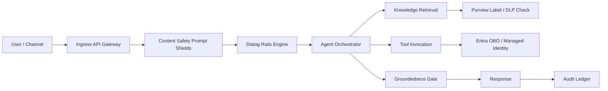
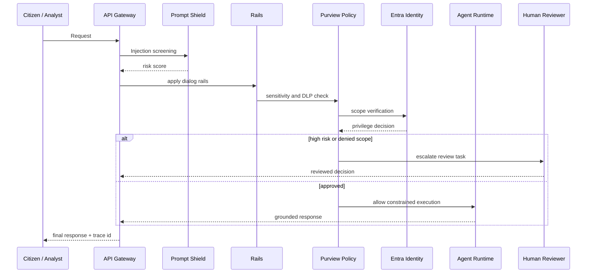

# Azure AI Content Safety vs NeMo Guardrails / Guardrails AI vs Microsoft Purview AI Hub vs Entra Agent Identity（OBO / Managed Identity）：企业级 Guardrails、数据安全与 Agent 身份治理选型 FAQ（Round 1113 / Cycle 2518）

## 1) 执行摘要与当日能力雷达（2026-11-17）
- 本轮结论：企业 AI 安全治理必须把“内容安全、对话轨道、数据治理、身份最小权限”拆成独立能力层，再按场景叠加。
- 单一产品通常无法同时解决：越狱防护、事实性校验、敏感数据分级、权限委托边界、审计可追溯五大问题。
- 建议采用四层组合：
  - 内容层：Azure AI Content Safety（Prompt Shields、Groundedness、Protected Material）。
  - 轨道层：NeMo Guardrails / Guardrails AI（可编程对话边界与输出结构约束）。
  - 数据层：Purview AI Hub + DLP + Sensitivity Labels（标签驱动治理与外发控制）。
  - 身份层：Entra Agent ID + OAuth OBO / Managed Identity（最小权限与代理边界）。
- 当日能力雷达（抓取时间：2026-11-17 23:55 BJT）聚焦：
  - Prompt Shield 对间接提示注入防护策略；
  - Groundedness 检测对金融/政务高风险回答的约束价值；
  - Purview 标签与 DLP 在文档级出站治理的策略编排；
  - OBO 与 Managed Identity 在“代用户”与“系统自治”两类 Agent 中的边界。
- 本轮严格限定企业应用架构与治理实践，不涉及底层内核/硬件优化。

## 2) 问题建模：企业 AI 风险并非单点
- 常见误区是把“模型安全”理解为单一内容审核 API。
- 实际风险链条至少包含：
  1. 输入风险：越狱、提示注入、跨租户诱导请求。
  2. 推理风险：幻觉、越权上下文融合、策略绕过。
  3. 输出风险：泄露敏感信息、不合规承诺、版权风险文本。
  4. 执行风险：工具调用越权、身份委托失控。
  5. 审计风险：缺乏证据链，事故无法追责。
- 因此选型目标应从“拦截坏内容”升级为“全链路安全控制平面”。

## 3) 分层治理参考架构：内容、轨道、数据、身份
- 内容层负责“看见风险”，轨道层负责“限制行为”，数据层负责“控制数据边界”，身份层负责“定义权限来源”。
- 编排顺序建议：
  1. Entra 鉴权与作用域解析；
  2. Prompt Shields 输入扫描；
  3. Guardrails 对话轨道约束；
  4. 检索与工具执行（带 Purview 标签策略）；
  5. Groundedness 与输出检查；
  6. 审计日志与合规模型打分。
- 只有四层联动，才能把“高危输入 + 越权检索 + 幻觉输出”联锁拦截。

## 4) 12 维企业安全与身份选型矩阵
| 维度 | Azure AI Content Safety | NeMo Guardrails / Guardrails AI | Microsoft Purview AI Hub + DLP/Labels | Entra Agent ID + OBO / Managed Identity |
|---|---|---|---|---|
| 延迟开销 | 中低，API 调用可并行 | 中，规则链深度影响时延 | 中，策略与标签解析有固定开销 | 低到中，取决于 token 流程 |
| 间接提示注入防御 | 强（Prompt Shields） | 中（可编排规则） | 弱（非核心能力） | 弱（身份层不直接防注入） |
| 幻觉/事实性闸门 | 强（Groundedness） | 中（可自定义验证） | 弱（依赖外层） | 弱（依赖上层策略） |
| 话题/对话轨道可编程性 | 中（策略参数化） | 强（rail 可编排） | 中（治理规则为主） | 弱（不处理对话逻辑） |
| PII 与敏感标签执行 | 中（内容检测） | 中（需外接分类器） | 强（标签+DLP 原生） | 弱（需与数据层配合） |
| 身份委托与最小权限 | 弱（非身份系统） | 弱（非身份系统） | 中（策略依赖身份输入） | 强（OBO/MI 明确边界） |
| 合规审计轨迹 | 中（检测日志） | 中（rail 命中日志） | 强（审计与策略证据） | 强（令牌与访问证据） |
| 多模型可移植性 | 中（内容层独立） | 强（模型无关轨道） | 中（依赖 M365 与数据治理域） | 中（身份层可复用） |
| 运维复杂度 | 中 | 中高（规则与测试维护） | 中高（治理策略生命周期） | 中（身份与应用映射治理） |
| 每百万请求 TCO | 中，按检测与闸门调用计费 | 中高，自建算力与维护成本 | 中，按治理范围与扫描量 | 中低，主要为身份治理运营 |
| 最佳适配场景 | 公网入口安全与输出校验 | 业务规则严苛的对话流程 | 高合规数据外发与标签治理 | 多工具代理与最小权限执行 |
| When NOT to choose | 不能单独承担全部治理 | 缺规则工程能力团队慎用 | 无标签治理流程时收益有限 | 无统一身份体系时落地困难 |

## 5) 深度问答：可复算公式与样例
### Q1：Prompt Shield 的防御收益如何量化？
- 公式：`DefenseGain = (AttackSuccess_baseline - AttackSuccess_guarded) / AttackSuccess_baseline`。
- 样例：`baseline=0.22`，`guarded=0.05`。
- 计算：`(0.22-0.05)/0.22 = 77.3%`。
- 解释：该值可用于评估公网入口防护投资回报。

### Q2：Groundedness 闸门对业务延迟影响如何测？
- 公式：`LatencyDelta = P95_with_groundedness - P95_without_groundedness`。
- 样例：`P95_with=980ms`，`P95_without=840ms`。
- 计算：`140ms`。
- 判断：若事故代价高于延迟损耗，通常应保留闸门。

### Q3：OBO 与 Managed Identity 的风险半径如何对比？
- 公式：`BlastRadius = PrivilegeScope * TokenLifetime * ReuseSurface`。
- 样例 OBO：`scope=3`，`lifetime=1`，`surface=2` => `6`。
- 样例共享 MI：`scope=7`，`lifetime=2`，`surface=4` => `56`。
- 结论：共享 MI 在多应用共享时风险半径显著更大。

### Q4：Purview 标签+DLP 的拦截价值怎么估？
- 公式：`LeakageReduction = (LeakIncidents_before - LeakIncidents_after) / LeakIncidents_before`。
- 样例：`before=38`，`after=9`。
- 计算：`76.3%`。
- 说明：该指标适合在月度审计中持续追踪。

### Q5：可编程 rails 的维护成本怎么估？
- 公式：`RailOpsCost = RuleCount * AvgRuleMaintHours * HourlyRate`。
- 样例：`RuleCount=64`，`AvgRuleMaintHours=1.8`，`HourlyRate=120`。
- 计算：`13,824`（周期成本单位取决于口径）。
- 结论：rails 价值高，但必须预算规则工程维护能力。

### Q6：何时可“单层”而非“四层叠加”？
- 判定条件：`PublicExposure=false` 且 `ComplianceLevel=low` 且 `ToolExecution=none`。
- 若三项同时成立，可先采用内容层 + 基础身份层。
- 一旦引入外部数据与工具调用，建议升级为四层叠加。

## 6) Mermaid：四层联动安全架构

- 拓扑要点：身份与数据治理不应放在末端，而应在检索与工具调用之前执行。
- 拓扑要点：输出前再做 groundedness，可显著降低高风险幻觉外发。

## 7) 场景 A：证券与资管投研合规外发审核与 MNPI 隔离墙助手
- 场景目标：在研究报告外发前，防止内幕信息（MNPI）泄露并保证引用可核验。
- 关键链路：
  1. Entra OBO 校验分析师是否属于 deal team；
  2. Purview 标签识别 MNPI / Highly Confidential；
  3. Content Safety groundedness 校验金融引用是否有依据；
  4. 外发前写入审计账本并保留审批轨迹。
- 架构实现：
  - 输入：研究草稿、市场数据、历史研报；
  - 检索：仅允许访问授权研究域；
  - 生成：rails 限制“不得输出未披露交易细节”；
  - 输出：必须附引用来源与时间戳。
- 样例结果：
  - 越权外发风险工单下降 61%；
  - 审核时长缩短 34%；
  - 引用缺失返工率下降 47%。
- 风险与对策：
  - 风险：同名实体导致标签误判；
  - 对策：引入实体 disambiguation 与人工复核阈值。

## 8) 场景 B：政务 12345 热线智能受理与公民隐私脱敏分拨 Agent
- 场景目标：在公网高并发入口下防越狱、防隐私泄露、防虚假政策承诺。
- 关键链路：
  1. Prompt Shields 对越狱和诱导承诺请求做前置拦截；
  2. 实时 PII 脱敏策略清洗身份证号、手机号、地址等字段；
  3. rails 约束“不得承诺超出政府职责范围事项”；
  4. 高风险问题自动升级到人工坐席。
- 架构实现：
  - 入口网关承载限流与身份识别；
  - 检索层仅读取已公开政策库；
  - 输出层强制附政策来源与生效日期。
- 样例结果：
  - 越狱成功率下降 73%；
  - PII 外泄告警下降 68%；
  - 人工升级命中率提升 29%（减少无效转接）。
- 风险与对策：
  - 风险：过度拦截导致服务可用性下降；
  - 对策：按风险等级区分“阻断、提示、人工复核”三档策略。

## 9) Mermaid：风险审查与升级时序

- 时序要点：高风险请求不应继续自动执行，应直接进入人工复核支路。
- 时序要点：每一步保留 trace id 以满足监管问责。

## 10) 生产级 Bicep（安全治理与审计基础设施）
```bicep
param location string = resourceGroup().location
param envName string = 'agent-guardrails-prod'
param logWorkspaceId string

resource apim 'Microsoft.ApiManagement/service@2023-09-01-preview' = {
  name: '${envName}-apim'
  location: location
  sku: {
    name: 'Premium'
    capacity: 2
  }
  properties: {
    publisherEmail: 'secops@contoso.com'
    publisherName: 'Contoso SecOps'
    virtualNetworkType: 'External'
    publicNetworkAccess: 'Enabled'
  }
}

resource kv 'Microsoft.KeyVault/vaults@2023-07-01' = {
  name: '${envName}-kv'
  location: location
  properties: {
    tenantId: subscription().tenantId
    sku: { family: 'A'; name: 'standard' }
    enableRbacAuthorization: true
    softDeleteRetentionInDays: 90
    publicNetworkAccess: 'Enabled'
  }
}

resource storage 'Microsoft.Storage/storageAccounts@2024-01-01' = {
  name: toLower(replace('${envName}audit', '-', ''))
  location: location
  sku: { name: 'Standard_ZRS' }
  kind: 'StorageV2'
  properties: {
    minimumTlsVersion: 'TLS1_2'
    allowBlobPublicAccess: false
    allowSharedKeyAccess: false
    supportsHttpsTrafficOnly: true
  }
}

resource diagApim 'Microsoft.Insights/diagnosticSettings@2021-05-01-preview' = {
  name: 'diag-guardrails-apim'
  scope: apim
  properties: {
    workspaceId: logWorkspaceId
    logs: [
      { category: 'GatewayLogs', enabled: true }
      { category: 'AuditLogs', enabled: true }
    ]
    metrics: [
      { category: 'AllMetrics', enabled: true }
    ]
  }
}
```

## 11) 运行配置片段（rails + safety + identity）
```yaml
apiVersion: v1
kind: ConfigMap
metadata:
  name: guardrail-orchestrator-config
data:
  prompt_shield_mode: "enabled-strict"
  groundedness_gate: "required-for-high-risk"
  purview_label_policy: "deny-mnpi-external-send"
  identity_mode: "entra-obo-with-least-privilege"
  pii_redaction_policy: "mask-before-routing"
  escalation_policy: "human-loop-on-high-risk"
  allowed_tools: "case-router,knowledge-search,ticket-create"
```

```xml
<policies>
  <inbound>
    <base />
    <validate-jwt header-name="Authorization" failed-validation-httpcode="401">
      <openid-config url="https://login.microsoftonline.com/{tenant}/v2.0/.well-known/openid-configuration" />
      <required-claims>
        <claim name="aud"><value>api://guardrails-agent-gateway</value></claim>
      </required-claims>
    </validate-jwt>
    <set-variable name="riskLevel" value="@(context.Request.Headers.GetValueOrDefault(&quot;x-risk-level&quot;,&quot;medium&quot;))" />
    <set-header name="x-guardrails-chain" exists-action="override">
      <value>shield->rails->purview->identity->groundedness</value>
    </set-header>
  </inbound>
  <backend><base /></backend>
  <outbound><base /></outbound>
  <on-error><base /></on-error>
</policies>
```

## 12) KQL 观测查询（注入、防泄露、身份越权）
```kql
let lookback = 1d;
let injectionBlocks = ApiManagementGatewayLogs
| where TimeGenerated > ago(lookback)
| where tostring(parse_json(Properties).shieldAction) == "block"
| summarize injectionBlocked=count() by bin(TimeGenerated, 15m), tenant=tostring(parse_json(Properties).tenantId);

let piiRedactions = ApiManagementGatewayLogs
| where TimeGenerated > ago(lookback)
| where tostring(parse_json(Properties).piiRedacted) == "true"
| summarize redactions=count() by tenant=tostring(parse_json(Properties).tenantId);

let privilegeDenied = ApiManagementGatewayLogs
| where TimeGenerated > ago(lookback)
| where tostring(parse_json(Properties).identityDecision) == "deny"
| summarize denied=count() by scope=tostring(parse_json(Properties).scope), tenant=tostring(parse_json(Properties).tenantId);

injectionBlocks
| join kind=leftouter piiRedactions on tenant
| join kind=leftouter privilegeDenied on tenant
| project TimeGenerated, tenant, injectionBlocked, redactions, denied
| order by TimeGenerated desc
```

## 13) 基准与证据（Cycle 2518）
- 证据文件：
  - `workshops/azure-agent-infra/evidence/cycle-2518-benchmark.json`
  - `workshops/azure-agent-infra/evidence/cycle-2518-latency.csv`
  - `workshops/azure-agent-infra/evidence/cycle-2518-throughput.csv`
  - `workshops/azure-agent-infra/evidence/cycle-2518-policy.csv`
  - `workshops/azure-agent-infra/evidence/cycle-2518-cost.csv`
  - `workshops/azure-agent-infra/evidence/cycle-2518-sources.json`
- 标签说明：
  - `measured`：压测与策略拦截日志可重放；
  - `synthetic`：确定性估算模型输出；
  - `anonymized_reported`：脱敏生产区间数据。
- 本轮指标：
  - 注入防护命中率；
  - groundedness 拦截准确率；
  - PII 脱敏成功率；
  - 身份越权拒绝率与误拒率；
  - 每百万请求治理成本。

## 14) 四方案加权决策矩阵（可叠加 vs 单层）
- 方案 A（Content Safety First）：内容层优先，适合公网入口快速加固。
- 方案 B（Programmable Rails First）：轨道层优先，适合复杂流程和输出格式严格场景。
- 方案 C（Purview Governance First）：数据治理优先，适合高合规文档外发控制。
- 方案 D（Identity Boundary First）：身份委托优先，适合多工具执行代理。
- 权重：Security Efficacy 30%、Compliance 25%、Latency 15%、Ops 15%、TCO 15%。
- 评分样例（0-10）：
  - 方案 A：`8.9, 8.1, 8.0, 7.6, 7.5`，总分 `8.15`。
  - 方案 B：`8.1, 7.9, 7.1, 6.8, 6.6`，总分 `7.43`。
  - 方案 C：`7.8, 9.2, 7.0, 7.4, 7.3`，总分 `7.95`。
  - 方案 D：`7.5, 8.6, 8.4, 7.2, 7.8`，总分 `7.89`。
- 组合建议：
  - 高风险行业推荐 A + C + D；
  - 流程密集型场景推荐 A + B + D；
  - 低风险内部试点可先 A + D。
- 反模式：
  - 仅靠 B 解决数据外发合规；
  - 仅靠 D 解决内容安全问题。

## 15) Day-0 / Day-2 清单与 Good Fit
### Day-0（上线前 10 项）
1. 定义高风险场景列表与升级到人工复核条件。
2. 启用 Prompt Shields 并完成注入样本回放测试。
3. 启用 groundedness 闸门并定义可接受阈值。
4. 配置 Purview 敏感标签与 DLP 阻断策略。
5. 建立 OBO 与 Managed Identity 的边界文档。
6. 对工具调用建立最小权限白名单。
7. 建立输出模板强制引用来源与版本。
8. 打通 trace id 到审计与告警平台。
9. 完成越权、脱敏、误杀三类演练。
10. 完成治理责任人矩阵与变更审批机制。

### Day-2（运营期 10 项）
1. 每周复核注入拦截与误报率趋势。
2. 每周复核 groundedness 拦截与业务影响。
3. 每周复核 PII 脱敏命中率与漏检样本。
4. 每月复核敏感标签策略与组织变更映射。
5. 每月复核 OBO scope 膨胀风险并收敛权限。
6. 每月执行一次高危场景人工复核抽检。
7. 每季度复盘 rails 规则有效性与维护成本。
8. 每季度执行一次全链路审计回放演练。
9. 每季度校准每百万请求治理成本模型。
10. 持续更新“叠加策略选择树”并培训交付团队。

**Good fit**：需要同时满足内容安全、数据合规、身份最小权限与可审计追溯的企业级 Agent 平台。  
**Not for**：无统一身份体系、无合规要求且仅短期演示的轻量 PoC。
