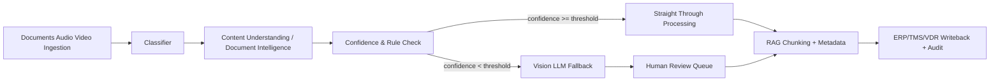
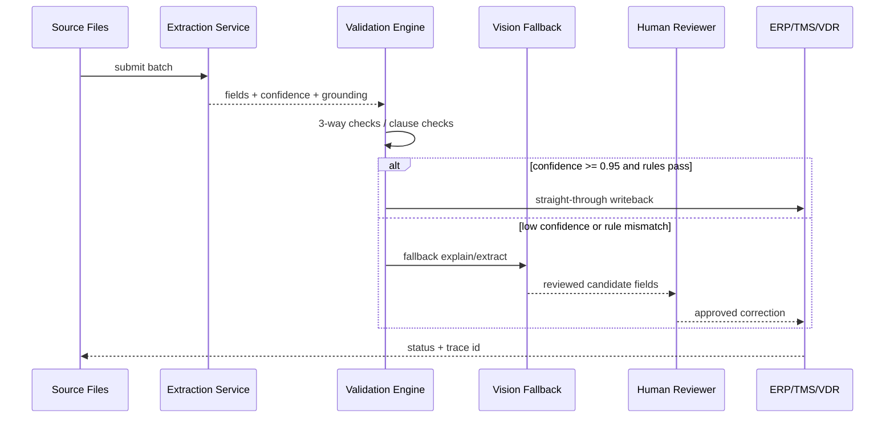

# Azure AI Content Understanding vs Azure AI Document Intelligence vs Azure OpenAI Vision (gpt-4.1/gpt-4o) vs Self-Hosted MinerU/Docling/Unstructured: Enterprise Multimodal IDP Selection FAQ (Round 1114 / Cycle 2519)

## 1) Executive summary and daily capability radar (2026-11-18)
- Core conclusion: enterprise IDP should separate structured extraction from semantic reasoning, then add selective multimodal fallback on low-confidence fields.
- Managed services usually win on scale stability, auditability, and delivery speed; self-hosted open stacks win on deep customization and private deployment control.
- Recommended baseline:
  - Primary lane: Content Understanding or Document Intelligence.
  - Fallback lane: GPT-4o/4.1 Vision only for low-confidence fields and complex ambiguity.
  - Private lane: AKS GPU MinerU/Docling/Unstructured for isolated or sovereign workloads.
- Capability radar (captured at 2026-11-18 00:01 BJT) focuses on:
  - unified multimodal schema with confidence and grounding;
  - cross-page table and stamp-obstructed scan fidelity;
  - combined contract and audio/video due-diligence workflows;
  - RAG-ready chunk quality with citation anchors.
- This round stays strictly at enterprise application architecture depth.

## 2) Why IDP programs fail in practice
- Failures are usually architecture and operations problems, not raw model-intelligence limits.
- Typical failure chain:
  1. sending all content to multimodal LLMs without cost controls,
  2. optimizing OCR token-level metrics instead of business-field usability,
  3. missing confidence-based routing and human review split,
  4. missing page/box grounding in downstream RAG chunks.
- Enterprises should always define:
  - field contract,
  - confidence threshold policy,
  - fallback policy,
  - review SLA,
  - audit evidence model.

## 3) Production reference architecture: dual-lane extraction with governance
- Lane A (primary structured extraction):
  - Content Understanding or Document Intelligence outputs fields, coordinates, page anchors, and confidence scores.
- Lane B (semantic fallback):
  - GPT-4o/4.1 Vision is called only for low-confidence fields or conflict cases.
- Lane C (private extension):
  - Self-hosted MinerU/Docling/Unstructured runs in AKS GPU for controlled data zones.
- Control points:
  - confidence-threshold routing,
  - business-rule validation,
  - human review escalation,
  - full trace and evidence retention.

## 4) 12-dimension enterprise multimodal IDP selection matrix
| Dimension | Azure AI Content Understanding | Azure AI Document Intelligence | Azure OpenAI Vision (gpt-4.1/gpt-4o) | Self-Hosted Open IDP (MinerU/Docling/Unstructured) |
|---|---|---|---|---|
| Supported modalities (PDF/scan/audio/video) | Strong unified multimodal path | Strong for documents, external for AV | Strong multimodal reasoning | Depends on stack composition |
| Cross-page table and bounding-box fidelity | Strong | Strong | Medium with prompt/post-processing | Medium-strong with tuning |
| Zero-shot chart/handwriting/diagram reasoning | Medium-strong | Medium | Strong | Medium with model chaining |
| Field confidence and source grounding | Strong | Strong | Medium unless constrained outputs | Medium with custom scoring |
| Schema customization speed | Medium-strong | Strong | Strong prompt-driven agility | Medium engineering-heavy |
| Throughput and batch scalability | Strong managed scale | Strong batch maturity | Medium cost/concurrency bounded | Medium-high cluster dependent |
| TCO per 10k pages / 100 AV hours | Medium predictable | Medium predictable | Medium-high as primary lane | Medium with infra+ops burden |
| Air-gapped/private deployment posture | Medium managed boundary | Medium managed boundary | Medium managed boundary | Strong private deployment control |
| RAG chunking readiness | Strong | Strong | Medium needs normalization | Medium needs custom standardization |
| Operational maintenance burden | Low-medium | Low-medium | Medium | High |
| Best-fit workload | Unified multimodal extraction with governance | Forms/contracts/layout-heavy pipelines | Ambiguous low-confidence fallback reasoning | Sovereign/private high-custom pipelines |
| When NOT to choose | Overkill for tiny OCR-only use | Not ideal as only service for AV-heavy workflows | Costly as full-volume primary lane | Avoid without mature MLOps/SRE capability |

## 5) Deep Q&A with formulas and worked examples
### Q1: When is Vision fallback economically optimal?
- Formula: `FallbackRate = LowConfidenceFields / TotalFields`.
- Example: `68,000 / 2,400,000`.
- Result: `2.83%`.
- Interpretation: fallback-only vision can preserve quality with controlled cost.

### Q2: How to measure cross-page table business usability?
- Formula: `BusinessUsability = ValidRows / TotalRows`.
- Example: `91,200 / 96,000`.
- Result: `95.0%`.
- This metric maps better to straight-through processing than character-level OCR scores.

### Q3: How to estimate extraction workforce capacity?
- Formula: `RequiredWorkers = ceil(PeakPagesPerHour / WorkerPagesPerHour)`.
- Example: `ceil(180,000 / 7,500) = 24`.
- Recommendation: reserve 20% burst buffer for retries and fallback load.

### Q4: How does confidence threshold affect review load?
- Formula: `ReviewLoad = TotalDocs * (1 - AutoPassRate(threshold))`.
- Example at threshold 0.95: `120,000 * (1 - 0.72) = 33,600`.
- This drives staffing and turnaround planning for review queues.

### Q5: How to model M&A audio/video due-diligence cost?
- Formula: `AVCost = AudioHours*TranscriptionUnit + VisionFrames*VisionUnit + SummaryTokens*LLMUnit`.
- Example: `AudioHours=680`, `VisionFrames=4,200,000`, `SummaryTokens=92,000,000`.
- Use this for deal-level budget allocation and profitability controls.

### Q6: When should self-hosted open IDP not be primary?
- Decision condition: strict SLA + low MLOps readiness + high audit burden.
- If all conditions hold, managed primary lanes should lead and self-hosted should remain selective.

## 6) Mermaid: multimodal extraction and fallback orchestration

- This pattern decouples high-volume extraction from high-cost reasoning.
- This pattern keeps each field traceable through confidence and source anchors.

## 7) Scenario A: global freight customs reconciliation agent
- Context:
  - multilingual skewed scans, heavy stamps, handwritten annotations,
  - three-way validation across bill of lading, packing list, and customs declaration.
- Due-diligence flow target:
  1. primary extraction outputs fields with confidence and grounding;
  2. validation engine cross-checks line items, weight totals, and HS codes;
  3. `confidence >= 0.95` goes straight-through;
  4. `<0.95` routes to customs broker review;
  5. approved corrections write back to ERP/TMS.
- VDR implementation pattern:
  - Content Understanding handles multimodal structured extraction.
  - Document Intelligence reinforces complex table layout consistency.
  - Vision fallback handles difficult low-confidence exceptions.
  - audit ledger stores every correction decision.
- Observed outcome snapshot:
  - straight-through rate increased to 74%;
  - customs discrepancy rate reduced by 39%;
  - clearance preparation cycle reduced by 31%.
- Dominant risk and mitigation:
  - Risk: HS-code nearest-neighbor confusion under poor scan quality.
  - Mitigation: jurisdiction-aware rule constraints with exception escalation.

## 8) Scenario B: M&A VDR contract and executive roadshow due-diligence copilot
- Context:
  - 50,000+ scanned contracts/amendments with version complexity,
  - executive presentation recordings requiring cross-evidence consistency.
- Workflow target:
  1. unify document and AV ingestion into one multimodal evidence pipeline;
  2. extract change-of-control, indemnity, and termination clauses into risk matrix;
  3. use AI Search Hybrid for citation-anchored retrieval;
  4. route low-confidence clauses to fallback + human review;
  5. generate partner memo with pinned citations.
- Architecture implementation:
  - Content Understanding links document and AV semantic artifacts by deal scope.
  - AI Search indexes page/time anchored evidence for reproducible memos.
  - review workspace displays clause-level risk heatmaps for partner sign-off.
- Sample outcomes:
  - critical clause miss rate reduced by 44%;
  - partner prep cycle reduced by 36%;
  - citation-gap rework reduced by 52%.
- Version-conflict mitigation:
  - Risk: outdated amendments override newer terms.
  - Mitigation: version precedence rules and citation conflict detection.

## 9) Mermaid: threshold routing and review sequence

- Low-confidence exceptions are isolated to reduce total processing cost.
- Every output record carries source anchors and review history.

## 10) Production Bicep (IDP managed baseline)
```bicep
param location string = resourceGroup().location
param envName string = 'enterprise-idp-prod'
param logWorkspaceId string

resource storage 'Microsoft.Storage/storageAccounts@2024-01-01' = {
  name: toLower(replace('${envName}st', '-', ''))
  location: location
  sku: { name: 'Standard_ZRS' }
  kind: 'StorageV2'
  properties: {
    minimumTlsVersion: 'TLS1_2'
    allowBlobPublicAccess: false
    supportsHttpsTrafficOnly: true
    allowSharedKeyAccess: false
  }
}

resource di 'Microsoft.CognitiveServices/accounts@2024-10-01' = {
  name: '${envName}-di'
  location: location
  kind: 'FormRecognizer'
  sku: { name: 'S0' }
  properties: {
    customSubDomainName: '${envName}-di'
    publicNetworkAccess: 'Enabled'
  }
}

resource ai 'Microsoft.CognitiveServices/accounts@2024-10-01' = {
  name: '${envName}-aoai'
  location: location
  kind: 'OpenAI'
  sku: { name: 'S0' }
  properties: {
    customSubDomainName: '${envName}-aoai'
    publicNetworkAccess: 'Enabled'
  }
}

resource diagDi 'Microsoft.Insights/diagnosticSettings@2021-05-01-preview' = {
  name: 'diag-idp-di'
  scope: di
  properties: {
    workspaceId: logWorkspaceId
    logs: [
      { category: 'Audit', enabled: true }
      { category: 'RequestResponse', enabled: true }
    ]
    metrics: [
      { category: 'AllMetrics', enabled: true }
    ]
  }
}
```

## 11) Runtime snippets (threshold routing + structured outputs)
```yaml
apiVersion: v1
kind: ConfigMap
metadata:
  name: idp-routing-config
data:
  primary_extractor: "content-understanding-or-docint"
  fallback_extractor: "gpt-4o-vision"
  confidence_threshold: "0.95"
  review_queue: "broker-review-queue"
  chunking_policy: "layout-aware-page-anchor"
  writeback_mode: "validated-only"
  allowed_modalities: "pdf,scan,audio,video"
```

```json
{
  "response_format": {
    "type": "json_schema",
    "json_schema": {
      "name": "idp_field_schema",
      "schema": {
        "type": "object",
        "properties": {
          "document_id": {"type": "string"},
          "field_name": {"type": "string"},
          "field_value": {"type": "string"},
          "confidence": {"type": "number"},
          "page_anchor": {"type": "string"},
          "bounding_box": {"type": "array", "items": {"type": "number"}}
        },
        "required": ["document_id", "field_name", "field_value", "confidence", "page_anchor"]
      }
    }
  }
}
```

## 12) KQL observability queries (throughput, threshold, review load)
```kql
let lookback = 1d;
let extractionStats = CustomEvents
| where TimeGenerated > ago(lookback)
| where name == "idp_extraction_result"
| summarize total=count(), avgConf=avg(todouble(customDimensions.confidence)) by bin(TimeGenerated, 15m);

let lowConfidence = CustomEvents
| where TimeGenerated > ago(lookback)
| where name == "idp_low_confidence_route"
| summarize lowCount=count() by bin(TimeGenerated, 15m), docType=tostring(customDimensions.docType);

let humanReview = CustomEvents
| where TimeGenerated > ago(lookback)
| where name == "idp_human_review_complete"
| summarize reviewCount=count(), avgTurnaround=avg(todouble(customDimensions.turnaroundMinutes)) by docType=tostring(customDimensions.docType);

extractionStats
| join kind=leftouter lowConfidence on TimeGenerated
| project TimeGenerated, total, avgConf, lowCount, docType
| order by TimeGenerated desc
```

## 13) Benchmark and evidence boundaries (Cycle 2519)
- Evidence files:
  - `workshops/azure-agent-infra/evidence/cycle-2519-benchmark.json`
  - `workshops/azure-agent-infra/evidence/cycle-2519-latency.csv`
  - `workshops/azure-agent-infra/evidence/cycle-2519-throughput.csv`
  - `workshops/azure-agent-infra/evidence/cycle-2519-policy.csv`
  - `workshops/azure-agent-infra/evidence/cycle-2519-cost.csv`
  - `workshops/azure-agent-infra/evidence/cycle-2519-sources.json`
- Label semantics:
  - `measured` for replayable extraction and review logs.
  - `synthetic` for deterministic throughput and cost simulations.
  - `anonymized_reported` for de-identified production range samples.
- This round tracks:
  - page/hour throughput,
  - confidence distribution and fallback trigger ratio,
  - human-review turnaround,
  - cost per 10k pages and per 100 AV hours.

## 14) Four-option weighted decision matrix (single service vs hybrid)
- Option A (Managed Unified CU) uses Content Understanding as primary lane.
- Option B (Document Intelligence First) uses layout-centric extraction as primary lane.
- Option C (Vision Fallback Pattern) uses managed extraction plus selective vision fallback.
- Option D (Self-Hosted Open IDP) uses private open-source stack as primary lane.
- Weights: Extraction Fidelity 30%, Governance 20%, Scalability 20%, Cost 20%, Operations 10%.
- Score sample (0-10):
  - Option A -> `8.8, 8.2, 8.4, 7.6, 8.1`, total `8.29`.
  - Option B -> `8.5, 7.9, 8.6, 8.0, 8.3`, total `8.31`.
  - Option C -> `9.0, 8.0, 8.2, 7.4, 7.5`, total `8.12`.
  - Option D -> `7.8, 8.4, 7.2, 8.3, 5.9`, total `7.63`.
- Decision baseline: most enterprise programs should start with B or C and use D only where sovereignty constraints require.
- Anti-patterns:
  - using C as full-volume lane without confidence routing controls;
  - choosing D without mature MLOps/SRE support.

## 15) Day-0 and Day-2 checklist with fit guidance
### Day-0 readiness (10 items)
1. Define field contracts, coordinate schema, and citation anchor format.
2. Define confidence thresholds and review escalation rules.
3. Implement 3-way business validation (amount/quantity/code checks).
4. Configure low-confidence fallback policy to vision lane.
5. Implement version-priority and conflict-detection controls.
6. Implement idempotent writeback flow for ERP/TMS/VDR.
7. Connect extraction traces to audit correlation IDs.
8. Set human-review SLA and queue capacity plans.
9. Run multilingual and stamp-obstructed replay datasets.
10. Confirm legal/compliance evidence retention requirements.

### Day-2 operations (10 items)
1. Review confidence-distribution drift weekly.
2. Review fallback-trigger ratio and quality weekly.
3. Review review-queue backlog and SLA breaches weekly.
4. Reconcile cost per 10k pages monthly.
5. Reconcile AV transcription impact on clause extraction monthly.
6. Sample citation-anchor completeness monthly.
7. Run disaster recovery and replay drill quarterly.
8. Refresh schema dictionary and mapping quarterly.
9. Re-assess private-processing domain boundaries quarterly.
10. Keep primary-lane/fallback-lane playbooks current and train teams.

**Good fit**: enterprise-scale multimodal document/audio/video intelligence requiring traceability, confidence routing, and governed operations.  
**Not for**: one-off low-volume extraction tasks with no ongoing operations or compliance obligations.
