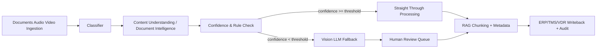
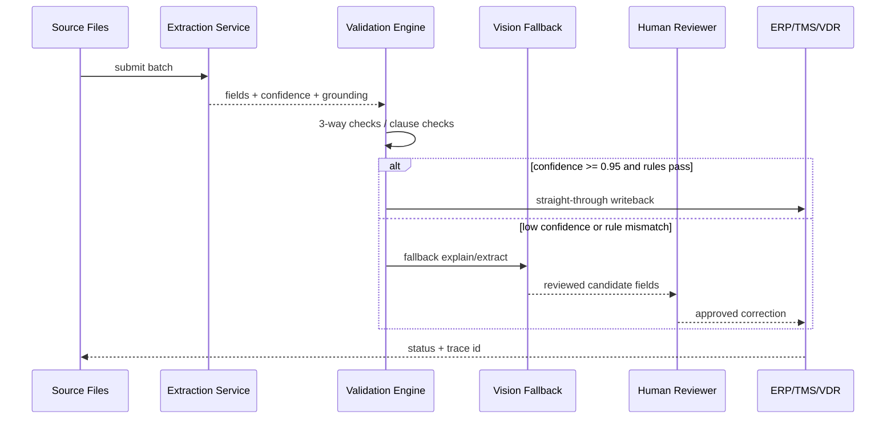

# Azure AI Content Understanding vs Azure AI Document Intelligence vs Azure OpenAI Vision（gpt-4.1/gpt-4o）vs 自建 MinerU/Docling/Unstructured：企业多模态文档与音视频智能（IDP）选型 FAQ（Round 1114 / Cycle 2519）

## 1) 执行摘要与当日能力雷达（2026-11-18）
- 本轮结论：企业级 IDP 不应把“识别”和“推理”混为一步，而应采用“结构化提取主通道 + 多模态 LLM 低置信回退通道”。
- 管理型服务在规模、稳定性、审计和交付速度上明显占优；自建开源栈在可定制与私有化边界上有优势，但运维负担更重。
- 推荐基线：
  - 主通道：Content Understanding 或 Document Intelligence。
  - 回退通道：仅对低置信字段调用 GPT-4o/4.1 Vision 进行补抽取与语义校验。
  - 私有化补位：对超敏数据域可引入 AKS GPU 自建 MinerU/Docling 流水线。
- 当日能力雷达（抓取时间：2026-11-18 00:01 BJT）聚焦：
  - 多模态统一 schema + 字段置信度 + grounding 需求持续增强；
  - 复杂跨页表格、印章遮挡、手写批注在国际贸易和法律场景成为主难点；
  - 音视频与文档联合审查（合同 + 路演录音）成为高价值场景；
  - RAG 下游对“可溯源分块质量”要求高于单次 OCR 准确率。
- 本轮仅讨论企业应用架构与交付治理，不涉及底层硬件/驱动优化。

## 2) 问题分解：IDP 项目失败常见根因
- 根因并非“模型不够强”，而是输入质量、字段定义、置信策略和人工复核机制失配。
- 典型失败路径：
  1. 直接把全部文档交给视觉大模型，成本不可控且溯源不足。
  2. 只看字符识别准确率，不看字段级置信度和业务可用率。
  3. 没有低置信回退与人工复核分流，错误直接写入核心系统。
  4. 下游 RAG 分块没有携带坐标和页码，导致引用不可审计。
- 因此企业应先设计“字段契约 + 置信阈值 + 回退路径 + 审计证据”四件套。

## 3) 生产参考架构：双通道提取与审计闭环
- 通道 A（结构化提取主通道）：
  - Content Understanding 或 Document Intelligence 输出字段、坐标、页码、置信度。
- 通道 B（语义补偿回退通道）：
  - 对低置信字段调用 GPT-4o/4.1 Vision 做二次解释和一致性验证。
- 通道 C（私有化补位）：
  - AKS GPU 上 MinerU/Docling/Unstructured 用于特殊文档或合规隔离域。
- 关键控制点：
  - 置信阈值路由；
  - 业务校验规则（例如金额、税号、HS code、日期逻辑）；
  - 人工复核触发器；
  - 全链路引用和证据落库。

## 4) 12 维企业多模态 IDP 选型矩阵
| 维度 | Azure AI Content Understanding | Azure AI Document Intelligence | Azure OpenAI Vision（gpt-4.1/gpt-4o） | 自建开源 IDP（MinerU/Docling/Unstructured） |
|---|---|---|---|---|
| 支持模态（PDF/扫描/音频/视频） | 强，统一多模态 schema | 强（文档为主，音视频需外接） | 强（多模态理解能力高） | 取决于组件组合，通常文档强于音视频 |
| 跨页复杂表格与框坐标保真度 | 强，面向结构化字段 | 强，布局提取成熟 | 中，需提示工程与后处理 | 中到强，依赖模型与后处理链 |
| 图表/手写/示意图零样本推理 | 中强 | 中 | 强 | 中，需定制模型组合 |
| 字段级置信度与来源定位 | 强（confidence + grounding） | 强（字段置信度成熟） | 中（需结构化输出约束） | 中（需自建评分策略） |
| Schema 定制速度 | 中强 | 强（预构建 + 自定义） | 强（提示驱动快） | 中（需工程化） |
| 吞吐与批处理扩展 | 强，托管扩展能力好 | 强，批量处理成熟 | 中，成本与并发限制明显 | 中高，取决于集群规模 |
| 每 10k 页 / 每 100 小时成本 | 中，可控 | 中，可控 | 中高，回退使用更经济 | 中，算力与运维叠加 |
| 私有化/隔离部署姿态 | 中（托管边界） | 中（托管边界） | 中（托管边界） | 强（可私有化） |
| 下游 RAG 分块就绪度 | 强，结构化输出友好 | 强，布局输出友好 | 中，需二次切块规范化 | 中，需自建标准化层 |
| 运维维护负担 | 低到中 | 低到中 | 中 | 高 |
| 最佳适配工作负载 | 多模态统一抽取与审计 | 合同/票据/表单文档流水线 | 复杂语义补抽取与解释 | 高定制、私有化与离线批处理 |
| When NOT to choose | 仅做轻量 OCR 时可能过重 | 音视频为主场景不宜单独使用 | 大规模全量主通道成本高 | 缺 MLOps/SRE 能力团队慎用 |

## 5) 深度问答：公式与数值样例
### Q1：何时触发 Vision 回退最经济？
- 公式：`FallbackRate = LowConfidenceFields / TotalFields`。
- 样例：`LowConfidenceFields=68,000`，`TotalFields=2,400,000`。
- 计算：`2.83%`。
- 结论：将 Vision 用于低置信字段回退可显著降低总体成本。

### Q2：跨页表格业务可用率如何衡量？
- 公式：`BusinessUsability = ValidRows / TotalRows`。
- 样例：`ValidRows=91,200`，`TotalRows=96,000`。
- 计算：`95.0%`。
- 用法：直接对应“可直通入库”的业务指标，而非字符级准确率。

### Q3：吞吐容量如何估算？
- 公式：`RequiredWorkers = ceil(PeakPagesPerHour / WorkerPagesPerHour)`。
- 样例：`PeakPagesPerHour=180,000`，`WorkerPagesPerHour=7,500`。
- 计算：`24` 个处理单元。
- 建议：再预留 20% 缓冲用于重试与回退任务。

### Q4：置信阈值对人工复核量影响如何量化？
- 公式：`ReviewLoad = TotalDocs * (1 - AutoPassRate(threshold))`。
- 样例：阈值 0.95 时 `AutoPassRate=0.72`，`TotalDocs=120,000`。
- 计算：`33,600` 份进入人工复核。
- 说明：阈值需在风险与人力成本间平衡。

### Q5：M&A 音视频转录+摘要成本如何估？
- 公式：`AVCost = AudioHours*TranscriptionUnit + VisionFrames*VisionUnit + SummaryTokens*LLMUnit`。
- 样例：`AudioHours=680`，`VisionFrames=4,200,000`，`SummaryTokens=92,000,000`。
- 结果：可按部门和项目拆分核算，支持 deal-level 成本跟踪。

### Q6：何时不建议自建开源 IDP 作为主路径？
- 判定条件：`SLA严格` 且 `团队缺乏MLOps` 且 `合规审计要求高`。
- 若三项同时满足，优先托管服务，开源栈仅作为补位或离线处理。

## 6) Mermaid：多模态提取与回退编排

- 该拓扑把“智能提取”和“风险控制”解耦，提升可控性。
- 该拓扑确保每个字段都有可追溯来源与处理轨迹。

## 7) 场景 A：跨国航运清关核单 Agent（提单/装箱单/报关单）
- 业务难点：
  - 多语言、倾斜扫描、盖章遮挡、手写批注混杂；
  - 同一票货物需做 3-way 校验：line item、重量、HS code。
- 目标流程：
  1. 文档主抽取输出字段与置信度；
  2. 业务规则引擎做三方一致性校验；
  3. `confidence >= 0.95` 自动直通；
  4. `<0.95` 进入报关行人工复核；
  5. 结果回写 ERP/TMS。
- 参考架构：
  - Content Understanding 负责多模态结构化提取；
  - Document Intelligence 处理复杂表格布局；
  - Vision 回退专注低置信异常字段解释；
  - 审计账本记录每次纠偏动作。
- 样例收益：
  - 自动直通率提升至 74%；
  - 报关差错率下降 39%；
  - 平均清关准备时长缩短 31%。
- 风险与对策：
  - 风险：HS code 近似项误匹配；
  - 对策：规则引擎加入国家/品类白名单与异常上浮审查。

## 8) 场景 B：律所 M&A VDR 合同 + 路演音视频尽调助手
- 业务难点：
  - 50,000+ 扫描合同与补充协议版本复杂；
  - 高管路演录音/视频需要与合同条款交叉审查；
  - 需输出可引用、可追责的 partner memo。
- 目标流程：
  1. 文档与音视频统一进入多模态管道；
  2. 抽取 Change-of-Control、赔偿、终止条款并构建风险矩阵；
  3. AI Search Hybrid 负责证据检索与引用固定；
  4. 低置信条款由 Vision 和人工复核补证；
  5. 最终生成带引用锚点的尽调摘要。
- 参考架构：
  - Content Understanding 聚合同一 deal 的文档与音视频语义片段；
  - AI Search 维护页码级与时间戳级引用索引；
  - 审核工作台提供 clause-level 风险热力图。
- 样例收益：
  - 关键条款漏检率下降 44%；
  - 合伙人审阅准备时间下降 36%；
  - 引用缺失导致的返工下降 52%。
- 风险与对策：
  - 风险：旧版本补充协议覆盖新版本条款；
  - 对策：版本优先级规则 + 引用冲突检测 + 人工确认。

## 9) Mermaid：阈值路由与人工复核时序

- 时序要点：回退和人工复核只作用于高风险部分，避免全量高成本。
- 时序要点：每个字段记录来源、置信度、复核动作。

## 10) 生产级 Bicep（文档智能 + 存储 + 诊断）
```bicep
param location string = resourceGroup().location
param envName string = 'enterprise-idp-prod'
param logWorkspaceId string

resource storage 'Microsoft.Storage/storageAccounts@2024-01-01' = {
  name: toLower(replace('${envName}st', '-', ''))
  location: location
  sku: { name: 'Standard_ZRS' }
  kind: 'StorageV2'
  properties: {
    minimumTlsVersion: 'TLS1_2'
    allowBlobPublicAccess: false
    supportsHttpsTrafficOnly: true
    allowSharedKeyAccess: false
  }
}

resource di 'Microsoft.CognitiveServices/accounts@2024-10-01' = {
  name: '${envName}-di'
  location: location
  kind: 'FormRecognizer'
  sku: { name: 'S0' }
  properties: {
    customSubDomainName: '${envName}-di'
    publicNetworkAccess: 'Enabled'
  }
}

resource ai 'Microsoft.CognitiveServices/accounts@2024-10-01' = {
  name: '${envName}-aoai'
  location: location
  kind: 'OpenAI'
  sku: { name: 'S0' }
  properties: {
    customSubDomainName: '${envName}-aoai'
    publicNetworkAccess: 'Enabled'
  }
}

resource diagDi 'Microsoft.Insights/diagnosticSettings@2021-05-01-preview' = {
  name: 'diag-idp-di'
  scope: di
  properties: {
    workspaceId: logWorkspaceId
    logs: [
      { category: 'Audit', enabled: true }
      { category: 'RequestResponse', enabled: true }
    ]
    metrics: [
      { category: 'AllMetrics', enabled: true }
    ]
  }
}
```

## 11) 运行配置片段（阈值路由 + 结构化输出）
```yaml
apiVersion: v1
kind: ConfigMap
metadata:
  name: idp-routing-config
data:
  primary_extractor: "content-understanding-or-docint"
  fallback_extractor: "gpt-4o-vision"
  confidence_threshold: "0.95"
  review_queue: "broker-review-queue"
  chunking_policy: "layout-aware-page-anchor"
  writeback_mode: "validated-only"
  allowed_modalities: "pdf,scan,audio,video"
```

```json
{
  "response_format": {
    "type": "json_schema",
    "json_schema": {
      "name": "idp_field_schema",
      "schema": {
        "type": "object",
        "properties": {
          "document_id": {"type": "string"},
          "field_name": {"type": "string"},
          "field_value": {"type": "string"},
          "confidence": {"type": "number"},
          "page_anchor": {"type": "string"},
          "bounding_box": {"type": "array", "items": {"type": "number"}}
        },
        "required": ["document_id", "field_name", "field_value", "confidence", "page_anchor"]
      }
    }
  }
}
```

## 12) KQL 观测查询（吞吐、阈值命中、人工复核）
```kql
let lookback = 1d;
let extractionStats = CustomEvents
| where TimeGenerated > ago(lookback)
| where name == "idp_extraction_result"
| summarize total=count(), avgConf=avg(todouble(customDimensions.confidence)) by bin(TimeGenerated, 15m);

let lowConfidence = CustomEvents
| where TimeGenerated > ago(lookback)
| where name == "idp_low_confidence_route"
| summarize lowCount=count() by bin(TimeGenerated, 15m), docType=tostring(customDimensions.docType);

let humanReview = CustomEvents
| where TimeGenerated > ago(lookback)
| where name == "idp_human_review_complete"
| summarize reviewCount=count(), avgTurnaround=avg(todouble(customDimensions.turnaroundMinutes)) by docType=tostring(customDimensions.docType);

extractionStats
| join kind=leftouter lowConfidence on TimeGenerated
| project TimeGenerated, total, avgConf, lowCount, docType
| order by TimeGenerated desc
```

## 13) 基准与证据（Cycle 2519）
- 证据文件：
  - `workshops/azure-agent-infra/evidence/cycle-2519-benchmark.json`
  - `workshops/azure-agent-infra/evidence/cycle-2519-latency.csv`
  - `workshops/azure-agent-infra/evidence/cycle-2519-throughput.csv`
  - `workshops/azure-agent-infra/evidence/cycle-2519-policy.csv`
  - `workshops/azure-agent-infra/evidence/cycle-2519-cost.csv`
  - `workshops/azure-agent-infra/evidence/cycle-2519-sources.json`
- 标签定义：
  - `measured`：重放任务与人工复核日志；
  - `synthetic`：按固定公式估算批处理成本；
  - `anonymized_reported`：脱敏生产样本区间。
- 本轮指标：
  - 每页/每小时吞吐；
  - 字段级置信度分布；
  - 回退触发率；
  - 人工复核周转时间；
  - 每 10k 页与每 100 小时总成本。

## 14) 四方案加权决策矩阵（单服务 vs 混合）
- 方案 A（Managed Unified CU）：以 Content Understanding 为主。
- 方案 B（Document Intelligence First）：以布局提取与预构建模型为主。
- 方案 C（Vision Fallback Pattern）：托管提取 + Vision 低置信回退。
- 方案 D（Self-Hosted Open IDP）：私有化开源栈为主。
- 权重：Extraction Fidelity 30%、Governance 20%、Scalability 20%、Cost 20%、Ops 10%。
- 样例评分（0-10）：
  - 方案 A：`8.8, 8.2, 8.4, 7.6, 8.1`，总分 `8.29`。
  - 方案 B：`8.5, 7.9, 8.6, 8.0, 8.3`，总分 `8.31`。
  - 方案 C：`9.0, 8.0, 8.2, 7.4, 7.5`，总分 `8.12`。
  - 方案 D：`7.8, 8.4, 7.2, 8.3, 5.9`，总分 `7.63`。
- 结论：大多数企业生产优先 B 或 C；D 适合强私有化约束组织。
- 反模式：
  - 用 C 做全量主通道导致成本爆炸；
  - 无 MLOps 能力却直接采用 D 作为核心链路。

## 15) Day-0 / Day-2 清单与 Good Fit
### Day-0（上线前 10 项）
1. 定义字段契约、坐标规范与引用锚点格式。
2. 确定置信阈值与人工复核升级规则。
3. 完成 3-way 业务校验规则（金额/数量/编码）。
4. 配置低置信字段 Vision 回退策略。
5. 建立文档版本优先级与冲突检测规则。
6. 打通 ERP/TMS/VDR 写回幂等机制。
7. 建立抽取链路 trace id 与审计映射。
8. 建立人工复核 SLA 与队列容量计划。
9. 完成多语种和盖章遮挡样本回放测试。
10. 与法务/合规确认证据保留策略。

### Day-2（运营期 10 项）
1. 每周复核字段置信度分布漂移。
2. 每周复核回退触发率与回退质量。
3. 每周复核人工复核积压与 SLA 违约。
4. 每月复核每 10k 页处理成本和预算偏差。
5. 每月复核音视频转录误差对条款识别影响。
6. 每月抽检引用锚点完整性与可追溯性。
7. 每季度执行一次灾备与回放演练。
8. 每季度更新文档 schema 与字段字典。
9. 每季度评估是否需要扩大私有化处理域。
10. 持续维护“主通道+回退通道”决策树并培训团队。

**Good fit**：大规模企业文档与音视频智能处理，且要求可审计、可回退、可分层治理。  
**Not for**：少量一次性文档处理且无持续运营需求的临时项目。
