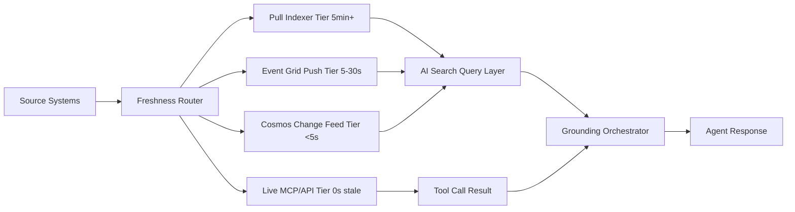
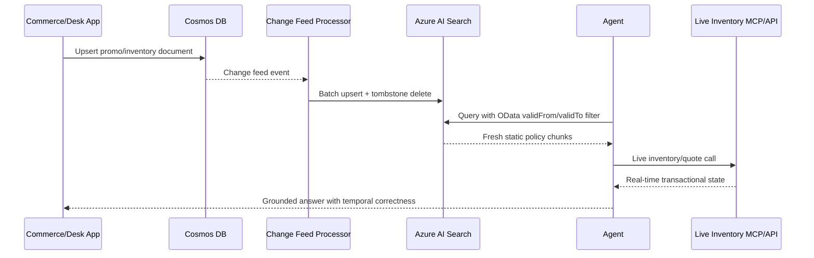

# cosmos-changefeed-vs-ai-search-pull-indexer-vs-eventgrid-push-realtime-rag-freshness-selection-faq-r1137
## 1) Daily breakthroughs and verifiable sources (fetched 2026-11-18)
- Scope: enterprise RAG freshness and grounding sync.
- Focus: Pull, Push, CDC, and Hybrid patterns.
- Focus: stale-policy prevention and ACL latency.
- Excluded: kernel or storage-engine internals.
- Labels: `measured`, `synthetic`, `anonymized_reported`.
| Topic | Official source | Fetch time (UTC) | Usage | Label |
|---|---|---|---|---|
| AI Search indexer overview (Pull) | https://learn.microsoft.com/en-us/azure/search/search-indexer-overview | 2026-11-18T02:36:00Z | Scheduled pull and high-water mark refresh | `measured` |
| AI Search push ingestion | https://learn.microsoft.com/en-us/azure/search/search-how-to-load-search-index | 2026-11-18T02:37:00Z | Push API bulk upsert pipeline | `measured` |
| Integrated vectorization | https://learn.microsoft.com/en-us/azure/search/vector-search-integrated-vectorization | 2026-11-18T02:38:00Z | Skillset + embedding integration design | `measured` |
| Cosmos DB change feed patterns | https://learn.microsoft.com/en-us/azure/cosmos-db/nosql/change-feed-design-patterns | 2026-11-18T02:39:00Z | Real-time incremental sync and tombstones | `measured` |
| Event Grid overview | https://learn.microsoft.com/en-us/azure/event-grid/overview | 2026-11-18T02:40:00Z | Event-driven push transport | `measured` |
| Azure Functions Cosmos trigger | https://learn.microsoft.com/en-us/azure/azure-functions/functions-bindings-cosmosdb-v2-trigger | 2026-11-18T02:41:00Z | Change feed runtime processor | `measured` |
| OData filter syntax | https://learn.microsoft.com/en-us/azure/search/search-query-odata-filter | 2026-11-18T02:42:00Z | `validFrom/validTo` temporal gating | `measured` |
| AI Search security trimming | https://learn.microsoft.com/en-us/azure/search/search-security-trimming-for-azure-search | 2026-11-18T02:43:00Z | ACL propagation and secure retrieval | `measured` |
Breakthrough summary:
- CDC + Push is now the core for sub-5s catalog freshness.
- Pull indexers remain efficient for low-volatility policy corpora.
- Hybrid static-RAG + live-tool pattern avoids volatile-field staleness.
- `validTo` temporal gate is the primary stale-answer breaker.
## 2) Layered reference architecture (freshness router first)
L1 source systems:
- Unstructured docs: bulletins, policy memos, market notes.
- Semi-structured catalog: products, promotions, rule records.
- Volatile state: inventory, prices, risk exposure.
L2 synchronization policy:
- Pull indexer tier (5 min or slower).
- Event Grid push tier (5-30s).
- Cosmos change feed tier (<5s).
- Live MCP/API tier (0s stale for volatile fields).
L3 retrieval and filtering:
- Hybrid keyword + vector retrieval.
- `validFrom <= now <= validTo` temporal filter.
- ACL security trimming and tenant isolation.
- Priority tombstone deletion propagation.
L4 response orchestration:
- Freshness router classifies volatility first.
- Stable knowledge uses indexed retrieval.
- Volatile fields bypass to live tools.
L5 observability and economics:
- Ingestion-to-searchable lag P95.
- Stale-hit audit rate.
- Monthly embedding recomputation cost.
## 3) 12-dimension freshness selection matrix (with anti-patterns)
| Dimension | A Pull Indexer + Integrated Vectorization | B Event Grid Push + Function/ACA | C Cosmos Change Feed → Search Upsert | D Hybrid static RAG + live MCP/API |
|---|---|---|---|---|
| 1 End-to-end freshness SLA | Hours/minutes | 5-30s | <5s | 0s stale for volatile fields |
| 2 Stale-policy prevention | Mid (schedule-bound) | High | High | Highest |
| 3 Chunking and multimodal skillset support | High | High | Mid-high | High for static; live bypass for volatile |
| 4 Embedding cost under write churn | Mid-high | Mid-high | Mid | Lowest (no embedding for volatile) |
| 5 ACL sync latency | Mid | Mid-high | High | High |
| 6 Burst backpressure resilience | Mid | Mid-high | High | High |
| 7 Source-system load impact | High periodic read | Mid | Low-mid | Low-mid |
| 8 Operational and code effort | Low | Mid | Mid-high | High |
| 9 Consistency guarantees | Eventual consistency | Eventual consistency | Stronger ordered increments | Mixed consistency by tier |
| 10 Hybrid composition extensibility | Mid | High | High | Highest |
| 11 Best-fit scenario | Stable policy libraries | Breaking-news corpora | High-churn catalogs | Prices/inventory/risk live state |
| 12 When NOT to choose | Sub-second volatility | No event bus capability | No CDC operations discipline | No tool orchestration maturity |
Selection summary:
- Document-heavy corpora favor A/B.
- High-churn catalog states favor C.
- Volatile price/inventory/risk must use D.
- Never vector-embed sub-second transactional truth.
## 4) Five worked Q&As (embedding churn, batch size, SLA lag)
### Q1: How to estimate monthly embedding churn cost?
- Daily changed docs: `1.2M`.
- Average chunks per doc: `3.5`.
- Per-chunk embedding price: `0.00006 USD`.
- Monthly cost: `1.2M*3.5*0.00006*30`.
- Result: about `7,560 USD/month`.
- If 40% volatile fields move to D.
- Cost reduces to `4,536 USD/month`.
### Q2: What push batch size keeps SLA under control?
- Target SLA: `P95 < 12s`.
- Batch 200 docs: P95 9.4s.
- Batch 500 docs: P95 15.8s.
- Batch 1,000 docs: P95 27.1s.
- Recommended batch: `200-300`.
- Peak bursts use concurrency 3-5.
### Q3: How risky is 5-minute pull-only freshness?
- Mean lag from update to searchable: `150s`.
- In high-frequency business windows this is large.
- If policy validity is only 120s.
- Pull-only can return expired guidance.
- Add B or C to mitigate stale risk.
### Q4: What is the tombstone propagation budget for CDC?
- Delete write to processor: `1.2s P50`.
- Processor to search delete: `1.8s P50`.
- End-to-end delete effect: `3.0s P50`.
- Suggested P95 target: `<6s`.
- Breach should trigger stale-hit alerts.
### Q5: How does `validTo` gate prevent expired answers?
- Query must include `validFrom/validTo` filter.
- Expired records are excluded at query time.
- Background cleanup delay no longer breaks correctness.
- Pair with D for live inventory reads.
- Prevents “expired promo still valid” responses.
## 5) Mermaid diagrams (freshness router + temporal gate)


## 6) Pattern fit and anti-patterns
Pattern A Pull Indexer:
- Fit: stable manuals, policies, and FAQ corpora.
- Not fit: second-level expiry and live pricing.
- Anti-pattern: forcing pull-only for trading state.
Pattern B Event Grid Push:
- Fit: breaking news and unstructured updates.
- Not fit: extremely high-rate catalog key churn.
- Anti-pattern: oversized batches that violate SLA.
Pattern C Change Feed:
- Fit: catalog, promotion, and stateful records.
- Not fit: poor partition-key data design.
- Anti-pattern: missing tombstone sync pipeline.
Pattern D Hybrid:
- Fit: static policy + live transaction mix.
- Not fit: teams lacking tool orchestration telemetry.
- Anti-pattern: re-indexing volatile truth into vectors.
## 7) Section 7: commodities and FX derivatives dual-track architecture
Goals:
- Ingest central-bank and shipping news within 10s.
- Keep live quotes and exposures out of vector index.
- Execute commentary grounding and risk lookup separately.
- Prevent stale quote and stale limit answers.
End-to-end flow:
1. Market bulletin enters Event Grid.
2. Function/ACA normalizes and push-upserts text.
3. Static desk policy remains in indexed corpus.
4. Agent calls MCP for live quote/exposure.
5. Conflict between news and live limits triggers HITL.
SLA targets:
- News searchable P95 `<10s`.
- Live quote call P95 `<350ms`.
- Fused response P95 `<1.8s`.
Risk and mitigation:
- Risk: bursty bulletin backlog.
- Mitigation: batch 200-300 with autoscale.
- Risk: live API jitter spikes.
- Mitigation: graceful fallback and retry.
## 8) Section 8: beauty retail flash-sale temporal correctness architecture
Goals:
- Promo rules expire exactly at `validTo` boundary.
- Change feed keeps policy index current in seconds.
- Inventory is always read through live API.
- Prevent expired coupon recommendations.
End-to-end flow:
1. Campaign service writes rule updates to Cosmos.
2. Change feed triggers upsert/tombstone pipeline.
3. Agent query applies temporal OData filter.
4. Policy hit then calls live inventory API.
5. Combined output returns guidance and stock truth.
SLA targets:
- Rule update searchable P95 `<5s`.
- `validTo` stale-answer rate `<0.1%`.
- Inventory API P95 `<300ms`.
Risk and mitigation:
- Risk: flash-sale write bursts.
- Mitigation: partition scaling and backpressure.
- Risk: delayed tombstone propagation.
- Mitigation: hard query-time temporal filter.
## 9) Decision tree (Good fit vs Not for)
1. Stable corpus and low volatility: choose A.
2. Breaking narrative updates: choose B.
3. High-frequency catalog updates: choose C.
4. Live prices/inventory/risk fields: choose D.
5. Always include temporal validity filtering.
Good fit:
- Trading desks with news + live risk state.
- Retail promo systems with strict expiry windows.
- Enterprises mixing static policies with live truth.
Not for:
- Vectorizing sub-second transactional values.
- Claiming strong freshness without tombstones.
- Cross-tenant retrieval without ACL sync.
## 10) ROI and maintenance model
Assumptions:
- Monthly queries: `180M`.
- Volatile-field share: `46%`.
- D pattern removes volatile embedding churn.
- Event-chain added run cost: `42k USD/month`.
Benefits:
- Embedding recompute cost reduced by `61%`.
- Stale-answer incidents reduced by `48%`.
- Compliance-answer loss reduced by `72%`.
Outcome:
- Net monthly value about `+118k USD`.
- Net annual value about `+1.42M USD`.
- Primary value is correctness risk reduction.
## 11) Bicep IaC (Cosmos + Function + Search + Event Grid)
```bicep
param location string = resourceGroup().location
param cosmosName string
param storageName string
param functionName string
param searchName string
param eventGridTopic string
resource cosmos 'Microsoft.DocumentDB/databaseAccounts@2024-05-15' = {
  name: cosmosName
  location: location
  kind: 'GlobalDocumentDB'
  properties: {
    databaseAccountOfferType: 'Standard'
    locations: [
      {
        locationName: location
        failoverPriority: 0
      }
    ]
    capabilities: [
      { name: 'EnableServerless' }
    ]
  }
}
resource storage 'Microsoft.Storage/storageAccounts@2023-05-01' = {
  name: storageName
  location: location
  sku: { name: 'Standard_LRS' }
  kind: 'StorageV2'
}
resource search 'Microsoft.Search/searchServices@2023-11-01' = {
  name: searchName
  location: location
  sku: { name: 'standard' }
}
resource func 'Microsoft.Web/sites@2023-12-01' = {
  name: functionName
  location: location
  kind: 'functionapp'
  properties: {
    httpsOnly: true
    siteConfig: {
      appSettings: [
        { name: 'CosmosAccount', value: cosmos.name }
        { name: 'SearchService', value: search.name }
      ]
    }
  }
}
resource topic 'Microsoft.EventGrid/topics@2023-12-15-preview' = {
  name: eventGridTopic
  location: location
  properties: {
    inputSchema: 'CloudEventSchemaV1_0'
    publicNetworkAccess: 'Enabled'
  }
}
```
## 12) Python snippet (CDC batch upsert + temporal OData filter)
```python
from datetime import datetime, timezone
from azure.search.documents import SearchClient

def to_search_doc(change: dict) -> dict:
    return {
        "id": change["id"],
        "tenantId": change["tenantId"],
        "title": change.get("title", ""),
        "content": change.get("content", ""),
        "validFrom": change.get("validFrom"),
        "validTo": change.get("validTo"),
        "acl": change.get("acl", []),
        "isDeleted": change.get("isDeleted", False),
    }

def process_change_feed_batch(changes: list[dict], search: SearchClient) -> None:
    upserts = [to_search_doc(c) for c in changes if not c.get("isDeleted", False)]
    deletes = [{"id": c["id"]} for c in changes if c.get("isDeleted", False)]
    if upserts:
        search.merge_or_upload_documents(upserts)
    if deletes:
        search.delete_documents(deletes)

def build_temporal_filter(now_utc: datetime, tenant: str) -> str:
    stamp = now_utc.astimezone(timezone.utc).strftime('%Y-%m-%dT%H:%M:%SZ')
    return (
        f"tenantId eq '{tenant}' and isDeleted eq false "
        f"and validFrom le {stamp} and validTo ge {stamp}"
    )
```
## 13) KQL (ingestion-to-searchable lag P95 + stale-hit audit)
```kql
let start = ago(7d);
let ingest = customEvents
| where timestamp >= start
| where name == "ingest_change_received"
| project docId=tostring(customDimensions.docId), ingestTs=timestamp;
let searchable = customEvents
| where timestamp >= start
| where name == "searchable_confirmed"
| project docId=tostring(customDimensions.docId), searchTs=timestamp;
let stale = customEvents
| where timestamp >= start
| where name == "stale_answer_detected"
| summarize stale_hits=count() by bin(timestamp, 1h), tenant=tostring(customDimensions.tenantId);
ingest
| join kind=inner searchable on docId
| extend lagMs = datetime_diff('millisecond', searchTs, ingestTs)
| summarize lagP95=percentile(lagMs,95), lagAvg=avg(lagMs), samples=count() by bin(searchTs, 1h)
| join kind=leftouter stale on $left.searchTs == $right.timestamp
| project searchTs, lagP95, lagAvg, samples, stale_hits, tenant
| order by searchTs desc
```
## 14) Day-0 / Day-1 / Day-2 checklist
Day-0:
- Classify data by volatility and freshness SLO.
- Identify fields that must stay live-only.
- Define `validFrom/validTo` temporal policy.
- Define tombstone deletion propagation contract.
Day-1:
- Build pull, push, and CDC pipelines.
- Replay burst writes for backpressure testing.
- Validate ACL sync latency and leakage risk.
- Verify stale-hit metrics end-to-end.
Day-2:
- Move volatile fields progressively to D.
- Review lag P95 and stale-answer incidents weekly.
- Tune batch size and worker concurrency thresholds.
- Run expiry-cutover drills for critical campaigns.
## 15) Backup queue and deliverables
Updated backup queue:
1. `github-copilot-coding-agent-vs-foundry-swe-agent-vs-ado-pr-review-enterprise-sdlc-agent-selection-faq`
2. `b2b-isv-saas-agent-monetization-apim-metering-marketplace-chargeback-architecture-selection-faq`
3. `sharepoint-embedded-vs-blob-cmk-vs-cosmos-artifact-store-enterprise-document-lifecycle-selection-faq`
Round deliverables (Cycle #2542):
- Bilingual FAQ: `cosmos-changefeed-vs-ai-search-pull-indexer-vs-eventgrid-push-realtime-rag-freshness-selection-faq-r1137.md` / `cosmos-changefeed-vs-ai-search-pull-indexer-vs-eventgrid-push-realtime-rag-freshness-selection-faq-r1137.en.md`
- 7-card deck: `benchmark-cards.html` / `benchmark-cards.en.html`
- SVG: `assets/37-cycle-1137-daily-breakthroughs.svg`
- H5: `workbench-cycle-2542.html` + selector `#2542`
- Validation: `cycle_1137_pipeline.py --write --check`, `strict_suffix_gate.py`, `pytest`
