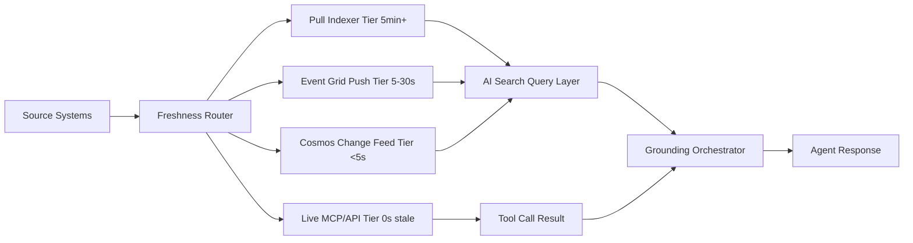
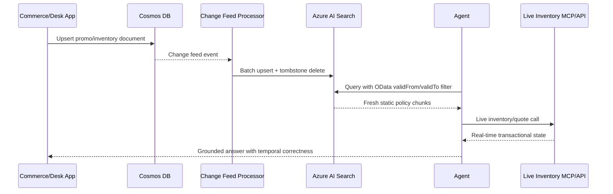

# cosmos-changefeed-vs-ai-search-pull-indexer-vs-eventgrid-push-realtime-rag-freshness-selection-faq-r1137
## 1) 当日热点与可验证来源（2026-11-18 抓取）
- 主题边界：企业 RAG 新鲜度与动态检索同步。
- 关注点：Pull/Push/CDC/Hybrid 四类模式。
- 关注点：过期策略防陈旧、ACL 同步、写入抖动。
- 不讨论：内核、存储引擎、硬件细节。
- 标签：`measured`、`synthetic`、`anonymized_reported`。
| 主题 | 官方来源 | 抓取时间（UTC） | 用途 | 标签 |
|---|---|---|---|---|
| AI Search Indexer 概览（Pull） | https://learn.microsoft.com/en-us/azure/search/search-indexer-overview | 2026-11-18T02:36:00Z | 计划任务拉取与高水位更新 | `measured` |
| AI Search Push 索引写入 | https://learn.microsoft.com/en-us/azure/search/search-how-to-load-search-index | 2026-11-18T02:37:00Z | Push API 批量 upsert | `measured` |
| Integrated Vectorization | https://learn.microsoft.com/en-us/azure/search/vector-search-integrated-vectorization | 2026-11-18T02:38:00Z | 集成向量化与技能链 | `measured` |
| Cosmos DB Change Feed | https://learn.microsoft.com/en-us/azure/cosmos-db/nosql/change-feed-design-patterns | 2026-11-18T02:39:00Z | CDC 实时增量与 tombstone 传播 | `measured` |
| Event Grid 概览 | https://learn.microsoft.com/en-us/azure/event-grid/overview | 2026-11-18T02:40:00Z | 事件驱动推送总线 | `measured` |
| Azure Functions 触发器 | https://learn.microsoft.com/en-us/azure/azure-functions/functions-bindings-cosmosdb-v2-trigger | 2026-11-18T02:41:00Z | Change Feed 处理器运行时 | `measured` |
| OData Filter 语法 | https://learn.microsoft.com/en-us/azure/search/search-query-odata-filter | 2026-11-18T02:42:00Z | `validFrom/validTo` 时间窗过滤 | `measured` |
| AI Search 安全过滤 | https://learn.microsoft.com/en-us/azure/search/search-security-trimming-for-azure-search | 2026-11-18T02:43:00Z | ACL 安全裁剪同步策略 | `measured` |
当日突破摘要：
- CDC+Push 已成为亚 5 秒目录同步主干。
- Pull Indexer 仍适合低频政策文档入库。
- Hybrid“静态 RAG + 实时工具”可实现零陈旧关键字段。
- `validTo` 时间门控是防过期答案核心闸门。
## 2) 分层参考架构（Freshness Router First）
L1 数据源层：
- 非结构化文档：公告、制度、快讯。
- 半结构化目录：商品、优惠、规则。
- 强实时状态：库存、价格、风险敞口。
L2 同步策略层：
- Pull Indexer（5 分钟以上）。
- Event Grid Push（5~30 秒）。
- Cosmos Change Feed（<5 秒）。
- Live MCP/API 工具直查（0 秒陈旧）。
L3 检索与过滤层：
- 向量检索 + 关键词混合召回。
- `validFrom <= now <= validTo`。
- ACL 过滤与租户隔离。
- tombstone 删除优先传播。
L4 响应编排层：
- Freshness Router 先判断数据波动级别。
- 稳态信息走索引检索链路。
- 易变字段走 Live API 工具调用。
L5 可观测与成本层：
- ingestion-to-searchable lag P95。
- stale-hit 命中率审计。
- embedding 重算月度成本看板。
## 3) 12 维新鲜度选型矩阵（含反模式）
| 维度 | A Pull Indexer + Integrated Vectorization | B Event Grid Push + Function/ACA | C Cosmos Change Feed → Search Upsert | D Hybrid 静态RAG + 实时 MCP/API |
|---|---|---|---|---|
| 1 端到端新鲜度 SLA | 小时/分钟级 | 5~30 秒 | <5 秒 | 实时字段 0 秒陈旧 |
| 2 过期策略防陈旧能力 | 中（依赖调度） | 高 | 高 | 最高 |
| 3 chunking 与多模态 skillset | 高 | 高 | 中高 | 静态高、实时旁路 |
| 4 高写入 churn 嵌入重算成本 | 中高 | 中高 | 中 | 最低（易变字段不嵌入） |
| 5 ACL 同步时延 | 中 | 中高 | 高 | 高 |
| 6 突发背压与限流韧性 | 中 | 中高 | 高 | 高 |
| 7 源系统读压影响 | 高（周期拉取） | 中 | 低中 | 低中 |
| 8 运维与代码复杂度 | 低 | 中 | 中高 | 高 |
| 9 一致性保证 | 最终一致 | 最终一致 | 更强顺序增量一致 | 混合一致 |
| 10 混合组合扩展性 | 中 | 高 | 高 | 最高 |
| 11 Best-fit 场景 | 政策库/手册库 | 快讯/公告推送 | 目录/规则高频变更 | 价格库存等极易变字段 |
| 12 When NOT to choose | 秒级实时需求 | 无事件总线能力 | 无 CDC 运维能力 | 团队缺路由治理能力 |
选型结论：
- 文档型知识优先 A/B。
- 目录型变更优先 C。
- 价格库存风险值必须 D。
- 关键字段禁止“盲目向量化”。
## 4) 五组可复算 Q&A（嵌入 churn 成本、批量尺寸、时延）
### Q1：高写入 churn 下 embedding 月成本如何估算？
- 日变更文档：`1.2M`。
- 平均 chunk：`3.5`。
- 单 chunk 向量化成本：`0.00006 USD`。
- 月成本：`1.2M*3.5*0.00006*30`。
- 结果约 `7,560 USD/月`。
- 若将 40% 易变字段改走 D。
- 成本降为 `4,536 USD/月`。
### Q2：Push API batch 大小如何设定？
- 目标 SLA：`P95 < 12s`。
- 单批 200 文档：P95 9.4s。
- 单批 500 文档：P95 15.8s。
- 单批 1,000 文档：P95 27.1s。
- 推荐批量 `200~300`。
- 峰值时启用并行度 3~5。
### Q3：Pull Indexer 5 分钟周期的陈旧风险如何量化？
- 更新发生到可检索平均滞后：`150s`。
- 在高频业务窗口可能超过策略容忍。
- 若策略有效期只有 120s。
- 则 Pull-only 模式会产生过期答复风险。
- 应叠加 B 或 C 缓解。
### Q4：Change Feed tombstone 传播时延预算？
- 写入删除事件到消费器：`1.2s P50`。
- 消费到 Search 删除：`1.8s P50`。
- 端到端删除生效：`3.0s P50`。
- P95 目标建议控制在 `<6s`。
- 超过阈值需触发 stale-hit 告警。
### Q5：`validTo` 门控如何防止秒级过期误答？
- 查询条件必须含：`validFrom le now and validTo ge now`。
- 命中过期文档直接剔除。
- 背景清理延迟不再影响答复正确性。
- 建议配合 D 路线读取实时库存。
- 避免“过期券仍可用”错误回答。
## 5) Mermaid（四层新鲜度路由 + Change Feed/validTo/Live MCP）


## 6) 四种模式定位与反模式
A Pull Indexer：
- 适合：稳定制度文档、手册、FAQ。
- 不适合：秒级失效优惠、实时价格。
- 反模式：拿 Pull-only 承担交易态数据。
B Event Grid Push：
- 适合：快讯、公告、非结构化文本。
- 不适合：超高频目录主键级变更。
- 反模式：批量过大导致 SLA 失控。
C Change Feed：
- 适合：目录、促销规则、状态型文档。
- 不适合：无分区键治理的数据模型。
- 反模式：忽略 tombstone 同步链路。
D Hybrid：
- 适合：静态策略 + 实时交易混合业务。
- 不适合：团队缺工具编排与监控能力。
- 反模式：把实时字段再次写入向量索引。
## 7) Section 7：大宗商品与外汇衍生品交易台双轨架构
目标：
- 央行/航运快讯 10 秒内进入 RAG 检索面。
- 实时报价与敞口不入向量索引。
- 新闻解读与风险阈值分轨执行。
- 防止“旧价新答”或“旧限额新答”。
端到端流程：
1. 市场快讯进入 Event Grid。
2. Function/ACA 进行文本清洗与 Push upsert。
3. 交易规则与限额走静态策略索引。
4. Agent 回答前调用 MCP 获取实时报价。
5. 若快讯与实时敞口冲突则强制人工确认。
关键 SLA：
- 快讯入库可检索 P95 `<10s`。
- 实时报价调用 P95 `<350ms`。
- 双轨合成回答 P95 `<1.8s`。
风险与缓解：
- 风险：快讯批量突发堆积。
- 缓解：Push 批量 200~300 + 自动扩容。
- 风险：实时 API 抖动。
- 缓解：降级提示 + 二次重试。
## 8) Section 8：美妆百货大促秒级规则生效与库存直查
目标：
- 限时券规则在 `validTo` 截点即时失效。
- 促销规则由 Change Feed 同步 Search。
- 库存始终走实时 API 查询。
- 防止“券已失效仍推荐使用”。
端到端流程：
1. 运营系统更新券规则到 Cosmos。
2. Change Feed 触发 upsert/tombstone。
3. Agent 查询时附带 OData 时间窗过滤。
4. 命中政策文本后再调用库存 API。
5. 组合结果输出导购建议。
关键 SLA：
- 规则切换到可检索 P95 `<5s`。
- `validTo` 截点误答率 `<0.1%`。
- 库存直查 P95 `<300ms`。
风险与缓解：
- 风险：大促瞬时写入暴涨。
- 缓解：分区扩展与批处理回压。
- 风险：过期 tombstone 延迟。
- 缓解：查询侧时间窗硬过滤。
## 9) 选型决策树（Good fit vs Not for）
1. 若知识更新慢且稳定，选 A。
2. 若文本快讯秒级入库，选 B。
3. 若目录规则高频更新，选 C。
4. 若包含实时价格库存，必须 D。
5. 任何场景都要加时间窗过滤。
Good fit：
- 金融市场快讯问答与交易协同。
- 零售大促规则频繁变更场景。
- 既有文档知识又有实时状态的企业。
Not for：
- 把秒级状态全量向量化索引。
- 无 tombstone 传播却承诺“强实时正确”。
- 无 ACL 同步机制仍做跨租户检索。
## 10) ROI 与维护成本模型
假设：
- 月查询量：`180M`。
- 动态字段比例：`46%`。
- 采用 D 后动态字段不嵌入。
- 维护事件链路新增成本：`42k USD/月`。
收益：
- 嵌入重算成本降低：`-61%`。
- stale-answer 工单降低：`-48%`。
- 合规错误答复损失下降：`-72%`。
结论：
- 月净收益约：`+118k USD`。
- 年净收益约：`+1.42M USD`。
- 关键收益来自“防错而非仅提速”。
## 11) Bicep IaC（Cosmos + Change Feed Function + Search + Event Grid）
```bicep
param location string = resourceGroup().location
param cosmosName string
param storageName string
param functionName string
param searchName string
param eventGridTopic string
resource cosmos 'Microsoft.DocumentDB/databaseAccounts@2024-05-15' = {
  name: cosmosName
  location: location
  kind: 'GlobalDocumentDB'
  properties: {
    databaseAccountOfferType: 'Standard'
    locations: [
      {
        locationName: location
        failoverPriority: 0
      }
    ]
    capabilities: [
      { name: 'EnableServerless' }
    ]
  }
}
resource storage 'Microsoft.Storage/storageAccounts@2023-05-01' = {
  name: storageName
  location: location
  sku: { name: 'Standard_LRS' }
  kind: 'StorageV2'
}
resource search 'Microsoft.Search/searchServices@2023-11-01' = {
  name: searchName
  location: location
  sku: { name: 'standard' }
}
resource func 'Microsoft.Web/sites@2023-12-01' = {
  name: functionName
  location: location
  kind: 'functionapp'
  properties: {
    httpsOnly: true
    siteConfig: {
      appSettings: [
        { name: 'CosmosAccount', value: cosmos.name }
        { name: 'SearchService', value: search.name }
      ]
    }
  }
}
resource topic 'Microsoft.EventGrid/topics@2023-12-15-preview' = {
  name: eventGridTopic
  location: location
  properties: {
    inputSchema: 'CloudEventSchemaV1_0'
    publicNetworkAccess: 'Enabled'
  }
}
```
## 12) Python（Change Feed batch upsert + OData temporal filter）
```python
from datetime import datetime, timezone
from azure.search.documents import SearchClient

def to_search_doc(change: dict) -> dict:
    return {
        "id": change["id"],
        "tenantId": change["tenantId"],
        "title": change.get("title", ""),
        "content": change.get("content", ""),
        "validFrom": change.get("validFrom"),
        "validTo": change.get("validTo"),
        "acl": change.get("acl", []),
        "isDeleted": change.get("isDeleted", False),
    }

def process_change_feed_batch(changes: list[dict], search: SearchClient) -> None:
    upserts = [to_search_doc(c) for c in changes if not c.get("isDeleted", False)]
    deletes = [{"id": c["id"]} for c in changes if c.get("isDeleted", False)]
    if upserts:
        search.merge_or_upload_documents(upserts)
    if deletes:
        search.delete_documents(deletes)

def build_temporal_filter(now_utc: datetime, tenant: str) -> str:
    stamp = now_utc.astimezone(timezone.utc).strftime('%Y-%m-%dT%H:%M:%SZ')
    return (
        f"tenantId eq '{tenant}' and isDeleted eq false "
        f"and validFrom le {stamp} and validTo ge {stamp}"
    )
```
## 13) KQL（ingestion-to-searchable lag P95 + stale-hit 审计）
```kql
let start = ago(7d);
let ingest = customEvents
| where timestamp >= start
| where name == "ingest_change_received"
| project docId=tostring(customDimensions.docId), ingestTs=timestamp;
let searchable = customEvents
| where timestamp >= start
| where name == "searchable_confirmed"
| project docId=tostring(customDimensions.docId), searchTs=timestamp;
let stale = customEvents
| where timestamp >= start
| where name == "stale_answer_detected"
| summarize stale_hits=count() by bin(timestamp, 1h), tenant=tostring(customDimensions.tenantId);
ingest
| join kind=inner searchable on docId
| extend lagMs = datetime_diff('millisecond', searchTs, ingestTs)
| summarize lagP95=percentile(lagMs,95), lagAvg=avg(lagMs), samples=count() by bin(searchTs, 1h)
| join kind=leftouter stale on $left.searchTs == $right.timestamp
| project searchTs, lagP95, lagAvg, samples, stale_hits, tenant
| order by searchTs desc
```
## 14) Day-0 / Day-1 / Day-2 清单
Day-0：
- 盘点数据源波动级别与新鲜度 SLO。
- 识别必须走 Live API 的字段集合。
- 设计 `validFrom/validTo` 时间门控策略。
- 制定 tombstone 删除传播规范。
Day-1：
- 建立 Pull/Push/CDC 三条同步流水线。
- 回放历史写入尖峰验证背压能力。
- 校验 ACL 同步时延与越权风险。
- 验证 stale-hit 审计指标可见性。
Day-2：
- 把动态字段逐步切到 D 路线。
- 周期复盘 lag P95 与误答工单。
- 优化批量大小与并发度阈值。
- 建立规则过期秒级演练机制。
## 15) 备份队列与交付清单
备份队列（已更新）：
1. `github-copilot-coding-agent-vs-foundry-swe-agent-vs-ado-pr-review-enterprise-sdlc-agent-selection-faq`
2. `b2b-isv-saas-agent-monetization-apim-metering-marketplace-chargeback-architecture-selection-faq`
3. `sharepoint-embedded-vs-blob-cmk-vs-cosmos-artifact-store-enterprise-document-lifecycle-selection-faq`
本轮交付（Cycle #2542）：
- 双语 FAQ：`cosmos-changefeed-vs-ai-search-pull-indexer-vs-eventgrid-push-realtime-rag-freshness-selection-faq-r1137.md` / `cosmos-changefeed-vs-ai-search-pull-indexer-vs-eventgrid-push-realtime-rag-freshness-selection-faq-r1137.en.md`
- 7-card：`benchmark-cards.html` / `benchmark-cards.en.html`
- SVG：`assets/37-cycle-1137-daily-breakthroughs.svg`
- H5：`workbench-cycle-2542.html` + selector `#2542`
- 校验：`cycle_1137_pipeline.py --write --check`、`strict_suffix_gate.py`、`pytest`
