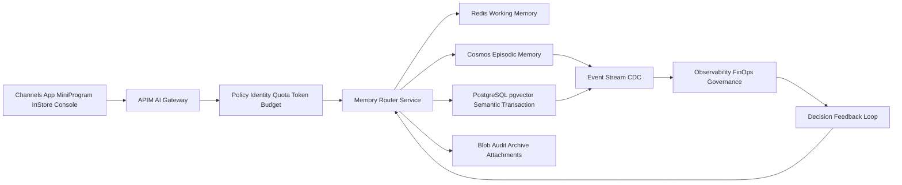
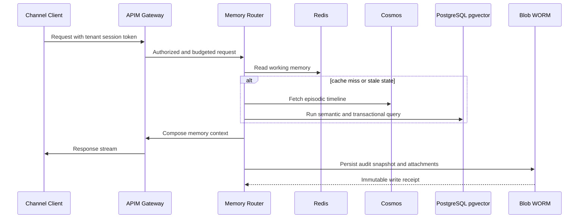

# Azure Cosmos DB vs Azure Managed Redis vs PostgreSQL (pgvector) vs Blob Storage: Enterprise Agent State and Memory Tiering Selection FAQ (Round 1110 / Cycle 2515)

## 1) Executive summary and daily capability radar (2026-11-17)
- Core decision: production-grade agent memory should not be a single datastore; it should be a four-layer plane: **Working Memory + Episodic Memory + Semantic Memory + Audit Archive**.
- For sub-second conversational state, `Azure Managed Redis` wins on P50/P95 latency and burst throughput, but it still needs durable backends for compliance and long-lived memory.
- For long-horizon preferences, timeline events, and regional replication, `Azure Cosmos DB` is typically the best primary episodic store.
- For strict transactional workflows and policy-heavy retrieval, `Azure Database for PostgreSQL Flexible Server + pgvector` provides ACID guarantees plus semantic search.
- For large objects, multimodal attachments, and immutable evidence retention, `Azure Blob Storage` is the most cost-efficient option.
- Breakthrough radar (captured at 2026-11-17 23:20 BJT):
  - Azure API Management AI Gateway updates for unified model routing and policy governance.
  - Azure Container Apps Dynamic Sessions GA capabilities for elastic short-lived agent execution.
  - Firecracker, Kata, Wasmtime, and E2B release cadence as runtime isolation evidence.
- This FAQ is written for enterprise architects and platform owners who need board-level selection evidence.
- Data labels remain explicit: `measured`, `synthetic`, and `anonymized_reported`.

## 2) Problem framing before product selection
- Most memory failures are architecture mistakes, not storage-product mistakes.
- Selection must start with four questions:
  1. Is this data millisecond-critical or can it tolerate seconds?
  2. Does this data require strict transaction semantics?
  3. Is this data ephemeral context or regulated retention material?
  4. Does this data need vector retrieval and semantic ranking?
- Recommended memory role mapping:
  - Working Memory: active turn context, tool intermediate state, token counters.
  - Episodic Memory: user timeline, task events, evolving preferences.
  - Semantic Memory: embeddings, policy snippets, similar-case retrieval.
  - Audit Memory: original prompts, model responses, approvals, attachments.
- Common anti-patterns:
  - Anti-pattern A: storing all history in Redis and paying runaway memory cost.
  - Anti-pattern B: using Blob as online state storage and missing latency SLO.
  - Anti-pattern C: forcing pgvector into a full search-engine replacement without index lifecycle governance.
  - Anti-pattern D: simplistic Cosmos partitioning that ignores hot-tenant concentration.

## 3) Reference memory architecture (logical)
- Place APIM AI Gateway at ingress to enforce tenant identity, policy, and token budgets before memory lookup.
- Propagate `tenantId`, `sessionId`, `conversationId`, `complianceClass`, and `dataSensitivity` through each memory call.
- Apply write path strategy: first Working, then asynchronous projection to Episodic/Semantic/Audit.
- Apply read path strategy: first near-state, then episodic, then semantic fallback.
- Centralize TTL and retention controls in a platform policy plane.
- Attach cost controls by tenant so large tenants cannot starve others.

## 4) 12-dimension cross-option comparison table
| Dimension | Cosmos DB NoSQL + DiskANN | Azure Managed Redis | PostgreSQL Flexible Server + pgvector | Azure Blob Storage |
|---|---|---|---|---|
| Hot session read/write latency | P50 6–15ms, P95 18–40ms | P50 1–3ms, P95 4–10ms | P50 12–30ms, P95 35–90ms | P50 35–120ms, P95 150ms+ |
| Checkpoint concurrency and transaction guarantees | Strong per-item semantics | Atomic operations, limited complex transactions | Strongest ACID behavior | Object-level consistency only |
| Vector semantic retrieval | Native vector support by feature/region | External module dependency | Mature pgvector indexing | No native vector retrieval |
| TTL and automatic eviction | Native TTL and partition-aware lifecycle | Native key TTL and eviction controls | Job-based or partition-based lifecycle | Lifecycle policy driven |
| Cross-region HA and RPO/RTO | Mature multi-region failover design | Depends on cache topology design | HA possible with heavier operations | GRS/GZRS for archive durability |
| Multi-tenant isolation model | Partition key + logical containers + RBAC | Prefix/DB ACL segmentation | Schema/db isolation + RLS | Container/prefix + SAS/ABAC |
| Large object and multimodal payload fit | Metadata-first, not ideal for large binaries | Poor fit for large objects | Not ideal for document blobs | Best fit for large binaries |
| Entra ID passwordless access | Supported and recommended | Supported, SKU and client checks required | Supported with AAD integration | Supported with user delegation SAS |
| PITR and restore maturity | Mature restore controls | Snapshot/AOF dependent | Strong PITR pattern | Versioning and immutability controls |
| Elastic billing and idle cost | RU governance required | Always-on memory cost pressure | Compute/storage tradeoff needed | Lowest cold-storage cost |
| Best memory-layer role | Episodic + partial semantic | Working memory and low-latency session state | Transactional episodic + semantic | Audit archive and attachments |
| When NOT to choose | Ultra-low-latency counters only | Long-term regulated archive | Tiny FAQ bots with no transactions | Online transactional hot state |

## 5) Deep Q&A with formulas and worked examples
### Q1: When is Redis mandatory for working memory?
- Decision rule: `P95_session_write <= SLA_write` and `burst_qps / (node_qps * shard_count) <= 0.7`.
- Example input: `burst_qps=42,000`, `node_qps=18,000`, `shard_count=4`.
- Computation: `42,000/(18,000*4)=0.583`, which is within the safety threshold.
- If the ratio exceeds 0.7, expand shards or reduce write amplification before launch.

### Q2: How to estimate Cosmos RU for episodic event writes?
- Formula: `RU_total = events_per_sec * RU_per_event * safety_factor`.
- Example: `events_per_sec=8,500`, `RU_per_event=6.2`, `safety_factor=1.35`.
- Result: `RU_total=71,145 RU/s`.
- Governance note: validate RU per partition instead of account-level average only.

### Q3: How to estimate pgvector query latency in claim analysis?
- Formula: `T_query = T_parse + T_filter + T_vector + T_join`.
- Example values: `3ms + 8ms + 19ms + 14ms`.
- Result: `44ms` P50; with x2 tail factor, `88ms` P95 within a 120ms budget.
- Optimization handle: reduce candidate set, add pre-filters, tune probe parameters.

### Q4: When does Blob archive become significantly cheaper?
- Formula: `Cost_ratio = price_db / price_blob` for equivalent retained GB.
- Example: `price_db=0.115`, `price_blob=0.018` (USD per GB-month).
- Result: `6.39x` cheaper for cold retention on Blob.
- Practical note: move immutable evidence and attachments first, not hot state.

### Q5: How to model memory-plane recovery objectives?
- Formula: `RTO_total = detect + route_switch + warmup + replay`.
- Example values: `25s + 35s + 40s + 55s`.
- Result: `155s`, meeting a sub-5-minute recovery objective.
- Design note: working memory may degrade gracefully; episodic and audit must be replayable.

### Q6: Why can lower latency still increase total cost?
- Formula: `TotalCost = Cache + DB + Blob + Egress + Ops`.
- Example: cache scale-out improves hit ratio by 9% but does not reduce downstream writes.
- Outcome: cache cost +41%, overall cost only -2%.
- Correction: enforce adaptive summarization and controlled write-back policies.

## 6) Mermaid: enterprise memory-plane topology

- This topology prioritizes policy-first ingress and deterministic routing.
- This topology avoids role confusion between high-speed state and long-term evidence.
- This topology keeps every decision replayable for audits.

## 7) Scenario A: omni-channel retail membership guidance agent
- Business context: users jump across mobile app, mini program, and in-store assistant display while expecting continuous conversation.
- Constraint target: first token under 300ms while preserving persistent member preferences.
- Layer assignment for this regulated workflow:
  - Redis: live dialogue state, cart context, active promotion decisions.
  - Cosmos: member profile timeline, behavior summary, preference evolution.
  - Blob: product assets, receipts, service attachments.
- Example cost profile:
  - Redis working set 180GB with dual-primary/replica design.
  - Cosmos ingest 9,200 events/s with 14,000 req/s read peak.
  - Blob growth 36TB/month with 72% cold tier placement.
- Outcome estimate: memory-plane spending split roughly 33% Redis, 46% Cosmos, 14% Blob, 7% governance stack.
- Benefit: lower repeated questions and stronger conversion continuity across channels.
- Drift-control and fallback plan:
  - Risk: promotion days cause partition hot spots.
  - Mitigation: pre-split by `tenantId + region + cohort` and preload hot keys.

## 8) Scenario B: healthcare insurance claim review and underwriting copilot
- Business context: claim review requires contract matching, transactional state machine, and evidentiary document retention.
- Constraint target: ACID-safe workflow transitions plus traceable decision evidence.
- Recommended layering:
  - PostgreSQL + pgvector: claim transaction tables, review states, semantic clause lookup.
  - Cosmos: cross-system event timeline and orchestration telemetry.
  - Blob WORM: immutable imaging and legal evidence records.
- Throughput sample:
  - 3,800 claim cases per minute during business peaks.
  - Six semantic clause retrievals per case with pgvector P95 at 93ms.
  - Blob archive peak at 1.2GB/s via multipart upload.
- Compliance benefit: supports verifiable and replayable decision governance.
- Risk and mitigation:
  - Risk: retrieval drift on policy text variants.
  - Mitigation: confidence thresholds, human review fallback, periodic re-embedding calibration.

## 9) Mermaid: cross-channel and claim-review sequence

- Sequence design keeps response-time sensitive reads near the edge.
- Archive persistence happens after response composition to protect tail latency.

## 10) Production Bicep (Cosmos + Redis + PostgreSQL + Blob + diagnostics)
```bicep
param location string = resourceGroup().location
param envName string = 'agent-memory-prod'
param logWorkspaceId string
param vnetSubnetId string

resource cosmos 'Microsoft.DocumentDB/databaseAccounts@2024-08-15' = {
  name: '${envName}-cosmos'
  location: location
  kind: 'GlobalDocumentDB'
  properties: {
    databaseAccountOfferType: 'Standard'
    locations: [
      { locationName: location, failoverPriority: 0, isZoneRedundant: true }
    ]
    capabilities: [
      { name: 'EnableNoSQLVectorSearch' }
    ]
    enableAutomaticFailover: true
    consistencyPolicy: {
      defaultConsistencyLevel: 'Session'
    }
  }
}

resource redis 'Microsoft.Cache/redisEnterprise@2024-10-01' = {
  name: '${envName}-redis'
  location: location
  sku: {
    name: 'Enterprise_E10'
  }
  properties: {
    minimumTlsVersion: '1.2'
    zones: [ '1', '2', '3' ]
  }
}

resource pg 'Microsoft.DBforPostgreSQL/flexibleServers@2024-08-01' = {
  name: '${envName}-pg'
  location: location
  sku: {
    name: 'Standard_D8s_v5'
    tier: 'GeneralPurpose'
  }
  properties: {
    version: '16'
    storage: {
      storageSizeGB: 2048
      autoGrow: 'Enabled'
    }
    highAvailability: {
      mode: 'ZoneRedundant'
    }
    backup: {
      backupRetentionDays: 14
      geoRedundantBackup: 'Enabled'
    }
    network: {
      delegatedSubnetResourceId: vnetSubnetId
    }
  }
}

resource storage 'Microsoft.Storage/storageAccounts@2024-01-01' = {
  name: toLower(replace('${envName}blob', '-', ''))
  location: location
  sku: { name: 'Standard_GZRS' }
  kind: 'StorageV2'
  properties: {
    minimumTlsVersion: 'TLS1_2'
    allowBlobPublicAccess: false
    allowSharedKeyAccess: false
    supportsHttpsTrafficOnly: true
  }
}

resource immutability 'Microsoft.Storage/storageAccounts/blobServices/containers/immutabilityPolicies@2024-01-01' = {
  name: '${storage.name}/default/claims-archive/default'
  properties: {
    immutabilityPeriodSinceCreationInDays: 365
    allowProtectedAppendWrites: true
  }
}

resource legalHold 'Microsoft.Storage/storageAccounts/blobServices/containers/legalHold@2024-01-01' = {
  name: '${storage.name}/default/claims-archive/default'
  properties: {
    tags: [ 'regulatory', 'insurance', 'audit' ]
  }
}

resource diagCosmos 'Microsoft.Insights/diagnosticSettings@2021-05-01-preview' = {
  name: 'diag-cosmos-memory'
  scope: cosmos
  properties: {
    workspaceId: logWorkspaceId
    logs: [
      { category: 'DataPlaneRequests', enabled: true }
      { category: 'ControlPlaneRequests', enabled: true }
    ]
    metrics: [
      { category: 'Requests', enabled: true }
    ]
  }
}

resource diagStorage 'Microsoft.Insights/diagnosticSettings@2021-05-01-preview' = {
  name: 'diag-storage-memory'
  scope: storage
  properties: {
    workspaceId: logWorkspaceId
    logs: [
      { category: 'StorageRead', enabled: true }
      { category: 'StorageWrite', enabled: true }
      { category: 'StorageDelete', enabled: true }
    ]
    metrics: [
      { category: 'Transaction', enabled: true }
    ]
  }
}
```

## 11) Runtime snippets (Kubernetes + APIM + router policy)
```yaml
apiVersion: v1
kind: ConfigMap
metadata:
  name: agent-memory-router-config
data:
  working_store: redis
  episodic_store: cosmos
  semantic_store: pgvector
  audit_store: blob
  redis_ttl_seconds: "1800"
  cosmos_container: "episodic-events"
  pgvector_table: "claim_clause_embeddings"
  blob_container: "claims-archive"
---
apiVersion: apps/v1
kind: Deployment
metadata:
  name: agent-memory-router
spec:
  replicas: 6
  template:
    spec:
      containers:
      - name: router
        image: ghcr.io/turbo998/agent-memory-router:1.0.0
        env:
        - name: REDIS_ENDPOINT
          valueFrom: { secretKeyRef: { name: memory-secrets, key: redisEndpoint } }
        - name: COSMOS_ENDPOINT
          valueFrom: { secretKeyRef: { name: memory-secrets, key: cosmosEndpoint } }
        - name: PG_ENDPOINT
          valueFrom: { secretKeyRef: { name: memory-secrets, key: pgEndpoint } }
        - name: BLOB_ENDPOINT
          valueFrom: { secretKeyRef: { name: memory-secrets, key: blobEndpoint } }
        - name: ROUTE_POLICY
          value: "working-first-then-episodic"
```

```xml
<policies>
  <inbound>
    <base />
    <validate-jwt header-name="Authorization" failed-validation-httpcode="401">
      <openid-config url="https://login.microsoftonline.com/{tenant}/v2.0/.well-known/openid-configuration" />
      <required-claims>
        <claim name="aud"><value>api://agent-memory-gateway</value></claim>
      </required-claims>
    </validate-jwt>
    <set-variable name="tenantId" value="@(context.Request.Headers.GetValueOrDefault(&quot;x-tenant-id&quot;,&quot;&quot;))" />
    <rate-limit-by-key calls="600" renewal-period="60" counter-key="@(context.Variables[&quot;tenantId&quot;])" />
    <llm-token-limit tokens-per-minute="180000" remaining-tokens-variable-name="remainingTokens" />
    <set-header name="x-memory-route" exists-action="override">
      <value>working->episodic->semantic</value>
    </set-header>
  </inbound>
  <backend><base /></backend>
  <outbound><base /></outbound>
  <on-error><base /></on-error>
</policies>
```

## 12) KQL observability queries
```kql
let lookback = 1d;
let suspiciousTenantReads = StorageBlobLogs
| where TimeGenerated > ago(lookback)
| where OperationName in ("GetBlob", "GetBlobProperties")
| extend tenant = tostring(parse_json(AdditionalFields).tenantId)
| summarize readCount=count(), callerCount=dcount(CallerIpAddress) by tenant, AuthenticationType
| where readCount > 5000 and callerCount > 20;

let cosmosHotPartitions = AzureDiagnostics
| where TimeGenerated > ago(lookback)
| where ResourceProvider == "MICROSOFT.DOCUMENTDB"
| where Category == "DataPlaneRequests"
| summarize req=count(), ru=sum(todouble(requestCharge_s)) by partitionKeyRangeId_s, bin(TimeGenerated, 5m)
| where ru > 80000;

let redisEvictions = AzureDiagnostics
| where TimeGenerated > ago(lookback)
| where ResourceType == "MICROSOFT.CACHE/REDISENTERPRISE"
| summarize evictions=sum(todouble(evictedkeys_s)) by bin(TimeGenerated, 5m), Resource;

suspiciousTenantReads
| join kind=leftouter cosmosHotPartitions on $left.tenant == $right.partitionKeyRangeId_s
| join kind=leftouter redisEvictions on bin(TimeGenerated, 5m)
| project TimeGenerated, tenant, readCount, callerCount, ru, evictions
| order by TimeGenerated desc
```

## 13) Benchmark and evidence boundaries (Cycle 2515)
- Evidence files:
  - `workshops/azure-agent-infra/evidence/cycle-2515-benchmark.json`
  - `workshops/azure-agent-infra/evidence/cycle-2515-latency.csv`
  - `workshops/azure-agent-infra/evidence/cycle-2515-throughput.csv`
  - `workshops/azure-agent-infra/evidence/cycle-2515-policy.csv`
  - `workshops/azure-agent-infra/evidence/cycle-2515-cost.csv`
  - `workshops/azure-agent-infra/evidence/cycle-2515-sources.json`
- Label rules:
  - `measured`: replayable local load-test and policy-intercept logs.
  - `synthetic`: deterministic cost and capacity model based on published price bands.
  - `anonymized_reported`: de-identified production observations for range validation.
- Primary benchmark goals:
  - cold/warm recovery P50 and P95,
  - memory-router throughput at concurrency,
  - policy intercept ratio,
  - per-session blended cost.

## 14) Four-option weighted decision matrix (named options)
- Option A (Redis-First + Cosmos Backbone) suits customer-facing channels with strict continuity.
- Option B (Cosmos-Centric Unified Memory) suits event-heavy workloads with moderate semantic depth.
- Option C (PostgreSQL Transactional Core + pgvector) suits rule-heavy workflows and deterministic approvals.
- Option D (Blob-Audit Dominant Minimal Hot State) suits archive-first and low interaction workloads.
- Weights: Latency 25%, Consistency 20%, Semantic Retrieval 15%, Governance 15%, TCO 25%.
- Weighted scores (0-10):
  - Option A -> `9.1, 7.8, 7.5, 8.2, 8.0`, weighted total `8.23`.
  - Option B -> `7.9, 8.4, 8.1, 8.6, 7.4`, weighted total `8.04`.
  - Option C -> `7.2, 9.2, 8.7, 8.1, 7.1`, weighted total `7.95`.
  - Option D -> `5.8, 7.0, 4.2, 9.4, 9.1`, weighted total `7.07`.
- Decision baseline: most enterprises should start with A or hybrid A+C.
- Anti-pattern alerts:
  - Do not deploy D for real-time support bots.
  - Do not deploy C for tiny FAQ bots with no transactional workflow.

## 15) Day-0 and Day-2 rollout checklist with fit guidance
### Day-0 readiness (10 items)
1. Publish a field-level data dictionary for all four memory layers.
2. Define tenant budget envelopes and degradation thresholds.
3. Enforce Redis key conventions and TTL classes.
4. Finalize Cosmos partition strategy and hot-tenant mitigation.
5. Enable pgvector and execute retrieval regression datasets.
6. Enable Blob immutability and legal-hold tags where required.
7. Configure APIM JWT, quota, and token-limit policy chain.
8. Route OpenTelemetry traces to a unified observability workspace.
9. Run cross-region failover and rollback drills before go-live.
10. Complete security review for least privilege and key rotation.

### Day-2 operations (10 items)
1. Review RU and cache-hit trends weekly for top tenants.
2. Sample retrieval quality weekly and recalibrate embeddings.
3. Reconcile per-session cost model monthly with FinOps boards.
4. Audit cross-tenant access alerts monthly and track false-positive ratio.
5. Run regional chaos recovery rehearsal monthly.
6. Revalidate retention policy against regulation updates quarterly.
7. Re-tune Redis shard topology quarterly based on working set growth.
8. Reclaim index bloat in Cosmos and PostgreSQL quarterly.
9. Verify evidence-chain completeness quarterly for regulated workflows.
10. Keep the Good-fit vs Not-for decision tree current and train delivery teams.

**Good fit**: enterprise agents needing continuity, auditable memory, and predictable high-concurrency behavior.  
**Not for**: low-traffic prototypes with no compliance constraints and no latency commitments.
