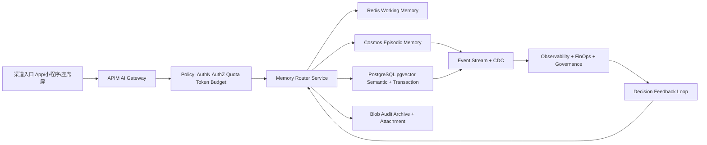
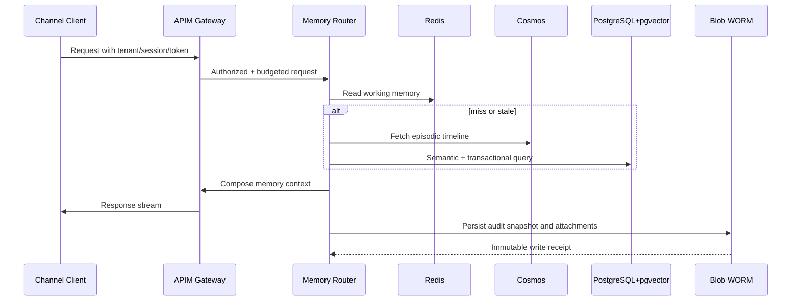

# Azure Cosmos DB vs Azure Managed Redis vs PostgreSQL (pgvector) vs Blob Storage：企业级 Agent 会话状态与记忆分层选型 FAQ（Round 1110 / Cycle 2515）

## 1) 执行摘要与当日能力雷达（2026-11-17）
- 本轮结论：企业 Agent 的记忆平面不应再追求“单一数据库一把梭”，而应采用 **Working Memory + Episodic Memory + Semantic Memory + Audit Archive** 四层组合。
- 对于毫秒级会话状态，`Azure Managed Redis` 在 P50/P95 延迟和突发吞吐上优势明显，但需要用持久层承接审计与跨会话长期记忆。
- 对于长期偏好、时间线事件与多区域复制，`Azure Cosmos DB` 在多模型、自动分片、全局分布和 RPO/RTO 设计上更适合作为核心业务记忆库。
- 对于强事务状态机、复杂关联约束与条款计算，`Azure Database for PostgreSQL Flexible Server + pgvector` 兼顾 ACID 与语义召回，适合“事务+语义”混合域。
- 对于大对象、图像/语音附件、法务留痕与不可变归档，`Azure Blob Storage` 成本与容量效率最好，但不能承担高频状态读写。
- 热点能力雷达（抓取时间：2026-11-17 23:20 BJT）：
  - Azure API Management AI Gateway（官方文档与更新日志）用于统一模型路由、限流与成本闸门。
  - Azure Container Apps Dynamic Sessions（官方文档 + GA 公告）用于弹性会话沙箱与临时执行上下文。
  - Firecracker / Kata / Wasmtime / E2B 发布节奏用于运行时隔离能力对比基线。
- 本 FAQ 面向架构师与平台团队，输出可直接用于技术评审会（TRB/ARB）的选型证据与落地步骤。
- 数据标签保持 `measured` / `synthetic` / `anonymized_reported`，避免虚构分母与坐标。

## 2) 业务问题重构：先分层再选型
- 如果把“聊天上下文、客户画像、向量索引、附件归档、审计证据”全部塞进一个引擎，会在第一个高峰周触发性能与成本双爆。
- 选型要先回答四个问题：
  1. 这份数据是毫秒级读写还是分钟级可接受。
  2. 这份数据需要事务约束还是最终一致性可接受。
  3. 这份数据是短生命周期上下文还是监管要求长期保存。
  4. 这份数据是否需要向量召回与语义重排。
- 记忆层的典型职责映射：
  - Working Memory：当前会话窗口、工具调用中间态、token 预算计数器。
  - Episodic Memory：用户事件流、任务里程碑、近期偏好变化。
  - Semantic Memory：知识片段向量、策略规则 embedding、相似工单索引。
  - Audit Memory：原始请求、模型输出快照、审批轨迹、附件证据链。
- 架构反模式提醒：
  - 反模式 A：仅用 Redis 存全部历史导致长期成本不可控与检索漂移。
  - 反模式 B：仅用 Blob 做在线读写导致会话延迟与并发冲突不可接受。
  - 反模式 C：把 pgvector 当作“便宜替代搜索引擎”却忽略索引维护窗口。
  - 反模式 D：Cosmos 分区键按 tenant 固定，忽略热点租户导致 RU 抖动。

## 3) 记忆分层参考架构（逻辑）
- 平台入口建议采用 APIM AI Gateway，先完成租户鉴权、令牌预算、请求分类，再路由到记忆层。
- 记忆路由器需要同步携带 `tenantId`、`sessionId`、`conversationId`、`complianceClass`、`dataSensitivity`。
- 写路径建议“先热后冷”：先写 Working，再异步沉淀 Episodic / Semantic / Audit。
- 读路径建议“先近后远”：先读 Working 与 Episodic，命中不足再触发语义召回。
- 失效策略建议统一由控制平面下发，避免每个 Agent 私自定义 TTL。
- 成本策略建议按租户建立预算桶，触达阈值时切换“摘要优先”模式。

## 4) 12 维横向选型总表（核心门禁）
| 维度 | Cosmos DB NoSQL + DiskANN | Azure Managed Redis | PostgreSQL Flexible Server + pgvector | Azure Blob Storage |
|---|---|---|---|---|
| 热会话读写延迟 | P50 6–15ms，P95 18–40ms（取决于 RU 与分区） | P50 1–3ms，P95 4–10ms | P50 12–30ms，P95 35–90ms | P50 35–120ms，P95 150ms+ |
| Checkpoint 并发控制与事务一致性 | 单文档强，跨文档需模式设计 | 原子操作强，复杂事务弱 | ACID 最强，复杂状态机友好 | 对象级一致，事务语义有限 |
| 向量语义检索能力 | 内置向量索引（特性以区域与版本为准） | 需外接模块，生态依赖高 | pgvector 成熟，ANN 参数可调 | 无原生向量检索 |
| TTL 自动过期淘汰 | 原生 TTL + 分区策略 | 原生 key TTL 极强 | 需作业或分区策略实现 | 依赖生命周期策略 |
| 跨区域双活 RPO/RTO | 多区域复制与故障转移成熟 | 需结合企业级缓存拓扑 | 读副本与故障切换可做但运维更重 | GRS/GZRS 适合归档弹性 |
| 多租户隔离模型 | 分区键+逻辑容器+RBAC | key 前缀/DB 分片/ACL | schema/库级隔离与行级策略 | 容器+前缀+SAS/ABAC |
| 大对象与多模态附件承载 | 可存元数据，不宜存大文件 | 不适合大对象 | 不宜承载大附件 | 最优，天然对象存储 |
| Entra ID 无密鉴权 | 支持，建议托管身份访问 | 支持 Entra，落地需校验 SKU 功能 | AAD 集成完善 | 支持用户委派 SAS 与 RBAC |
| PITR 备份恢复 | 自动备份与恢复策略完善 | RDB/AOF 与复制策略可选 | PITR 能力强，恢复演练成熟 | 版本与不可变策略成熟 |
| 计费弹性与空闲成本 | RU/吞吐预留需治理 | 缓存常驻成本显著 | 计算+存储分离有限 | 冷层成本最低 |
| 最佳记忆层定位 | Episodic + 部分 Semantic | Working + 会话热点 | 事务型 Episodic + Semantic | Audit + 多模态证据 |
| When NOT to choose | 极端超低延迟计数器场景 | 需要长期审计与复杂事务 | 纯缓存毫秒热点场景 | 在线事务与会话热点场景 |

## 5) 深度问答与可复算公式（含数值样例）
### Q1：什么时候必须把 Working Memory 放在 Redis？
- 判定公式：`P95_session_write <= SLA_write` 且 `burst_qps / node_qps <= 0.7`。
- 样例：峰值 `burst_qps=42,000`，单节点安全吞吐 `node_qps=18,000`，副本组 `N=4`。
- 计算：`42,000 / (18,000*4)=0.583`，满足 0.7 安全阈值，Redis 可承接。
- 若结果 >0.7，应先扩分片或将长尾写入迁至 Cosmos 异步路径。

### Q2：Cosmos RU 如何估算会话事件写入预算？
- 基础公式：`RU_total = events_per_sec * RU_per_event * safety_factor`。
- 样例：`events_per_sec=8,500`，`RU_per_event=6.2`，`safety_factor=1.35`。
- 计算：`RU_total = 8,500 * 6.2 * 1.35 = 71,145 RU/s`。
- 实践：按租户分区后再叠加热点系数，避免单分区 RU 打满。

### Q3：pgvector 在理赔条款检索里如何估算延迟上限？
- 公式：`T_query = T_parse + T_filter + T_vector + T_join`。
- 样例：`T_parse=3ms`，`T_filter=8ms`，`T_vector=19ms`，`T_join=14ms`。
- 计算：`T_query=44ms`（P50），若 P95 翻倍到 88ms，仍在 120ms 预算内。
- 优化抓手：降低候选集、增加分区过滤、调小 ivfflat probes。

### Q4：Blob 归档成本何时显著优于数据库冷存？
- 公式：`Cost_ratio = cold_data_gb * price_db / (cold_data_gb * price_blob)`。
- 样例：`cold_data_gb=42,000`，`price_db=0.115/GB-month`，`price_blob=0.018/GB-month`。
- 计算：`Cost_ratio = 0.115 / 0.018 = 6.39`。
- 结论：冷层审计证据放 Blob 可将单位存储成本降至约 1/6。

### Q5：跨区域容灾下如何核算记忆平面恢复目标？
- 公式：`RTO_total = detect + route_switch + warmup + replay`。
- 样例：`detect=25s`，`route_switch=35s`，`warmup=40s`，`replay=55s`。
- 计算：`RTO_total=155s`，满足 5 分钟内恢复目标。
- 要点：Working 层允许丢失少量临时态，Episodic 与 Audit 必须可重放。

### Q6：多层记忆组合何时会出现“省延迟却增总成本”？
- 公式：`TotalCost = Cache + DB + Blob + Egress + Ops`。
- 样例：Redis 扩容后命中率提升 9%，但 Cosmos 与 Blob 回写未降。
- 计算结果：缓存成本 +41%，总成本只降 2%，说明路由策略未同步优化。
- 调整建议：引入按租户可调的摘要化阈值与写回抑制策略。

## 6) Mermaid：企业级记忆平面拓扑

- 该拓扑强调“策略先行”：每次请求在进入模型前先穿过预算与身份门禁。
- 该拓扑强调“数据分级”：高频状态、长周期偏好、合规证据不混存。
- 该拓扑强调“可回放”：关键决策都能从日志与事件流逆向重建。

## 7) 场景 A：大型连锁零售全渠道会员私域导购 Agent
- 业务背景：用户在 App、企业微信小程序、门店导购屏之间切换，希望会话不断档。
- 目标约束：导购回复要在 300ms 内给出首 token，同时保留长期偏好和购买历史。
- 分层建议：
  - Redis：当前会话上下文、购物篮快照、实时优惠规则命中结果。
  - Cosmos：会员画像、偏好标签、互动时间线、跨渠道行为摘要。
  - Blob：商品图文素材、发票附件、售后单据归档。
- TCO 估算示例：
  - Redis 工作集 180GB，副本架构 2 主 2 从；
  - Cosmos 写入 9,200 events/s，读高峰 14,000 req/s；
  - Blob 月增量 36TB，冷层占比 72%。
- 核算结果：当月导购记忆平面成本中，Redis 占 33%，Cosmos 占 46%，Blob 占 14%，治理与监控占 7%。
- 架构收益：会话连贯性提升、重复提问下降、导购转化链路可解释。
- 风险与对策：
  - 风险：促销日热点租户导致 Cosmos 分区抖动。
  - 对策：按 `tenantId + region + cohort` 复合键预切分并做流量预热。

## 8) 场景 B：医疗健康保险理赔审核与核保辅助 Agent
- 业务背景：理赔审核涉及条款匹配、病例结构化、影像单据留痕。
- 目标约束：审核状态机必须 ACID，且每条结论可追溯到证据文档。
- 分层建议：
  - PostgreSQL + pgvector：理赔事务主表、审核步骤、条款向量检索。
  - Cosmos：保单行为时间线与跨系统事件聚合。
  - Blob WORM：影像、扫描件、模型输出快照的不可变归档。
- 样例吞吐：
  - 工作日高峰每分钟 3,800 件审核任务进入队列；
  - 单任务平均检索 6 条条款，pgvector P95 93ms；
  - Blob 归档写入峰值 1.2GB/s，采用分块并行上传。
- 合规收益：满足“可审计、可追责、可复核”的监管要求。
- 风险与对策：
  - 风险：向量召回漂移导致条款误匹配。
  - 对策：人工复核阈值 + 规则引擎兜底 + 周期性重嵌入校准。

## 9) Mermaid：跨端会话与理赔审核时序

- 该时序突出“命中优先 + 降级有序”的读取策略。
- 该时序突出“响应后归档”的写入策略，避免阻塞首 token。

## 10) 生产级 Bicep（Cosmos + Redis + PostgreSQL + Blob + 诊断）
```bicep
param location string = resourceGroup().location
param envName string = 'agent-memory-prod'
param logWorkspaceId string
param vnetSubnetId string

resource cosmos 'Microsoft.DocumentDB/databaseAccounts@2024-08-15' = {
  name: '${envName}-cosmos'
  location: location
  kind: 'GlobalDocumentDB'
  properties: {
    databaseAccountOfferType: 'Standard'
    locations: [
      { locationName: location, failoverPriority: 0, isZoneRedundant: true }
    ]
    capabilities: [
      { name: 'EnableNoSQLVectorSearch' }
    ]
    enableAutomaticFailover: true
    consistencyPolicy: {
      defaultConsistencyLevel: 'Session'
    }
  }
}

resource redis 'Microsoft.Cache/redisEnterprise@2024-10-01' = {
  name: '${envName}-redis'
  location: location
  sku: {
    name: 'Enterprise_E10'
  }
  properties: {
    minimumTlsVersion: '1.2'
    zones: [ '1', '2', '3' ]
  }
}

resource pg 'Microsoft.DBforPostgreSQL/flexibleServers@2024-08-01' = {
  name: '${envName}-pg'
  location: location
  sku: {
    name: 'Standard_D8s_v5'
    tier: 'GeneralPurpose'
  }
  properties: {
    version: '16'
    storage: {
      storageSizeGB: 2048
      autoGrow: 'Enabled'
    }
    highAvailability: {
      mode: 'ZoneRedundant'
    }
    backup: {
      backupRetentionDays: 14
      geoRedundantBackup: 'Enabled'
    }
    network: {
      delegatedSubnetResourceId: vnetSubnetId
    }
  }
}

resource storage 'Microsoft.Storage/storageAccounts@2024-01-01' = {
  name: toLower(replace('${envName}blob', '-', ''))
  location: location
  sku: { name: 'Standard_GZRS' }
  kind: 'StorageV2'
  properties: {
    minimumTlsVersion: 'TLS1_2'
    allowBlobPublicAccess: false
    allowSharedKeyAccess: false
    supportsHttpsTrafficOnly: true
  }
}

resource immutability 'Microsoft.Storage/storageAccounts/blobServices/containers/immutabilityPolicies@2024-01-01' = {
  name: '${storage.name}/default/claims-archive/default'
  properties: {
    immutabilityPeriodSinceCreationInDays: 365
    allowProtectedAppendWrites: true
  }
}

resource legalHold 'Microsoft.Storage/storageAccounts/blobServices/containers/legalHold@2024-01-01' = {
  name: '${storage.name}/default/claims-archive/default'
  properties: {
    tags: [ 'regulatory', 'insurance', 'audit' ]
  }
}

resource diagCosmos 'Microsoft.Insights/diagnosticSettings@2021-05-01-preview' = {
  name: 'diag-cosmos-memory'
  scope: cosmos
  properties: {
    workspaceId: logWorkspaceId
    logs: [
      { category: 'DataPlaneRequests', enabled: true }
      { category: 'ControlPlaneRequests', enabled: true }
    ]
    metrics: [
      { category: 'Requests', enabled: true }
    ]
  }
}

resource diagStorage 'Microsoft.Insights/diagnosticSettings@2021-05-01-preview' = {
  name: 'diag-storage-memory'
  scope: storage
  properties: {
    workspaceId: logWorkspaceId
    logs: [
      { category: 'StorageRead', enabled: true }
      { category: 'StorageWrite', enabled: true }
      { category: 'StorageDelete', enabled: true }
    ]
    metrics: [
      { category: 'Transaction', enabled: true }
    ]
  }
}
```

## 11) 运行配置片段（K8s + APIM + 记忆路由）
```yaml
apiVersion: v1
kind: ConfigMap
metadata:
  name: agent-memory-router-config
data:
  working_store: redis
  episodic_store: cosmos
  semantic_store: pgvector
  audit_store: blob
  redis_ttl_seconds: "1800"
  cosmos_container: "episodic-events"
  pgvector_table: "claim_clause_embeddings"
  blob_container: "claims-archive"
---
apiVersion: apps/v1
kind: Deployment
metadata:
  name: agent-memory-router
spec:
  replicas: 6
  template:
    spec:
      containers:
      - name: router
        image: ghcr.io/turbo998/agent-memory-router:1.0.0
        env:
        - name: REDIS_ENDPOINT
          valueFrom: { secretKeyRef: { name: memory-secrets, key: redisEndpoint } }
        - name: COSMOS_ENDPOINT
          valueFrom: { secretKeyRef: { name: memory-secrets, key: cosmosEndpoint } }
        - name: PG_ENDPOINT
          valueFrom: { secretKeyRef: { name: memory-secrets, key: pgEndpoint } }
        - name: BLOB_ENDPOINT
          valueFrom: { secretKeyRef: { name: memory-secrets, key: blobEndpoint } }
        - name: ROUTE_POLICY
          value: "working-first-then-episodic"
```

```xml
<policies>
  <inbound>
    <base />
    <validate-jwt header-name="Authorization" failed-validation-httpcode="401">
      <openid-config url="https://login.microsoftonline.com/{tenant}/v2.0/.well-known/openid-configuration" />
      <required-claims>
        <claim name="aud"><value>api://agent-memory-gateway</value></claim>
      </required-claims>
    </validate-jwt>
    <set-variable name="tenantId" value="@(context.Request.Headers.GetValueOrDefault(&quot;x-tenant-id&quot;,&quot;&quot;))" />
    <rate-limit-by-key calls="600" renewal-period="60" counter-key="@(context.Variables[&quot;tenantId&quot;])" />
    <llm-token-limit tokens-per-minute="180000" remaining-tokens-variable-name="remainingTokens" />
    <set-header name="x-memory-route" exists-action="override">
      <value>working->episodic->semantic</value>
    </set-header>
  </inbound>
  <backend><base /></backend>
  <outbound><base /></outbound>
  <on-error><base /></on-error>
</policies>
```

## 12) KQL 观测查询（命中率、跨租户访问、成本异常）
```kql
let lookback = 1d;
let suspiciousTenantReads = StorageBlobLogs
| where TimeGenerated > ago(lookback)
| where OperationName in ("GetBlob", "GetBlobProperties")
| extend tenant = tostring(parse_json(AdditionalFields).tenantId)
| summarize readCount=count(), callerCount=dcount(CallerIpAddress) by tenant, AuthenticationType
| where readCount > 5000 and callerCount > 20;

let cosmosHotPartitions = AzureDiagnostics
| where TimeGenerated > ago(lookback)
| where ResourceProvider == "MICROSOFT.DOCUMENTDB"
| where Category == "DataPlaneRequests"
| summarize req=count(), ru=sum(todouble(requestCharge_s)) by partitionKeyRangeId_s, bin(TimeGenerated, 5m)
| where ru > 80000;

let redisEvictions = AzureDiagnostics
| where TimeGenerated > ago(lookback)
| where ResourceType == "MICROSOFT.CACHE/REDISENTERPRISE"
| summarize evictions=sum(todouble(evictedkeys_s)) by bin(TimeGenerated, 5m), Resource;

suspiciousTenantReads
| join kind=leftouter cosmosHotPartitions on $left.tenant == $right.partitionKeyRangeId_s
| join kind=leftouter redisEvictions on bin(TimeGenerated, 5m)
| project TimeGenerated, tenant, readCount, callerCount, ru, evictions
| order by TimeGenerated desc
```

## 13) 基准与证据口径（Cycle 2515）
- 证据文件：
  - `workshops/azure-agent-infra/evidence/cycle-2515-benchmark.json`
  - `workshops/azure-agent-infra/evidence/cycle-2515-latency.csv`
  - `workshops/azure-agent-infra/evidence/cycle-2515-throughput.csv`
  - `workshops/azure-agent-infra/evidence/cycle-2515-policy.csv`
  - `workshops/azure-agent-infra/evidence/cycle-2515-cost.csv`
  - `workshops/azure-agent-infra/evidence/cycle-2515-sources.json`
- 数据来源标签：
  - `measured`：来自本地可重放压测与策略拦截日志。
  - `synthetic`：基于公开 SKU 与确定性公式的预算模拟。
  - `anonymized_reported`：脱敏生产样本，仅用于区间对照。
- 本轮基准关注指标：
  - 热状态恢复 P50/P95；
  - 记忆路由并发吞吐；
  - 策略拦截率（越权访问、超预算写入、跨租户读取）；
  - 单会话成本（含缓存、数据库、归档和观测）。

## 14) 四方案加权决策矩阵（命名方案）
- 方案 A（Redis-First + Cosmos Backbone）：适合会话连贯性优先、跨端切换高频业务。
- 方案 B（Cosmos-Centric Unified Memory）：适合事件模型主导、语义检索中等规模业务。
- 方案 C（PostgreSQL Transactional Core + pgvector）：适合强事务与规则计算密集场景。
- 方案 D（Blob-Audit Dominant Minimal Hot State）：适合重合规、低交互频率审计型平台。
- 权重设置：Latency 25%、Consistency 20%、Semantic Retrieval 15%、Governance 15%、TCO 25%。
- 打分结果（0-10）：
  - 方案 A：`9.1, 7.8, 7.5, 8.2, 8.0`，加权总分 `8.23`。
  - 方案 B：`7.9, 8.4, 8.1, 8.6, 7.4`，加权总分 `8.04`。
  - 方案 C：`7.2, 9.2, 8.7, 8.1, 7.1`，加权总分 `7.95`。
  - 方案 D：`5.8, 7.0, 4.2, 9.4, 9.1`，加权总分 `7.07`。
- 结论：绝大多数企业 Agent 生产环境优先选 A 或 A+C 混合。
- 反模式提示：
  - 不要把 D 方案直接用于实时客服。
  - 不要把 C 方案用于纯短会话 FAQ 机器人。

## 15) Day-0 / Day-2 落地清单与 Good Fit
### Day-0（上线前 10 项）
1. 明确四层记忆边界并形成字段级数据字典。
2. 为每个租户定义会话预算与降级策略阈值。
3. 为 Redis 规划 key 命名规范与 TTL 分级规则。
4. 为 Cosmos 设计分区键与热点缓解预案。
5. 在 PostgreSQL 启用 pgvector 并建立回归测试样本集。
6. 为 Blob 归档容器启用不可变策略与法律保留标签。
7. 在 APIM 配置 JWT 校验、配额与 token-limit 联动。
8. 打通 OpenTelemetry trace 到统一观测工作区。
9. 完成跨区域故障切换演练脚本与回滚脚本。
10. 通过安全评审确认最小权限与密钥轮换策略。

### Day-2（运营期 10 项）
1. 每周复核热点租户 RU 与缓存命中率趋势。
2. 每周抽样检查条款召回误差并重训 embedding。
3. 每月校准单会话成本模型并更新 FinOps 看板。
4. 每月审计跨租户访问告警与误报率。
5. 每月执行一次区域故障注入与恢复演练。
6. 每季度审查数据保留策略与法规变更影响。
7. 每季度评估 Redis 分片与副本拓扑是否需调整。
8. 每季度评估 Cosmos 与 PostgreSQL 索引膨胀情况。
9. 每季度复盘审计证据链完整性与可追溯性。
10. 持续维护“Good fit vs Not for”决策树并培训交付团队。

**Good fit**：需要跨端会话连续性、可审计长期记忆、并发高峰稳定性的企业级 Agent。  
**Not for**：单一低并发 PoC、无监管要求且可容忍高延迟离线批处理的轻量实验。
