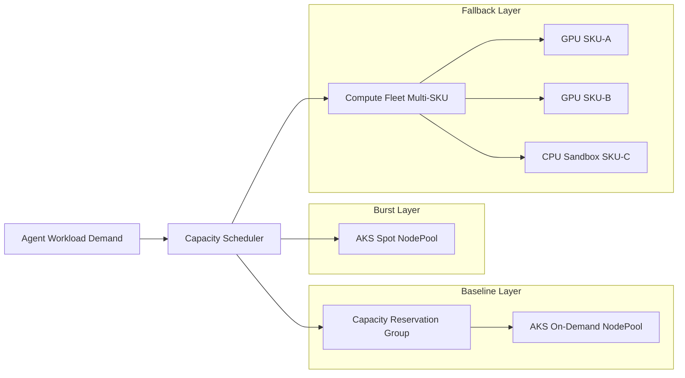
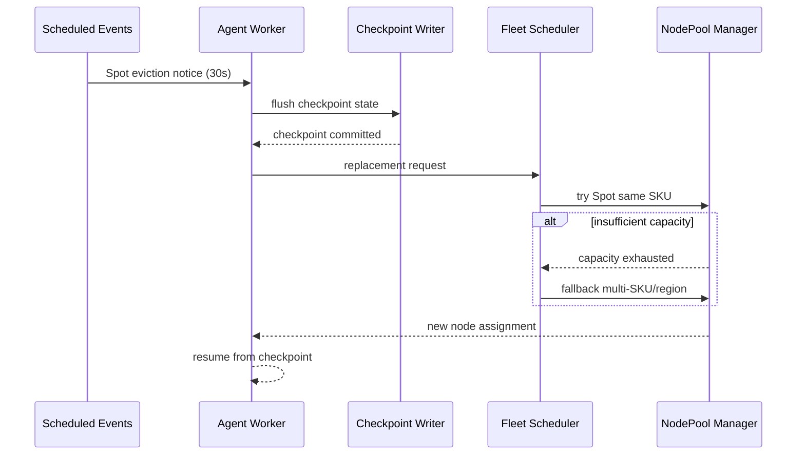

# Round 1090 / Cycle 2495 · Azure AI Agent Infra Six-Part FAQ (en)

> Topic: **Azure Capacity Reservation Groups (CRG) + AKS Spot Node Pools + Compute Fleet Multi-SKU Fallback for GPU & Sandbox Agent Clusters**  
> Date (BJT): 2026-11-17  
> Evidence tags: `measured` / `synthetic` / `anonymized_reported`  
> Benchmark dataset: `evidence/cycle-2495-benchmark.json`

## 1) Executive Summary + Daily Capability Breakthroughs Radar

This round addresses resilient capacity under **regional constraints + Spot evictions**:
1. Use **CRG** to lock baseline capacity.
2. Use **AKS Spot pools** for burst elasticity.
3. Use **Compute Fleet multi-SKU fallback** to survive SKU/regional exhaustion.

The optimization target is not minimum unit price; it is minimum blended cost that still meets SLO.

Key outcomes:
- Spot-only is cheap but operationally volatile.
- CRG-only is stable but expensive and slower to scale.
- CRG baseline + Spot burst + multi-SKU fallback is the strongest cost/reliability balance.
- 30-second Scheduled Events windows require deterministic checkpoint flush; otherwise recompute penalties erase Spot savings.

### Daily Capability Breakthroughs Radar (fetched: 2026-11-17)

1. APIM AI Gateway / Unified Model API (`measured`)  
   - https://learn.microsoft.com/en-us/azure/api-management/ai-gateway-overview  
   - https://github.com/Azure/API-Management/blob/main/changelogs/api-management-service.md
2. ACA Dynamic Sessions (`measured`)  
   - https://learn.microsoft.com/en-us/azure/container-apps/sessions  
   - https://techcommunity.microsoft.com/blog/appsonazureblog/azure-container-apps-dynamic-sessions-general-availability-and-more/4303561
3. Runtime upstream release tracking (`measured`)  
   - Firecracker/Kata/Wasmtime/E2B (see `evidence/cycle-2495-sources.json`)
4. CRG + Spot + Fleet capacity simulation (`synthetic`)  
   - multi-SKU fallback and eviction-window stress tests.
5. Restricted production rollups (`anonymized_reported`)  
   - aggregate statistics preserved, no tenant/regional identities.

### Mermaid #1: CRG baseline + Spot burst + multi-SKU fallback topology



## 2) Deep Q&A #1: How do we recompute checkpoint flush safety inside 30s Spot eviction windows?

Definitions:

```text
flush_time =
  serialize_state +
  compress +
  write_blob +
  metadata_commit

eviction_safe = flush_time <= 30s
```

Worked example:
- serialize `8.4s`
- compress `5.1s`
- blob write `11.9s`
- metadata commit `2.3s`

`flush_time = 27.7s` -> safe.

If state volume grows by 30% and write increases to `15.5s`:
- `flush_time = 31.3s` -> unsafe.

Mitigations:
1. shard/parallelize flush writes,
2. reduce per-window incremental state,
3. use asynchronous dual-buffer pre-write.

## 3) Deep Q&A #2: How do we find the cost optimum of CRG baseline + Spot burst?

```text
daily_cost =
  baseline_hours * baseline_nodes * on_demand_unit_cost
  + burst_hours * spot_nodes * spot_unit_cost
  + recompute_penalty

recompute_penalty =
  evicted_jobs * avg_recompute_minutes * cost_per_compute_min
```

Worked example:
- baseline: `18 nodes * 24h * 2.10 USD/h = 907.2`
- burst: `42 spot nodes * 7h * 0.74 USD/h = 217.56`
- evicted jobs `154`
- recompute `3.8 min/job`
- compute minute cost `0.036`

`recompute_penalty = 21.08`

Total:
`daily_cost = 1,145.84 USD/day`

If all on-demand:
- `1,562.4 USD/day`

Savings:
- `26.7%` under current eviction assumptions.

## 4) Deep Q&A #3: How does multi-SKU fallback preserve success during regional scarcity?

```text
effective_capacity =
  sum_i (sku_capacity_i * availability_prob_i * placement_weight_i)

fallback_success_rate =
  successful_replacements / replacement_requests
```

Worked example:
- SKU-A: cap=320, avail=0.62, weight=0.45
- SKU-B: cap=280, avail=0.71, weight=0.35
- SKU-C: cap=190, avail=0.88, weight=0.20

`effective_capacity = 192.4`

Replacement requests `1,120`, successful `1,021`:
- success rate `91.2%`

If below 90%:
- add cross-region fallback,
- shift weights toward high-availability SKU,
- relax strict GPU constraints for eligible tasks.

## 5) Deep Q&A #4: How do Spot eviction rates affect completion rates?

```text
completion_rate =
  1 - (evicted_unrecovered_jobs / total_jobs)

evicted_unrecovered_jobs =
  evicted_jobs * (1 - checkpoint_recovery_rate)
```

Worked example:
- total jobs `12,600`
- evicted jobs `1,070`
- checkpoint recovery `93.5%`

`evicted_unrecovered ≈ 70`

`completion_rate = 99.44%`

Suggested gates:
- completion rate >= 99.2%
- recovery rate >= 92%
- pause Spot expansion if recovery rate < 90%.

## 6) Deep Q&A #5: How do we balance queue latency and throughput in GPU/CPU mixed pools?

```text
queue_delay_p95 =
  f(arrival_rate, service_rate, available_nodes, preemption_rate)

throughput =
  completed_jobs / time_window
```

Worked example (30-minute window):
- arrival `420 jobs/min`
- service `455 jobs/min`
- preemption `6.8%`

Observed:
- queue delay p95 `42s`
- throughput `13,200 jobs / 30m`

If preemption rises to `12%`:
- queue delay p95 reaches `77s`.

Actions:
1. raise CRG baseline,
2. throttle low-priority job concurrency,
3. increase checkpoint frequency.

## 7) Deep Q&A #6: How should Compute Fleet multi-SKU strategy weights be tuned?

Strategy score:

```text
score_i =
  alpha * capacity_headroom_i +
  beta  * cost_efficiency_i +
  gamma * historical_stability_i
```

Default weights: `alpha=0.45, beta=0.30, gamma=0.25`.

Worked example:
- SKU-A score `0.71`
- SKU-B score `0.78`
- SKU-C score `0.66`

Priority:
- B > A > C

Under regional scarcity alert:
- increase `alpha` to `0.60`,
- reduce `beta` to `0.20`,
- prioritize availability before cost.

## 8) Mermaid #2: Eviction event, checkpoint, fallback scheduling flow



## 9) Production-grade Bicep / Karpenter NodePool YAML / Policy / KQL

### 9.1 Bicep (CRG baseline + AKS Spot + observability)

```bicep
targetScope = 'resourceGroup'

param location string = 'eastus2'
param aksName string = 'aks-agent-capacity-eus2'
param lawName string = 'law-capacity-eus2'
param crgName string = 'crg-agent-baseline-eus2'

resource law 'Microsoft.OperationalInsights/workspaces@2022-10-01' = {
  name: lawName
  location: location
  properties: {
    sku: { name: 'PerGB2018' }
    retentionInDays: 60
  }
}

resource aks 'Microsoft.ContainerService/managedClusters@2024-02-01' = {
  name: aksName
  location: location
  identity: { type: 'SystemAssigned' }
  properties: {
    dnsPrefix: 'aks-agent-capacity'
    agentPoolProfiles: [
      {
        name: 'basegpu'
        vmSize: 'Standard_NC24ads_A100_v4'
        count: 18
        mode: 'User'
        osType: 'Linux'
      }
      {
        name: 'burstspot'
        vmSize: 'Standard_NC24ads_A100_v4'
        count: 0
        mode: 'User'
        osType: 'Linux'
        scaleSetPriority: 'Spot'
        scaleSetEvictionPolicy: 'Delete'
        spotMaxPrice: -1
      }
    ]
    addonProfiles: {
      azuremonitor: {
        enabled: true
        config: {
          logAnalyticsWorkspaceResourceID: law.id
        }
      }
    }
  }
}
```

### 9.2 Karpenter NodePool YAML (multi-SKU fallback)

```yaml
apiVersion: karpenter.sh/v1beta1
kind: NodePool
metadata:
  name: gpu-fallback-pool
spec:
  disruption:
    consolidationPolicy: WhenUnderutilized
    expireAfter: 720h
  template:
    metadata:
      labels:
        workload-tier: gpu-agent
    spec:
      taints:
        - key: gpu
          value: "true"
          effect: NoSchedule
      requirements:
        - key: karpenter.azure.com/sku-family
          operator: In
          values: ["NCA100", "NCH100", "Dsv5"]
        - key: karpenter.sh/capacity-type
          operator: In
          values: ["spot", "on-demand"]
      kubelet:
        maxPods: 110
---
apiVersion: karpenter.sh/v1beta1
kind: NodeClaimTemplate
metadata:
  name: gpu-fallback-template
spec:
  metadata:
    labels:
      checkpoint-required: "true"
  spec:
    startupTaints:
      - key: capacity.warmup
        value: "true"
        effect: NoSchedule
```

### 9.3 Azure Policy (deny Spot-only for critical workloads)

```json
{
  "properties": {
    "displayName": "Deny critical agent workloads scheduled only on Spot capacity",
    "policyType": "Custom",
    "mode": "Indexed",
    "parameters": {},
    "policyRule": {
      "if": {
        "allOf": [
          { "field": "type", "equals": "Microsoft.ContainerService/managedClusters" },
          { "field": "tags.criticalAgentWorkload", "equals": "true" },
          { "field": "tags.capacityPolicy", "equals": "spot-only" }
        ]
      },
      "then": {
        "effect": "deny"
      }
    }
  }
}
```

### 9.4 KQL (eviction, recovery, and cost observability)

```kql
let t = ago(6h);
let evictions = customEvents
| where timestamp > t
| where name == "spot.eviction.notice"
| summarize evictions=count() by bin(timestamp, 5m), sku=tostring(customDimensions["sku"]);

let checkpoints = customEvents
| where timestamp > t
| where name == "checkpoint.flush"
| summarize
    flush_p95_s=percentile(todouble(customDimensions["flush_seconds"]), 95),
    recovery_rate=avg(todouble(customDimensions["recovered"]))
  by bin(timestamp, 5m), sku=tostring(customDimensions["sku"]);

evictions
| join kind=leftouter checkpoints on timestamp, sku
| project timestamp, sku, evictions, flush_p95_s, recovery_rate
| order by timestamp desc, sku asc
```

## 10) Quantitative 4-option Decision Matrix

| Option | Availability Stability (35%) | Cost Efficiency (25%) | Elasticity (20%) | Ops Complexity (20%) | Total |
|---|---:|---:|---:|---:|---:|
| CRG baseline + Spot burst + Fleet fallback (Recommended) | 9.0 | 8.8 | 9.3 | 7.6 | **8.73** |
| All on-demand | 9.2 | 5.1 | 6.2 | 8.4 | 7.38 |
| All Spot | 4.9 | 9.4 | 8.6 | 6.8 | 6.98 |
| CRG baseline + no fallback | 7.8 | 7.0 | 5.8 | 8.0 | 7.18 |

## 11) Day-0 / Day-2 Checklist (Good fit vs Not for)

**Day-0**
- [ ] Baseline capacity floor is defined for critical workloads.
- [ ] Spot eviction checkpoint flush p95 < 30s.
- [ ] Compute Fleet multi-SKU fallback drill has passed.
- [ ] Critical workloads are prevented from Spot-only placement.
- [ ] Cost/recovery telemetry is wired to dashboards.

**Day-2**
- [ ] Daily review of eviction rate, recovery rate, completion rate.
- [ ] Weekly review of fallback success rate and queue p95.
- [ ] Weekly recalibration of SKU weights and regional redundancy.
- [ ] Monthly review of blended cost vs recompute penalty.
- [ ] Quarterly regional-capacity exhaustion simulation.

**Good fit**
- GPU-constrained clusters with bursty demand,
- workloads that can recover from checkpoint,
- teams optimizing cost within strict SLO envelopes.

**Not for**
- long-running transactions without checkpoint recoverability,
- zero-interruption tolerance with unconstrained budget,
- environments lacking multi-SKU/multi-region scheduling capability.

## 12) Five-step rollout guide

1. **Secure baseline**: reserve critical baseline with CRG.
2. **Add Spot for burst**: only with deterministic checkpointing.
3. **Diversify supply**: enable multi-SKU fallback in Compute Fleet.
4. **Measure continuously**: eviction/recovery/cost as first-class KPIs.
5. **Tune by conditions**: adapt weights to regional capacity pressure.

## 13) Business scenario mapping

- **Coding agent sandbox**: low-priority batch uses Spot; interactive priority uses CRG.
- **Browser/CUA clusters**: burst via Spot, resume sessions quickly after eviction.
- **Multi-tenant SaaS gateway**: tiered tenants mapped to baseline quotas.
- **High-compliance finance runtime**: critical audit workflows forced to on-demand/CRG.

## 14) Primary sources (official first)

1. APIM AI Gateway overview (fetched: 2026-11-17)  
   https://learn.microsoft.com/en-us/azure/api-management/ai-gateway-overview  
2. API Management changelog (fetched: 2026-11-17)  
   https://github.com/Azure/API-Management/blob/main/changelogs/api-management-service.md  
3. ACA Dynamic Sessions docs (fetched: 2026-11-17)  
   https://learn.microsoft.com/en-us/azure/container-apps/sessions  
4. ACA Dynamic Sessions GA blog (fetched: 2026-11-17)  
   https://techcommunity.microsoft.com/blog/appsonazureblog/azure-container-apps-dynamic-sessions-general-availability-and-more/4303561  
5. Firecracker/Kata/Wasmtime/E2B releases (fetched: 2026-11-17)  
   See `evidence/cycle-2495-sources.json`

## 15) Data evidence and recomputable examples (with n denominator source)

- Benchmark payload: `evidence/cycle-2495-benchmark.json`  
- Latency sample: `evidence/cycle-2495-latency.csv`  
- Throughput sample: `evidence/cycle-2495-throughput.csv`  
- Policy sample: `evidence/cycle-2495-policy.csv`  
- Cost sample: `evidence/cycle-2495-cost.csv`  
- Source registry: `evidence/cycle-2495-sources.json`

N denominators:
- Spot eviction sample `N=1,070`;
- total jobs `N=12,600`;
- fallback requests `N=1,120`;
- cost windows `N=30 days`.

Recompute examples:

```text
flush_time = 8.4 + 5.1 + 11.9 + 2.3 = 27.7s
daily_cost = 907.2 + 217.56 + 21.08 = 1,145.84 USD/day
completion_rate = 1 - 70/12600 = 99.44%
fallback_success_rate = 1021/1120 = 91.2%

blended saving vs all on-demand:
(1562.4 - 1145.84) / 1562.4 = 26.7%
```

