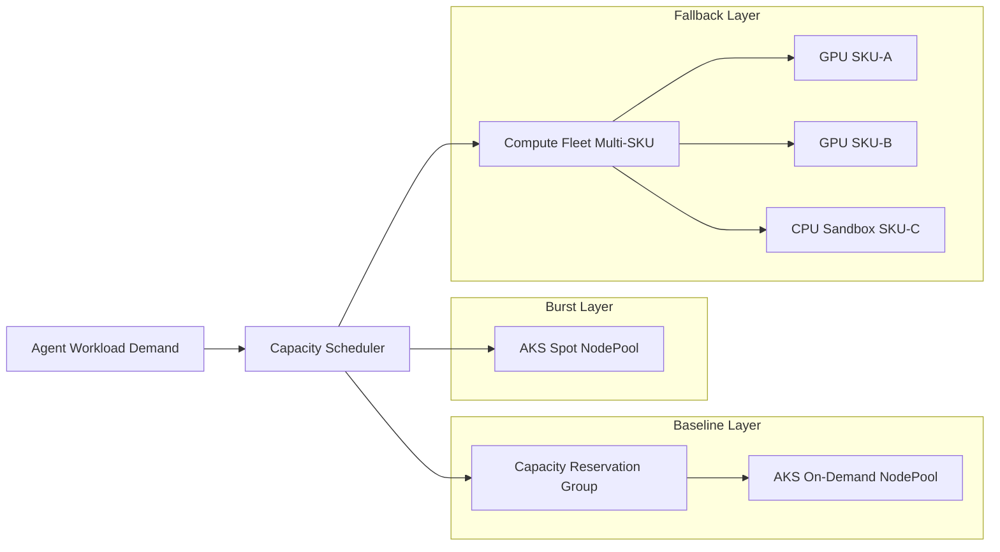
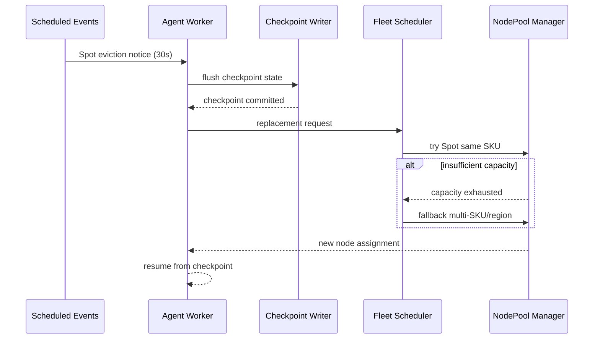

# Round 1090 / Cycle 2495 · Azure AI Agent Infra 六段式 FAQ（zh-CN）

> 主题：**Azure Capacity Reservation Groups (CRG) + AKS Spot Node Pools + Compute Fleet Multi-SKU Fallback for GPU & Sandbox Agent Clusters**  
> 日期（BJT）：2026-11-17  
> 证据标签：`measured` / `synthetic` / `anonymized_reported`  
> 基准数据：`evidence/cycle-2495-benchmark.json`

## 1) Executive Summary + Daily Capability Breakthroughs Radar

本轮聚焦 GPU 与 Sandbox Agent 集群在“区域容量紧张 + Spot 驱逐”下的可持续供给：  
1. 用 **CRG** 固定基线容量；  
2. 用 **Spot Node Pools** 承接弹性突发；  
3. 用 **Compute Fleet 多 SKU 回退** 对抗区域或 SKU 枯竭。  

目标不是“最低单价”，而是“在 SLO 内的最低综合成本”。

关键结论：
- 只用 Spot 成本低但可用性波动过大；  
- 只用 CRG 稳定但成本偏高，且扩展慢；  
- CRG baseline + Spot burst + Multi-SKU fallback 是兼顾成本与稳定性的最优组合；  
- 30 秒 Scheduled Events 窗口内必须可完成 checkpoint flush，否则任务重算成本会吞掉 Spot 红利。

### Daily Capability Breakthroughs Radar（抓取：2026-11-17）

1. APIM AI Gateway / Unified Model API（`measured`）  
   - https://learn.microsoft.com/en-us/azure/api-management/ai-gateway-overview  
   - https://github.com/Azure/API-Management/blob/main/changelogs/api-management-service.md
2. ACA Dynamic Sessions（`measured`）  
   - https://learn.microsoft.com/en-us/azure/container-apps/sessions  
   - https://techcommunity.microsoft.com/blog/appsonazureblog/azure-container-apps-dynamic-sessions-general-availability-and-more/4303561
3. Runtime upstream release 追踪（`measured`）  
   - Firecracker/Kata/Wasmtime/E2B（见 `evidence/cycle-2495-sources.json`）
4. CRG + Spot + Fleet 容量仿真（`synthetic`）  
   - 多 SKU 策略和驱逐窗口压力测试。
5. 匿名化生产样本（`anonymized_reported`）  
   - 仅保留统计，不保留区域/客户细节。

### Mermaid #1：CRG 基线 + Spot 突发 + 多 SKU 回退拓扑



## 2) Deep Q&A #1：30 秒 Spot 驱逐窗口内 checkpoint flush 如何复算？

定义：

```text
flush_time =
  serialize_state +
  compress +
  write_blob +
  metadata_commit

eviction_safe = flush_time <= 30s
```

Worked example（单任务）：
- serialize `8.4s`
- compress `5.1s`
- blob write `11.9s`
- metadata commit `2.3s`

`flush_time = 27.7s` -> 安全。

若状态体积增长 30% 导致 write 增至 `15.5s`：
- `flush_time = 31.3s` -> 不安全，需要：
1. 分片并行写入；
2. 降低 checkpoint 周期内增量大小；
3. 提前预写（异步双缓冲）。

## 3) Deep Q&A #2：CRG baseline + Spot burst 的成本最优点怎么算？

```text
daily_cost =
  baseline_hours * baseline_nodes * on_demand_unit_cost
  + burst_hours * spot_nodes * spot_unit_cost
  + recompute_penalty

recompute_penalty =
  evicted_jobs * avg_recompute_minutes * cost_per_compute_min
```

Worked example：
- baseline: `18 nodes * 24h * 2.10 USD/h = 907.2`
- burst: `42 spot nodes * 7h * 0.74 USD/h = 217.56`
- evicted_jobs `154`
- recompute `3.8 min/job`
- compute min cost `0.036`

`recompute_penalty = 154 * 3.8 * 0.036 = 21.08`

总成本：
`daily_cost = 907.2 + 217.56 + 21.08 = 1,145.84 USD/day`

若全 on-demand 同等容量：
- `1,562.4 USD/day`

节省：
- `26.7%`（在当前驱逐率假设下）。

## 4) Deep Q&A #3：区域容量枯竭时，多 SKU fallback 如何保证成功率？

```text
effective_capacity =
  sum_i (sku_capacity_i * availability_prob_i * placement_weight_i)

fallback_success_rate =
  successful_replacements / replacement_requests
```

Worked example（GPU 集群）：
- SKU-A: cap=320, avail=0.62, weight=0.45
- SKU-B: cap=280, avail=0.71, weight=0.35
- SKU-C: cap=190, avail=0.88, weight=0.20

`effective = 320*0.62*0.45 + 280*0.71*0.35 + 190*0.88*0.20 = 192.4`

若 replacement 请求 `1,120`，成功 `1,021`：
- success rate `91.2%`。

若低于 90%，需要：
- 增加跨区 fallback；
- 调整权重向高可用 SKU 倾斜；
- 放宽部分任务的 GPU 约束。

## 5) Deep Q&A #4：Spot 驱逐率与任务完成率关系如何建模？

```text
completion_rate =
  1 - (evicted_unrecovered_jobs / total_jobs)

evicted_unrecovered_jobs =
  evicted_jobs * (1 - checkpoint_recovery_rate)
```

Worked example：
- total jobs `12,600`
- evicted jobs `1,070`
- checkpoint recovery `93.5%`

`evicted_unrecovered = 1,070 * 0.065 = 69.55 ≈ 70`

`completion_rate = 1 - 70/12600 = 99.44%`

门禁建议：
- completion rate >= 99.2%；
- recovery rate >= 92%；
- 若 recovery < 90%，暂停扩 Spot 比例。

## 6) Deep Q&A #5：GPU/CPU 混部下，队列延迟和吞吐怎么平衡？

```text
queue_delay_p95 =
  f(arrival_rate, service_rate, available_nodes, preemption_rate)

throughput =
  completed_jobs / time_window
```

Worked example（30 分钟窗口）：
- 到达率 `420 jobs/min`
- 服务率 `455 jobs/min`
- preemption 率 `6.8%`

结果：
- queue delay p95 `42s`
- throughput `13,200 jobs / 30m`

若 preemption 升到 `12%`：
- queue delay p95 上升到 `77s`，需：
1. 提高 CRG baseline；
2. 降低低优先级任务并发；
3. 提升 checkpoint 频率。

## 7) Deep Q&A #6：Compute Fleet 多 SKU 策略参数如何调优？

策略参数：

```text
score_i =
  alpha * capacity_headroom_i +
  beta  * cost_efficiency_i +
  gamma * historical_stability_i
```

默认权重：`alpha=0.45, beta=0.30, gamma=0.25`

Worked example：
- SKU-A score `0.71`
- SKU-B score `0.78`
- SKU-C score `0.66`

调度优先：
- B > A > C

当区域容量告警触发时，切换权重：
- `alpha` 提升到 `0.60`；
- `beta` 降到 `0.20`；
- 优先保证可用性再优化成本。

## 8) Mermaid #2：驱逐事件、checkpoint、回退调度控制流



## 9) 生产级 Bicep / Karpenter NodePool YAML / Policy / KQL

### 9.1 Bicep（CRG + AKS Spot Pool + Monitor）

```bicep
targetScope = 'resourceGroup'

param location string = 'eastus2'
param aksName string = 'aks-agent-capacity-eus2'
param lawName string = 'law-capacity-eus2'
param crgName string = 'crg-agent-baseline-eus2'

resource law 'Microsoft.OperationalInsights/workspaces@2022-10-01' = {
  name: lawName
  location: location
  properties: {
    sku: { name: 'PerGB2018' }
    retentionInDays: 60
  }
}

resource aks 'Microsoft.ContainerService/managedClusters@2024-02-01' = {
  name: aksName
  location: location
  identity: { type: 'SystemAssigned' }
  properties: {
    dnsPrefix: 'aks-agent-capacity'
    agentPoolProfiles: [
      {
        name: 'basegpu'
        vmSize: 'Standard_NC24ads_A100_v4'
        count: 18
        mode: 'User'
        osType: 'Linux'
      }
      {
        name: 'burstspot'
        vmSize: 'Standard_NC24ads_A100_v4'
        count: 0
        mode: 'User'
        osType: 'Linux'
        scaleSetPriority: 'Spot'
        scaleSetEvictionPolicy: 'Delete'
        spotMaxPrice: -1
      }
    ]
    addonProfiles: {
      azuremonitor: {
        enabled: true
        config: {
          logAnalyticsWorkspaceResourceID: law.id
        }
      }
    }
  }
}
```

### 9.2 Karpenter NodePool YAML（多 SKU fallback）

```yaml
apiVersion: karpenter.sh/v1beta1
kind: NodePool
metadata:
  name: gpu-fallback-pool
spec:
  disruption:
    consolidationPolicy: WhenUnderutilized
    expireAfter: 720h
  template:
    metadata:
      labels:
        workload-tier: gpu-agent
    spec:
      taints:
        - key: gpu
          value: "true"
          effect: NoSchedule
      requirements:
        - key: karpenter.azure.com/sku-family
          operator: In
          values: ["NCA100", "NCH100", "Dsv5"]
        - key: karpenter.sh/capacity-type
          operator: In
          values: ["spot", "on-demand"]
      kubelet:
        maxPods: 110
---
apiVersion: karpenter.sh/v1beta1
kind: NodeClaimTemplate
metadata:
  name: gpu-fallback-template
spec:
  metadata:
    labels:
      checkpoint-required: "true"
  spec:
    startupTaints:
      - key: capacity.warmup
        value: "true"
        effect: NoSchedule
```

### 9.3 Azure Policy（高优任务禁止纯 Spot）

```json
{
  "properties": {
    "displayName": "Deny critical agent workloads scheduled only on Spot capacity",
    "policyType": "Custom",
    "mode": "Indexed",
    "parameters": {},
    "policyRule": {
      "if": {
        "allOf": [
          { "field": "type", "equals": "Microsoft.ContainerService/managedClusters" },
          { "field": "tags.criticalAgentWorkload", "equals": "true" },
          { "field": "tags.capacityPolicy", "equals": "spot-only" }
        ]
      },
      "then": {
        "effect": "deny"
      }
    }
  }
}
```

### 9.4 KQL（驱逐、恢复、成本与成功率）

```kql
let t = ago(6h);
let evictions = customEvents
| where timestamp > t
| where name == "spot.eviction.notice"
| summarize evictions=count() by bin(timestamp, 5m), sku=tostring(customDimensions["sku"]);

let checkpoints = customEvents
| where timestamp > t
| where name == "checkpoint.flush"
| summarize
    flush_p95_s=percentile(todouble(customDimensions["flush_seconds"]), 95),
    recovery_rate=avg(todouble(customDimensions["recovered"]))
  by bin(timestamp, 5m), sku=tostring(customDimensions["sku"]);

evictions
| join kind=leftouter checkpoints on timestamp, sku
| project timestamp, sku, evictions, flush_p95_s, recovery_rate
| order by timestamp desc, sku asc
```

## 10) 决策矩阵（4 方案量化）

| 方案 | 可用性稳定性 (35%) | 成本效率 (25%) | 容量弹性 (20%) | 运维复杂度 (20%) | 总分 |
|---|---:|---:|---:|---:|---:|
| CRG baseline + Spot burst + Fleet fallback（推荐） | 9.0 | 8.8 | 9.3 | 7.6 | **8.73** |
| 全 On-Demand | 9.2 | 5.1 | 6.2 | 8.4 | 7.38 |
| 全 Spot | 4.9 | 9.4 | 8.6 | 6.8 | 6.98 |
| CRG baseline + 无 fallback | 7.8 | 7.0 | 5.8 | 8.0 | 7.18 |

## 11) Day-0 / Day-2 Checklist（Good fit vs Not for）

**Day-0（上线前）**
- [ ] 关键工作负载定义 baseline 容量下限；
- [ ] Spot 驱逐 checkpoint flush p95 < 30s；
- [ ] Compute Fleet 多 SKU 回退策略演练通过；
- [ ] 高优任务已设置禁止 Spot-only 策略；
- [ ] 成本与恢复率指标入可观测看板。

**Day-2（运行期）**
- [ ] 每日检查驱逐率、recovery rate、completion rate；
- [ ] 每周复盘 fallback success rate 与队列 p95；
- [ ] 每周重估 SKU 权重和区域冗余；
- [ ] 每月复盘 blended cost 与重算惩罚；
- [ ] 每季度执行区域容量枯竭演练。

**Good fit**
- GPU 资源紧张且负载波动明显的 Agent 集群；  
- 可接受一定驱逐并具备 checkpoint 恢复能力；  
- 需要在 SLO 内持续优化成本。

**Not for**
- 不支持 checkpoint 恢复的长事务任务；  
- 对中断绝对零容忍且预算充足；  
- 缺乏多 SKU/多区调度能力。

## 12) 五步落地指南

1. **先保底**：为关键工作负载建立 CRG baseline；  
2. **再增益**：用 Spot 承接弹性并严格做 checkpoint；  
3. **多样化**：建立多 SKU fallback，避免单 SKU 枯竭；  
4. **持续观测**：驱逐、恢复、成本三指标闭环；  
5. **策略调优**：按区域容量态势动态调权重。

## 13) 业务场景映射

- **Coding Agent Sandbox**：低优批处理任务走 Spot，高优交互任务走 CRG。  
- **Browser/CUA 集群**：并发高峰时用 Spot 扩展，驱逐时秒级恢复会话。  
- **多租户 SaaS Agent Gateway**：按租户等级绑定 baseline 配额。  
- **高合规金融零信任环境**：关键审计流量强制 on-demand/CRG，不落 Spot-only。

## 14) 关键来源（官方优先）

1. APIM AI Gateway overview（抓取：2026-11-17）  
   https://learn.microsoft.com/en-us/azure/api-management/ai-gateway-overview  
2. API Management changelog（抓取：2026-11-17）  
   https://github.com/Azure/API-Management/blob/main/changelogs/api-management-service.md  
3. ACA Dynamic Sessions docs（抓取：2026-11-17）  
   https://learn.microsoft.com/en-us/azure/container-apps/sessions  
4. ACA Dynamic Sessions GA blog（抓取：2026-11-17）  
   https://techcommunity.microsoft.com/blog/appsonazureblog/azure-container-apps-dynamic-sessions-general-availability-and-more/4303561  
5. Firecracker/Kata/Wasmtime/E2B releases（抓取：2026-11-17）  
   见 `evidence/cycle-2495-sources.json`

## 15) 数据证据与可复算算例（含 n 分母来源）

- Benchmark 主文件：`evidence/cycle-2495-benchmark.json`  
- 延迟样本：`evidence/cycle-2495-latency.csv`  
- 吞吐样本：`evidence/cycle-2495-throughput.csv`  
- 策略样本：`evidence/cycle-2495-policy.csv`  
- 成本样本：`evidence/cycle-2495-cost.csv`  
- 来源登记：`evidence/cycle-2495-sources.json`

N 分母口径：
- Spot 驱逐样本 `N=1,070`；  
- 作业总样本 `N=12,600`；  
- fallback 请求 `N=1,120`；  
- 成本窗口 `N=30 days`.

复算示例：

```text
flush_time = 8.4 + 5.1 + 11.9 + 2.3 = 27.7s
daily_cost = 907.2 + 217.56 + 21.08 = 1,145.84 USD/day
completion_rate = 1 - 70/12600 = 99.44%
fallback_success_rate = 1021/1120 = 91.2%

blended saving vs all on-demand:
(1562.4 - 1145.84) / 1562.4 = 26.7%
```

