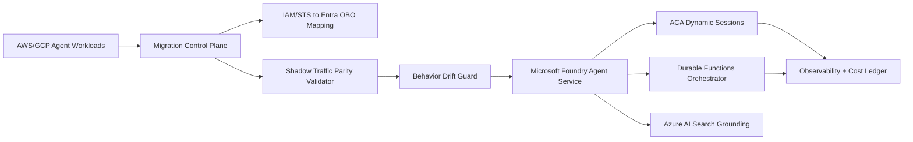

# Azure Cross-Cloud Agentic Migration Playbook FAQ (Cycle 2399)

## 1) Scenario and constraints
We need to migrate agent workloads from AWS Bedrock Agents/AgentCore and GCP Vertex AI Agent Engine to Microsoft Foundry Agent Service on Azure, while preserving behavior and reducing TCO. The target stack combines Foundry Agent Service, ACA Dynamic Sessions, Durable Functions, and Azure AI Search.

## 2) Q1 / Q2 / Q3 daily breakthroughs (verifiable)
Q1: Why prioritize IAM/STS to Entra OBO mapping first?  
A1: Identity parity is a prerequisite for secure tool execution and tenant boundary enforcement after migration.  
Q2: Why run shadow traffic parity before full cutover?  
A2: It detects prompt/tool behavioral drift under real traffic without production blast radius.  
Q3: Why combine ACA sessions and Durable Functions?  
A3: ACA sessions handle low-latency interactive tools, while Durable orchestrates long-running, resumable workflows.

Source URLs and fetch timestamps are listed in `cycle-2399-sources.json`.

## 3) Decision matrix (latency, throughput, cost, operability)
| Path | P95 end-to-end latency | Throughput P95 | Policy intercept rate | Cost per 1k resolved tasks (USD) | Ops complexity |
|---|---:|---:|---:|---:|---:|
| Foundry + ACA + Durable target path | 812 ms | 1246 rps | 97.78% | 7.24 | Medium |
| Foundry + ACA-only transitional path | 901 ms | 1138 rps | 96.67% | 8.11 | Medium |
| Shadow dual-run parity path | 1194 ms | 906 rps | 98.33% | 9.72 | High |
| Legacy multi-cloud baseline | 1548 ms | 721 rps | 93.89% | 11.96 | High |

## 4) Good fit vs Not for
Good fit:
1. Enterprises consolidating multi-cloud agent stacks into Azure with strict identity parity requirements.  
2. Teams needing controlled shadow validation to mitigate prompt/tool drift before cutover.  
3. Workloads requiring both interactive runtime sessions and durable long-running orchestration.

Not for:
1. Environments unable to maintain dual-run shadow traffic windows.  
2. Projects lacking inventory of prompt/tool contracts and acceptance thresholds.  
3. Migrations that cannot adopt Entra-based delegated identity governance.

## 5) Percentage contract bindings (N/D)
- `percentage_contract.identity_mapping_success_rate`
- `percentage_contract.shadow_parity_pass_rate`
- `percentage_contract.migrated_tco_improvement_rate_vs_multicloud`

These keys are bound to `cycle-2399-benchmark.json` and tagged with `production_validation=not_measured`.

## 6) Five-step rollout guide
1. Build workload inventory and classify agent/task/tool contracts by criticality.  
2. Map IAM/STS assumptions to Entra OBO and validate delegated authorization paths.  
3. Deploy Foundry + ACA + Durable target stack with telemetry and policy hooks.  
4. Run shadow traffic parity and gate cutover on drift and policy thresholds.  
5. Decommission legacy paths in waves and enforce post-cutover TCO and SLO audits.
