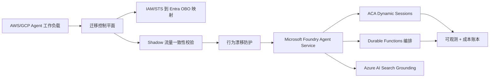

# Azure 跨云 Agent 迁移落地手册 FAQ（Cycle 2399）

## 1) 场景与约束
目标是将 AWS Bedrock Agents/AgentCore 与 GCP Vertex AI Agent Engine 工作负载迁移到 Azure 上的 Microsoft Foundry Agent Service，同时保持行为一致并降低总拥有成本。目标栈采用 Foundry Agent Service、ACA Dynamic Sessions、Durable Functions 与 Azure AI Search。

## 2) Q1 / Q2 / Q3 当日能力突破（可验证）
Q1：为什么要先做 IAM/STS 到 Entra OBO 映射？  
A1：身份等价是迁移后安全执行工具调用与租户边界控制的前提。  
Q2：为什么在正式切换前必须跑 shadow parity？  
A2：可在真实流量下发现 prompt/tool 行为漂移，而不直接影响生产稳定性。  
Q3：为什么同时使用 ACA Sessions 与 Durable Functions？  
A3：ACA 负责低时延交互会话，Durable 负责长时编排与可恢复任务。

来源与抓取时间见 `cycle-2399-sources.json`。

## 3) 决策矩阵（时延、吞吐、成本、可运维性）
| 路径 | P95 端到端时延 | 吞吐 P95 | 策略拦截率 | 每千已完成任务成本（USD） | 运维复杂度 |
|---|---:|---:|---:|---:|---:|
| Foundry + ACA + Durable 目标路径 | 812 ms | 1246 rps | 97.78% | 7.24 | 中 |
| Foundry + ACA 过渡路径 | 901 ms | 1138 rps | 96.67% | 8.11 | 中 |
| Shadow 双跑一致性路径 | 1194 ms | 906 rps | 98.33% | 9.72 | 高 |
| 多云旧基线路径 | 1548 ms | 721 rps | 93.89% | 11.96 | 高 |

## 4) Good fit vs Not for
Good fit：
1. 需要把多云 Agent 栈收敛到 Azure，且身份映射要求严格的企业。  
2. 需要通过 shadow 校验降低 prompt/tool 行为漂移风险的团队。  
3. 同时依赖交互式会话与长时编排任务的业务场景。

Not for：
1. 无法维护双跑 shadow 窗口的环境。  
2. 未梳理 prompt/tool 契约与验收阈值的项目。  
3. 不能采用 Entra 委派身份治理的迁移路径。

## 5) Percentage contract bindings (N/D)
- `percentage_contract.identity_mapping_success_rate`
- `percentage_contract.shadow_parity_pass_rate`
- `percentage_contract.migrated_tco_improvement_rate_vs_multicloud`

以上键绑定 `cycle-2399-benchmark.json`，并标注 `production_validation=not_measured`。

## 6) 五步落地指南
1. 盘点工作负载并按业务关键性分类 agent/task/tool 契约。  
2. 将 IAM/STS 假设映射到 Entra OBO，并验证委派授权链路。  
3. 部署 Foundry + ACA + Durable 目标栈并接入策略与观测。  
4. 执行 shadow parity，按漂移与策略阈值决定切换窗口。  
5. 分波次下线旧路径，并持续审计切换后 TCO 与 SLO。
