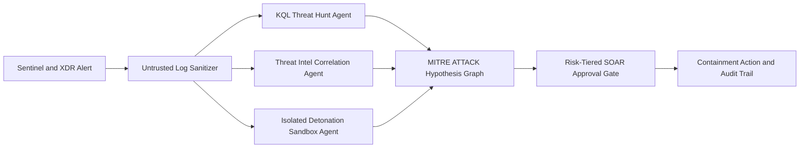

# Enterprise Cybersecurity SOC Triage, Threat Hunting, and SOAR Containment Agent Infrastructure FAQ (Cycle 2430)

## 1) Executive summary
This cycle designs a dual-lane SOC architecture: Tier-1 alert deduplication and prioritization on Sentinel plus Defender XDR, Tier-2 KQL threat hunting with parallel threat-intelligence and sandbox artifact detonation, and risk-tiered SOAR containment guarded by crown-jewel asset policies.

## 2) Q1 / Q2 / Q3
Q1: Why are SOC agents vulnerable to indirect prompt injection in logs?  
A1: Attackers can embed malicious instructions inside user-agent strings, headers, and payload fields that poison investigation prompts if logs are not sanitized.  
Q2: Why must investigation identity and containment identity be separated?  
A2: Investigation identities should remain read-only while containment identities require explicit approval gates and least privilege.  
Q3: How do we prevent accidental isolation of domain controllers or production AKS?  
A3: Apply crown-jewel tagging and blast-radius policies that require tiered approvals before high-impact containment.

## 3) SOC multi-agent closed loop (sanitize, parallel investigation, risk-tiered containment)

## 4) Decision matrix: Security Copilot OOB vs custom Foundry SOC agents vs hybrid mode
| Option | Time-to-value | Customization | Risk control | Ops complexity | Best fit |
|---|---:|---:|---:|---:|---|
| Security Copilot OOB | Highest | Medium | High | Low | Fast Tier-1/Tier-2 uplift |
| Custom Foundry SOC agents | Medium | Highest | High | High | Deep enterprise orchestration |
| Hybrid model | High | High | Highest | Medium-High | Large phased SOC transformation |

## 5) Enterprise SOC production checklist (with daily breakthroughs)
- Sanitize all untrusted log content before prompt or tool invocation.  
- Split investigation identity from containment identity with separate controls.  
- Require secondary approval for Tier-0 and crown-jewel containment actions.  
- Keep replayable audit chains for evidence, decisions, and containment outputs.  
- Daily breakthroughs (fetched on 2026-11-16, official/release-first):  
  - Sentinel and Defender XDR official integration baseline (`measured`).  
  - Security Copilot and Foundry investigation interoperability patterns (`anonymized_reported`).  
  - ACA/Kata isolation sandbox viability for malicious artifact analysis (`synthetic`).

## 6) Good fit vs Not for with percentage contract bindings
Good fit:  
1. Enterprise SOC teams targeting lower alert fatigue with safer automated containment.  
2. Regulated sectors requiring controlled approvals for high-impact containment.

Not for:  
1. Teams without untrusted-log sanitization and identity-separation governance.  
2. Platforms that auto-isolate crown-jewel assets without risk-tier checks.

Percentage contract bindings:
- `percentage_contract.prompt_injection_log_block_rate`
- `percentage_contract.crown_jewel_false_positive_containment_prevention_rate`
- `percentage_contract.critical_incident_mttr_improvement_rate`
- `percentage_contract.per_incident_siem_token_cost_reduction_rate`

These keys bind to `cycle-2430-benchmark.json` with `production_validation=not_measured`.
