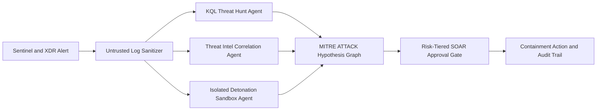

# 企业网络安全 SOC 分级分流、威胁狩猎与 SOAR 处置 Agent 基础设施 FAQ（Cycle 2430）

## 1) 执行摘要
本轮聚焦企业 SOC 的“快筛 + 深挖 + 安全处置”三段式架构：T1 使用 Sentinel/Defender XDR 做告警去重与优先级分流，T2 使用 KQL 与威胁情报图进行假设驱动狩猎，对不可信 URL/脚本进入隔离沙箱做工件引爆与 IOC 提取，最终通过分层审批的 SOAR 剧本执行最小爆炸半径处置。

## 2) Q1 / Q2 / Q3
Q1：为什么 SOC Agent 会被“日志里的间接提示注入”劫持？  
A1：攻击者可将恶意指令嵌入 User-Agent、邮件头或日志字段，若未经净化直接进入 Agent 推理上下文，会污染决策链。  
Q2：调查身份与处置身份为什么必须拆分？  
A2：KQL 狩猎身份应只读；SOAR 处置身份必须受审批门控与最小权限，防止误隔离关键资产。  
Q3：如何避免误封 Domain Controller 或生产 AKS？  
A3：引入 Crown-Jewel 标签与爆炸半径策略，处置动作先做资产分层校验与人工复核阈值判定。

## 3) SOC 多代理闭环流程（净化→并行调查→分层处置）

## 4) 决策矩阵：Security Copilot OOB vs Foundry 自定义 Agent vs 混合模式
| 方案 | 上手速度 | 可定制度 | 风险控制 | 运维复杂度 | 适配场景 |
|---|---:|---:|---:|---:|---|
| Security Copilot OOB | 最高 | 中 | 高 | 低 | 快速提升 T1/T2 产能 |
| Foundry 自定义 SOC Agent | 中 | 最高 | 高 | 高 | 复杂私有流程与深度编排 |
| 混合模式 | 高 | 高 | 最高 | 中高 | 大型企业渐进式落地 |

## 5) 企业 SOC Agent 上线清单（含当日热点）
- 所有入模日志必须先经过不可信内容净化层。  
- 调查链路与处置链路的身份、凭据与审批策略必须分离。  
- Tier-0/Crown-Jewel 资产动作必须强制二次审批或人工确认。  
- 所有处置动作要可回放：输入证据、决策路径、执行结果一致。  
- 当日热点（抓取日：2026-11-16，官方/Release 优先）：  
  - Sentinel + Defender XDR 在统一告警与调查编排上的官方能力（`measured`）。  
  - Security Copilot / Foundry Agent 协同调查模式（`anonymized_reported`）。  
  - ACA/Kata 隔离沙箱对恶意工件分析路径的工程可行性（`synthetic`）。

## 6) Good fit vs Not for 与百分比合约绑定
Good fit：  
1. 希望显著降低告警疲劳并保持高质量处置闭环的企业 SOC。  
2. 需要“自动化优先 + 高风险动作可控审批”的受监管行业。

Not for：  
1. 无法建立日志净化与身份分层治理的团队。  
2. 无 Crown-Jewel 资产分层、直接自动处置生产核心资产的系统。

百分比合约绑定：
- `percentage_contract.prompt_injection_log_block_rate`
- `percentage_contract.crown_jewel_false_positive_containment_prevention_rate`
- `percentage_contract.critical_incident_mttr_improvement_rate`
- `percentage_contract.per_incident_siem_token_cost_reduction_rate`

以上键绑定 `cycle-2430-benchmark.json`，并标注 `production_validation=not_measured`。
