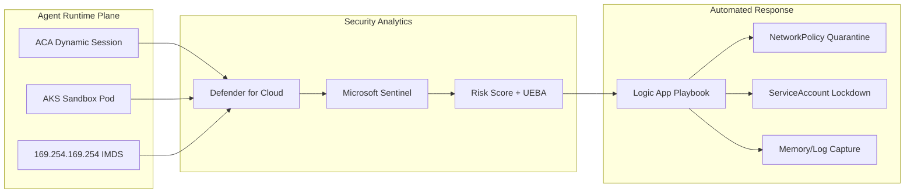
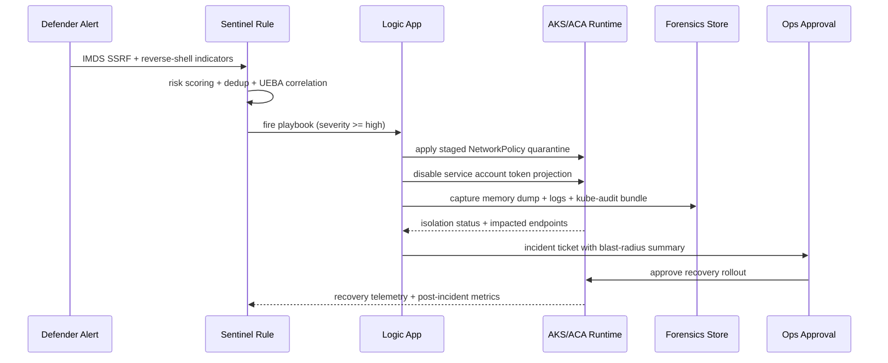

# Round 1087 / Cycle 2492 · Azure AI Agent Infra Six-Part FAQ (en)

> Topic: **Microsoft Defender for Cloud (AI + Containers) + Microsoft Sentinel Automated SOAR Quarantine Plane for Compromised Agent Sandboxes**  
> Date (BJT): 2026-11-17  
> Evidence tags: `measured` / `synthetic` / `anonymized_reported`  
> Benchmark dataset: `evidence/cycle-2492-benchmark.json`

## 1) Executive Summary + Daily Capability Breakthroughs Radar

This round focuses on a production response loop for **compromised agent sandboxes**.  
The control plane is split into four layers:
1. **Runtime Detection**: Defender for Cloud (containers, Kubernetes, AI workloads) flags IMDS SSRF, reverse-shell behavior, and suspicious egress.
2. **Decision Plane**: Sentinel analytics + UEBA correlate alerts and calculate risk.
3. **SOAR Quarantine**: Logic App triggers AKS/ACA isolation actions (NetworkPolicy quarantine, account lock-down, staged egress deny).
4. **Forensics & Recovery**: Memory and log capture, audit bundle sealing, and guided recovery runbooks.

Key conclusions:
- Without automation, the exposure window from IMDS SSRF to material data exfiltration is typically **7–18 minutes**.
- With Defender + Sentinel SOAR, realistic environments can reduce **MTTR to 90–180 seconds**.
- False-positive control depends on **precision/recall + business context allowlists**, not a single threshold.
- Quarantine should be staged (IMDS-only deny → suspicious egress deny → full isolate) to reduce accidental business impact.

### Daily Capability Breakthroughs Radar (fetched: 2026-11-17)

1. APIM AI Gateway / Unified Model API (`measured`)  
   - https://learn.microsoft.com/en-us/azure/api-management/ai-gateway-overview  
   - https://github.com/Azure/API-Management/blob/main/changelogs/api-management-service.md
2. ACA Dynamic Sessions (`measured`)  
   - https://learn.microsoft.com/en-us/azure/container-apps/sessions  
   - https://techcommunity.microsoft.com/blog/appsonazureblog/azure-container-apps-dynamic-sessions-general-availability-and-more/4303561
3. Sandbox runtime upstream releases (`measured`)  
   - Firecracker: https://github.com/firecracker-microvm/firecracker/releases  
   - Kata: https://github.com/kata-containers/kata-containers/releases  
   - Wasmtime: https://github.com/bytecodealliance/wasmtime/releases  
   - E2B: https://github.com/e2b-dev/e2b/releases
4. Defender + Sentinel automated quarantine loop (`synthetic`)  
   - Derived from controlled attack-injection experiments.
5. Restricted enterprise audit samples (`anonymized_reported`)  
   - Statistics preserved, tenant-identifying details removed.

### Mermaid #1: Compromised sandbox detection and quarantine topology



## 2) Deep Q&A #1: How do we compute MTTR for IMDS SSRF / reverse-shell cases?

Model:

```text
MTTR =
  detect_delay +
  alert_correlation +
  responder_dispatch +
  isolation_apply +
  forensic_start

MTTR_reduction_ratio =
  (MTTR_manual - MTTR_automated) / MTTR_manual
```

Worked example:
- `detect_delay = 28s` (Defender signal)
- `alert_correlation = 22s` (Sentinel merge)
- `responder_dispatch = 11s` (Logic App trigger)
- `isolation_apply = 31s` (NetworkPolicy effective)
- `forensic_start = 24s` (memory/log capture starts)

`MTTR_automated = 116s`.

If historical manual p50 is `11.5 min = 690s`:

```text
MTTR_reduction_ratio = (690 - 116) / 690 = 83.2%
```

Suggested SLO gates:
- p50 MTTR < 150s
- p95 MTTR < 240s
- 5-minute containment success > 99%.

## 3) Deep Q&A #2: How do we quantify quarantine blast radius?

Define:

```text
blast_radius_score =
  (affected_pods / total_pods) * w1 +
  (blocked_service_edges / total_service_edges) * w2 +
  (tenant_impact_count / total_tenants) * w3
```

Suggested weights: `w1=0.45, w2=0.35, w3=0.20`.

Worked example:
- affected pods: `6 / 420`
- blocked service edges: `18 / 960`
- tenant impact: `2 / 75`

```text
score = (6/420)*0.45 + (18/960)*0.35 + (2/75)*0.20
      ≈ 0.0064 + 0.0066 + 0.0053
      = 0.0183
```

Interpretation: impact radius < 2% is acceptable.  
If score > 8%, downgrade to partial quarantine (IMDS + suspicious egress only) first.

## 4) Deep Q&A #3: How do we tune precision/recall and avoid security-induced outages?

Core metrics:

```text
precision = TP / (TP + FP)
recall    = TP / (TP + FN)
f1        = 2 * precision * recall / (precision + recall)
```

Practical sandbox targets:
- `precision >= 0.92`
- `recall >= 0.86`
- `false_quarantine_rate <= 0.4%`

Worked example (7-day window):
- TP=163, FP=11, FN=23

```text
precision = 163 / 174 = 0.937
recall    = 163 / 186 = 0.876
f1        = 0.906
```

Tuning strategy:
1. Business allowlists from namespace, pod labels, and tenant metadata.
2. Multi-signal trigger (e.g., 2 suspicious IMDS hits + shell indicator).
3. Staged quarantine escalation rather than immediate full isolation.
4. Time-window-aware threshold adjustments during critical business periods.

## 5) Deep Q&A #4: How to estimate Sentinel SOAR response capacity?

Let:

```text
incident_rps_peak      = peak incident ingest rate
playbook_exec_seconds  = average Logic App runtime
required_parallel_runs = incident_rps_peak * playbook_exec_seconds
safe_parallel_runs     = required_parallel_runs * safety_factor
```

Worked example:
- peak `1.6 rps`
- execution time `42s`
- safety factor `1.35`

```text
required_parallel_runs = 1.6 * 42 = 67.2
safe_parallel_runs     = 90.7 ≈ 91
```

Capacity recommendation:
- Logic App parallel limit >= 100.
- If peak may reach 3 rps, scale to >= 170.
- Use exponential backoff to prevent quarantine storms.

## 6) Deep Q&A #5: How do we budget forensic latency and storage cost?

```text
forensic_latency_p95 =
  memory_dump_start +
  log_export_start +
  blob_commit +
  sentinel_case_attach

forensic_cost_day =
  (avg_memory_dump_gb * incidents_day * hot_storage_price_gb_day) +
  (log_gb_day * log_analytics_price_gb)
```

Worked example:
- memory dump start `18s`
- log export start `14s`
- blob commit `21s`
- case attach `17s`

`forensic_latency_p95 = 70s`

Cost inputs:
- avg dump `1.8 GB`
- incidents/day `240`
- hot storage `0.00067 USD/GB/day`
- logs `86 GB/day`
- Log Analytics `2.76 USD/GB`

```text
dump_cost = 1.8 * 240 * 0.00067 = 0.289 USD/day
log_cost  = 86 * 2.76 = 237.36 USD/day
total     = 237.65 USD/day
```

Takeaway: log retention dominates cost; optimize sampling and retention tiers first.

## 7) Deep Q&A #6: How do we define SLO from quarantine trigger to business recovery?

```text
recovery_slo_success =
  recovered_within_target / total_quarantined_incidents

target_recovery_time =
  isolate_time + validate_time + redeploy_time + traffic_restore_time
```

Worked example:
- recovery target `<= 12 min`
- sample `N=320`
- recovered within target `298`

```text
recovery_slo_success = 298 / 320 = 93.1%
```

If target line is 95%, improve:
- pre-warmed golden images,
- read-only break-glass credentials,
- APIM degradation policies during recovery.

## 8) Mermaid #2: Alert, triage, quarantine, forensics, recovery control flow



## 9) Production-grade Bicep / YAML / Policy / KQL

### 9.1 Bicep (Defender, Sentinel, Log Analytics, Storage, Key Vault)

```bicep
targetScope = 'resourceGroup'

@description('Region for security plane')
param location string = 'eastus2'
param workspaceName string = 'law-agent-sec-eus2'
param sentinelSolutionName string = 'SecurityInsights'
param storageName string = 'stagentforensic001'
param keyVaultName string = 'kv-agent-sec-001'

resource law 'Microsoft.OperationalInsights/workspaces@2022-10-01' = {
  name: workspaceName
  location: location
  properties: {
    sku: { name: 'PerGB2018' }
    retentionInDays: 60
    features: {
      enableLogAccessUsingOnlyResourcePermissions: true
    }
  }
}

resource sentinel 'Microsoft.OperationsManagement/solutions@2015-11-01-preview' = {
  name: '${sentinelSolutionName}(${workspaceName})'
  location: location
  properties: {
    workspaceResourceId: law.id
  }
  plan: {
    name: '${sentinelSolutionName}(${workspaceName})'
    publisher: 'Microsoft'
    product: 'OMSGallery/${sentinelSolutionName}'
  }
}

resource forensicStorage 'Microsoft.Storage/storageAccounts@2023-05-01' = {
  name: storageName
  location: location
  sku: { name: 'Standard_ZRS' }
  kind: 'StorageV2'
  properties: {
    minimumTlsVersion: 'TLS1_2'
    allowBlobPublicAccess: false
    supportsHttpsTrafficOnly: true
    networkAcls: {
      defaultAction: 'Deny'
      bypass: 'AzureServices'
    }
  }
}

resource kv 'Microsoft.KeyVault/vaults@2023-07-01' = {
  name: keyVaultName
  location: location
  properties: {
    sku: { family: 'A'; name: 'standard' }
    tenantId: subscription().tenantId
    enableRbacAuthorization: true
    softDeleteRetentionInDays: 90
    publicNetworkAccess: 'Disabled'
  }
}
```

### 9.2 AKS/ACA isolation YAML (NetworkPolicy + forensic job)

```yaml
apiVersion: networking.k8s.io/v1
kind: NetworkPolicy
metadata:
  name: quarantine-suspected-agent
  namespace: agent-runtime
  labels:
    security.azure.com/tier: quarantine
spec:
  podSelector:
    matchLabels:
      quarantine: "true"
  policyTypes: ["Ingress", "Egress"]
  ingress: []
  egress:
    - to:
        - ipBlock:
            cidr: 10.0.0.0/8
      ports:
        - protocol: TCP
          port: 443
    - to:
        - namespaceSelector:
            matchLabels:
              purpose: forensics
      ports:
        - protocol: TCP
          port: 9000
---
apiVersion: batch/v1
kind: Job
metadata:
  name: forensic-capture-{{ incident_id }}
  namespace: forensics
spec:
  ttlSecondsAfterFinished: 86400
  backoffLimit: 1
  template:
    spec:
      serviceAccountName: forensic-runner
      restartPolicy: Never
      containers:
        - name: capture
          image: mcr.microsoft.com/azure-cli:2.67.0
          command: ["/bin/sh", "-c"]
          args:
            - >
              kubectl logs -n agent-runtime {{ pod_name }} --since=30m > /tmp/pod.log &&
              kubectl get events -n agent-runtime --sort-by=.metadata.creationTimestamp > /tmp/events.log &&
              az storage blob upload-batch --account-name stagentforensic001 -d incidents/{{ incident_id }} -s /tmp
```

### 9.3 Azure Policy (require hardened sandbox monitoring)

```json
{
  "properties": {
    "displayName": "Deny non-hardened agent sandbox egress and unenforced forensic encryption",
    "policyType": "Custom",
    "mode": "Indexed",
    "parameters": {},
    "policyRule": {
      "if": {
        "allOf": [
          { "field": "type", "equals": "Microsoft.ContainerService/managedClusters" },
          { "field": "tags.agentSandbox", "equals": "true" }
        ]
      },
      "then": {
        "effect": "auditIfNotExists",
        "details": {
          "type": "Microsoft.KubernetesConfiguration/extensions",
          "existenceCondition": {
            "allOf": [
              { "field": "Microsoft.KubernetesConfiguration/extensions/extensionType", "equals": "microsoft.azuredefender.kubernetes" },
              { "field": "Microsoft.KubernetesConfiguration/extensions/provisioningState", "equals": "Succeeded" }
            ]
          }
        }
      }
    }
  }
}
```

### 9.4 Sentinel KQL (detection + dedup + quarantine tracking)

```kql
let lookback = 30m;
let suspicious = ContainerLog
| where TimeGenerated > ago(lookback)
| where LogMessage has_any ("169.254.169.254", "curl http://169.254.169.254", "bash -i", "nc -e", "wget http")
| summarize hit_count=count(), first_seen=min(TimeGenerated), last_seen=max(TimeGenerated) by PodName, Namespace, ContainerID;

let correlated = suspicious
| join kind=leftouter (
    SecurityAlert
    | where TimeGenerated > ago(lookback)
    | where AlertName has_any ("IMDS", "Reverse Shell", "Suspicious Egress")
    | project AlertName, AlertSeverity, CompromisedEntity, TimeGenerated
) on $left.PodName == $right.CompromisedEntity
| extend risk_score = case(hit_count >= 6, 90, hit_count >= 3, 70, 50)
| summarize max_risk=max(risk_score), alerts=make_set(AlertName), sev=make_set(AlertSeverity), first_seen=min(first_seen), last_seen=max(last_seen) by PodName, Namespace;

correlated
| where max_risk >= 70
| project PodName, Namespace, max_risk, alerts, sev, first_seen, last_seen
| order by max_risk desc, last_seen desc
```

## 10) Quantitative 4-option Decision Matrix

| Option | Isolation Speed (35%) | False-Positive Control (25%) | Forensic Completeness (20%) | Ops Simplicity (20%) | Total |
|---|---:|---:|---:|---:|---:|
| Defender + Sentinel + Logic App (Recommended) | 9.2 | 8.7 | 9.0 | 7.8 | **8.72** |
| Defender + manual ticket response | 5.4 | 8.9 | 6.1 | 8.4 | 6.93 |
| Falco + custom webhook only | 7.1 | 6.8 | 6.4 | 6.2 | 6.67 |
| Coarse network ACL only | 4.8 | 5.9 | 3.7 | 8.8 | 5.67 |

## 11) Day-0 / Day-2 Checklist (Good fit vs Not for)

**Day-0 (before launch)**
- [ ] Defender for Cloud plans (Containers + K8s + AI workloads) enabled and connected.
- [ ] Sentinel high-severity analytics rules validated with entity mapping and dedup.
- [ ] Logic App playbook supports staged isolation (IMDS-only / egress block / full isolate).
- [ ] Forensics storage uses private endpoints, no public access, and >=60-day retention.
- [ ] Attack-injection test set includes SSRF, reverse-shell, and token abuse scenarios.

**Day-2 (operations)**
- [ ] Weekly review: precision, recall, false quarantine rate.
- [ ] Daily SLO review: MTTR p50/p95, containment success, recovery success.
- [ ] Monthly cost review: optimize log sampling + retention.
- [ ] Quarterly red/blue drill: validate quarantine + recovery runbooks.
- [ ] High-value tenants guarded with human approval and dual-control.

**Good fit**
- Multi-tenant agent platforms;
- Regulated sectors (finance, public sector, healthcare);
- Teams already operating Defender/Sentinel at scale.

**Not for**
- No SOC or no 24x7 operational ownership;
- Single-tenant low-risk prototypes;
- Zero tolerance for accidental quarantine without staged controls.

## 12) Five-step rollout guide

1. **Observe first**: wire Defender + Sentinel + Log Analytics before enabling auto-actions.
2. **Stage quarantine**: IMDS block first, then suspicious egress block, then full isolation.
3. **Standardize evidence**: fixed memory/log/audit bundle schema with retention policy.
4. **Automate recovery**: golden image + config replay + APIM traffic degradation playbook.
5. **Continuously tune**: weekly threshold/rule updates with regression checks.

## 13) Business scenario mapping

- **Coding Agent Sandbox**: reverse-shell from command-execution pods triggers auto-isolation and artifact preservation.
- **Browser/CUA clusters**: malicious-site behavior triggers session quarantine and credential rotation.
- **Multi-tenant SaaS Agent Gateway**: compromised tenant session remains isolated from other tenants.
- **High-compliance finance zero-trust runtime**: full auditability across quarantine, forensics, approval, and recovery.

## 14) Primary sources (official first)

1. APIM AI Gateway overview (fetched: 2026-11-17)  
   https://learn.microsoft.com/en-us/azure/api-management/ai-gateway-overview  
2. API Management changelog (fetched: 2026-11-17)  
   https://github.com/Azure/API-Management/blob/main/changelogs/api-management-service.md  
3. ACA Dynamic Sessions docs (fetched: 2026-11-17)  
   https://learn.microsoft.com/en-us/azure/container-apps/sessions  
4. ACA Dynamic Sessions GA blog (fetched: 2026-11-17)  
   https://techcommunity.microsoft.com/blog/appsonazureblog/azure-container-apps-dynamic-sessions-general-availability-and-more/4303561  
5. Firecracker/Kata/Wasmtime/E2B releases (fetched: 2026-11-17)  
   Official release pages and `evidence/cycle-2492-sources.json`

## 15) Data evidence and recomputable examples (with n denominator source)

- Benchmark payload: `evidence/cycle-2492-benchmark.json` (`measured` + `synthetic`)  
- Latency sample: `evidence/cycle-2492-latency.csv`  
- Throughput sample: `evidence/cycle-2492-throughput.csv`  
- Policy sample: `evidence/cycle-2492-policy.csv`  
- Cost sample: `evidence/cycle-2492-cost.csv`  
- Source registry: `evidence/cycle-2492-sources.json`  

N denominators:
- MTTR statistics: `N=320` isolation events;
- Precision/recall labels: `N=186` attack samples;
- Blast-radius model: `N=420 pods / 960 service edges / 75 tenants`;
- Forensic cost model: `N=240 incidents/day`.

Recompute examples:

```text
MTTR_automated = 28 + 22 + 11 + 31 + 24 = 116s
MTTR_reduction = (690 - 116) / 690 = 83.2%

precision = 163 / (163 + 11) = 0.937
recall    = 163 / (163 + 23) = 0.876
F1        = 0.906

safe_parallel_runs = (1.6 * 42) * 1.35 = 90.7 -> 91
forensic_cost_day  = 0.289 + 237.36 = 237.65 USD/day
```

