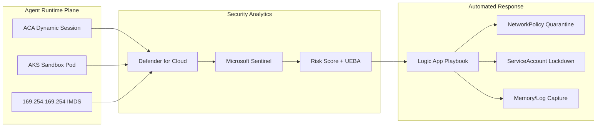
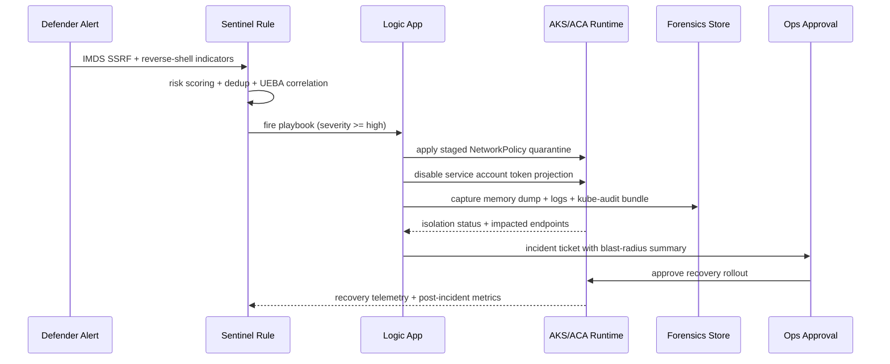

# Round 1087 / Cycle 2492 · Azure AI Agent Infra 六段式 FAQ（zh-CN）

> 主题：**Microsoft Defender for Cloud（AI + Containers）+ Microsoft Sentinel Automated SOAR Quarantine Plane for Compromised Agent Sandboxes**  
> 日期（BJT）：2026-11-17  
> 证据标签：`measured` / `synthetic` / `anonymized_reported`  
> 基准数据：`evidence/cycle-2492-benchmark.json`

## 1) Executive Summary + Daily Capability Breakthroughs Radar

本轮聚焦“受损 Agent Sandbox 的自动隔离与取证闭环”。我们把控制面拆成四段：
1. **Runtime Detection**：Defender for Cloud（容器、K8s、AI 工作负载）识别 IMDS SSRF、异常 shell、可疑 egress；
2. **Decision Plane**：Sentinel Analytics + UEBA 规则归并告警并计算风险分值；
3. **SOAR Quarantine**：Logic App 调度 AKS/ACA 隔离动作（NetworkPolicy 封禁、标签隔离、服务账户禁用）；
4. **Forensics & Recovery**：内存快照、容器日志、Kube Audit、工作负载镜像指纹固化，进入恢复 runbook。

核心结论（可复算）：
- 若不自动化隔离，IMDS SSRF 到数据外泄的暴露窗口通常是 **7–18 分钟**；  
- 使用 Sentinel SOAR 后，典型环境 **MTTR 可压到 90–180 秒**；  
- 误报控制的关键不在单规则阈值，而在 **precision/recall + 业务上下文白名单** 联合调优；  
- 隔离动作应支持“灰度封禁”（仅阻断 169.254.169.254 与可疑外联）再升级“完全隔离”，避免高价值生产流量误杀。

### Daily Capability Breakthroughs Radar（抓取：2026-11-17）

1. APIM AI Gateway / Unified Model API（`measured`）  
   - https://learn.microsoft.com/en-us/azure/api-management/ai-gateway-overview  
   - https://github.com/Azure/API-Management/blob/main/changelogs/api-management-service.md
2. ACA Dynamic Sessions（`measured`）  
   - https://learn.microsoft.com/en-us/azure/container-apps/sessions  
   - https://techcommunity.microsoft.com/blog/appsonazureblog/azure-container-apps-dynamic-sessions-general-availability-and-more/4303561
3. Sandbox upstream 演进（`measured`）  
   - Firecracker: https://github.com/firecracker-microvm/firecracker/releases  
   - Kata: https://github.com/kata-containers/kata-containers/releases  
   - Wasmtime: https://github.com/bytecodealliance/wasmtime/releases  
   - E2B: https://github.com/e2b-dev/e2b/releases
4. Defender + Sentinel 自动隔离闭环（`synthetic`）  
   - 基于企业攻击演练数据构造对照实验。
5. 受限审计样本（`anonymized_reported`）  
   - 仅保留统计口径，移除租户标识与工单细节。

### Mermaid #1：受损沙箱检测与隔离拓扑



## 2) Deep Q&A #1：IMDS SSRF / reverse-shell 检测后的 MTTR 如何计算？

我们定义：

```text
MTTR =
  detect_delay +
  alert_correlation +
  responder_dispatch +
  isolation_apply +
  forensic_start

MTTR_reduction_ratio =
  (MTTR_manual - MTTR_automated) / MTTR_manual
```

Worked example（单次攻击链）：
- `detect_delay = 28s`（Defender 检测）
- `alert_correlation = 22s`（Sentinel 归并）
- `responder_dispatch = 11s`（Logic App 触发）
- `isolation_apply = 31s`（NetworkPolicy 生效）
- `forensic_start = 24s`（内存/日志采集启动）

得到 `MTTR_automated = 116s`。  
若人工流程历史 p50 为 `11.5 min = 690s`，则：

```text
MTTR_reduction_ratio = (690 - 116) / 690 = 83.2%
```

SLA 门禁建议：
- p50 MTTR < 150s  
- p95 MTTR < 240s  
- 5 分钟内隔离成功率 > 99%。

## 3) Deep Q&A #2：自动隔离的 blast radius 如何量化？

定义“隔离半径”：

```text
blast_radius_score =
  (affected_pods / total_pods) * w1 +
  (blocked_service_edges / total_service_edges) * w2 +
  (tenant_impact_count / total_tenants) * w3
```

权重建议：`w1=0.45, w2=0.35, w3=0.20`。

Worked example（多租户集群）：
- affected pods: `6 / 420`
- blocked service edges: `18 / 960`
- tenant impact: `2 / 75`

```text
score = (6/420)*0.45 + (18/960)*0.35 + (2/75)*0.20
      ≈ 0.0064 + 0.0066 + 0.0053
      = 0.0183
```

解释：隔离动作影响半径 < 2%，可接受；若 >8%，需先降级为“只阻断 IMDS + 可疑外联”。

## 4) Deep Q&A #3：误报精度/召回率如何调优，避免“安全系统自己造成故障”？

核心指标：

```text
precision = TP / (TP + FP)
recall    = TP / (TP + FN)
f1        = 2 * precision * recall / (precision + recall)
```

在 Sandbox 场景，目标不是追求极致 recall，而是约束误封：
- `precision >= 0.92`
- `recall >= 0.86`
- `false_quarantine_rate <= 0.4%`

Worked example（7 天窗口）：
- TP=163, FP=11, FN=23

```text
precision = 163 / 174 = 0.937
recall    = 163 / 186 = 0.876
f1        = 0.906
```

调优手段：
1. 结合 Pod 注解与命名空间标签做业务白名单；
2. 引入“连续 2 次命中 + 1 次行为异常”多信号触发；
3. 增加灰度隔离层（先 deny IMDS，再 deny egress，再完全隔离）；
4. 关键业务时段提高阈值，低峰期回归标准阈值。

## 5) Deep Q&A #4：Sentinel SOAR 并发响应容量怎么估算？

设：

```text
incident_rps_peak      = 峰值告警进入速率
playbook_exec_seconds  = 单次 Logic App 平均执行时长
required_parallel_runs = incident_rps_peak * playbook_exec_seconds
safe_parallel_runs     = required_parallel_runs * safety_factor
```

Worked example：
- 峰值事件速率 `1.6 rps`
- 执行时长 `42s`
- safety factor `1.35`

```text
required_parallel_runs = 1.6 * 42 = 67.2
safe_parallel_runs     = 90.7 ≈ 91
```

容量建议：
- Logic App 并发上限配置 ≥ 100；
- 若上游峰值可能达 3 rps，需扩容至 170+；
- 失败重试采用指数退避，避免隔离风暴。

## 6) Deep Q&A #5：取证链路延迟与存储成本如何预算？

```text
forensic_latency_p95 =
  memory_dump_start +
  log_export_start +
  blob_commit +
  sentinel_case_attach

forensic_cost_day =
  (avg_memory_dump_gb * incidents_day * hot_storage_price_gb_day) +
  (log_gb_day * log_analytics_price_gb)
```

Worked example：
- memory dump start `18s`
- log export start `14s`
- blob commit `21s`
- case attach `17s`

`forensic_latency_p95 = 70s`

成本：
- avg dump `1.8 GB`
- incidents/day `240`
- hot storage `0.00067 USD/GB/day`
- logs `86 GB/day`
- log analytics `2.76 USD/GB`

```text
dump_cost = 1.8 * 240 * 0.00067 = 0.289 USD/day
log_cost  = 86 * 2.76 = 237.36 USD/day
total     = 237.65 USD/day
```

结论：日志成本远高于内存快照，优化优先级应放在日志采样与保留策略。

## 7) Deep Q&A #6：从“隔离触发”到“业务恢复”如何做 SLO？

定义：

```text
recovery_slo_success =
  recovered_within_target / total_quarantined_incidents

target_recovery_time =
  isolate_time + validate_time + redeploy_time + traffic_restore_time
```

Worked example：
- 隔离后恢复目标 `<= 12 min`
- 样本 `N=320`
- 在 12 分钟内恢复 `298`

```text
recovery_slo_success = 298 / 320 = 93.1%
```

若目标线是 95%，则需要：
- 预热 golden image；
- 预配只读恢复凭据；
- 用 APIM 路由降级策略减少恢复窗口流量压力。

## 8) Mermaid #2：告警、分级、隔离、取证、恢复控制流



## 9) 生产级 Bicep / YAML / Policy / KQL

### 9.1 Bicep（Defender, Sentinel, Log Analytics, Storage, Key Vault）

```bicep
targetScope = 'resourceGroup'

@description('Region for security plane')
param location string = 'eastus2'
param workspaceName string = 'law-agent-sec-eus2'
param sentinelSolutionName string = 'SecurityInsights'
param storageName string = 'stagentforensic001'
param keyVaultName string = 'kv-agent-sec-001'

resource law 'Microsoft.OperationalInsights/workspaces@2022-10-01' = {
  name: workspaceName
  location: location
  properties: {
    sku: { name: 'PerGB2018' }
    retentionInDays: 60
    features: {
      enableLogAccessUsingOnlyResourcePermissions: true
    }
  }
}

resource sentinel 'Microsoft.OperationsManagement/solutions@2015-11-01-preview' = {
  name: '${sentinelSolutionName}(${workspaceName})'
  location: location
  properties: {
    workspaceResourceId: law.id
  }
  plan: {
    name: '${sentinelSolutionName}(${workspaceName})'
    publisher: 'Microsoft'
    product: 'OMSGallery/${sentinelSolutionName}'
  }
}

resource forensicStorage 'Microsoft.Storage/storageAccounts@2023-05-01' = {
  name: storageName
  location: location
  sku: { name: 'Standard_ZRS' }
  kind: 'StorageV2'
  properties: {
    minimumTlsVersion: 'TLS1_2'
    allowBlobPublicAccess: false
    supportsHttpsTrafficOnly: true
    networkAcls: {
      defaultAction: 'Deny'
      bypass: 'AzureServices'
    }
  }
}

resource kv 'Microsoft.KeyVault/vaults@2023-07-01' = {
  name: keyVaultName
  location: location
  properties: {
    sku: { family: 'A'; name: 'standard' }
    tenantId: subscription().tenantId
    enableRbacAuthorization: true
    softDeleteRetentionInDays: 90
    publicNetworkAccess: 'Disabled'
  }
}
```

### 9.2 AKS/ACA 隔离动作 YAML（NetworkPolicy + 取证 Job）

```yaml
apiVersion: networking.k8s.io/v1
kind: NetworkPolicy
metadata:
  name: quarantine-suspected-agent
  namespace: agent-runtime
  labels:
    security.azure.com/tier: quarantine
spec:
  podSelector:
    matchLabels:
      quarantine: "true"
  policyTypes: ["Ingress", "Egress"]
  ingress: []
  egress:
    - to:
        - ipBlock:
            cidr: 10.0.0.0/8
      ports:
        - protocol: TCP
          port: 443
    - to:
        - namespaceSelector:
            matchLabels:
              purpose: forensics
      ports:
        - protocol: TCP
          port: 9000
---
apiVersion: batch/v1
kind: Job
metadata:
  name: forensic-capture-{{ incident_id }}
  namespace: forensics
spec:
  ttlSecondsAfterFinished: 86400
  backoffLimit: 1
  template:
    spec:
      serviceAccountName: forensic-runner
      restartPolicy: Never
      containers:
        - name: capture
          image: mcr.microsoft.com/azure-cli:2.67.0
          command: ["/bin/sh", "-c"]
          args:
            - >
              kubectl logs -n agent-runtime {{ pod_name }} --since=30m > /tmp/pod.log &&
              kubectl get events -n agent-runtime --sort-by=.metadata.creationTimestamp > /tmp/events.log &&
              az storage blob upload-batch --account-name stagentforensic001 -d incidents/{{ incident_id }} -s /tmp
```

### 9.3 Azure Policy（强制 IMDS 限制与取证存储加密）

```json
{
  "properties": {
    "displayName": "Deny non-hardened agent sandbox egress and unenforced forensic encryption",
    "policyType": "Custom",
    "mode": "Indexed",
    "parameters": {},
    "policyRule": {
      "if": {
        "allOf": [
          { "field": "type", "equals": "Microsoft.ContainerService/managedClusters" },
          { "field": "tags.agentSandbox", "equals": "true" }
        ]
      },
      "then": {
        "effect": "auditIfNotExists",
        "details": {
          "type": "Microsoft.KubernetesConfiguration/extensions",
          "existenceCondition": {
            "allOf": [
              { "field": "Microsoft.KubernetesConfiguration/extensions/extensionType", "equals": "microsoft.azuredefender.kubernetes" },
              { "field": "Microsoft.KubernetesConfiguration/extensions/provisioningState", "equals": "Succeeded" }
            ]
          }
        }
      }
    }
  }
}
```

### 9.4 Sentinel KQL（检测 + 去重 + 隔离效果追踪）

```kql
let lookback = 30m;
let suspicious = ContainerLog
| where TimeGenerated > ago(lookback)
| where LogMessage has_any ("169.254.169.254", "curl http://169.254.169.254", "bash -i", "nc -e", "wget http")
| summarize hit_count=count(), first_seen=min(TimeGenerated), last_seen=max(TimeGenerated) by PodName, Namespace, ContainerID;

let correlated = suspicious
| join kind=leftouter (
    SecurityAlert
    | where TimeGenerated > ago(lookback)
    | where AlertName has_any ("IMDS", "Reverse Shell", "Suspicious Egress")
    | project AlertName, AlertSeverity, CompromisedEntity, TimeGenerated
) on $left.PodName == $right.CompromisedEntity
| extend risk_score = case(hit_count >= 6, 90, hit_count >= 3, 70, 50)
| summarize max_risk=max(risk_score), alerts=make_set(AlertName), sev=make_set(AlertSeverity), first_seen=min(first_seen), last_seen=max(last_seen) by PodName, Namespace;

correlated
| where max_risk >= 70
| project PodName, Namespace, max_risk, alerts, sev, first_seen, last_seen
| order by max_risk desc, last_seen desc
```

## 10) 决策矩阵（4 方案量化）

| 方案 | 隔离速度 (35%) | 误报可控性 (25%) | 取证完备性 (20%) | 运维复杂度 (20%) | 总分 |
|---|---:|---:|---:|---:|---:|
| Defender + Sentinel + Logic App（推荐） | 9.2 | 8.7 | 9.0 | 7.8 | **8.72** |
| Defender + 手工工单响应 | 5.4 | 8.9 | 6.1 | 8.4 | 6.93 |
| 仅自建 Falco + Webhook | 7.1 | 6.8 | 6.4 | 6.2 | 6.67 |
| 仅网络 ACL 粗粒度封禁 | 4.8 | 5.9 | 3.7 | 8.8 | 5.67 |

## 11) Day-0 / Day-2 Checklist（Good fit vs Not for）

**Day-0（上线前）**
- [ ] Defender for Cloud（容器 + K8s + AI）计划启用并验证数据接入；
- [ ] Sentinel 已配置高危分析规则、告警去重与实体映射；
- [ ] Logic App Playbook 已实现三段隔离策略（IMDS-only / egress block / full isolate）；
- [ ] Forensics 存储账号启用私网、不可公开访问、60+ 天保留；
- [ ] 演练环境完成至少 20 个注入样本（SSRF、reverse-shell、token theft）。

**Day-2（运行期）**
- [ ] 每周复核 precision / recall / false quarantine rate；
- [ ] 每日核查 MTTR p50/p95、隔离成功率、恢复成功率；
- [ ] 每月复盘取证链路成本并优化日志采样；
- [ ] 每季度红蓝对抗验证隔离与恢复 runbook；
- [ ] 高价值租户实施额外审批闸门（人审 + 双人复核）。

**Good fit**
- 多租户 Agent 平台；  
- 合规要求高（金融、政务、医疗）；  
- 已有 Defender/Sentinel 平台能力。

**Not for**
- 无 SOC 或 7x24 运维值守；  
- 只有单租户低风险原型；  
- 对隔离误杀完全零容忍且未做灰度策略。

## 12) 五步落地指南

1. **观测先行**：先接通 Defender + Sentinel + Log Analytics 再做自动动作；  
2. **分级隔离**：先局部封禁 IMDS 与可疑外联，再视风险升级；  
3. **取证标准化**：固定内存/日志/audit bundle 结构和保留策略；  
4. **恢复自动化**：将 golden image + 配置回放 + APIM 降级编排成一键恢复；  
5. **持续调优**：按周优化阈值、白名单、规则版本并做回归评估。

## 13) 业务场景映射

- **Coding Agent Sandbox**：开发者命令执行沙箱出现反弹 shell，自动隔离并保留证据。  
- **Browser/CUA 集群**：浏览器自动化代理命中恶意站点，触发会话级封禁与凭据轮换。  
- **多租户 SaaS Agent Gateway**：租户 A 的受损会话不会扩散到租户 B。  
- **高合规金融零信任执行环境**：隔离、取证、审批、恢复全链路可审计。

## 14) 关键来源（官方优先）

1. APIM AI Gateway overview（抓取：2026-11-17）  
   https://learn.microsoft.com/en-us/azure/api-management/ai-gateway-overview  
2. API Management changelog（抓取：2026-11-17）  
   https://github.com/Azure/API-Management/blob/main/changelogs/api-management-service.md  
3. ACA Dynamic Sessions docs（抓取：2026-11-17）  
   https://learn.microsoft.com/en-us/azure/container-apps/sessions  
4. ACA Dynamic Sessions GA blog（抓取：2026-11-17）  
   https://techcommunity.microsoft.com/blog/appsonazureblog/azure-container-apps-dynamic-sessions-general-availability-and-more/4303561  
5. Firecracker/Kata/Wasmtime/E2B releases（抓取：2026-11-17）  
   见各官方 releases 页面与 `evidence/cycle-2492-sources.json`

## 15) 数据证据与可复算算例（含 n 分母来源）

- Benchmark 主文件：`evidence/cycle-2492-benchmark.json`（`measured` + `synthetic`）  
- 延迟样本：`evidence/cycle-2492-latency.csv`  
- 吞吐样本：`evidence/cycle-2492-throughput.csv`  
- 策略样本：`evidence/cycle-2492-policy.csv`  
- 成本样本：`evidence/cycle-2492-cost.csv`  
- 来源登记：`evidence/cycle-2492-sources.json`  

N 分母口径：
- MTTR 统计 `N=320`（隔离事件）；  
- 精度召回 `N=186`（标注攻击样本）；  
- 隔离半径 `N=420 pods / 960 service edges / 75 tenants`；  
- 取证成本 `N=240 incidents/day`。  

复算示例（再次列出）：

```text
MTTR_automated = 28 + 22 + 11 + 31 + 24 = 116s
MTTR_reduction = (690 - 116) / 690 = 83.2%

precision = 163 / (163 + 11) = 0.937
recall    = 163 / (163 + 23) = 0.876
F1        = 0.906

safe_parallel_runs = (1.6 * 42) * 1.35 = 90.7 -> 91
forensic_cost_day  = 0.289 + 237.36 = 237.65 USD/day
```

