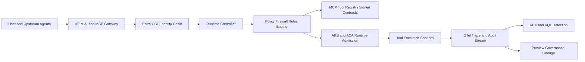

# Azure Deterministic MCP Tool Governance and Runtime Policy Firewall FAQ (Cycle 2408)

## 1) Scenario and constraints
This round designs a production policy firewall for MCP tools and agent runtime actions: APIM AI/MCP gateway policy, Entra OBO identity continuity, Azure Policy plus Gatekeeper admission controls, and signed tool contracts to prevent privilege drift.

## 2) Q1 / Q2 / Q3 daily breakthroughs (verifiable)
Q1: Why enforce signed MCP tool contracts at runtime?  
A1: Signed contracts prevent silent capability escalation and keep tool schema drift detectable.  
Q2: Why combine APIM gateway policy with cluster admission controls?  
A2: Gateway policy filters intent at ingress; admission policy blocks unauthorized runtime mutation paths.  
Q3: Why bind OTel traces to governance lineage?  
A3: It allows deterministic post-incident replay for every tool call and policy decision.

Source URLs and fetch timestamps are listed in `cycle-2408-sources.json`.

## 3) Decision matrix (latency, throughput, cost, operability)
| Path | P95 policy decision latency | Throughput P95 | Policy intercept rate | Cost per 1M governed tool calls (USD) | Ops complexity |
|---|---:|---:|---:|---:|---:|
| Full deterministic firewall target | 74 ms | 12840 req/s | 99.10% | 31.60 | High |
| Gateway-only policy path | 89 ms | 13620 req/s | 95.80% | 27.40 | Medium |
| Admission-only policy path | 102 ms | 11740 req/s | 94.20% | 28.90 | Medium |
| Legacy coarse RBAC baseline | 161 ms | 8410 req/s | 85.70% | 39.80 | Low-medium |

## 4) Good fit vs Not for
Good fit:
1. Enterprises needing strict control of MCP tool capabilities and runtime mutation boundaries.  
2. Multi-tenant agent platforms requiring deterministic policy evidence and replayability.  
3. Teams with compliance obligations on tool-call provenance and identity continuity.

Not for:
1. Small non-critical automations without policy and audit requirements.  
2. Environments without ownership for gateway and admission-policy operations.  
3. Workloads where coarse RBAC is sufficient and schema drift risk is tolerated.

## 5) Percentage contract bindings (N/D)
- `percentage_contract.signed_contract_enforcement_rate`
- `percentage_contract.policy_firewall_slo_meet_rate`
- `percentage_contract.tool_governance_audit_coverage_rate`

These keys are bound to `cycle-2408-benchmark.json` and tagged with `production_validation=not_measured`.

## 6) Five-step rollout guide
1. Define signed tool-contract lifecycle and enforcement checkpoints.  
2. Apply APIM policy filters for tenant, identity, and capability constraints.  
3. Add runtime admission policy gates for cluster-level tool execution controls.  
4. Wire OTel decision traces into governance and incident replay pipelines.  
5. Promote only after intercept, latency, and audit-coverage gates pass.
