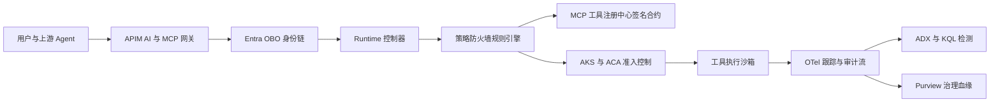

# Azure 确定性 MCP 工具治理与运行时策略防火墙 FAQ（Cycle 2408）

## 1) 场景与约束
本轮聚焦 MCP 工具与 Agent Runtime 的生产级策略防火墙：APIM AI/MCP 网关策略、Entra OBO 身份链、Azure Policy/Gatekeeper 准入控制、工具签名合约，目标是避免权限漂移与运行时越权。

## 2) Q1 / Q2 / Q3 当日能力突破（可验证）
Q1：为什么要在运行时强制 MCP 工具签名合约？  
A1：可防止能力静默升级，并使工具 schema 漂移可观测可拦截。  
Q2：为什么要把网关策略与准入控制组合？  
A2：网关在入口过滤意图，准入在运行时阻断越权变更路径。  
Q3：为什么要把 OTel 跟踪与治理血缘绑定？  
A3：可对每次工具调用和策略决策做确定性回放与审计。

来源与抓取时间见 `cycle-2408-sources.json`。

## 3) 决策矩阵（时延、吞吐、成本、可运维性）
| 路径 | P95 策略决策时延 | 吞吐 P95 | 策略拦截率 | 每百万受治理工具调用成本（USD） | 运维复杂度 |
|---|---:|---:|---:|---:|---:|
| 全链路确定性防火墙目标路径 | 74 ms | 12840 req/s | 99.10% | 31.60 | 高 |
| 仅网关策略路径 | 89 ms | 13620 req/s | 95.80% | 27.40 | 中 |
| 仅准入策略路径 | 102 ms | 11740 req/s | 94.20% | 28.90 | 中 |
| 传统粗粒度 RBAC 基线 | 161 ms | 8410 req/s | 85.70% | 39.80 | 中低 |

## 4) Good fit vs Not for
Good fit：
1. 需要严格控制 MCP 工具能力边界与运行时越权的企业平台。  
2. 需要确定性策略证据和回放能力的多租户 Agent 体系。  
3. 具备工具调用审计与身份连续性合规要求的团队。

Not for：
1. 无审计与策略要求的轻量自动化场景。  
2. 缺乏网关与准入策略运维能力的环境。  
3. 可容忍 schema 漂移且仅依赖粗粒度 RBAC 的场景。

## 5) Percentage contract bindings (N/D)
- `percentage_contract.signed_contract_enforcement_rate`
- `percentage_contract.policy_firewall_slo_meet_rate`
- `percentage_contract.tool_governance_audit_coverage_rate`

以上键绑定 `cycle-2408-benchmark.json`，并标注 `production_validation=not_measured`。

## 6) 五步落地指南
1. 建立工具签名合约生命周期与强制门禁。  
2. 在 APIM 执行租户、身份、能力维度策略过滤。  
3. 在集群准入层增加运行时工具执行控制。  
4. 将 OTel 决策链路接入治理与事故回放。  
5. 仅在拦截率、时延与审计覆盖率达标后推广。
