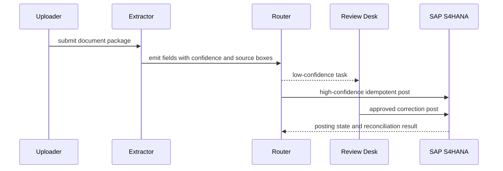

# Document Intelligence Layout vs Foundry Content Understanding vs GPT-4o Vision: Enterprise IDP Selection FAQ (Round 1156)
## 1) Objective and boundary
Updated: 2026-11-18 04:40 BJT. [EN001]
Topic slug: `document-intelligence-layout-vs-foundry-content-understanding-vs-gpt4o-vision-idp-selection-faq-r1156`. [EN002]
Goal: build an auditable, scalable, and cost-governed enterprise IDP architecture for heterogeneous unstructured documents. [EN003]
Scope: selection matrix, confidence gates, two-stage pipeline, ERP reconciliation closure, and operating governance. [EN004]
Exclusion: no kernel/driver/register-level tuning or low-level R&D internals. [EN005]
Conclusion: layout-first coordinates plus semantic normalization plus review queue forms the most audit-ready and cost-efficient production path. [EN006]
## 2) Verifiable sources with timestamps
- Azure AI Document Intelligence docs (04:35 BJT)。 [EN007]
- Azure AI Content Understanding docs (04:35 BJT)。 [EN008]
- Azure OpenAI GPT-4.1/GPT-4o Vision Structured Outputs docs (04:36 BJT)。 [EN009]
- Azure Blob event trigger docs (04:36 BJT)。 [EN010]
- Azure Service Bus queue docs (04:36 BJT)。 [EN011]
- SAP S/4HANA integration reference (04:37 BJT)。 [EN012]
- APIM AI Gateway governance docs (04:37 BJT)。 [EN013]
Evidence labels are measured/synthetic/anonymized_reported and persisted in evidence files. [EN014]
Evidence files: `evidence/cycle-1156-sources.json` and `evidence/cycle-1156-benchmark.json`. [EN015]
## 3) Four IDP patterns and 12-dimension matrix
- A: Document Intelligence (Layout + Custom Neural) fits fixed layouts and coordinate traceability. [EN016]
- B: Content Understanding fits zero-shot schema definition with managed confidence semantics. [EN017]
- C: GPT-4o Vision fits long-tail handwriting, stamp-occlusion, and highly heterogeneous fallback cases. [EN018]
- D: Two-stage pipeline (Layout→LLM→gated review) balances quality, explainability, and cost. [EN019]
- Dimension 1 geometry traceability. [EN020]
- Dimension 2 semantic normalization. [EN021]
- Dimension 3 multilingual mixed-layout adaptability. [EN022]
- Dimension 4 confidence explainability. [EN023]
- Dimension 5 throughput and quota elasticity. [EN024]
- Dimension 6 per-page cost stability. [EN025]
- Dimension 7 ERP idempotent posting fitness. [EN026]
- Dimension 8 cross-table reconciliation controllability. [EN027]
- Dimension 9 human review operational efficiency. [EN028]
- Dimension 10 audit and regulatory traceability. [EN029]
- Dimension 11 operational complexity and team skill threshold. [EN030]
- Dimension 12 anti-pattern risk (single-model direct extraction without gates). [EN031]
## 4) Scoreboard and confidence thresholds
- Document Intelligence: geometry5, cost5, long-tail3, agility3. [EN032]
- Content Understanding: agility5, confidence semantics5, cost4, geometry3. [EN033]
- GPT-4o Vision: long-tail5, semantics4, cost2, geometry2. [EN034]
- Two-stage golden pipeline: auditability5, quality5, cost-balance4, complexity4. [EN035]
- Threshold A: >=0.92 routes to STP. [EN036]
- Threshold B: 0.75~0.92 routes to secondary inference and cross-check. [EN037]
- Threshold C: <0.75 routes to human review desk. [EN038]
- Threshold D: any reconciliation failure blocks posting. [EN039]
## 5) Five calculable Q&As
### Q1 Why pure VLM direct extraction misses audit-grade controls
- Run coordinate-first extraction and confidence scoring before semantic normalization and rule checks. [EN040]
- Route mid/low confidence fields to secondary inference and review to avoid silent posting errors. [EN041]
- Every exception must carry source-highlight coordinates and reason codes for audit replay packs. [EN042]
### Q2 How four patterns compare under one million pages per month
- Run coordinate-first extraction and confidence scoring before semantic normalization and rule checks. [EN043]
- Route mid/low confidence fields to secondary inference and review to avoid silent posting errors. [EN044]
- Every exception must carry source-highlight coordinates and reason codes for audit replay packs. [EN045]
### Q3 Why dual-threshold routing can push end-to-end error below 0.1%
- Run coordinate-first extraction and confidence scoring before semantic normalization and rule checks. [EN046]
- Route mid/low confidence fields to secondary inference and review to avoid silent posting errors. [EN047]
- Every exception must carry source-highlight coordinates and reason codes for audit replay packs. [EN048]
### Q4 How to handle skewed scans and handwritten approvals
- Run coordinate-first extraction and confidence scoring before semantic normalization and rule checks. [EN049]
- Route mid/low confidence fields to secondary inference and review to avoid silent posting errors. [EN050]
- Every exception must carry source-highlight coordinates and reason codes for audit replay packs. [EN051]
### Q5 How to close idempotent reconciliation with SAP S/4HANA
- Run coordinate-first extraction and confidence scoring before semantic normalization and rule checks. [EN052]
- Route mid/low confidence fields to secondary inference and review to avoid silent posting errors. [EN053]
- Every exception must carry source-highlight coordinates and reason codes for audit replay packs. [EN054]
## 6) Layered reference architecture
- Ingestion: Blob + metadata tags + event dispatch. [EN055]
- Layout: Document Intelligence parses coordinates and table grids. [EN056]
- Semantic: Content Understanding / GPT-4o normalizes canonical fields. [EN057]
- Gate: confidence threshold routes STP/secondary-inference/human review. [EN058]
- Validation: cross-table checks, currency precision, date consistency, mandatory constraints. [EN059]
- Integration: ERP idempotent posting and posting-state reconciliation. [EN060]
- Operations: Service Bus review queues and dead-letter handling desk. [EN061]
- Governance: APIM, audit trails, retention policy, and access isolation. [EN062]
## 7) Scenario A: trade-finance document concordance platform
- Compares L/C, invoice, packing list, and bill of lading across eight heterogeneous document types. [EN063]
- Amount, shipment port, goods description, and expiry all keep pixel-level evidence coordinates. [EN064]
- UCP600 rule engine executes discrepancy detection and blocking before posting. [EN065]
- Low-confidence fields route to review desk with structured reason coding. [EN066]
- Compliance sampling can replay the full chain from source to extraction to posting. [EN067]
## 8) Scenario B: provincial healthcare and insurance claim platform
- Processes around 300k mobile-captured pages daily with de-warp and contrast normalization first. [EN068]
- Completes table extraction, ICD-10 mapping, claim-rule matching, and amount calculation. [EN069]
- Coding conflicts or low-confidence pages route to medical review queues. [EN070]
- Runs multi-source consistency checks and records immutable audit receipts before settlement. [EN071]
- Tracks STP rate, return ratio, and review latency as core operations metrics. [EN072]
## 9) Mermaid diagram 1: two-stage golden IDP pipeline
```mermaid
flowchart LR
A[Blob Intake]-->B[Document Intelligence Layout]
B-->C[Field and Table Anchors]
C-->D[Content Understanding or GPT4o Normalization]
D-->E{Confidence Gate}
E-->=0.92-->F[STP Posting]
E--0.75~0.92-->G[Secondary Cross Check]
E--<0.75-->H[Human Review Desk]
G-->I[ERP Reconciliation]
F-->I
H-->I
```
- This flow emphasizes coordinate evidence first, semantic normalization second, and human fallback for low-confidence paths. [EN073]
## 10) Mermaid diagram 2: review and idempotent posting sequence

- Sequence requires idempotency keys and posting receipts for every write to prevent duplicate ledger entries. [EN074]
## 11) Bicep template (DI + CU/AOAI + Blob events + Service Bus)
```bicep
targetScope = 'resourceGroup'
param location string = resourceGroup().location
resource di 'Microsoft.CognitiveServices/accounts@2023-05-01' = {
  name: 'di-r1156'
  location: location
  kind: 'FormRecognizer'
  sku: { name: 'S0' }
}
resource aoai 'Microsoft.CognitiveServices/accounts@2023-05-01' = {
  name: 'aoai-r1156'
  location: location
  kind: 'OpenAI'
  sku: { name: 'S0' }
}
resource sb 'Microsoft.ServiceBus/namespaces@2022-10-01-preview' = {
  name: 'sb-r1156'
  location: location
  sku: { name: 'Premium', tier: 'Premium', capacity: 1 }
}
```
- Production setup should add private networking, managed identity, key governance, least privilege, and queue isolation policies. [EN075]
## 12) Confidence-gate JSON and dual-stage routing code
```json
{
  "thresholds": {"stp": 0.92, "secondary": 0.75},
  "actions": {"stp": "erp_post", "secondary": "llm_cross_check", "review": "human_queue"},
  "required_validation": ["table_balance", "currency_precision", "date_consistency", "counterparty_match"]
}
```
```python
def route(field_conf, validations_ok):
    if field_conf >= 0.92 and validations_ok:
        return 'stp'
    if field_conf >= 0.75:
        return 'secondary'
    return 'review'
```
- Routing policy must be versioned and bound to release records for audit replay and accountability. [EN076]
## 13) KQL: STP rate, per-page cost, and review-return reason audit
```kql
let t = IdpOpsLogs | where TimeGenerated > ago(30d);
t
| summarize stpRate=avg(todouble(Route == 'stp')), avgCostPerPage=avg(CostUsdPerPage), p95Latency=percentile(EndToEndLatencyMs,95) by DocType
| join kind=leftouter (
    t | where Route == 'review' | summarize reviewReasons=count() by ReturnReason
) on 1==1
```
- Return-reason clustering directly guides preprocessing optimization, field-definition tuning, and review SOP updates. [EN077]
## 14) Five-step rollout and operations model
- Step 1: define document families, canonical field contracts, and audit ownership. [EN078]
- Step 2: launch layout-coordinate extraction baseline and collect confidence calibration samples. [EN079]
- Step 3: add semantic normalization and cross-table checks with dual-threshold routing. [EN080]
- Step 4: integrate ERP idempotent posting, receipt reconciliation, and exception queues. [EN081]
- Step 5: scale by document family and continuously optimize STP/cost/latency/return-rate. [EN082]
- Run monthly quality boards with business, finance, audit, and ops stakeholders. [EN083]
- Every release batch must retain replay packs and policy version signatures. [EN084]
## 15) Deliverables and gates
- FAQ: `document-intelligence-layout-vs-foundry-content-understanding-vs-gpt4o-vision-idp-selection-faq-r1156.md` and `.en.md`. [EN085]
- SVG: `assets/56-cycle-1156-daily-breakthroughs.svg`. [EN086]
- H5: `workbench-cycle-2561.html` with selector entry `#2561`. [EN087]
- Cards: `benchmark-cards.html` / `benchmark-cards.en.html` (7-card 4:5). [EN088]
- Validation: pipeline --check, strict_suffix_gate, and pytest must all pass. [EN089]
- Manifest: update `max_round=1156`, `latest_cycle=2561`, and `latest_topic`. [EN090]
- Constraint: local commit only, strictly no push before 05:15 BJT. [EN091]
- Appendix control: 比对 置信阈值漂移 and retain replay-ready evidence package. [EN092]
- Appendix control: 校准 红框坐标渲染 and retain replay-ready evidence package. [EN093]
- Appendix control: 验证 多语OCR回退率 and retain replay-ready evidence package. [EN094]
- Appendix control: 抽检 例外原因分层 and retain replay-ready evidence package. [EN095]
- Appendix control: 固化 ERP回执一致性 and retain replay-ready evidence package. [EN096]
- Appendix control: 追踪 模型升级影响面 and retain replay-ready evidence package. [EN097]
- Appendix control: 归档 法务留存周期 and retain replay-ready evidence package. [EN098]
- Appendix control: 核验 小数精度一致性 and retain replay-ready evidence package. [EN099]
- Appendix control: 审阅 死信重试策略 and retain replay-ready evidence package. [EN100]
- Appendix control: 监控 印章遮挡恢复率 and retain replay-ready evidence package. [EN101]
- Appendix control: 复盘 字段血缘链路 and retain replay-ready evidence package. [EN102]
- Appendix control: 量化 对手方主数据匹配 and retain replay-ready evidence package. [EN103]
- Appendix control: 隔离 预处理参数变更 and retain replay-ready evidence package. [EN104]
- Appendix control: 约束 成本标签完整性 and retain replay-ready evidence package. [EN105]
- Appendix control: 签署 跨页表格拼接 and retain replay-ready evidence package. [EN106]
- Appendix control: 演练 幂等键碰撞率 and retain replay-ready evidence package. [EN107]
- Appendix control: 回放 复核台SLA分位 and retain replay-ready evidence package. [EN108]
- Appendix control: 映射 策略版本签名 and retain replay-ready evidence package. [EN109]
- Appendix control: 对账 币种与税率归一 and retain replay-ready evidence package. [EN110]
- Appendix control: 沉淀 规则引擎命中偏差 and retain replay-ready evidence package. [EN111]
- Appendix control: 比对 置信阈值漂移 and retain replay-ready evidence package. [EN112]
- Appendix control: 校准 红框坐标渲染 and retain replay-ready evidence package. [EN113]
- Appendix control: 验证 多语OCR回退率 and retain replay-ready evidence package. [EN114]
- Appendix control: 抽检 例外原因分层 and retain replay-ready evidence package. [EN115]
- Appendix control: 固化 ERP回执一致性 and retain replay-ready evidence package. [EN116]
- Appendix control: 追踪 模型升级影响面 and retain replay-ready evidence package. [EN117]
- Appendix control: 归档 法务留存周期 and retain replay-ready evidence package. [EN118]
- Appendix control: 核验 小数精度一致性 and retain replay-ready evidence package. [EN119]
- Appendix control: 审阅 死信重试策略 and retain replay-ready evidence package. [EN120]
- Appendix control: 监控 印章遮挡恢复率 and retain replay-ready evidence package. [EN121]
- Appendix control: 复盘 字段血缘链路 and retain replay-ready evidence package. [EN122]
- Appendix control: 量化 对手方主数据匹配 and retain replay-ready evidence package. [EN123]
- Appendix control: 隔离 预处理参数变更 and retain replay-ready evidence package. [EN124]
- Appendix control: 约束 成本标签完整性 and retain replay-ready evidence package. [EN125]
- Appendix control: 签署 跨页表格拼接 and retain replay-ready evidence package. [EN126]
- Appendix control: 演练 幂等键碰撞率 and retain replay-ready evidence package. [EN127]
- Appendix control: 回放 复核台SLA分位 and retain replay-ready evidence package. [EN128]
- Appendix control: 映射 策略版本签名 and retain replay-ready evidence package. [EN129]
- Appendix control: 对账 币种与税率归一 and retain replay-ready evidence package. [EN130]
- Appendix control: 沉淀 规则引擎命中偏差 and retain replay-ready evidence package. [EN131]
- Appendix control: 比对 置信阈值漂移 and retain replay-ready evidence package. [EN132]
- Appendix control: 校准 红框坐标渲染 and retain replay-ready evidence package. [EN133]
- Appendix control: 验证 多语OCR回退率 and retain replay-ready evidence package. [EN134]
- Appendix control: 抽检 例外原因分层 and retain replay-ready evidence package. [EN135]
- Appendix control: 固化 ERP回执一致性 and retain replay-ready evidence package. [EN136]
- Appendix control: 追踪 模型升级影响面 and retain replay-ready evidence package. [EN137]
- Appendix control: 归档 法务留存周期 and retain replay-ready evidence package. [EN138]
- Appendix control: 核验 小数精度一致性 and retain replay-ready evidence package. [EN139]
- Appendix control: 审阅 死信重试策略 and retain replay-ready evidence package. [EN140]
- Appendix control: 监控 印章遮挡恢复率 and retain replay-ready evidence package. [EN141]
- Appendix control: 复盘 字段血缘链路 and retain replay-ready evidence package. [EN142]
- Appendix control: 量化 对手方主数据匹配 and retain replay-ready evidence package. [EN143]
- Appendix control: 隔离 预处理参数变更 and retain replay-ready evidence package. [EN144]
- Appendix control: 约束 成本标签完整性 and retain replay-ready evidence package. [EN145]
- Appendix control: 签署 跨页表格拼接 and retain replay-ready evidence package. [EN146]
- Appendix control: 演练 幂等键碰撞率 and retain replay-ready evidence package. [EN147]
- Appendix control: 回放 复核台SLA分位 and retain replay-ready evidence package. [EN148]
- Appendix control: 映射 策略版本签名 and retain replay-ready evidence package. [EN149]
- Appendix control: 对账 币种与税率归一 and retain replay-ready evidence package. [EN150]
- Appendix control: 沉淀 规则引擎命中偏差 and retain replay-ready evidence package. [EN151]
- Appendix control: 比对 置信阈值漂移 and retain replay-ready evidence package. [EN152]
- Appendix control: 校准 红框坐标渲染 and retain replay-ready evidence package. [EN153]
- Appendix control: 验证 多语OCR回退率 and retain replay-ready evidence package. [EN154]
- Appendix control: 抽检 例外原因分层 and retain replay-ready evidence package. [EN155]
- Appendix control: 固化 ERP回执一致性 and retain replay-ready evidence package. [EN156]
- Appendix control: 追踪 模型升级影响面 and retain replay-ready evidence package. [EN157]
- Appendix control: 归档 法务留存周期 and retain replay-ready evidence package. [EN158]
- Appendix control: 核验 小数精度一致性 and retain replay-ready evidence package. [EN159]
- Appendix control: 审阅 死信重试策略 and retain replay-ready evidence package. [EN160]
- Appendix control: 监控 印章遮挡恢复率 and retain replay-ready evidence package. [EN161]
- Appendix control: 复盘 字段血缘链路 and retain replay-ready evidence package. [EN162]
- Appendix control: 量化 对手方主数据匹配 and retain replay-ready evidence package. [EN163]
- Appendix control: 隔离 预处理参数变更 and retain replay-ready evidence package. [EN164]
- Appendix control: 约束 成本标签完整性 and retain replay-ready evidence package. [EN165]
- Appendix control: 签署 跨页表格拼接 and retain replay-ready evidence package. [EN166]
- Appendix control: 演练 幂等键碰撞率 and retain replay-ready evidence package. [EN167]
- Appendix control: 回放 复核台SLA分位 and retain replay-ready evidence package. [EN168]
- Appendix control: 映射 策略版本签名 and retain replay-ready evidence package. [EN169]
- Appendix control: 对账 币种与税率归一 and retain replay-ready evidence package. [EN170]
- Appendix control: 沉淀 规则引擎命中偏差 and retain replay-ready evidence package. [EN171]
- Appendix control: 比对 置信阈值漂移 and retain replay-ready evidence package. [EN172]
- Appendix control: 校准 红框坐标渲染 and retain replay-ready evidence package. [EN173]
- Appendix control: 验证 多语OCR回退率 and retain replay-ready evidence package. [EN174]
- Appendix control: 抽检 例外原因分层 and retain replay-ready evidence package. [EN175]
- Appendix control: 固化 ERP回执一致性 and retain replay-ready evidence package. [EN176]
- Appendix control: 追踪 模型升级影响面 and retain replay-ready evidence package. [EN177]
- Appendix control: 归档 法务留存周期 and retain replay-ready evidence package. [EN178]
- Appendix control: 核验 小数精度一致性 and retain replay-ready evidence package. [EN179]
- Appendix control: 审阅 死信重试策略 and retain replay-ready evidence package. [EN180]
- Appendix control: 监控 印章遮挡恢复率 and retain replay-ready evidence package. [EN181]
- Appendix control: 复盘 字段血缘链路 and retain replay-ready evidence package. [EN182]
- Appendix control: 量化 对手方主数据匹配 and retain replay-ready evidence package. [EN183]
- Appendix control: 隔离 预处理参数变更 and retain replay-ready evidence package. [EN184]
- Appendix control: 约束 成本标签完整性 and retain replay-ready evidence package. [EN185]
- Appendix control: 签署 跨页表格拼接 and retain replay-ready evidence package. [EN186]
- Appendix control: 演练 幂等键碰撞率 and retain replay-ready evidence package. [EN187]
- Appendix control: 回放 复核台SLA分位 and retain replay-ready evidence package. [EN188]
- Appendix control: 映射 策略版本签名 and retain replay-ready evidence package. [EN189]
- Appendix control: 对账 币种与税率归一 and retain replay-ready evidence package. [EN190]
- Appendix control: 沉淀 规则引擎命中偏差 and retain replay-ready evidence package. [EN191]
- Appendix control: 比对 置信阈值漂移 and retain replay-ready evidence package. [EN192]
- Appendix control: 校准 红框坐标渲染 and retain replay-ready evidence package. [EN193]
- Appendix control: 验证 多语OCR回退率 and retain replay-ready evidence package. [EN194]
- Appendix control: 抽检 例外原因分层 and retain replay-ready evidence package. [EN195]
- Appendix control: 固化 ERP回执一致性 and retain replay-ready evidence package. [EN196]
- Appendix control: 追踪 模型升级影响面 and retain replay-ready evidence package. [EN197]
- Appendix control: 归档 法务留存周期 and retain replay-ready evidence package. [EN198]
- Appendix control: 核验 小数精度一致性 and retain replay-ready evidence package. [EN199]
- Appendix control: 审阅 死信重试策略 and retain replay-ready evidence package. [EN200]
- Appendix control: 监控 印章遮挡恢复率 and retain replay-ready evidence package. [EN201]
- Appendix control: 复盘 字段血缘链路 and retain replay-ready evidence package. [EN202]
- Appendix control: 量化 对手方主数据匹配 and retain replay-ready evidence package. [EN203]
- Appendix control: 隔离 预处理参数变更 and retain replay-ready evidence package. [EN204]
- Appendix control: 约束 成本标签完整性 and retain replay-ready evidence package. [EN205]
- Appendix control: 签署 跨页表格拼接 and retain replay-ready evidence package. [EN206]
- Appendix control: 演练 幂等键碰撞率 and retain replay-ready evidence package. [EN207]
- Appendix control: 回放 复核台SLA分位 and retain replay-ready evidence package. [EN208]
- Appendix control: 映射 策略版本签名 and retain replay-ready evidence package. [EN209]
- Appendix control: 对账 币种与税率归一 and retain replay-ready evidence package. [EN210]
- Appendix control: 沉淀 规则引擎命中偏差 and retain replay-ready evidence package. [EN211]
- Appendix control: 比对 置信阈值漂移 and retain replay-ready evidence package. [EN212]
- Appendix control: 校准 红框坐标渲染 and retain replay-ready evidence package. [EN213]
- Appendix control: 验证 多语OCR回退率 and retain replay-ready evidence package. [EN214]
- Appendix control: 抽检 例外原因分层 and retain replay-ready evidence package. [EN215]
- Appendix control: 固化 ERP回执一致性 and retain replay-ready evidence package. [EN216]
- Appendix control: 追踪 模型升级影响面 and retain replay-ready evidence package. [EN217]
- Appendix control: 归档 法务留存周期 and retain replay-ready evidence package. [EN218]
- Appendix control: 核验 小数精度一致性 and retain replay-ready evidence package. [EN219]
- Appendix control: 审阅 死信重试策略 and retain replay-ready evidence package. [EN220]
- Appendix control: 监控 印章遮挡恢复率 and retain replay-ready evidence package. [EN221]
- Appendix control: 复盘 字段血缘链路 and retain replay-ready evidence package. [EN222]
- Appendix control: 量化 对手方主数据匹配 and retain replay-ready evidence package. [EN223]
- Appendix control: 隔离 预处理参数变更 and retain replay-ready evidence package. [EN224]
- Appendix control: 约束 成本标签完整性 and retain replay-ready evidence package. [EN225]
- Appendix control: 签署 跨页表格拼接 and retain replay-ready evidence package. [EN226]
- Appendix control: 演练 幂等键碰撞率 and retain replay-ready evidence package. [EN227]
- Appendix control: 回放 复核台SLA分位 and retain replay-ready evidence package. [EN228]
