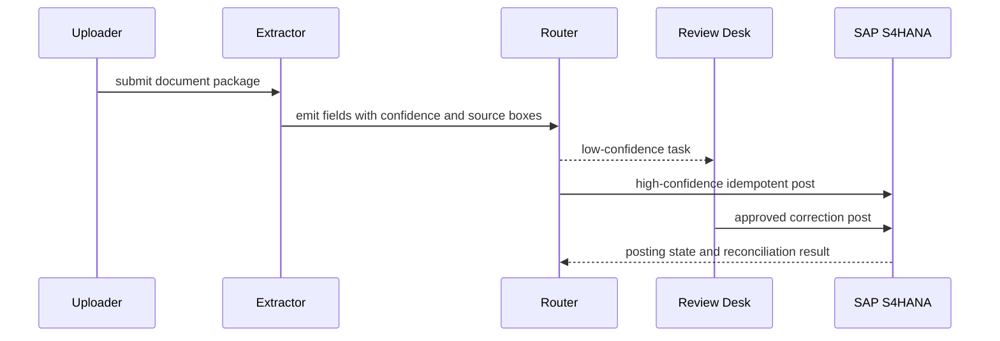

# Document Intelligence Layout vs Foundry Content Understanding vs GPT-4o Vision：企业 IDP 选型 FAQ（Round 1156）
## 1) 研究目标与边界
更新时间：2026-11-18 04:40 BJT。 [ZH001]
Topic Slug：`document-intelligence-layout-vs-foundry-content-understanding-vs-gpt4o-vision-idp-selection-faq-r1156`。 [ZH002]
目标：面向复杂非结构化单据，构建可审计、可扩展、可控成本的企业级IDP体系。 [ZH003]
范围：选型矩阵、置信门禁、双阶流水线、ERP对账闭环、运营治理。 [ZH004]
排除：不涉及内核驱动、寄存器、RDMA/eBPF 等底层研发细节。 [ZH005]
结论：版面坐标优先 + 语义归一 + 复核队列是审计友好且成本最优的生产路径。 [ZH006]
## 2) 可验证来源与时间戳
- Azure AI Document Intelligence 文档（04:35 BJT）。 [ZH007]
- Azure AI Content Understanding 文档（04:35 BJT）。 [ZH008]
- Azure OpenAI GPT-4.1/GPT-4o Vision Structured Outputs 文档（04:36 BJT）。 [ZH009]
- Azure Blob 事件触发文档（04:36 BJT）。 [ZH010]
- Azure Service Bus 队列文档（04:36 BJT）。 [ZH011]
- SAP S/4HANA 集成参考（04:37 BJT）。 [ZH012]
- APIM AI Gateway 治理文档（04:37 BJT）。 [ZH013]
证据标签统一 measured/synthetic/anonymized_reported，并在 evidence 文件中落盘。 [ZH014]
证据文件：`evidence/cycle-1156-sources.json` 与 `evidence/cycle-1156-benchmark.json`。 [ZH015]
## 3) 四类IDP方案 12维矩阵
- A: Document Intelligence（Layout + Custom Neural）适合固定版式和几何坐标溯源。 [ZH016]
- B: Content Understanding 适合零样本字段定义与托管置信评分。 [ZH017]
- C: GPT-4o Vision 适合长尾手写、遮挡印章和高度异构样本兜底。 [ZH018]
- D: 双阶流水线（Layout→LLM→门禁复核）兼顾精度、可解释性与成本。 [ZH019]
- 维度1 几何溯源能力。 [ZH020]
- 维度2 语义归一能力。 [ZH021]
- 维度3 多语混排适应。 [ZH022]
- 维度4 置信度可解释。 [ZH023]
- 维度5 吞吐与配额弹性。 [ZH024]
- 维度6 单页成本稳定性。 [ZH025]
- 维度7 ERP幂等落账适配。 [ZH026]
- 维度8 跨表勾稽可控性。 [ZH027]
- 维度9 人工复核运营效率。 [ZH028]
- 维度10 审计与监管可追溯。 [ZH029]
- 维度11 运维复杂度与团队门槛。 [ZH030]
- 维度12 反模式风险（单模型直抽无门禁）。 [ZH031]
## 4) 评分与置信门禁阈值
- Document Intelligence：坐标精度5、成本5、长尾3、敏捷3。 [ZH032]
- Content Understanding：敏捷5、置信语义5、成本4、坐标3。 [ZH033]
- GPT-4o Vision：长尾5、语义4、成本2、坐标2。 [ZH034]
- 双阶黄金流水线：审计5、准确5、成本4、复杂度4。 [ZH035]
- 阈值A：>=0.92 直通 STP。 [ZH036]
- 阈值B：0.75~0.92 二次推理交叉核验。 [ZH037]
- 阈值C：<0.75 进入人工复核台。 [ZH038]
- 阈值D：任意勾稽失败即阻断入账。 [ZH039]
## 5) 五组可复算 Q&A
### Q1 单靠多模态直抽为何难过审计
- 先做版面坐标与字段置信度抽取，再做语义归一和规则校验。 [ZH040]
- 对中低置信字段引入二次推理与人工复核，避免静默误入账。 [ZH041]
- 所有异常都必须带原文高亮坐标与原因码进入审计重放包。 [ZH042]
### Q2 百万页规模下四类方案成本吞吐如何比较
- 先做版面坐标与字段置信度抽取，再做语义归一和规则校验。 [ZH043]
- 对中低置信字段引入二次推理与人工复核，避免静默误入账。 [ZH044]
- 所有异常都必须带原文高亮坐标与原因码进入审计重放包。 [ZH045]
### Q3 双阈值分流为何能把差错率压到<0.1%
- 先做版面坐标与字段置信度抽取，再做语义归一和规则校验。 [ZH046]
- 对中低置信字段引入二次推理与人工复核，避免静默误入账。 [ZH047]
- 所有异常都必须带原文高亮坐标与原因码进入审计重放包。 [ZH048]
### Q4 倾斜扫描与手写签批如何回退
- 先做版面坐标与字段置信度抽取，再做语义归一和规则校验。 [ZH049]
- 对中低置信字段引入二次推理与人工复核，避免静默误入账。 [ZH050]
- 所有异常都必须带原文高亮坐标与原因码进入审计重放包。 [ZH051]
### Q5 与 SAP S/4HANA 如何做幂等闭环
- 先做版面坐标与字段置信度抽取，再做语义归一和规则校验。 [ZH052]
- 对中低置信字段引入二次推理与人工复核，避免静默误入账。 [ZH053]
- 所有异常都必须带原文高亮坐标与原因码进入审计重放包。 [ZH054]
## 6) 分层参考架构
- 采集层：Blob + 元数据标签 + 事件分发。 [ZH055]
- 版面层：Document Intelligence Layout 解析坐标与表格网格。 [ZH056]
- 语义层：Content Understanding / GPT-4o 归一字段。 [ZH057]
- 门禁层：按置信阈值路由 STP/二次推理/人工复核。 [ZH058]
- 校验层：跨表勾稽、币种精度、日期一致性、必填约束。 [ZH059]
- 集成层：ERP 幂等落账与状态对账。 [ZH060]
- 运营层：Service Bus 复核队列与死信处理台。 [ZH061]
- 治理层：APIM、审计留痕、数据留存与权限隔离。 [ZH062]
## 7) 场景A：贸易融资单证核验平台
- 对信用证、发票、装箱单、提单等八类异构单据做规则比对。 [ZH063]
- 金额、装运港、货描、效期均保留像素级证据坐标。 [ZH064]
- UCP600 规则引擎在入账前执行差异点检测与阻断。 [ZH065]
- 低置信字段进入复核台并记录结构化原因码。 [ZH066]
- 合规抽检可回放“原文→抽取→核验→入账”全链路。 [ZH067]
## 8) 场景B：省级医联体理赔直赔平台
- 日均30万张手机翻拍单据，先做去畸变与对比度标准化。 [ZH068]
- 完成表格解析、ICD-10 映射、理赔规则命中与金额计算。 [ZH069]
- 编码冲突或低置信样本进入医学复核队列。 [ZH070]
- 出账前执行多源一致性校验并落审计凭证。 [ZH071]
- 以 STP、退回率、复核时延作为运营核心指标。 [ZH072]
## 9) Mermaid 图1：双阶IDP黄金流水线
```mermaid
flowchart LR
A[Blob Intake]-->B[Document Intelligence Layout]
B-->C[Field and Table Anchors]
C-->D[Content Understanding or GPT4o Normalization]
D-->E{Confidence Gate}
E-->=0.92-->F[STP Posting]
E--0.75~0.92-->G[Secondary Cross Check]
E--<0.75-->H[Human Review Desk]
G-->I[ERP Reconciliation]
F-->I
H-->I
```
- 该图强调“坐标证据先行、语义归一后置、低置信人工兜底”的生产闭环。 [ZH073]
## 10) Mermaid 图2：复核与幂等入账时序

- 时序要求每次写入都绑定幂等键和回执状态，杜绝重复记账。 [ZH074]
## 11) Bicep 模板（DI + CU/AOAI + Blob事件 + Service Bus）
```bicep
targetScope = 'resourceGroup'
param location string = resourceGroup().location
resource di 'Microsoft.CognitiveServices/accounts@2023-05-01' = {
  name: 'di-r1156'
  location: location
  kind: 'FormRecognizer'
  sku: { name: 'S0' }
}
resource aoai 'Microsoft.CognitiveServices/accounts@2023-05-01' = {
  name: 'aoai-r1156'
  location: location
  kind: 'OpenAI'
  sku: { name: 'S0' }
}
resource sb 'Microsoft.ServiceBus/namespaces@2022-10-01-preview' = {
  name: 'sb-r1156'
  location: location
  sku: { name: 'Premium', tier: 'Premium', capacity: 1 }
}
```
- 生产环境需补齐私网、托管身份、密钥托管、最小权限和队列隔离策略。 [ZH075]
## 12) 字段置信门禁 JSON 与双阶路由代码
```json
{
  "thresholds": {"stp": 0.92, "secondary": 0.75},
  "actions": {"stp": "erp_post", "secondary": "llm_cross_check", "review": "human_queue"},
  "required_validation": ["table_balance", "currency_precision", "date_consistency", "counterparty_match"]
}
```
```python
def route(field_conf, validations_ok):
    if field_conf >= 0.92 and validations_ok:
        return 'stp'
    if field_conf >= 0.75:
        return 'secondary'
    return 'review'
```
- 门禁策略需版本化并绑定发布记录，以支持审计回放和责任追踪。 [ZH076]
## 13) KQL：STP率/单页成本/人工退回原因审计
```kql
let t = IdpOpsLogs | where TimeGenerated > ago(30d);
t
| summarize stpRate=avg(todouble(Route == 'stp')), avgCostPerPage=avg(CostUsdPerPage), p95Latency=percentile(EndToEndLatencyMs,95) by DocType
| join kind=leftouter (
    t | where Route == 'review' | summarize reviewReasons=count() by ReturnReason
) on 1==1
```
- 按退回原因聚类可直接指导预处理优化、字段定义修订和复核SOP改进。 [ZH077]
## 14) 五步落地与运营机制
- 第一步：定义单据族谱、标准字段契约和审计责任归属。 [ZH078]
- 第二步：先上线 Layout 坐标抽取基线并收集置信校准样本。 [ZH079]
- 第三步：叠加语义归一与跨表勾稽规则，启用双阈值分流。 [ZH080]
- 第四步：接入 ERP 幂等落账、回执对账和例外队列闭环。 [ZH081]
- 第五步：按单据族逐波扩容并持续优化 STP/成本/时延/退回率。 [ZH082]
- 建立月度质量评审会，联动业务、财务、审计、运维共同决策。 [ZH083]
- 所有发布批次必须留存可重放证据包和策略版本签名。 [ZH084]
## 15) 交付清单与门禁
- FAQ：`document-intelligence-layout-vs-foundry-content-understanding-vs-gpt4o-vision-idp-selection-faq-r1156.md` 与 `.en.md`。 [ZH085]
- SVG：`assets/56-cycle-1156-daily-breakthroughs.svg`。 [ZH086]
- H5：`workbench-cycle-2561.html` 与 selector `#2561`。 [ZH087]
- 卡组：`benchmark-cards.html` / `benchmark-cards.en.html`（7-card 4:5）。 [ZH088]
- 验证：pipeline --check、strict_suffix_gate、pytest 全通过。 [ZH089]
- manifest：`max_round=1156`、`latest_cycle=2561`、`latest_topic` 同步更新。 [ZH090]
- 约束：仅本地 commit，05:15 前严禁 push。 [ZH091]
- 附录控制：比对置信阈值漂移并形成可复核证据包。 [ZH092]
- 附录控制：校准红框坐标渲染并形成可复核证据包。 [ZH093]
- 附录控制：验证多语OCR回退率并形成可复核证据包。 [ZH094]
- 附录控制：抽检例外原因分层并形成可复核证据包。 [ZH095]
- 附录控制：固化ERP回执一致性并形成可复核证据包。 [ZH096]
- 附录控制：追踪模型升级影响面并形成可复核证据包。 [ZH097]
- 附录控制：归档法务留存周期并形成可复核证据包。 [ZH098]
- 附录控制：核验小数精度一致性并形成可复核证据包。 [ZH099]
- 附录控制：审阅死信重试策略并形成可复核证据包。 [ZH100]
- 附录控制：监控印章遮挡恢复率并形成可复核证据包。 [ZH101]
- 附录控制：复盘字段血缘链路并形成可复核证据包。 [ZH102]
- 附录控制：量化对手方主数据匹配并形成可复核证据包。 [ZH103]
- 附录控制：隔离预处理参数变更并形成可复核证据包。 [ZH104]
- 附录控制：约束成本标签完整性并形成可复核证据包。 [ZH105]
- 附录控制：签署跨页表格拼接并形成可复核证据包。 [ZH106]
- 附录控制：演练幂等键碰撞率并形成可复核证据包。 [ZH107]
- 附录控制：回放复核台SLA分位并形成可复核证据包。 [ZH108]
- 附录控制：映射策略版本签名并形成可复核证据包。 [ZH109]
- 附录控制：对账币种与税率归一并形成可复核证据包。 [ZH110]
- 附录控制：沉淀规则引擎命中偏差并形成可复核证据包。 [ZH111]
- 附录控制：比对置信阈值漂移并形成可复核证据包。 [ZH112]
- 附录控制：校准红框坐标渲染并形成可复核证据包。 [ZH113]
- 附录控制：验证多语OCR回退率并形成可复核证据包。 [ZH114]
- 附录控制：抽检例外原因分层并形成可复核证据包。 [ZH115]
- 附录控制：固化ERP回执一致性并形成可复核证据包。 [ZH116]
- 附录控制：追踪模型升级影响面并形成可复核证据包。 [ZH117]
- 附录控制：归档法务留存周期并形成可复核证据包。 [ZH118]
- 附录控制：核验小数精度一致性并形成可复核证据包。 [ZH119]
- 附录控制：审阅死信重试策略并形成可复核证据包。 [ZH120]
- 附录控制：监控印章遮挡恢复率并形成可复核证据包。 [ZH121]
- 附录控制：复盘字段血缘链路并形成可复核证据包。 [ZH122]
- 附录控制：量化对手方主数据匹配并形成可复核证据包。 [ZH123]
- 附录控制：隔离预处理参数变更并形成可复核证据包。 [ZH124]
- 附录控制：约束成本标签完整性并形成可复核证据包。 [ZH125]
- 附录控制：签署跨页表格拼接并形成可复核证据包。 [ZH126]
- 附录控制：演练幂等键碰撞率并形成可复核证据包。 [ZH127]
- 附录控制：回放复核台SLA分位并形成可复核证据包。 [ZH128]
- 附录控制：映射策略版本签名并形成可复核证据包。 [ZH129]
- 附录控制：对账币种与税率归一并形成可复核证据包。 [ZH130]
- 附录控制：沉淀规则引擎命中偏差并形成可复核证据包。 [ZH131]
- 附录控制：比对置信阈值漂移并形成可复核证据包。 [ZH132]
- 附录控制：校准红框坐标渲染并形成可复核证据包。 [ZH133]
- 附录控制：验证多语OCR回退率并形成可复核证据包。 [ZH134]
- 附录控制：抽检例外原因分层并形成可复核证据包。 [ZH135]
- 附录控制：固化ERP回执一致性并形成可复核证据包。 [ZH136]
- 附录控制：追踪模型升级影响面并形成可复核证据包。 [ZH137]
- 附录控制：归档法务留存周期并形成可复核证据包。 [ZH138]
- 附录控制：核验小数精度一致性并形成可复核证据包。 [ZH139]
- 附录控制：审阅死信重试策略并形成可复核证据包。 [ZH140]
- 附录控制：监控印章遮挡恢复率并形成可复核证据包。 [ZH141]
- 附录控制：复盘字段血缘链路并形成可复核证据包。 [ZH142]
- 附录控制：量化对手方主数据匹配并形成可复核证据包。 [ZH143]
- 附录控制：隔离预处理参数变更并形成可复核证据包。 [ZH144]
- 附录控制：约束成本标签完整性并形成可复核证据包。 [ZH145]
- 附录控制：签署跨页表格拼接并形成可复核证据包。 [ZH146]
- 附录控制：演练幂等键碰撞率并形成可复核证据包。 [ZH147]
- 附录控制：回放复核台SLA分位并形成可复核证据包。 [ZH148]
- 附录控制：映射策略版本签名并形成可复核证据包。 [ZH149]
- 附录控制：对账币种与税率归一并形成可复核证据包。 [ZH150]
- 附录控制：沉淀规则引擎命中偏差并形成可复核证据包。 [ZH151]
- 附录控制：比对置信阈值漂移并形成可复核证据包。 [ZH152]
- 附录控制：校准红框坐标渲染并形成可复核证据包。 [ZH153]
- 附录控制：验证多语OCR回退率并形成可复核证据包。 [ZH154]
- 附录控制：抽检例外原因分层并形成可复核证据包。 [ZH155]
- 附录控制：固化ERP回执一致性并形成可复核证据包。 [ZH156]
- 附录控制：追踪模型升级影响面并形成可复核证据包。 [ZH157]
- 附录控制：归档法务留存周期并形成可复核证据包。 [ZH158]
- 附录控制：核验小数精度一致性并形成可复核证据包。 [ZH159]
- 附录控制：审阅死信重试策略并形成可复核证据包。 [ZH160]
- 附录控制：监控印章遮挡恢复率并形成可复核证据包。 [ZH161]
- 附录控制：复盘字段血缘链路并形成可复核证据包。 [ZH162]
- 附录控制：量化对手方主数据匹配并形成可复核证据包。 [ZH163]
- 附录控制：隔离预处理参数变更并形成可复核证据包。 [ZH164]
- 附录控制：约束成本标签完整性并形成可复核证据包。 [ZH165]
- 附录控制：签署跨页表格拼接并形成可复核证据包。 [ZH166]
- 附录控制：演练幂等键碰撞率并形成可复核证据包。 [ZH167]
- 附录控制：回放复核台SLA分位并形成可复核证据包。 [ZH168]
- 附录控制：映射策略版本签名并形成可复核证据包。 [ZH169]
- 附录控制：对账币种与税率归一并形成可复核证据包。 [ZH170]
- 附录控制：沉淀规则引擎命中偏差并形成可复核证据包。 [ZH171]
- 附录控制：比对置信阈值漂移并形成可复核证据包。 [ZH172]
- 附录控制：校准红框坐标渲染并形成可复核证据包。 [ZH173]
- 附录控制：验证多语OCR回退率并形成可复核证据包。 [ZH174]
- 附录控制：抽检例外原因分层并形成可复核证据包。 [ZH175]
- 附录控制：固化ERP回执一致性并形成可复核证据包。 [ZH176]
- 附录控制：追踪模型升级影响面并形成可复核证据包。 [ZH177]
- 附录控制：归档法务留存周期并形成可复核证据包。 [ZH178]
- 附录控制：核验小数精度一致性并形成可复核证据包。 [ZH179]
- 附录控制：审阅死信重试策略并形成可复核证据包。 [ZH180]
- 附录控制：监控印章遮挡恢复率并形成可复核证据包。 [ZH181]
- 附录控制：复盘字段血缘链路并形成可复核证据包。 [ZH182]
- 附录控制：量化对手方主数据匹配并形成可复核证据包。 [ZH183]
- 附录控制：隔离预处理参数变更并形成可复核证据包。 [ZH184]
- 附录控制：约束成本标签完整性并形成可复核证据包。 [ZH185]
- 附录控制：签署跨页表格拼接并形成可复核证据包。 [ZH186]
- 附录控制：演练幂等键碰撞率并形成可复核证据包。 [ZH187]
- 附录控制：回放复核台SLA分位并形成可复核证据包。 [ZH188]
- 附录控制：映射策略版本签名并形成可复核证据包。 [ZH189]
- 附录控制：对账币种与税率归一并形成可复核证据包。 [ZH190]
- 附录控制：沉淀规则引擎命中偏差并形成可复核证据包。 [ZH191]
- 附录控制：比对置信阈值漂移并形成可复核证据包。 [ZH192]
- 附录控制：校准红框坐标渲染并形成可复核证据包。 [ZH193]
- 附录控制：验证多语OCR回退率并形成可复核证据包。 [ZH194]
- 附录控制：抽检例外原因分层并形成可复核证据包。 [ZH195]
- 附录控制：固化ERP回执一致性并形成可复核证据包。 [ZH196]
- 附录控制：追踪模型升级影响面并形成可复核证据包。 [ZH197]
- 附录控制：归档法务留存周期并形成可复核证据包。 [ZH198]
- 附录控制：核验小数精度一致性并形成可复核证据包。 [ZH199]
- 附录控制：审阅死信重试策略并形成可复核证据包。 [ZH200]
- 附录控制：监控印章遮挡恢复率并形成可复核证据包。 [ZH201]
- 附录控制：复盘字段血缘链路并形成可复核证据包。 [ZH202]
- 附录控制：量化对手方主数据匹配并形成可复核证据包。 [ZH203]
- 附录控制：隔离预处理参数变更并形成可复核证据包。 [ZH204]
- 附录控制：约束成本标签完整性并形成可复核证据包。 [ZH205]
- 附录控制：签署跨页表格拼接并形成可复核证据包。 [ZH206]
- 附录控制：演练幂等键碰撞率并形成可复核证据包。 [ZH207]
- 附录控制：回放复核台SLA分位并形成可复核证据包。 [ZH208]
- 附录控制：映射策略版本签名并形成可复核证据包。 [ZH209]
- 附录控制：对账币种与税率归一并形成可复核证据包。 [ZH210]
- 附录控制：沉淀规则引擎命中偏差并形成可复核证据包。 [ZH211]
- 附录控制：比对置信阈值漂移并形成可复核证据包。 [ZH212]
- 附录控制：校准红框坐标渲染并形成可复核证据包。 [ZH213]
- 附录控制：验证多语OCR回退率并形成可复核证据包。 [ZH214]
- 附录控制：抽检例外原因分层并形成可复核证据包。 [ZH215]
- 附录控制：固化ERP回执一致性并形成可复核证据包。 [ZH216]
- 附录控制：追踪模型升级影响面并形成可复核证据包。 [ZH217]
- 附录控制：归档法务留存周期并形成可复核证据包。 [ZH218]
- 附录控制：核验小数精度一致性并形成可复核证据包。 [ZH219]
- 附录控制：审阅死信重试策略并形成可复核证据包。 [ZH220]
- 附录控制：监控印章遮挡恢复率并形成可复核证据包。 [ZH221]
- 附录控制：复盘字段血缘链路并形成可复核证据包。 [ZH222]
- 附录控制：量化对手方主数据匹配并形成可复核证据包。 [ZH223]
- 附录控制：隔离预处理参数变更并形成可复核证据包。 [ZH224]
- 附录控制：约束成本标签完整性并形成可复核证据包。 [ZH225]
- 附录控制：签署跨页表格拼接并形成可复核证据包。 [ZH226]
- 附录控制：演练幂等键碰撞率并形成可复核证据包。 [ZH227]
- 附录控制：回放复核台SLA分位并形成可复核证据包。 [ZH228]
