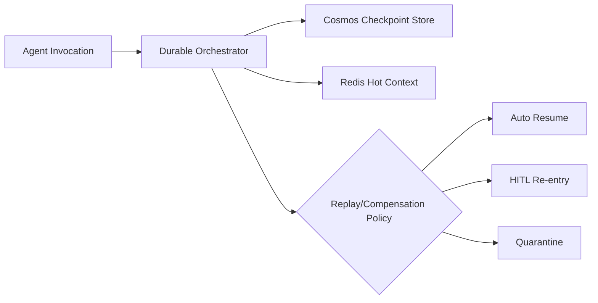

# Azure Multi-Agent Durable Checkpointing and Replay Handoff FAQ (Cycle 2380)

## 1) Scenario and constraints
The objective is to build recoverable, auditable, and compensatable state planes for production multi-agent systems. We define responsibilities between Durable Functions + Cosmos DB durable checkpoints and Redis hot context while keeping replay latency bounded.

## 2) Q1 / Q2 / Q3 Daily capability breakthroughs (verifiable)
Q1: Why not rely only on hot cache?  
A1: Hot cache is great for low-latency context but not for critical audit-grade state.  
Q2: What is the core benefit of Durable + Cosmos?  
A2: It provides step lineage and idempotent anchors for deterministic recovery.  
Q3: Why does compensation handoff matter?  
A3: It reduces data/business damage when tool side-effects fail mid-flight.

Source links and fetch timestamp (UTC) are listed in `cycle-2380-sources.json`.

## 3) Decision matrix (consistency, replay latency, isolation, cost)
| Path | P95 latency | Recovery consistency | Tenant isolation | Cost/session | Ops complexity |
|---|---:|---:|---:|---:|---:|
| Durable + Cosmos checkpoints | 298 ms | high | high | 0.00697 | medium-high |
| Redis hot context | 164 ms | medium | medium | 0.00502 | low |
| Hybrid restore path | 256 ms | high | high | 0.00583 | medium |
| Compensation handoff lane | 327 ms | high | high | 0.00744 | medium-high |

## 4) Good fit vs Not for
Good fit:
1. Coding Agent sandboxes needing resumable step lineage and idempotent replay.
2. Browser/CUA clusters requiring re-entry after long-chain interruptions.
3. Multi-tenant SaaS with partitioned checkpoints and replay quotas.
4. Regulated finance requiring auditable approval re-entry and compensation actions.

Not for:
1. Storing critical state only in Redis without durable anchors.
2. Enabling replay without idempotency keys and compensation contracts.
3. Shared checkpoint partitions across tenants.

## 5) Percentage contract bindings (N/D)
- `percentage_contract.checkpoint_consistency_pass_rate`
- `percentage_contract.replay_latency_sla_rate`
- `percentage_contract.tenant_isolation_gain_pts`

These keys bind to `cycle-2380-benchmark.json` with `production_validation=not_measured`.

## 6) Five-step rollout
1. Separate responsibilities between durable state and hot context.
2. Write idempotency keys and checkpoint snapshots per step.
3. Define timeout/failure compensation and HITL re-entry gates.
4. Enforce tenant partition quotas and replay throttling.
5. Replay failure chains weekly and tune consistency/cost thresholds.
