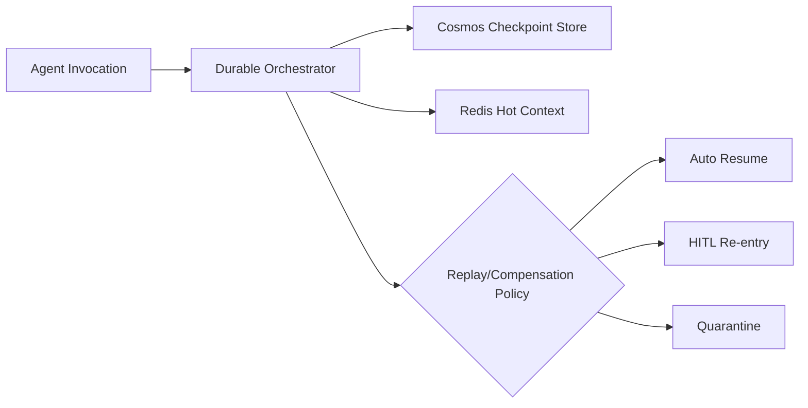

# Azure 多 Agent 持久检查点与重放移交 FAQ（Cycle 2380）

## 1) 场景与约束
目标是为多 Agent 生产系统建立可恢复、可审计、可补偿的状态平面：比较 Durable Functions + Cosmos DB 持久检查点与 Redis 热态上下文的分工，保证中断恢复一致性与重放延迟可控。

## 2) Q1 / Q2 / Q3 当日能力突破（可验证）
Q1：为什么不能只用热缓存？  
A1：热缓存适合低延迟上下文，不适合承载关键审计级状态。  
Q2：Durable + Cosmos 的核心收益？  
A2：提供可追溯步骤线与幂等恢复锚点。  
Q3：补偿移交为何必要？  
A3：工具副作用失败时可通过补偿流减少数据与业务损伤。

来源与抓取时间（UTC）写入 `cycle-2380-sources.json`。

## 3) 决策矩阵（一致性、恢复时延、隔离、成本）
| 路径 | P95 延迟 | 恢复一致性 | 租户隔离 | 单会话成本 | 运维复杂度 |
|---|---:|---:|---:|---:|---:|
| Durable + Cosmos 检查点 | 298 ms | 高 | 高 | 0.00697 | 中高 |
| Redis 热态上下文 | 164 ms | 中 | 中 | 0.00502 | 低 |
| 混合恢复路径 | 256 ms | 高 | 高 | 0.00583 | 中 |
| 补偿移交通道 | 327 ms | 高 | 高 | 0.00744 | 中高 |

## 4) Good fit vs Not for
Good fit：
1. Coding Agent sandbox：需要可恢复步骤链与幂等重放。  
2. Browser/CUA 集群：长链路会话中断后可重入恢复。  
3. 多租户 SaaS：租户分区检查点与配额防止重放风暴。  
4. 金融合规：审批重入与补偿动作全链路可审计。

Not for：
1. 把关键状态仅放在 Redis，不做持久化锚点。  
2. 无幂等键与补偿契约却开启自动重放。  
3. 跨租户共享检查点或弱分区设计。

## 5) Percentage contract bindings (N/D)
- `percentage_contract.checkpoint_consistency_pass_rate`
- `percentage_contract.replay_latency_sla_rate`
- `percentage_contract.tenant_isolation_gain_pts`

以上键绑定 `cycle-2380-benchmark.json`，并标注 `production_validation=not_measured`。

## 6) 五步落地指南
1. 划分持久状态与热态上下文职责边界。  
2. 为每步执行写入幂等键与检查点快照。  
3. 定义超时/失败补偿流程与 HITL 重入门。  
4. 实施租户分区配额与重放节流策略。  
5. 周度回放异常链路，校准一致性与成本阈值。
