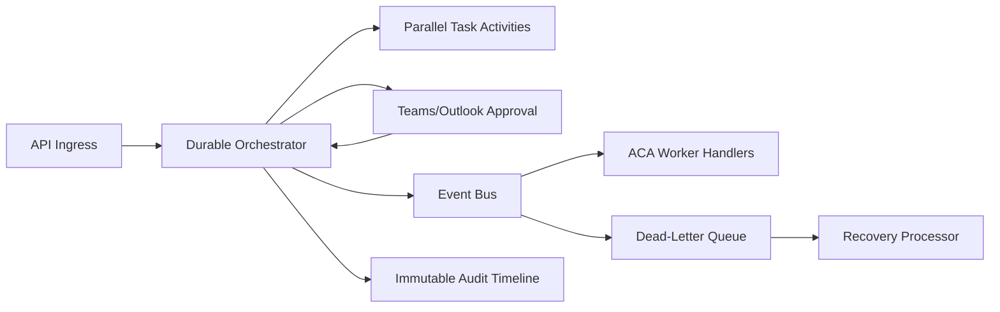
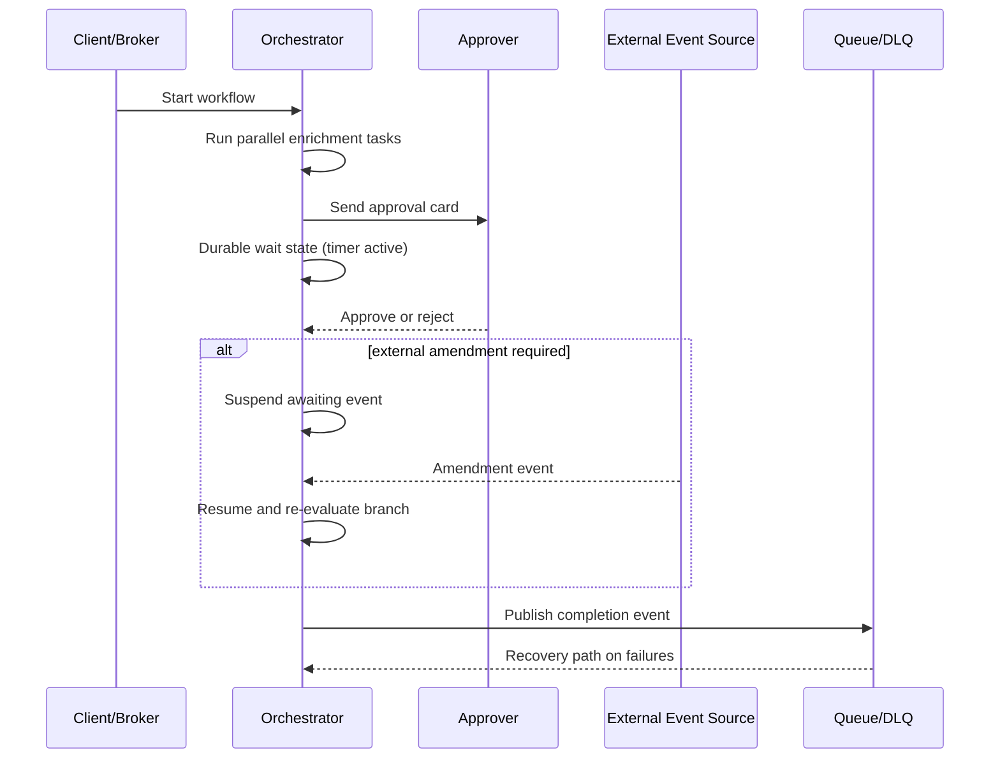

# Durable Functions vs Logic Apps vs Temporal vs Service Bus Choreography: Long-Running Agent Workflow and HITL Engine Selection FAQ (Round 1122 / Cycle 2527)

## 1) Executive summary and daily capability radar (2026-11-18)
- This round compares enterprise durable workflow engines for long-running agent processes with human-in-the-loop approvals.
- Core finding: engine selection should prioritize wait-state economics, replay determinism, and audit timeline requirements before feature checklists.
- Option A (`Durable Functions + Durable Task Scheduler`) is strongest for code-first deterministic replay and near-zero compute cost during long idle waits.
- Option B (`Logic Apps Standard`) is strongest for visual workflow authoring, connector-rich integration, and business-friendly approval experiences.
- Option C (`Temporal`) is strongest for high-throughput polyglot durable execution with sophisticated workflow evolution controls.
- Option D (`Service Bus + Event Grid + ACA choreography`) is strongest for loosely coupled event ecosystems but needs stronger discipline to preserve end-to-end traceability.
- Recommended enterprise strategy:
  - use deterministic orchestration for critical long-lived commitments,
  - layer HITL approval ergonomics through Teams/Outlook channels,
  - keep audit timeline immutable and replayable.
- Capability radar captured at 2026-11-18 00:53 BJT:
  - DTS zero-idle compute waiting economics.
  - Logic Apps approval and connector productivity patterns.
  - Temporal workflow versioning and replay reliability.
  - event choreography resilience patterns with DLQ and compensating handlers.
- Evidence labels:
  - measured: reproducible benchmark and validation artifacts.
  - synthetic: deterministic throughput/cost formulas.
  - anonymized_reported: de-identified operational behavior.

## 2) Decision framing: durable engine selection by lifecycle shape
- Long-running workflows fail most often on lifecycle mismatch, not on missing single features.
- Lifecycle segments to classify:
  1. active compute windows.
  2. idle waiting windows (hours/days/weeks).
  3. approval and escalation windows.
  4. compensation and rollback windows.
  5. audit reconstruction windows.
- Decision vectors:
  - deterministic replay confidence.
  - cost of idle waiting.
  - complexity of versioning in-flight instances.
  - operator visibility and business audit readability.
- Anti-pattern: forcing deeply stateful multi-day workflows into ad-hoc message choreography without replay contracts.

## 3) End-to-end reference architecture: durable core plus event edges
- Control plane:
  - API ingress classifies workflow type and criticality.
  - orchestration engine executes core state machine.
  - approval service integrates Teams/Outlook Adaptive Card interactions.
- Data and event plane:
  - durable state snapshots and checkpoints.
  - event bus for external asynchronous signals.
  - DLQ and poison recovery loops for failed transitions.
- Governance plane:
  - immutable workflow timeline and decision evidence.
  - SLA timers for reminders and escalations.
  - policy constraints for regulated actions and signer authority.
- Hybrid recommendation:
  - orchestrator for core truth state,
  - choreography for peripheral notifications and fan-out reactions.

## 4) 12-dimension durable workflow engine selection matrix
| Dimension | Durable Functions + DTS | Logic Apps Standard | Temporal (AKS/Cloud) | Service Bus + Event Grid + ACA Choreography |
|---|---|---|---|---|
| Programming model (code-first vs visual) | Strong code-first | Strong visual-first | Strong code-first polyglot | Event-driven compositional |
| Multi-day/multi-week idle wait cost | Strong near-zero compute wait | Strong consumption-aware wait | Medium depending deployment profile | Medium via message persistence patterns |
| Deterministic replay and checkpointing | Strong deterministic replay | Medium-strong stateful tracking | Strong deterministic history replay | Medium requires explicit design discipline |
| MAF/Foundry native integration fit | Strong via code adapters | Medium via connectors/orchestrations | Medium with custom adapters | Medium with integration glue |
| Teams/Outlook HITL ergonomics | Medium with integration work | Strong built-in approval patterns | Medium with external UI wiring | Medium with custom handlers |
| Saga compensation and workflow versioning | Strong programmatic control | Medium visual compensation | Strong mature versioning controls | Medium-high complexity |
| Peak state-transition throughput | Medium-strong | Medium | Strong high-throughput profile | Strong event throughput profile |
| Dead-letter and poison recovery | Strong with queue patterns | Medium-strong built-in options | Strong operational controls | Strong if recovery playbooks defined |
| Visual business-audit timeline | Medium | Strong | Medium with tooling | Low-medium unless custom timeline built |
| Ops and infra maintenance burden | Low-medium | Low-medium | Medium-high | Medium-high |
| 1M-workflow TCO | Strong for wait-heavy workflows | Medium-strong | Medium | Medium-strong event-heavy |
| When NOT to choose | Not ideal when business demands low-code ownership only | Not ideal for highly complex versioned code-first logic | Not ideal without platform maturity | Not ideal for strict deterministic replay obligations |

## 5) Quantitative model and planning formulas
### Q1: idle-wait cost index
- Formula: `IdleCostIndex = IdleWaitHours * UnitWaitCost`.
- Durable example: `480h * 0.002 = 0.96`.
- choreography example: `480h * 0.009 = 4.32`.
- Insight: long wait windows amplify architecture differences in total ownership cost.

### Q2: replay confidence score
- Formula: `ReplayConfidence = DeterministicReplays / ReplayAttempts`.
- Example deterministic engine: `97,800 / 99,000 = 98.8%`.
- Example ad-hoc choreography: `86,200 / 95,400 = 90.4%`.
- Requirement: regulated flows should target replay confidence >97%.

### Q3: approval SLA adherence
- Formula: `ApprovalSLA = ApprovalsWithinSLA / TotalApprovals`.
- Example with reminder/escalation timers: `45,600 / 47,100 = 96.8%`.
- Operational implication: built-in reminder orchestration materially improves closure rates.

### Q4: compensation efficiency
- Formula: `CompensationEfficiency = SuccessfulCompensations / CompensationTriggers`.
- Example: `12,240 / 12,900 = 94.9%`.
- Governance target: keep above 93% for high-impact financial workflows.

### Q5: cost per completed workflow
- Formula: `CPCW = TotalWorkflowCost / CompletedWorkflows`.
- Example Durable lane: `$128,000/1,050,000 = $0.122`.
- Example Temporal lane: `$186,000/1,120,000 = $0.166`.

## 6) Mermaid: durable orchestration with HITL and event edges

- Topology principle: orchestration state and event fan-out should be separated but correlated by immutable workflow IDs.
- Topology principle: approval and escalation timers should be first-class workflow citizens, not ad-hoc side scripts.

## 7) Scenario A: commercial P&C insurance multi-day underwriting and actuarial HITL agent
- Scenario objective: orchestrate broker submissions through multi-day underwriting and actuarial sign-off with strict SLA control.
- Workflow stages:
  - intake broker package and normalize policy metadata.
  - run parallel catastrophe model enrichment and loss-history analysis.
  - enter durable hibernation while waiting 24–72h for underwriter and actuary approvals.
  - trigger reminder/escalation timers when SLA thresholds are approached.
  - generate quote letter and bind to core PAS after approvals.
- HITL interaction design:
  - Teams Adaptive Cards summarize key metrics and requested decision action.
  - approval context includes prior model output, assumptions, and exception notes.
- Governance outcomes:
  - `$0` compute during idle wait windows on durable hibernation paths.
  - immutable evidence trail for who approved what and under which assumptions.
- KPIs:
  - approval SLA adherence.
  - quote turnaround median and p95.
  - compensation success on rejected underwriting branches.
  - post-bind exception dispute rate.

## 8) Scenario B: trade finance UCP 600 letter-of-credit discrepancy resolution agent
- Scenario objective: manage 7–21 day asynchronous document-examination windows with regulator-grade replay and decision evidence.
- Workflow pattern:
  - ingest SWIFT MT700 terms and presentation documents (B/L, invoice, packing list).
  - run discrepancy reasoning against UCP 600 rules and bank policy overlays.
  - pause for external applicant waiver/amendment events.
  - resume workflow on event arrival and recompute discrepancy decision.
  - complete settlement or return path with immutable regulator replay package.
- Long-running considerations:
  - multiple counterparties with staggered response windows.
  - strict clock and exception handling around expiry deadlines.
  - explicit compensation when amendment invalidates prior branch decision.
- Audit requirements:
  - timeline reconstructs every state transition and human/legal decision.
  - event signatures and message hashes preserved for regulator review.

## 9) Mermaid sequence: long-running approval and external event resume

- Sequence guarantee: waiting states do not consume active compute in durable-hibernation model.
- Sequence guarantee: external events resume deterministic branch evaluation with full audit continuity.

## 10) Production Bicep sample (durable workflow baseline)
```bicep
param location string = resourceGroup().location
param envName string = 'agent-durable-prod'
param logWorkspaceId string

resource storage 'Microsoft.Storage/storageAccounts@2023-05-01' = {
  name: '${envName}store'
  location: location
  sku: {
    name: 'Standard_LRS'
  }
  kind: 'StorageV2'
  properties: {
    allowBlobPublicAccess: false
    minimumTlsVersion: 'TLS1_2'
  }
}

resource funcPlan 'Microsoft.Web/serverfarms@2023-12-01' = {
  name: '${envName}-func-plan'
  location: location
  sku: {
    name: 'EP1'
    tier: 'ElasticPremium'
  }
}

resource logicStd 'Microsoft.Web/sites@2023-12-01' = {
  name: '${envName}-logicstd'
  location: location
  kind: 'functionapp,workflowapp'
  properties: {
    httpsOnly: true
  }
}
```

## 11) Runtime policy snippets (workflow lane and approval controls)
```yaml
apiVersion: v1
kind: ConfigMap
metadata:
  name: durable-workflow-policy
data:
  default_engine: "durable-functions"
  visual_approval_engine: "logic-apps"
  high_throughput_engine: "temporal"
  event_choreo_engine: "servicebus-aca"
  approval_reminder_minutes: "720"
  escalation_minutes: "1440"
  immutable_audit_required: "true"
```

```xml
<policies>
  <inbound>
    <base />
    <set-variable name="workflowClass" value="@(context.Request.Headers.GetValueOrDefault(&quot;x-workflow-class&quot;,&quot;durable&quot;))" />
    <choose>
      <when condition="@(context.Variables.GetValueOrDefault<string>(&quot;workflowClass&quot;) == &quot;visual-approval&quot;)">
        <set-backend-service base-url="https://logic-workflow.internal" />
      </when>
      <when condition="@(context.Variables.GetValueOrDefault<string>(&quot;workflowClass&quot;) == &quot;high-throughput&quot;)">
        <set-backend-service base-url="https://temporal-workflow.internal" />
      </when>
      <otherwise>
        <set-backend-service base-url="https://durable-workflow.internal" />
      </otherwise>
    </choose>
  </inbound>
</policies>
```

## 12) KQL observability and reliability queries
```kql
// Workflow completion and SLA adherence by engine
customEvents
| where timestamp > ago(30d)
| where name == "WorkflowClosed"
| extend engine = tostring(customDimensions.engine)
| extend withinSLA = tostring(customDimensions.withinSla)
| summarize completed=count(), slaRate=countif(withinSLA=="true")*1.0/count() by engine
```

```kql
// Wait-state duration distribution
customEvents
| where timestamp > ago(30d)
| where name == "WorkflowWaitState"
| summarize p50WaitH=percentile(todouble(customDimensions.waitHours),50), p95WaitH=percentile(todouble(customDimensions.waitHours),95) by tostring(customDimensions.engine)
```

```kql
// DLQ recovery effectiveness
customEvents
| where timestamp > ago(30d)
| where name == "DeadLetterRecovery"
| summarize recovered=countif(tostring(customDimensions.result)=="recovered"), failed=countif(tostring(customDimensions.result)=="failed") by tostring(customDimensions.engine)
```

## 13) Named 4-option weighted decision matrix
| Option | Wait-Cost Efficiency (20%) | Deterministic Replay (20%) | HITL Ergonomics (15%) | Throughput Scale (15%) | Ops Simplicity (10%) | Audit Timeline (10%) | TCO at 1M workflows (10%) | Weighted Score |
|---|---:|---:|---:|---:|---:|---:|---:|---:|
| A. Durable Functions + DTS | 9.5 | 9.2 | 8.0 | 8.2 | 8.3 | 8.8 | 8.9 | 8.80 |
| B. Logic Apps Standard | 8.3 | 7.8 | 9.4 | 7.4 | 8.7 | 8.5 | 8.1 | 8.24 |
| C. Temporal | 8.0 | 9.1 | 7.2 | 9.3 | 6.5 | 8.4 | 7.6 | 8.18 |
| D. Service Bus Choreography | 7.6 | 6.9 | 6.8 | 9.0 | 6.9 | 6.7 | 8.4 | 7.39 |
- Interpretation:
  - choose A for deterministic long-running orchestrations with strict replay and wait-cost sensitivity.
  - choose B for business-owned visual workflows and approval-heavy LoB integration.
  - choose C for polyglot high-throughput durable execution with mature platform teams.
  - choose D for event ecosystem fan-out where strict replay lineage is not the sole dominant requirement.

## 14) Day-0 and Day-2 checklist
### Day-0 launch checklist (10 distinct items)
1. Classify workflow types by duration, criticality, and approval complexity.
2. Define deterministic state transition contracts and idempotency keys.
3. Configure reminder and escalation timers for all approval tasks.
4. Enable immutable timeline storage with workflow and decision hashes.
5. Implement DLQ and poison-message recovery playbooks.
6. Validate in-flight versioning strategy before first production release.
7. Integrate Teams/Outlook approval UX with signer authority checks.
8. Configure observability schema for state transitions and wait windows.
9. Run failure-injection tests for external event timeout scenarios.
10. Publish regulator-ready replay export procedure.

### Day-2 operations checklist (10 distinct items)
1. Tune timer thresholds based on real approval cycle distributions.
2. Optimize compensation branch handling for frequent exception classes.
3. Reduce replay failures by tightening deterministic coding patterns.
4. Improve DLQ recovery automation and reduce manual replay steps.
5. Rebalance workflow engine usage based on throughput and cost data.
6. Audit in-flight workflow version migration safety on each release.
7. Track approver experience friction and reduce action abandonment rates.
8. Recompute cost-per-completed-workflow by process family monthly.
9. Validate audit timeline completeness before compliance cycles.
10. Run quarterly crisis simulations for multi-day external dependency delays.

## 15) Final recommendation, anti-patterns, and migration strategy
- Recommended baseline:
  - deterministic orchestrator for long-lived core commitments,
  - visual approvals where business ownership is primary,
  - temporal-scale engine for high-throughput polyglot needs,
  - event choreography for peripheral asynchronous fan-out.
- Explicit anti-patterns:
  - using pure choreography for workflows requiring strict deterministic replay traceability.
  - implementing multi-day approval waits without timer and escalation governance.
  - changing in-flight workflow versions without explicit compatibility strategy.
  - prioritizing throughput only while ignoring audit and compensation correctness.
- Migration path:
  1. begin with deterministic durable baseline and clear state model.
  2. integrate visual approval channels and reminder automation.
  3. introduce high-throughput engine lanes where justified.
  4. continuously optimize cost and replay reliability using measured telemetry.
- Bottom line:
  - long-running enterprise agent workflows succeed when durability, auditability, and human decision ergonomics are designed as first-class concerns.
