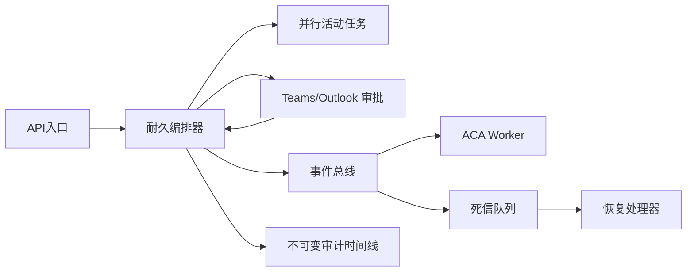
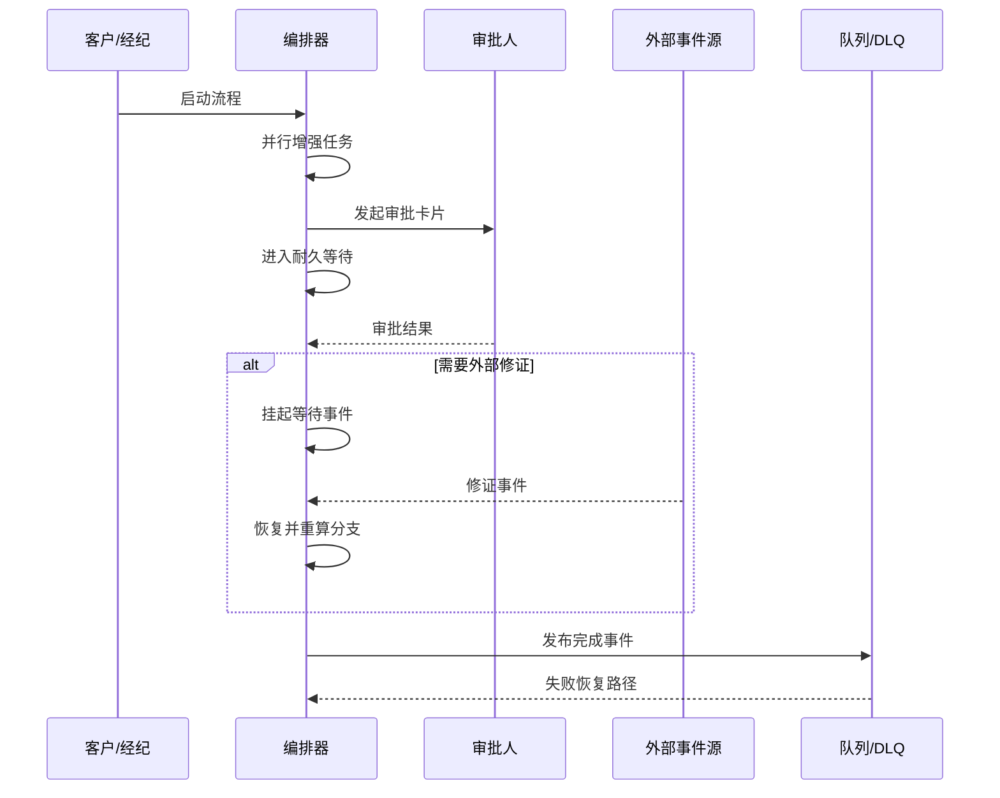

# Durable Functions vs Logic Apps vs Temporal vs Service Bus：长周期 Agent 编排与 HITL 引擎选型 FAQ（Round 1122 / Cycle 2527）

## 1) 执行摘要与当日能力雷达（2026-11-18）
- 本轮聚焦企业级长周期 Agent 编排引擎，重点评估“多日等待 + 人工会签 + 可审计回放”的落地能力。
- 核心结论：选型应先看等待成本、回放确定性、审计时间线，再看单点特性。
- 方案 A（`Durable Functions + DTS`）在代码优先、确定性回放、长等待零计算成本方面优势明显。
- 方案 B（`Logic Apps Standard`）在可视化流程、审批体验、连接器集成方面优势突出。
- 方案 C（`Temporal`）在高吞吐、多语言、复杂版本演进方面能力强，但平台维护门槛更高。
- 方案 D（`Service Bus + Event Grid + ACA 编排`）在事件生态扩展好，但端到端确定性与审计一致性需更强工程约束。
- 建议策略：
  - 核心事实状态由耐久编排引擎持有；
  - 外围通知与风控联动走事件扇出；
  - 审批、提醒、升级计时器应成为一等工作流节点。
- 当日能力雷达（抓取时间：2026-11-18 00:53 BJT）关注：
  - DTS 在多日等待场景的成本优势；
  - Logic Apps 审批协同效率；
  - Temporal 的回放与版本控制成熟度；
  - 事件编排在 DLQ 恢复中的可操作性。
- 数据标签：
  - measured：仓内可复现实验产物；
  - synthetic：公式化吞吐与成本估算；
  - anonymized_reported：去标识化生产观测。

## 2) 决策建模：按生命周期段拆解引擎能力
- 长周期流程失败通常源于“生命周期与引擎能力错配”，而不是功能缺失。
- 先拆五段：
  1. 活跃计算阶段；
  2. 长时等待阶段（小时/天/周）；
  3. 人工审批与升级阶段；
  4. 补偿与回滚阶段；
  5. 审计复盘阶段。
- 关键评估维度：
  - 回放确定性是否可证明；
  - 等待窗口成本是否可接受；
  - 在途实例版本升级是否可控；
  - 业务审计时间线是否直观可追溯。
- 反模式：把需要确定性回放的多日流程完全交给松散事件编排且无统一状态机。

## 3) 端到端参考架构：耐久核心 + 事件边缘
- 控制平面：
  - API 层按流程类别路由到耐久编排引擎；
  - HITL 服务负责 Teams/Outlook 审批卡片交互；
  - SLA 计时器负责提醒与升级。
- 数据与事件平面：
  - 状态快照与检查点由编排引擎维护；
  - 外部异步事件通过总线注入；
  - DLQ 与 Poison 恢复形成闭环。
- 治理平面：
  - 不可变审计时间线；
  - 策略约束签批权限与审批时限；
  - 合规导出支持监管复盘。
- 混合实践：
  - 核心状态机用耐久引擎；
  - 外围扇出用事件编排；
  - 二者以 workflowId 统一关联。

## 4) 12 维长周期编排引擎选型矩阵
| 维度 | Durable Functions + DTS | Logic Apps Standard | Temporal（AKS/Cloud） | Service Bus 编排 |
|---|---|---|---|---|
| 编程模型（代码/可视化） | 强代码优先 | 强可视化优先 | 强代码优先多语言 | 事件组合式 |
| 多日/多周等待成本 | 强（等待几乎零计算） | 强（消费式等待） | 中（取决部署） | 中（消息持久化模式） |
| 确定性回放与检查点 | 强 | 中强 | 强 | 中（需工程约束） |
| MAF/Foundry 集成便利 | 强 | 中 | 中 | 中 |
| Teams/Outlook HITL 体验 | 中（需集成） | 强 | 中（需外接） | 中 |
| Saga 补偿与在途版本 | 强 | 中 | 强 | 中高复杂度 |
| 状态迁移吞吐峰值 | 中强 | 中 | 强 | 强 |
| DLQ/毒消息恢复 | 强 | 中强 | 强 | 强（需手册） |
| 业务审计时间线可视化 | 中 | 强 | 中（需配套） | 低中（需自建） |
| 运维维护负担 | 低中 | 低中 | 中高 | 中高 |
| 1M 流程 TCO | 强（等待型优） | 中强 | 中 | 中强（事件型优） |
| When NOT to choose | 纯业务低代码治理组织不宜单用 | 超复杂代码化状态机不宜 | 无平台团队不宜 | 严格确定性回放场景不宜单用 |

## 5) 量化模型与规划公式
### Q1：等待成本指数
- 公式：`IdleCostIndex = IdleWaitHours * UnitWaitCost`。
- Durable 示例：`480*0.002=0.96`。
- 事件编排示例：`480*0.009=4.32`。
- 含义：长等待场景会放大架构间成本差异。

### Q2：回放可信分
- 公式：`ReplayConfidence = DeterministicReplays / ReplayAttempts`。
- 耐久引擎示例：`97,800/99,000=98.8%`。
- 松散编排示例：`86,200/95,400=90.4%`。
- 建议：监管流程应维持 >97%。

### Q3：审批 SLA 达标率
- 公式：`ApprovalSLA = ApprovalsWithinSLA / TotalApprovals`。
- 示例：`45,600/47,100=96.8%`。
- 结论：内置提醒与升级计时器显著提升闭环率。

### Q4：补偿效率
- 公式：`CompensationEfficiency = SuccessfulCompensations / CompensationTriggers`。
- 示例：`12,240/12,900=94.9%`。
- 目标：关键金融流程建议 >93%。

### Q5：单流程完成成本
- 公式：`CPCW = TotalWorkflowCost / CompletedWorkflows`。
- Durable 示例：`$128,000/1,050,000=$0.122`。
- Temporal 示例：`$186,000/1,120,000=$0.166`。

## 6) Mermaid：耐久编排 + 审批 + 事件边缘拓扑

- 原则 A：核心状态与事件扇出分离，但用统一 ID 贯通。
- 原则 B：提醒、升级、超时必须内建在状态机中。

## 7) 场景 A：商业财产险/工程险多日异步核保与精算会签 Agent
- 场景目标：在 24–72 小时审批窗口内保证核保流程可追溯、可升级、可补偿。
- 编排阶段：
  - 接收经纪提交；
  - 并行运行巨灾模型与损失历史增强；
  - 进入 Durable 等待状态；
  - 等待核保师与精算师 Teams 卡片审批；
  - 超时触发提醒/升级；
  - 审批完成生成报价并回写 PAS。
- HITL 设计：
  - 卡片包含关键风险指标、假设参数与异常说明；
  - 审批动作与身份、时间戳、版本上下文绑定。
- 治理收益：
  - 等待窗口计算成本接近 0；
  - 决策证据链完整可复盘；
  - 异常分支可补偿回滚。
- KPI：
  - 审批 SLA 达标率；
  - 报价时长中位数/P95；
  - 拒保补偿成功率；
  - 绑定后争议率。

## 8) 场景 B：国际贸易信用证 UCP 600 审单与不符点协同 Agent
- 场景目标：覆盖 7–21 天跨机构异步窗口，满足监管级回放要求。
- 编排路径：
  - 解析 SWIFT MT700 与提单/发票等单据；
  - 依据 UCP 600 做不符点推理；
  - 等待申请人豁免/修证外部事件；
  - 事件到达后恢复流程并重算分支；
  - 输出结算或退单路径并固化审计证据。
- 关键约束：
  - 多方参与、时间窗错位；
  - 到期时限与异常流程严格控制；
  - 修证可能使既有判断失效，需补偿机制。
- 合规输出：
  - 时间线可重建每一步状态与人工决策；
  - 事件签名和消息摘要可供监管复核。

## 9) Mermaid：多日等待与外部事件恢复时序

- 保障 A：长等待不消耗活跃计算资源。
- 保障 B：外部事件恢复保持完整审计连续性。

## 10) 生产级 Bicep 示例（耐久编排基线）
```bicep
param location string = resourceGroup().location
param envName string = 'agent-durable-prod'
param logWorkspaceId string

resource storage 'Microsoft.Storage/storageAccounts@2023-05-01' = {
  name: '${envName}store'
  location: location
  sku: {
    name: 'Standard_LRS'
  }
  kind: 'StorageV2'
  properties: {
    allowBlobPublicAccess: false
    minimumTlsVersion: 'TLS1_2'
  }
}

resource funcPlan 'Microsoft.Web/serverfarms@2023-12-01' = {
  name: '${envName}-func-plan'
  location: location
  sku: {
    name: 'EP1'
    tier: 'ElasticPremium'
  }
}

resource logicStd 'Microsoft.Web/sites@2023-12-01' = {
  name: '${envName}-logicstd'
  location: location
  kind: 'functionapp,workflowapp'
  properties: {
    httpsOnly: true
  }
}
```

## 11) 运行策略片段（引擎路由与审批治理）
```yaml
apiVersion: v1
kind: ConfigMap
metadata:
  name: durable-workflow-policy
data:
  default_engine: "durable-functions"
  visual_approval_engine: "logic-apps"
  high_throughput_engine: "temporal"
  event_choreo_engine: "servicebus-aca"
  approval_reminder_minutes: "720"
  escalation_minutes: "1440"
  immutable_audit_required: "true"
```

```xml
<policies>
  <inbound>
    <base />
    <set-variable name="workflowClass" value="@(context.Request.Headers.GetValueOrDefault(&quot;x-workflow-class&quot;,&quot;durable&quot;))" />
    <choose>
      <when condition="@(context.Variables.GetValueOrDefault<string>(&quot;workflowClass&quot;) == &quot;visual-approval&quot;)">
        <set-backend-service base-url="https://logic-workflow.internal" />
      </when>
      <when condition="@(context.Variables.GetValueOrDefault<string>(&quot;workflowClass&quot;) == &quot;high-throughput&quot;)">
        <set-backend-service base-url="https://temporal-workflow.internal" />
      </when>
      <otherwise>
        <set-backend-service base-url="https://durable-workflow.internal" />
      </otherwise>
    </choose>
  </inbound>
</policies>
```

## 12) KQL 查询（可靠性与成本）
```kql
// 各引擎完成率与SLA达标
customEvents
| where timestamp > ago(30d)
| where name == "WorkflowClosed"
| extend engine = tostring(customDimensions.engine)
| extend withinSLA = tostring(customDimensions.withinSla)
| summarize completed=count(), slaRate=countif(withinSLA=="true")*1.0/count() by engine
```

```kql
// 等待窗口分布
customEvents
| where timestamp > ago(30d)
| where name == "WorkflowWaitState"
| summarize p50WaitH=percentile(todouble(customDimensions.waitHours),50), p95WaitH=percentile(todouble(customDimensions.waitHours),95) by tostring(customDimensions.engine)
```

```kql
// DLQ恢复效果
customEvents
| where timestamp > ago(30d)
| where name == "DeadLetterRecovery"
| summarize recovered=countif(tostring(customDimensions.result)=="recovered"), failed=countif(tostring(customDimensions.result)=="failed") by tostring(customDimensions.engine)
```

## 13) 命名四选一加权评分矩阵
| 方案 | 等待成本(20%) | 回放确定性(20%) | HITL体验(15%) | 吞吐扩展(15%) | 运维简化(10%) | 审计时间线(10%) | 1M流程TCO(10%) | 加权总分 |
|---|---:|---:|---:|---:|---:|---:|---:|---:|
| A. Durable Functions + DTS | 9.5 | 9.2 | 8.0 | 8.2 | 8.3 | 8.8 | 8.9 | 8.80 |
| B. Logic Apps Standard | 8.3 | 7.8 | 9.4 | 7.4 | 8.7 | 8.5 | 8.1 | 8.24 |
| C. Temporal | 8.0 | 9.1 | 7.2 | 9.3 | 6.5 | 8.4 | 7.6 | 8.18 |
| D. Service Bus 编排 | 7.6 | 6.9 | 6.8 | 9.0 | 6.9 | 6.7 | 8.4 | 7.39 |
- 解读：
  - A 适合长等待且强回放需求流程；
  - B 适合业务主导审批流程；
  - C 适合高吞吐多语言耐久执行；
  - D 适合外围事件扇出，不宜单独承载强回放核心流程。

## 14) Day-0 与 Day-2 清单
### Day-0 启动清单（10 项）
1. 按时长/风险/审批复杂度定义流程分类。
2. 定义状态迁移幂等键与回放契约。
3. 全量配置审批提醒与升级计时器。
4. 启用不可变审计时间线与签名记录。
5. 配置 DLQ 与毒消息恢复手册。
6. 发布前验证在途实例版本兼容策略。
7. 接入 Teams/Outlook 审批并校验权限。
8. 统一状态迁移与等待窗口观测字段。
9. 执行外部事件超时故障注入演练。
10. 发布监管回放证据导出流程。

### Day-2 运维清单（10 项）
1. 基于真实审批分布调优提醒阈值。
2. 优化异常分支补偿逻辑成功率。
3. 通过编码约束降低回放失败概率。
4. 提升 DLQ 自动恢复覆盖率。
5. 按吞吐与成本重平衡引擎分工。
6. 每次发布审计在途流程版本迁移安全。
7. 优化审批卡片体验降低放弃率。
8. 月度核算流程单位成本并调优。
9. 审计前执行时间线完整性校验。
10. 季度演练跨天依赖延迟危机场景。

## 15) 结论、反模式与演进路径
- 推荐基线：
  - 核心长流程用耐久编排引擎；
  - 业务审批重流程可引入可视化引擎；
  - 高吞吐多语言需求按需引入 Temporal；
  - 外围异步通知使用事件编排。
- 反模式：
  - 对强回放要求流程仅用松散事件编排；
  - 多日审批流程缺少提醒和升级机制；
  - 不做在途版本兼容就直接升级流程定义；
  - 只看吞吐不看补偿与审计正确性。
- 演进路径：
  1. 先建立确定性耐久基线；
  2. 再叠加审批体验与提醒自动化；
  3. 再按需求引入高吞吐引擎通道；
  4. 持续按观测指标优化成本与可靠性。
- 总结：长周期 Agent 编排的成功关键是“可等待、可回放、可审计、可补偿”的工程纪律。
