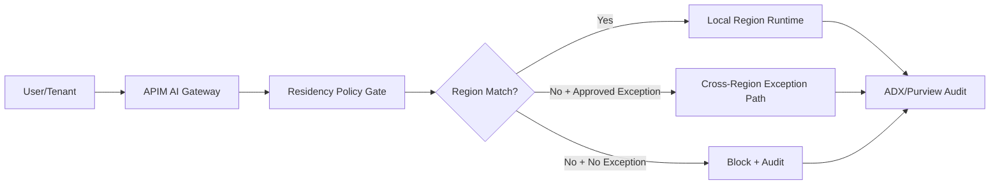

# Round 1044 / Cycle 2449 · Azure AI Agent Infra FAQ & Decision Guide (en)

> Topic: **Enterprise Agent Data Residency Geo-Fence Policy Gate**
>
> Date (BJT): 2026-11-16  
> Evidence labels: `measured` / `synthetic` / `anonymized_reported`  
> Benchmark payload: `evidence/cycle-2449-benchmark.json`

## 1) Executive Summary

This round addresses a hard requirement for global enterprises: **data residency and geographic fencing for cross-region tool invocation**.  
Key result: binding tenant sovereignty tags, region-routing policy, and endpoint allowlists at APIM/gateway admission can meet residency compliance with controlled latency impact.

## 2) Daily capability breakthroughs radar (2026-11-16)

1. **APIM AI Gateway / Unified Model API** (`measured`)  
   - Learn: https://learn.microsoft.com/en-us/azure/ai-gateway/overview  
   - Changelog: https://github.com/Azure/API-Management/blob/main/changelogs/api-management-service.md
2. **ACA Dynamic Sessions** (`measured`)  
   - Docs: https://learn.microsoft.com/en-us/azure/container-apps/sessions
3. **Runtime cadence** (`measured`)  
   - Firecracker/Kata/Wasmtime/E2B release streams (see sources ledger)

> Fetch timestamps are recorded in `evidence/cycle-2449-sources.json`.

## 3) Core architecture Q&A (residency + geo-fence)

**Q1: Why can the same tenant still violate residency boundaries?**  
A: Session context, tool settings, and cache replicas may live in different regions. `tenant_residency_region` must be a hard constraint at every tool-call admission.

**Q2: What is the minimum geo-fence admission contract?**  
A: Validate `tenant_region`, `requested_region`, `tool_endpoint_region`, and `policy_version`; block on mismatch.

**Q3: How do we balance compliance and latency?**  
A: Use tiered routing: local-region first; cross-region allowed only with explicit compliance exception ticket and full audit trace.

## 4) Mermaid architecture (residency gate path)

## 5) Decision matrix (residency governance modes)

| Strategy | Compliance strength | Latency | Ops complexity | Recommendation |
|---|---:|---:|---:|---|
| Audit-only logging | Low | Low | Low | Not for production |
| Soft warning + after-the-fact handling | Medium | Low | Medium | Transitional only |
| Hard block + exception approval channel | **High** | Medium | Mid-high | **Enterprise production default** |
| Full cross-region prohibition | Highest | Mid-high | Medium | Ultra-regulated, lower flexibility |

## 6) Production checklist (Good fit vs Not for + 5-step rollout)

### Good fit
- Global tenants under explicit data residency laws.
- Multi-tenant agent platforms requiring auditable regional boundaries.
- Workloads needing both model and tool-call geolocation controls.

### Not for
- Single-region low-compliance internal systems.
- Organizations unable to maintain region tags and exception workflows.

### Five-step rollout
1. Define region-of-record tags for tenants and datasets.  
2. Enforce geo-fence admission and exception-ticket checks in APIM.  
3. Log cross-region calls and blocks to ADX/Purview.  
4. Set thresholds for false blocks and exception abuse.  
5. Review policy hits, exception ratio, and latency impact monthly.  
