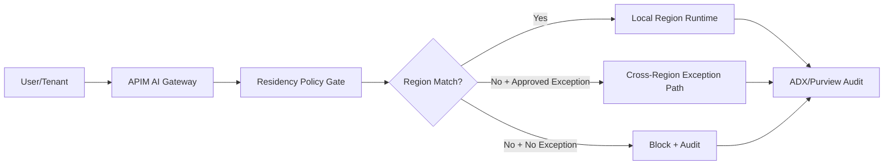

# Round 1044 / Cycle 2449 · Azure AI Agent Infra FAQ & 决策指南（zh-CN）

> Topic: **Enterprise Agent Data Residency Geo-Fence Policy Gate**
>
> Date (BJT): 2026-11-16  
> Evidence labels: `measured` / `synthetic` / `anonymized_reported`  
> Benchmark payload: `evidence/cycle-2449-benchmark.json`

## 1) Executive Summary

本轮面向跨国企业常见刚性要求：**数据驻留（Data Residency）与跨区域工具调用地理围栏（Geo-Fence）**。  
核心结论：将租户数据主权标签、区域路由策略和工具端点白名单联动到 APIM/Gateway 准入层，可在不显著恶化延迟的情况下，稳定满足驻留合规与审计追踪。

## 2) Daily capability breakthroughs radar（2026-11-16）

1. **APIM AI Gateway / Unified Model API**（`measured`）  
   - Learn: https://learn.microsoft.com/en-us/azure/ai-gateway/overview  
   - Changelog: https://github.com/Azure/API-Management/blob/main/changelogs/api-management-service.md
2. **ACA Dynamic Sessions**（`measured`）  
   - Docs: https://learn.microsoft.com/en-us/azure/container-apps/sessions
3. **Runtime cadence**（`measured`）  
   - Firecracker/Kata/Wasmtime/E2B release streams（见 sources ledger）

> 抓取时间见 `evidence/cycle-2449-sources.json`。

## 3) Core architecture Q&A（驻留与围栏）

**Q1: 为什么“同一租户”还会触发跨区违规？**  
A: 因为会话上下文、工具配置、缓存副本可能位于不同区域。必须把 `tenant_residency_region` 作为硬约束注入每次工具调用准入。

**Q2: Geo-fence 策略最小检查项是什么？**  
A: 建议强制校验：`tenant_region`, `requested_region`, `tool_endpoint_region`, `policy_version`。不满足即阻断并审计。

**Q3: 如何平衡合规与时延？**  
A: 采用分级路由：同区域优先；跨区仅在明确合规豁免下放行，并记录豁免票据 ID。

## 4) Mermaid architecture（Residency Gate）

## 5) Decision matrix（驻留治理策略）

| 策略 | 合规强度 | 延迟 | 运维复杂度 | 推荐 |
|---|---:|---:|---:|---|
| 仅日志审计 | 低 | 低 | 低 | 不建议生产 |
| 软警告 + 事后处置 | 中 | 低 | 中 | 过渡阶段 |
| 硬阻断 + 例外审批通道 | **高** | 中 | 中高 | **企业生产推荐** |
| 全量跨区禁用 | 最高 | 中高 | 中 | 超高合规但业务弹性低 |

## 6) Production checklist（Good fit vs Not for + 五步落地）

### Good fit
- 跨国业务、存在明确数据驻留法规约束。  
- 多租户 Agent 平台，需要可审计区域边界。  
- 需同时管理模型调用与工具调用的地理路径。

### Not for
- 单区域、低合规要求的内部系统。  
- 无法维护区域标签和例外审批流程的组织。

### 五步落地
1. 为租户与数据集建立 region-of-record 标签。  
2. 在 APIM 配置 geo-fence 准入策略与例外票据校验。  
3. 将跨区调用与阻断事件写入 ADX/Purview。  
4. 设定误阻断率与例外滥用阈值。  
5. 按月审计策略命中、例外占比和延迟影响。  
