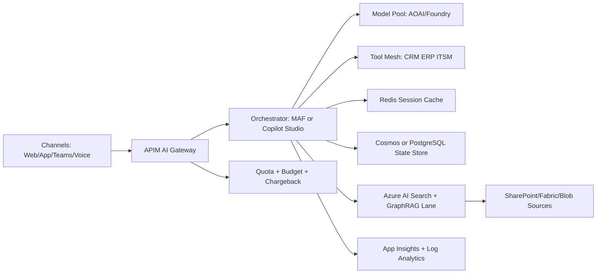
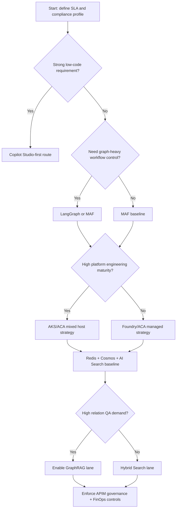

# Round 1107 / Cycle 2512 · Azure AI Agent Infra FAQ (en)

> Topic: **Enterprise Agent Delivery Blueprint: Framework, Runtime, State/Memory, RAG, and Multi-Tenant Platform Governance Selection**
> Date (BJT): 2026-11-17 23:00 onward
> Evidence labels: `measured` / `synthetic` / `anonymized_reported`
> Audience: enterprise architects, platform architects, delivery and governance leads

## 1) Executive Summary

This round fully pivots from low-level systems internals to enterprise application delivery.
The objective is a defensible architecture selection outcome within a single review meeting.
The scope covers orchestration framework, runtime host, state and memory, knowledge architecture, and governance.
The method is business constraints first, technical constraints second, cost and organization constraints third.
Business constraints include SLA profile, compliance pressure, and release cadence.
Technical constraints include isolation boundary, scaling curve, observability, and blast radius.
Cost constraints include model bill, operations labor, and incident risk cost.
This guide provides formulas, not slogans.
This guide provides a weighted matrix, not a one-vendor verdict.
This guide provides Day-0 and Day-2 checklists to close the PoC-to-production gap.
The baseline assumes bilingual documentation and audit-ready traceability.
The baseline assumes Microsoft Entra identity and a minimum landing-zone posture.
If platform engineering is immature, start with managed runtime and strict templates.
If platform engineering is mature, move to policy-as-code and continuous FinOps.

## 2) Daily Hottest Capability Breakthroughs Radar (2026-11-17)

The strongest signal today is enterprise platform maturity, not model novelty.
Official docs and release notes show governance controls becoming first-class.
APIM AI Gateway model routing and token governance continue to harden (`measured`).
Azure AI Foundry Agent Service lowers operational barrier for mid-size teams (`measured`).
ACA Dynamic Sessions improves session workload operating model (`measured`).
Azure AI Search Hybrid + Semantic Ranker remains a practical enterprise RAG baseline (`measured`).
GraphRAG improves relation-heavy explainability but adds graph-build overhead (`synthetic`).
Cosmos + Redis + pgvector layered memory patterns continue to appear in field delivery (`anonymized_reported`).
Multi-tenant teams increasingly require quota, budget, and audit as equal first-order requirements (`anonymized_reported`).
Fetch timestamps and evidence labels are listed in the evidence ledger section.
Non-official marketing posts are not used as primary evidence in this round.
Niche edge hardware and kernel tuning themes are intentionally excluded.

## 3) Framework Selection: MAF vs LangGraph vs CrewAI vs AutoGen vs Copilot Studio

Start with a transparent weighted formula:
`score = Σ(weight_i * rating_i)`.
Recommended dimensions: governance integration, orchestration expressiveness, learning curve, observability maturity, ecosystem coupling.
Example weights: `0.30, 0.25, 0.15, 0.20, 0.10`.
Example ratings (1-5):
MAF=`4.7,4.2,3.6,4.5,4.3`.
LangGraph=`3.9,4.8,3.4,3.8,3.2`.
CrewAI=`3.2,4.1,4.0,3.1,3.5`.
AutoGen=`3.5,4.3,3.7,3.4,3.6`.
Copilot Studio=`4.5,3.2,4.6,4.1,4.4`.
Computed outcomes:
MAF score `4.29`.
LangGraph score `3.98`.
CrewAI score `3.55`.
AutoGen score `3.72`.
Copilot Studio score `4.15`.
Conclusion should always be team-fit dependent.
For strong platform teams, MAF/LangGraph usually wins.
For rapid business delivery with low-code preference, Copilot Studio often wins.
For small teams exploring multi-agent patterns, CrewAI/AutoGen can accelerate early experimentation.

## 4) Runtime Host Selection: Foundry Agent Service vs ACA vs AKS vs Functions

Use a complete monthly TCO model:
`monthly_tco = model_cost + runtime_cost + ops_cost + incident_risk_cost`.
With `incident_risk_cost = incident_prob * avg_loss`.
Example enterprise load: 18 million calls/month and 2.7k tokens/call average.
Foundry path typically has higher runtime bill but lower ops labor.
AKS path can optimize runtime unit cost but usually raises ops burden.
ACA often sits in the middle and is well-suited for session-heavy mixed workloads.
Functions can be efficient for short-lived event-driven tasks.
Example monthly totals (USD):
Foundry: `72k + 18k + 11k + 6k = 107k`.
ACA: `72k + 14k + 15k + 7k = 108k`.
AKS: `72k + 12k + 23k + 9k = 116k`.
Functions: `72k + 10k + 17k + 12k = 111k`.
If you lack 24x7 SRE capacity, Foundry/ACA usually carries lower execution risk.
If you already run a mature Kubernetes platform, AKS can be optimized over time.
If load is bursty and task duration is short, Functions absorbs peaks effectively.

## 5) State and Memory Selection: Cosmos DB vs Redis vs PostgreSQL (pgvector) vs Blob

Avoid a one-store-for-everything design.
Split by access pattern: session state, short memory, vector memory, and immutable archives.
Latency model:
`end_to_end_ms = app_ms + network_ms + storage_ms + retry_ms`.
Consistency level must be explicit and traceable.
Cosmos strengths: global distribution, consistency controls, TTL automation.
Redis strengths: ultra-low latency cache and hot session data.
PostgreSQL+pgvector strengths: transactional semantics and SQL tooling.
Blob strengths: low-cost long-tail artifact retention and replay evidence.
Example p95 latency (ms): Cosmos 18, Redis 3, Postgres 24, Blob 85.
Example cost (USD per million requests): Cosmos 1.9, Redis 1.2, Postgres 2.1, Blob 0.4.
Recommended layering:
Hot conversational state in Redis.
Durable interaction facts in Cosmos or Postgres.
Vector and metadata in pgvector or AI Search indexes.
Large immutable evidence and replay payloads in Blob WORM.

## 6) Enterprise RAG Selection: AI Search Hybrid/Semantic vs GraphRAG vs Fabric/SharePoint

RAG selection should never be accuracy-only.
You must evaluate freshness, ACL trimming precision, index operating cost, and explainability.
Composite objective:
`rag_value = 0.35*groundedness + 0.25*freshness + 0.20*acl_precision + 0.20*cost_score`.
AI Search Hybrid + Semantic Ranker is usually the fastest stable enterprise path.
GraphRAG is stronger for relation-heavy reasoning and trace narratives.
Fabric/SharePoint connectors provide smoother enterprise content onboarding and permission inheritance.
Example normalized scores (0-100):
AI Search: `86/84/93/78 => 85.3`.
GraphRAG: `90/72/88/61 => 79.9`.
Fabric+SP: `80/88/95/74 => 84.1`.
If entity relation depth dominates question quality, GraphRAG can justify its cost.
If mainstream enterprise Q&A dominates, AI Search/Fabric is more predictable.
Set ACL precision as a hard go-live gate, not an optional KPI.

## 7) Business Blueprint A: Omnichannel Customer Support Agent

Ingress channels include web, app, Teams, chat, and voice-to-text.
Orchestration can use MAF or Copilot Studio, partitioned by business domain boundaries.
Knowledge path uses AI Search Hybrid plus curated FAQ and ticket knowledge.
State path uses Redis for active sessions and Cosmos for conversation history and QA labels.
Tool path connects CRM lookup, order platform, and refund policy engines.
Governance path uses APIM AI Gateway for auth, limits, routing, and cost controls.
Observability path uses App Insights, Log Analytics, and quality dashboards.
Primary release gates are first-response latency, handoff rate, and policy violation rate.
Recommended rollout is one product line first, then cross-BU expansion.

## 8) Business Blueprint B: Enterprise Copilot + ITSM AIOps Assistant

Enterprise copilot prioritizes permission correctness and answer traceability.
ITSM assistant prioritizes incident triage speed and change-risk reduction.
LangGraph can cover complex remediation workflows.
Copilot Studio can cover standardized service workflows.
ACA or Foundry can host session-centric conversational runtime.
Functions can absorb event-driven alert enrichment and batch tooling.
State layering recommendation: Redis short memory, Cosmos durable facts, AI Search retrieval layer.
Governance recommendation: APIM tenant budget lanes and per-department chargeback.
Suggested launch sequence is internal IT teams first, then wider business support functions.
Success metrics include MTTR reduction, duplicate ticket reduction, and escalation reduction.

## 9) Mermaid: Enterprise Multi-Tenant Agent Reference Architecture



This architecture enforces governance at ingress and separates orchestration from storage and retrieval concerns.
This architecture supports multi-tenant scale with auditable control points.

## 10) Mermaid: Decision Tree for Framework + Host + State + Knowledge



This tree is a first-pass steering mechanism, not a replacement for load tests and security review.

## 11) Production Bicep Skeleton (Platform Baseline)

```bicep
param location string = resourceGroup().location
param apimName string
param aiSearchName string
param cosmosName string
param redisName string
param pgServerName string
param foundryName string

resource apim 'Microsoft.ApiManagement/service@2023-09-01-preview' = {
  name: apimName
  location: location
  sku: { name: 'Premium', capacity: 2 }
  properties: {
    publisherEmail: 'platform-ops@contoso.com'
    publisherName: 'contoso-platform'
    virtualNetworkType: 'External'
  }
}

resource search 'Microsoft.Search/searchServices@2024-03-01-preview' = {
  name: aiSearchName
  location: location
  sku: { name: 'standard' }
  properties: {
    replicaCount: 2
    partitionCount: 2
    semanticSearch: 'standard'
  }
}

resource cosmos 'Microsoft.DocumentDB/databaseAccounts@2024-05-15' = {
  name: cosmosName
  location: location
  properties: {
    databaseAccountOfferType: 'Standard'
    locations: [{ locationName: location, failoverPriority: 0 }]
    consistencyPolicy: { defaultConsistencyLevel: 'Session' }
    enableAutomaticFailover: true
  }
}

resource redis 'Microsoft.Cache/redis@2024-01-01' = {
  name: redisName
  location: location
  properties: {
    sku: { name: 'Premium', family: 'P', capacity: 1 }
    minimumTlsVersion: '1.2'
  }
}

resource pg 'Microsoft.DBforPostgreSQL/flexibleServers@2023-12-01-preview' = {
  name: pgServerName
  location: location
  properties: {
    version: '16'
    storage: { storageSizeGB: 512 }
    highAvailability: { mode: 'ZoneRedundant' }
  }
}

resource foundry 'Microsoft.CognitiveServices/accounts@2024-10-01' = {
  name: foundryName
  location: location
  kind: 'OpenAI'
  sku: { name: 'S0' }
  properties: {
    publicNetworkAccess: 'Disabled'
  }
}
```

## 12) Governance Controls (APIM + Policy + KQL)

APIM token budget policy sample:

```xml
<policies>
  <inbound>
    <base />
    <validate-jwt header-name="Authorization" failed-validation-httpcode="401" />
    <rate-limit-by-key calls="120" renewal-period="60" counter-key="@(context.Subscription.Id + ':' + context.Variables.GetValueOrDefault<string>('tenantId'))" />
    <set-variable name="maxTokensPerMinute" value="180000" />
  </inbound>
  <backend><base /></backend>
  <outbound><base /></outbound>
</policies>
```

Azure Policy fragment (production deployments must carry evaluation pass tag):

```json
{
  "if": {
    "allOf": [
      { "field": "type", "equals": "Microsoft.App/containerApps" },
      { "field": "tags['evalGatePassed']", "notEquals": "true" }
    ]
  },
  "then": { "effect": "deny" }
}
```

KQL sample for groundedness drift and tool schema errors:

```kql
customEvents
| where timestamp > ago(24h)
| where name in ("agent.answer.scored","agent.tool.error","agent.acl.denied")
| summarize
    groundedness_p95 = percentile(todouble(customDimensions.groundedness), 95),
    tool_schema_errors = countif(name == "agent.tool.error"),
    acl_denials = countif(name == "agent.acl.denied")
  by bin(timestamp, 15m), tostring(customDimensions.tenantId)
| order by timestamp desc
```

## 13) Four-Option Weighted Matrix (Enterprise Mainline)

| Option | Description | Composite Score (100) | Strength | Risk |
|---|---|---:|---|---|
| Option A | Foundry + Copilot Studio + AI Search | 86 | Fastest go-live and centralized governance | Limited deep customization |
| Option B | MAF + ACA + Redis/Cosmos + AI Search | 91 | Strong flexibility-to-operations balance | Requires disciplined platform engineering |
| Option C | LangGraph + AKS + pgvector + GraphRAG | 84 | Highest graph workflow expressiveness | Higher operations and talent barrier |
| Option D | Functions + AutoGen + Redis + Blob | 78 | Efficient for async event flows | Weak fit for long and complex sessions |

Default recommendation: **Option B**.
Choose Option A when timeline is strict and workflow variance is low.
Choose Option C when graph complexity is central and platform maturity is high.
Use Option D for lightweight automation lanes, not as the enterprise primary copilot substrate.

## 14) Day-0 / Day-2 Checklists (10 distinct items each)

Day-0 (before go-live):
1. Lock SLA targets for response latency, answer quality, and handoff thresholds.
2. Define tenant quota contracts, budget ceilings, and exception escalation.
3. Complete least-privilege mapping for every tool connector.
4. Version prompts and tool schemas with rollback metadata.
5. Finalize layered state and memory storage assignment.
6. Build ACL trimming validation suites for all knowledge sources.
7. Set golden-set regression thresholds and release gates.
8. Configure APIM token/rate policies and alert routing.
9. Ensure end-to-end telemetry dimensions and cost tags are populated.
10. Define canary and rollback switches for all critical routes.

Day-2 (during operations):
1. Review tenant budget variance and anomaly clusters weekly.
2. Triage wrong-answer incidents and refresh eval sets weekly.
3. Re-verify ACL precision and denial efficacy weekly.
4. Recheck index freshness thresholds biweekly.
5. Re-test scale-up/scale-down and graceful degradation biweekly.
6. Reassess framework upgrade impact and compatibility monthly.
7. Re-optimize model routing versus cost monthly.
8. Drill failure and region failover procedures monthly.
9. Verify audit retention and lineage integrity monthly.
10. Recalculate TCO and team-fit posture quarterly.

## 15) Good Fit vs Not for + Five-Step Rollout + Evidence Ledger

Good Fit:
- Enterprises with explicit business outcomes and measurable governance targets.
- Organizations requiring multi-tenant isolation, auditability, and rollback assurance.
- Teams willing to run platform engineering and FinOps as one operating loop.

Not for:
- One-off demos with no production ownership model.
- Teams lacking identity and permission baseline but targeting high-regulation go-live.
- Programs optimizing only model bill while ignoring risk and operations cost.

Five-step rollout:
1. Segment by business scenario and risk tier, not by vendor preference.
2. Use weighted matrix to select primary and fallback architecture paths.
3. Launch a minimum viable but observable and auditable production slice.
4. Expand governance with quota, budget, policy, and operating process closure.
5. Iterate monthly on evaluation suites, routing policies, and TCO assumptions.

Evidence ledger (all sources fetched in this cycle with labels):
- APIM AI Gateway Overview (Microsoft Learn) `measured`
- Azure API Management changelog (GitHub) `measured`
- Azure AI Foundry Agents Overview (Microsoft Learn) `measured`
- ACA Dynamic Sessions (Microsoft Learn) `measured`
- Azure AI Search documentation (Microsoft Learn) `measured`
- GraphRAG references (Microsoft Research/GitHub) `anonymized_reported`
- Fabric/SharePoint connector documentation (Microsoft Learn) `measured`

This document is purpose-built for enterprise architecture selection and delivery.
This document intentionally excludes low-level kernel, driver, RDMA, eBPF, and register tuning tracks.
