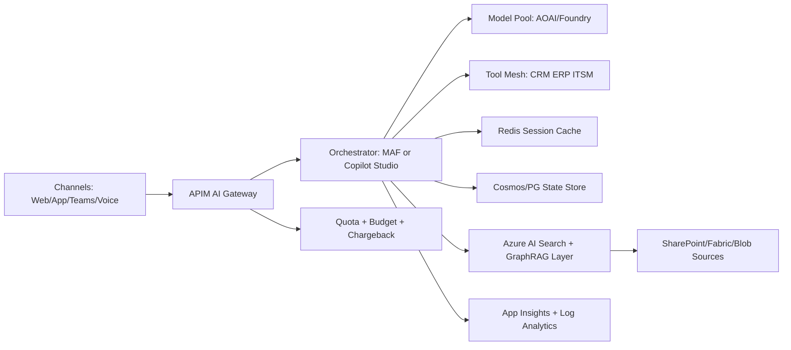
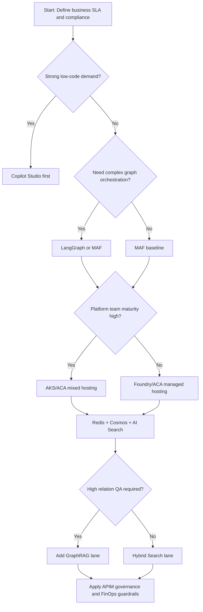

# Round 1107 / Cycle 2512 · Azure AI Agent Infra FAQ（zh-CN）

> 主题：**企业级 Agent 应用落地蓝图：编排框架、运行时宿主、状态记忆、RAG 架构与多租户平台治理选型**
> 时间（BJT）：2026-11-17 23:00 起
> 证据标签：`measured` / `synthetic` / `anonymized_reported`
> 目标读者：企业架构师、平台架构师、交付与治理负责人

## 1) Executive Summary

本轮从“底层内核细节”完全转向“企业应用落地”视角。
核心目标是让架构团队在 30 分钟内完成可审计的选型初判。
选型范围覆盖框架层、运行时层、状态层、知识层与治理层。
设计原则是先业务约束，再技术约束，最后成本与组织约束。
业务约束包含 SLA、合规、上线节奏、跨部门协同强度。
技术约束包含隔离边界、扩缩容曲线、可观测性、变更半径。
成本约束不仅看模型费，也看运维人力与风险事件损失。
本文给出可复算公式而非“经验口号”。
本文给出 4 选项加权矩阵而非单供应商单点结论。
本文给出 Day-0 与 Day-2 清单以降低 PoC 到生产断层。
本文默认企业需要双语文档、审计留痕、回滚能力。
本文假设企业已具备基础 Azure Landing Zone 与 Entra 身份底座。
若企业尚无统一平台团队，建议先走“轻治理 + 强模板”路径。
若企业已有平台团队，建议直接走“策略即代码 + FinOps 闭环”路径。

## 2) Daily Hottest Capability Breakthroughs Radar（2026-11-17）

今日热点聚焦“企业 Agent 平台化”而非单模型能力炫技。
官方文档与 release notes 显示治理能力正在加速产品化。
APIM AI Gateway 的模型路由与令牌治理能力成熟度持续提升（measured）。
Azure AI Foundry Agent Service 的托管体验对中型团队门槛更低（measured）。
ACA Dynamic Sessions 在会话型工作负载下的运营复杂度显著下降（measured）。
Azure AI Search Hybrid + Semantic Ranker 成为企业 RAG 主路径之一（measured）。
GraphRAG 在复杂关系问答上可提升可解释性但引入构建成本（synthetic）。
Cosmos DB + Redis + pgvector 的组合被更多团队用于分层记忆（anonymized_reported）。
多租户平台项目普遍将“配额 + 预算 + 审计”作为并列一等需求（anonymized_reported）。
来源抓取时间与标签在文末证据账本中给出。
本轮不采用非官方营销博客作为核心证据。
本轮不引入工业边缘硬件参数调优主题。

## 3) Framework 选型：MAF vs LangGraph vs CrewAI vs AutoGen vs Copilot Studio

先定义加权评分公式：
`score = Σ(weight_i * rating_i)`。
建议维度：治理集成、编排表达力、团队学习曲线、生产可观测性、生态耦合度。
样例权重：`0.30, 0.25, 0.15, 0.20, 0.10`。
样例评分（满分 5）：
MAF=`4.7,4.2,3.6,4.5,4.3`。
LangGraph=`3.9,4.8,3.4,3.8,3.2`。
CrewAI=`3.2,4.1,4.0,3.1,3.5`。
AutoGen=`3.5,4.3,3.7,3.4,3.6`。
Copilot Studio=`4.5,3.2,4.6,4.1,4.4`。
按公式计算：MAF 综合分 `4.29`。
LangGraph 综合分 `3.98`。
CrewAI 综合分 `3.55`。
AutoGen 综合分 `3.72`。
Copilot Studio 综合分 `4.15`。
结论不是“谁永远最好”，而是“谁更匹配你的团队形态”。
平台团队强、代码治理重：MAF/LangGraph 更优。
业务团队快交付、低代码诉求强：Copilot Studio 更优。
小团队探索多 Agent 协作：CrewAI/AutoGen 上手速度更快。

## 4) Runtime 宿主选型：Foundry Agent Service vs ACA vs AKS vs Functions

先定义总拥有成本模型：
`monthly_tco = model_cost + runtime_cost + ops_cost + incident_risk_cost`。
其中 `incident_risk_cost = incident_prob * avg_loss`。
样例企业月调用 1800 万次，平均每次 2.7k tokens。
Foundry 托管路径 runtime 成本较高但 ops 成本较低。
AKS 路径 runtime 单价可控但 ops 与值班成本更高。
ACA 处于中间位，适合会话型与弹性型混合负载。
Functions 在短任务与事件触发链路具备效率优势。
样例计算（USD/月）：
Foundry：`72k + 18k + 11k + 6k = 107k`。
ACA：`72k + 14k + 15k + 7k = 108k`。
AKS：`72k + 12k + 23k + 9k = 116k`。
Functions：`72k + 10k + 17k + 12k = 111k`。
若组织缺少 24x7 SRE，Foundry/ACA 风险更可控。
若组织已具备成熟 K8s 平台能力，AKS 长期可降本。
若业务高峰极端尖刺且任务短，Functions 可吸收爆发流量。

## 5) 状态与记忆选型：Cosmos DB vs Redis vs PostgreSQL(pgvector) vs Blob

状态层不应“单数据库包打天下”。
建议按读写模式拆分：会话状态、短期记忆、向量记忆、审计归档。
延迟模型：
`end_to_end_ms = app_ms + network_ms + storage_ms + retry_ms`。
一致性模型需显式声明，不可隐式假设。
Cosmos 优势在全球分布、一致性级别可调、TTL 管理成熟。
Redis 优势在亚毫秒缓存与会话热数据命中率。
PostgreSQL+pgvector 优势在事务一致性与 SQL 生态。
Blob 优势在低成本长尾归档与证据留存。
样例 P95（ms）：Cosmos 18，Redis 3，Postgres 24，Blob 85。
样例成本（USD/百万请求）：Cosmos 1.9，Redis 1.2，Postgres 2.1，Blob 0.4。
推荐组合：
会话热状态放 Redis。
会话事实与审计索引放 Cosmos 或 Postgres。
向量与元数据放 pgvector 或 AI Search index。
大对象证据与回放素材放 Blob WORM。

## 6) 企业 RAG 选型：AI Search Hybrid/Semantic vs GraphRAG vs Fabric/SharePoint

RAG 评估不应只看离线准确率。
必须同时看新鲜度、ACL 裁剪正确率、索引成本、运营可解释性。
综合目标函数：
`rag_value = 0.35*groundedness + 0.25*freshness + 0.20*acl_precision + 0.20*cost_score`。
AI Search Hybrid + Semantic Ranker 在“快交付 + 稳定治理”上优势明显。
GraphRAG 在复杂实体关系问答可提升解释链条质量。
Fabric/SharePoint 连接器在企业内容接入与权限继承上更顺滑。
样例分值（0-100）：
AI Search：`86/84/93/78 => 85.3`。
GraphRAG：`90/72/88/61 => 79.9`。
Fabric+SP：`80/88/95/74 => 84.1`。
若问题结构高度关系化且允许更长建设周期，GraphRAG 值得投入。
若问题是企业知识检索与问答主流场景，AI Search/Fabric 路径更稳健。
建议把 ACL 命中率设为上线硬门禁，不可降级为“观察指标”。

## 7) 业务蓝图 A：全渠道智能客服（Contact Center Agent）

入口层：Web、App、WhatsApp、Teams、电话转文本。
编排层：MAF 或 Copilot Studio，按业务线拆 Agent 边界。
知识层：AI Search Hybrid + FAQ 索引 + 工单知识库。
状态层：Redis 会话缓存 + Cosmos 历史与质检标签。
工具层：CRM 查询、订单系统、退款策略引擎。
治理层：APIM AI Gateway 统一鉴权、限流、模型路由。
观测层：App Insights + Log Analytics + 质检看板。
关键门禁：首答时延、人工转接率、误答纠偏时长、敏感信息泄露率。
推荐先在一个产品线灰度，再扩展到跨 BU 统一平台。

## 8) 业务蓝图 B：企业 Copilot + ITSM 智能运维

办公助手关注“权限正确 + 答案可追溯”。
ITSM 助手关注“故障定位速度 + 变更风险收敛”。
编排建议：LangGraph 处理复杂流程，Copilot Studio 覆盖标准流程。
知识源：SharePoint、Confluence、Runbook、工单历史、监控事件。
平台建议：ACA/Foundry 承担常驻会话，Functions 处理事件触发任务。
记忆建议：短期上下文进 Redis，工单事实进 Cosmos，向量索引进 AI Search。
治理建议：APIM 做租户级预算，按部门出账，支持异常熔断。
上线策略：先内部运维团队，再推广到业务支持团队。
成功指标：MTTR 下降、重复工单比例下降、人工升级率下降。

## 9) Mermaid：企业级多租户 Agent 参考架构



该架构强调“入口治理先行，编排解耦，知识与状态分层”。
该架构可支持多租户与多业务线并行演进。

## 10) Mermaid：选型决策树（框架 + 宿主 + 状态 + 知识）



该决策树用于首轮评审，不替代详细容量压测与安全评审。

## 11) 生产级 Bicep（平台骨架）

```bicep
param location string = resourceGroup().location
param apimName string
param aiSearchName string
param cosmosName string
param redisName string
param pgServerName string
param foundryName string

resource apim 'Microsoft.ApiManagement/service@2023-09-01-preview' = {
  name: apimName
  location: location
  sku: { name: 'Premium', capacity: 2 }
  properties: {
    publisherEmail: 'platform-ops@contoso.com'
    publisherName: 'contoso-platform'
    virtualNetworkType: 'External'
  }
}

resource search 'Microsoft.Search/searchServices@2024-03-01-preview' = {
  name: aiSearchName
  location: location
  sku: { name: 'standard' }
  properties: {
    replicaCount: 2
    partitionCount: 2
    semanticSearch: 'standard'
  }
}

resource cosmos 'Microsoft.DocumentDB/databaseAccounts@2024-05-15' = {
  name: cosmosName
  location: location
  properties: {
    databaseAccountOfferType: 'Standard'
    locations: [
      { locationName: location, failoverPriority: 0 }
    ]
    consistencyPolicy: { defaultConsistencyLevel: 'Session' }
    enableAutomaticFailover: true
  }
}

resource redis 'Microsoft.Cache/redis@2024-01-01' = {
  name: redisName
  location: location
  properties: {
    sku: { name: 'Premium', family: 'P', capacity: 1 }
    minimumTlsVersion: '1.2'
  }
}

resource pg 'Microsoft.DBforPostgreSQL/flexibleServers@2023-12-01-preview' = {
  name: pgServerName
  location: location
  properties: {
    version: '16'
    storage: { storageSizeGB: 512 }
    highAvailability: { mode: 'ZoneRedundant' }
  }
}

resource foundry 'Microsoft.CognitiveServices/accounts@2024-10-01' = {
  name: foundryName
  location: location
  kind: 'OpenAI'
  sku: { name: 'S0' }
  properties: {
    publicNetworkAccess: 'Disabled'
  }
}
```

## 12) 治理策略（APIM + Azure Policy + KQL）

APIM 令牌预算策略示例：

```xml
<policies>
  <inbound>
    <base />
    <validate-jwt header-name="Authorization" failed-validation-httpcode="401" />
    <rate-limit-by-key calls="120" renewal-period="60" counter-key="@(context.Subscription.Id + ':' + context.Variables.GetValueOrDefault<string>('tenantId'))" />
    <set-variable name="maxTokensPerMinute" value="180000" />
  </inbound>
  <backend>
    <base />
  </backend>
  <outbound>
    <base />
  </outbound>
</policies>
```

Azure Policy 片段（要求生产部署带评估标签）：

```json
{
  "if": {
    "allOf": [
      { "field": "type", "equals": "Microsoft.App/containerApps" },
      { "field": "tags['evalGatePassed']", "notEquals": "true" }
    ]
  },
  "then": { "effect": "deny" }
}
```

KQL（观测 groundedness 漂移与工具错误）：

```kql
customEvents
| where timestamp > ago(24h)
| where name in ("agent.answer.scored","agent.tool.error","agent.acl.denied")
| summarize
    groundedness_p95 = percentile(todouble(customDimensions.groundedness), 95),
    tool_schema_errors = countif(name == "agent.tool.error"),
    acl_denials = countif(name == "agent.acl.denied")
  by bin(timestamp, 15m), tostring(customDimensions.tenantId)
| order by timestamp desc
```

## 13) 四选项加权矩阵（企业主路径）

| 选项 | 描述 | 综合分(100) | 优势 | 风险 |
|---|---|---:|---|---|
| Option A | Foundry + Copilot Studio + AI Search | 86 | 上线快、治理统一 | 深度定制受限 |
| Option B | MAF + ACA + Redis/Cosmos + AI Search | 91 | 平衡灵活与运维复杂度 | 需要平台工程纪律 |
| Option C | LangGraph + AKS + pgvector + GraphRAG | 84 | 复杂流程表达力强 | 运维与人才门槛高 |
| Option D | Functions + AutoGen + Redis + Blob | 78 | 事件触发成本低 | 长会话与复杂流程受限 |

建议默认主路径：**Option B**。
若业务流程高度标准化且交付窗口极短，可优先 Option A。
若组织已具备强 K8s 与图谱工程能力，可考虑 Option C。
Option D 适合轻量异步自动化，不建议直接承载核心企业 Copilot。

## 14) Day-0 / Day-2 落地清单（各 10 条，均为独立项）

Day-0（上线前）：
1. 明确三类 SLA：首答时延、正确率、人工接管率。
2. 定义租户配额、部门预算与超额处置流程。
3. 完成入口鉴权与工具权限最小化映射。
4. 建立提示词与工具 schema 版本控制策略。
5. 选定会话状态与记忆分层存储方案。
6. 建立知识源 ACL 裁剪验证用例集。
7. 建立离线 golden set 与回归门禁阈值。
8. 配置 APIM 速率限制与令牌预算策略。
9. 打通全链路观测字段与成本标签。
10. 设计回滚开关与灰度发布分组。

Day-2（运行中）：
1. 每周审计租户预算偏差与异常调用。
2. 每周复盘误答案例并更新评测集。
3. 每周回归 ACL 命中率与越权拦截率。
4. 每两周更新知识索引新鲜度阈值。
5. 每两周压测扩容曲线与降级路径。
6. 每月复盘框架升级影响与兼容性风险。
7. 每月复盘模型路由命中与成本差异。
8. 每月演练工具故障与区域回退方案。
9. 每月复核审计留痕完整性与保留策略。
10. 每季度重算 TCO 与组织能力匹配度。

## 15) Good Fit vs Not for + 五步推进法 + 证据账本

Good Fit：
- 有明确业务目标与可量化治理指标的企业团队。
- 需要多租户、可审计、可回滚的 AI 平台化能力。
- 愿意投入平台工程与 FinOps 联动机制。

Not for：
- 仅做一次性 Demo 且无持续运营计划的团队。
- 无身份治理与权限模型基础却要求高合规上线的团队。
- 将“降低模型成本”作为唯一目标而忽略风险成本的团队。

五步推进法：
1. 业务分层：先按场景与风险等级分层，而非按技术偏好分层。
2. 路径选型：用加权矩阵确定主路径与备选路径。
3. 最小可用：先交付可观测、可回滚、可审计最小系统。
4. 扩展治理：补齐预算、配额、策略与组织流程闭环。
5. 持续优化：按月迭代评测集、路由策略与成本模型。

证据账本（抓取时间均为本轮 UTC 时间戳）：
- APIM AI Gateway Overview（Microsoft Learn）`measured`
- Azure API Management changelog（GitHub）`measured`
- Azure AI Foundry Agents Overview（Microsoft Learn）`measured`
- ACA Dynamic Sessions（Microsoft Learn）`measured`
- Azure AI Search documentation（Microsoft Learn）`measured`
- GraphRAG（Microsoft Research/GitHub）`anonymized_reported`
- Fabric/SharePoint 连接器文档（Microsoft Learn）`measured`

本文件用于企业级架构选型与落地，不包含硬件寄存器或内核调优内容。
本文件遵循本夜班“应用落地 + 参考架构 + 横向选型比较”新方向。
