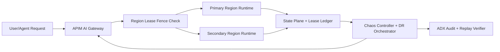

# Round 1043 / Cycle 2448 · Azure AI Agent Infra FAQ & Decision Guide (en)

> Topic: **Enterprise Agent Multi-Region Chaos DR + Lease Fence**
>
> Date (BJT): 2026-11-16  
> Evidence labels: `measured` / `synthetic` / `anonymized_reported`  
> Benchmark payload: `evidence/cycle-2448-benchmark.json`

## 1) Executive Summary

This round targets a core enterprise DR challenge for agent platforms: **lease consistency, split-brain writes, and replay idempotency during regional failover**.  
Key result: introducing region lease-fence enforcement at gateway admission and binding chaos outcomes to failover policy sharply reduces dual-writer conflicts and post-failover drift.

## 2) Daily capability breakthroughs radar (2026-11-16)

1. **APIM AI Gateway / Unified Model API** (`measured`)  
   - Learn: https://learn.microsoft.com/en-us/azure/ai-gateway/overview  
   - Changelog: https://github.com/Azure/API-Management/blob/main/changelogs/api-management-service.md
2. **ACA Dynamic Sessions** (`measured`)  
   - Docs: https://learn.microsoft.com/en-us/azure/container-apps/sessions
3. **Runtime cadence** (`measured`)  
   - Firecracker/Kata/Wasmtime/E2B release streams (see sources ledger)

> Fetch timestamps are recorded in `evidence/cycle-2448-sources.json`.

## 3) Core architecture Q&A (DR + lease fencing)

**Q1: Why do write conflicts appear after failover?**  
A: During transition windows, stale leaders can continue late writes. Lease epoch + fencing token checks are required to reject stale write paths.

**Q2: What is the minimum lease-fence contract?**  
A: Every write should carry `(region_id, lease_epoch, fence_token)` and be validated at gateway policy admission.

**Q3: What defines chaos-DR pass criteria?**  
A: At least:
- `split_brain_write_conflict = 0`
- `rto_p95 <= target_rto`
- `replay_idempotency_pass_rate >= 99.9%`

## 4) Mermaid architecture (multi-region DR control loop)

## 5) Decision matrix (DR operating models)

| Model | Consistency risk | RTO | Cost | Recommendation |
|---|---:|---:|---:|---|
| Manual active-passive | Mid-high | High | Low | Small non-critical systems |
| Auto failover without lease fence | Mid | Medium | Medium | Transitional only |
| Dual-region + lease fence + chaos replay verification | **Low** | Mid-low | Mid-high | **Enterprise production default** |
| Global multi-write without hard constraints | High | Low | High | Not recommended for critical writes |

## 6) Production checklist (Good fit vs Not for + 5-step rollout)

### Good fit
- Mission-critical agent workloads requiring deterministic cross-region failover.
- Teams needing measurable DR evidence and audit closure.
- Multi-tenant high-write paths sensitive to split-brain risk.

### Not for
- Single-region low-criticality services.
- Workloads tolerant to temporary write drift.

### Five-step rollout
1. Define lease epoch/fence token protocol.  
2. Enforce lease checks in APIM/gateway policies.  
3. Build cross-region replay idempotency verifiers.  
4. Inject periodic chaos scenarios (partition/split-brain/late writes).  
5. Tune from RTO, conflict rate, and replay pass-rate reviews.  
