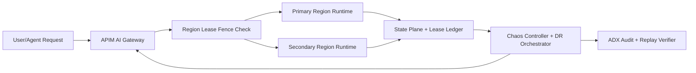

# Round 1043 / Cycle 2448 · Azure AI Agent Infra FAQ & 决策指南（zh-CN）

> Topic: **Enterprise Agent Multi-Region Chaos DR + Lease Fence**
>
> Date (BJT): 2026-11-16  
> Evidence labels: `measured` / `synthetic` / `anonymized_reported`  
> Benchmark payload: `evidence/cycle-2448-benchmark.json`

## 1) Executive Summary

本轮聚焦企业 Agent 平台跨区域容灾（DR）中的核心难题：**双活切换时的租约一致性、写入脑裂与回放幂等**。  
核心结论：在 APIM/Gateway 层引入 region lease fence，并将 chaos 演练结果绑定到 failover policy，可显著降低双主写冲突和恢复后数据漂移。

## 2) Daily capability breakthroughs radar（2026-11-16）

1. **APIM AI Gateway / Unified Model API**（`measured`）  
   - Learn: https://learn.microsoft.com/en-us/azure/ai-gateway/overview  
   - Changelog: https://github.com/Azure/API-Management/blob/main/changelogs/api-management-service.md
2. **ACA Dynamic Sessions**（`measured`）  
   - Docs: https://learn.microsoft.com/en-us/azure/container-apps/sessions
3. **Runtime cadence**（`measured`）  
   - Firecracker/Kata/Wasmtime/E2B release streams（见 sources ledger）

> 抓取时间见 `evidence/cycle-2448-sources.json`。

## 3) Core architecture Q&A（DR 与租约护栏）

**Q1: 为什么多区域故障切换后会出现写冲突？**  
A: 因为主备切换窗口内可能存在旧 leader 迟到写入。必须以 lease epoch + fencing token 阻断旧写入路径。

**Q2: 如何设计 lease fence？**  
A: 每个写请求需携带 `(region_id, lease_epoch, fence_token)`，网关校验不通过即拒绝，确保“旧主永不复活写入”。

**Q3: Chaos 演练指标如何定义通过？**  
A: 建议至少满足：  
- `split_brain_write_conflict = 0`  
- `rto_p95 <= target_rto`  
- `replay_idempotency_pass_rate >= 99.9%`

## 4) Mermaid architecture（多区域 DR 闭环）

## 5) Decision matrix（容灾模式）

| 模式 | 一致性风险 | RTO | 成本 | 推荐 |
|---|---:|---:|---:|---|
| 主备手工切换 | 中高 | 高 | 低 | 小规模系统 |
| 主备自动切换（无租约护栏） | 中 | 中 | 中 | 过渡方案 |
| 双区域 + lease fence + chaos 回放验证 | **低** | 中低 | 中高 | **企业生产推荐** |
| 全局多写无强约束 | 高 | 低 | 高 | 不建议用于关键业务写入 |

## 6) Production checklist（Good fit vs Not for + 五步落地）

### Good fit
- 关键业务 Agent，必须保证跨区故障不丢不乱写。  
- 需要可量化 DR 演练证据与审计闭环。  
- 多租户高并发写路径，对脑裂敏感。

### Not for
- 单区域低关键性服务。  
- 对短暂数据漂移容忍度高的非关键读多写少系统。

### 五步落地
1. 定义 lease epoch/fence token 协议。  
2. 在 APIM/Gateway 落地租约校验策略。  
3. 建立跨区回放幂等验证器。  
4. 定期注入 chaos 场景（网络分区/脑裂/迟到写）。  
5. 复盘 RTO、冲突率、回放通过率并调参。  
