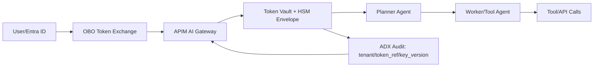

# Round 1041 / Cycle 2446 · Azure AI Agent Infra FAQ & Decision Guide (en)

> Topic: **Enterprise Agent OBO Token Vault + HSM Envelope Rotation**
>
> Date (BJT): 2026-11-16  
> Evidence labels: `measured` / `synthetic` / `anonymized_reported`  
> Benchmark payload: `evidence/cycle-2446-benchmark.json`

## 1) Executive Summary

This round targets a critical enterprise weakness in multi-tenant agents: **OBO token propagation, key-rotation windows, and consistency between token vaulting and HSM envelope encryption**.  
Main conclusion: centralizing OBO/tool/session secrets into a token vault with dual-version HSM rotation (N/N+1) and tenant-level audit lineage sharply reduces token leakage and rotation outage risk.

## 2) Daily capability breakthroughs radar (2026-11-16)

1. **APIM AI Gateway / Unified Model API** (`measured`)  
   - Learn: https://learn.microsoft.com/en-us/azure/ai-gateway/overview  
   - Changelog: https://github.com/Azure/API-Management/blob/main/changelogs/api-management-service.md
2. **ACA Dynamic Sessions** (`measured`)  
   - Docs: https://learn.microsoft.com/en-us/azure/container-apps/sessions
3. **Runtime cadence** (`measured`)  
   - Firecracker/Kata/Wasmtime/E2B release streams (see sources ledger)

> Fetch timestamps are recorded in `evidence/cycle-2446-sources.json`.

## 3) Core architecture Q&A (OBO + Vault + Rotation)

**Q1: Why do OBO tokens become hard to control across multi-hop agent flows?**  
A: Planner/Worker/Tool hops tend to copy bearer tokens. Once leaked in context, attribution and revocation are difficult. Use token-reference passing only, never raw token fan-out.

**Q2: How to rotate HSM envelope keys without downtime?**  
A: Use dual-version rotation:
- Writes use `key_vN+1`
- Reads accept `key_vN` and `key_vN+1`
- Retire `key_vN` only after background re-encryption completes

**Q3: How to quantify risk exposure during rotation?**  
A:  
`exposure_window = token_ttl + cache_ttl + max_retry_backoff`  
Keep this below your security threshold (for example, <30 minutes).

## 4) Mermaid architecture (OBO token-vault flow)

## 5) Decision matrix (token and key governance)

| Strategy | Security | Operability | Latency impact | Recommendation |
|---|---:|---:|---:|---|
| In-process plaintext token cache | Low | High | Low | Local PoC only |
| Vault plaintext + manual rotation | Medium | Medium | Medium | Transitional only |
| Vault + HSM envelope + dual-version rotation | **High** | Mid-high | Medium | **Enterprise production default** |
| Per-request real-time exchange + zero cache | High | Low | High | Ultra-regulated low-throughput scenarios |

## 6) Production checklist (Good fit vs Not for + 5-step rollout)

### Good fit
- Financial/public-sector multi-tenant agent platforms needing least-privilege traceability.
- Frequent key rotation and cross-team tool invocation.
- Strong requirement for non-disruptive key rotation plus tenant-level forensic audit.

### Not for
- Single-tenant, low-risk internal scripts.
- Environments without Key Vault/HSM capability or security ops ownership.

### Five-step rollout
1. Map OBO token lifecycles and service-boundary hops.  
2. Enforce token-reference-only propagation.  
3. Implement Vault + HSM dual-version rotation.  
4. Log `tenant_id/token_ref/key_version` into ADX audit streams.  
5. Drill token leak, key invalidation, and emergency revoke playbooks.  
