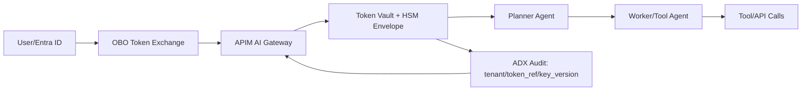

# Round 1041 / Cycle 2446 · Azure AI Agent Infra FAQ & 决策指南（zh-CN）

> Topic: **Enterprise Agent OBO Token Vault + HSM Envelope Rotation**
>
> Date (BJT): 2026-11-16  
> Evidence labels: `measured` / `synthetic` / `anonymized_reported`  
> Benchmark payload: `evidence/cycle-2446-benchmark.json`

## 1) Executive Summary

本轮聚焦企业多租户 Agent 的高风险短板：**OBO 令牌跨服务传递、密钥轮换窗口、令牌保险库（Token Vault）与 HSM Envelope 加密一致性**。  
核心结论：将 OBO token、tool credential 与 session secret 全部落入统一 Vault，采用双版本 HSM 密钥轮换（N/N+1）和租户隔离审计链，可显著降低令牌泄漏与轮换中断风险。

## 2) Daily capability breakthroughs radar（2026-11-16）

1. **APIM AI Gateway / Unified Model API**（`measured`）  
   - Learn: https://learn.microsoft.com/en-us/azure/ai-gateway/overview  
   - Changelog: https://github.com/Azure/API-Management/blob/main/changelogs/api-management-service.md
2. **ACA Dynamic Sessions**（`measured`）  
   - Docs: https://learn.microsoft.com/en-us/azure/container-apps/sessions
3. **Runtime cadence**（`measured`）  
   - Firecracker/Kata/Wasmtime/E2B release streams（见 sources ledger）

> 抓取时间见 `evidence/cycle-2446-sources.json`。

## 3) Core architecture Q&A（OBO + Vault + Rotation）

**Q1: 为什么 OBO token 在多跳链路中容易失控？**  
A: Planner/Worker/Tool 多跳会复制 bearer token，上下文泄漏后很难追责。应改为“仅传 token reference，不传明文 token”。

**Q2: HSM Envelope 轮换如何避免停机？**  
A: 使用双版本策略：  
- 写入使用 `key_vN+1`  
- 读取兼容 `key_vN` + `key_vN+1`  
- 后台重加密完成后再停用 `key_vN`

**Q3: 轮换窗口如何估算风险暴露时长？**  
A:  
`exposure_window = token_ttl + cache_ttl + max_retry_backoff`  
必须保证 `exposure_window` 小于安全策略定义阈值（例如 30 分钟）。

## 4) Mermaid architecture（OBO Token Vault 路径）

## 5) Decision matrix（令牌与密钥治理策略）

| 策略 | 安全性 | 可运维性 | 延迟影响 | 适用建议 |
|---|---:|---:|---:|---|
| 进程内明文缓存 token | 低 | 高 | 低 | 仅本地 PoC |
| Vault 明文存储 + 手工轮换 | 中 | 中 | 中 | 过渡期方案 |
| Vault + HSM Envelope + 双版本轮换 | **高** | 中高 | 中 | **企业生产推荐** |
| 每请求实时交换 + 零缓存 | 高 | 低 | 高 | 超高合规、低吞吐场景 |

## 6) Production checklist（Good fit vs Not for + 五步落地）

### Good fit
- 金融/政企多租户 Agent 平台，要求可审计最小权限。
- 存在跨团队工具调用和高频密钥轮换。
- 需要“不中断轮换”与“租户级追踪”并存。

### Not for
- 单租户低风险内部脚本。
- 无 Key Vault/HSM 基础设施或无安全运维团队支持。

### 五步落地
1. 梳理 OBO token 生命周期与跨服务边界。  
2. 建立 token reference-only 传递规范。  
3. 落地 Vault + HSM 双版本密钥轮换。  
4. 将 `tenant_id/token_ref/key_version` 写入 ADX 审计。  
5. 演练密钥失效、token 泄漏与紧急吊销场景。  
