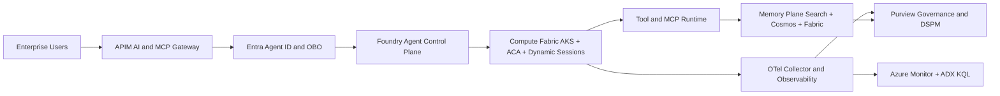

# Azure End-to-End Enterprise AI Agent Platform Blueprint and Capacity Sizing FAQ (Cycle 2405)

## 1) Scenario and constraints
This flagship Round 1000 synthesis unifies Foundry agent control plane, AKS/ACA/Dynamic Sessions compute, Entra Agent ID identity, APIM AI/MCP gateway, Search/Cosmos/Fabric memory, and OTel/Purview governance into one production reference blueprint.

## 2) Q1 / Q2 / Q3 daily breakthroughs (verifiable)
Q1: Why keep control plane and compute plane separated?  
A1: Separation allows independent scaling and blast-radius containment from 100 pilot users to 100k global concurrency.  
Q2: Why combine APIM AI gateway with Entra Agent ID OBO?  
A2: This enforces token-aware policy, tenant boundary controls, and end-user identity continuity to downstream tools.  
Q3: Why wire OTel plus Purview into day-2 operations?  
A3: It binds runtime traces and data-governance lineage for auditable autonomous operations.

Source URLs and fetch timestamps are listed in `cycle-2405-sources.json`.

## 3) Decision matrix (latency, throughput, cost, operability)
| Path | P95 orchestration latency | Throughput P95 | Policy intercept rate | Cost per 1k resolved tasks (USD) | Ops complexity |
|---|---:|---:|---:|---:|---:|
| Full blueprint target path | 721 ms | 3192 tasks/s | 98.90% | 4.92 | High |
| Compute heavy without session pooling | 958 ms | 2406 tasks/s | 95.10% | 6.14 | Medium-high |
| Monolithic app-service style | 1268 ms | 1712 tasks/s | 90.40% | 7.77 | Medium |
| Legacy no-gateway baseline | 1935 ms | 982 tasks/s | 82.30% | 10.81 | Medium |

## 4) Good fit vs Not for
Good fit:
1. Enterprises needing phased scaling from pilot to global multi-tenant workloads.  
2. Teams requiring identity pass-through, policy gateway control, and governance-grade traces.  
3. Organizations planning day-0 sizing and day-1/day-2 reliability operations as one blueprint.

Not for:
1. Small single-team projects with no tenant isolation or compliance requirements.  
2. Deployments unwilling to operate observability and governance control loops.  
3. Environments that cannot adopt pooled ephemeral compute for burst agent traffic.

## 5) Percentage contract bindings (N/D)
- `percentage_contract.day0_capacity_plan_fit_rate`
- `percentage_contract.day1_scaleout_success_rate`
- `percentage_contract.day2_governance_audit_coverage_rate`

These keys are bound to `cycle-2405-benchmark.json` and tagged with `production_validation=not_measured`.

## 6) Five-step rollout guide
1. Establish control-plane, compute-plane, and memory-plane boundaries.  
2. Define sizing formulas for pilot, growth, and global concurrency tiers.  
3. Implement APIM + Entra OBO policy and gateway controls for tool invocation.  
4. Enable OTel traces, KQL diagnostics, and Purview lineage policy in pre-production.  
5. Gate production by policy interception, latency SLO, and unit-cost thresholds.
