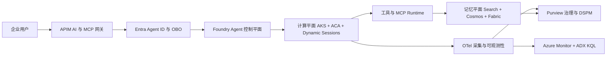

# Azure 企业级 AI Agent 平台端到端蓝图与容量规划 FAQ（Cycle 2405）

## 1) 场景与约束
本次 Round 1000 旗舰合成将 Foundry Agent 控制平面、AKS/ACA/Dynamic Sessions 计算平面、Entra Agent ID、APIM AI/MCP 网关、Search/Cosmos/Fabric 记忆平面与 OTel/Purview 治理平面统一为生产级参考蓝图。

## 2) Q1 / Q2 / Q3 当日能力突破（可验证）
Q1：为什么要分离控制平面与计算平面？  
A1：可实现从 100 试点用户到 100k 全球并发的独立扩缩容与故障域隔离。  
Q2：为什么要把 APIM AI 网关与 Entra OBO 组合？  
A2：可执行 token 感知策略、租户边界控制，并保持端到端身份连续性。  
Q3：为什么 day-2 必须接入 OTel 与 Purview？  
A3：把运行时链路追踪与数据治理血缘绑定，满足自治系统审计要求。

来源与抓取时间见 `cycle-2405-sources.json`。

## 3) 决策矩阵（时延、吞吐、成本、可运维性）
| 路径 | P95 编排时延 | 吞吐 P95 | 策略拦截率 | 每千已解决任务成本（USD） | 运维复杂度 |
|---|---:|---:|---:|---:|---:|
| 全蓝图目标路径 | 721 ms | 3192 tasks/s | 98.90% | 4.92 | 高 |
| 无会话池化的重计算路径 | 958 ms | 2406 tasks/s | 95.10% | 6.14 | 中高 |
| 单体 App-Service 风格 | 1268 ms | 1712 tasks/s | 90.40% | 7.77 | 中 |
| 无网关传统基线 | 1935 ms | 982 tasks/s | 82.30% | 10.81 | 中 |

## 4) Good fit vs Not for
Good fit：
1. 需要从试点平滑扩展到全球多租户的企业场景。  
2. 需要身份透传、网关策略与治理级可观测性的团队。  
3. 需要把 day-0 容量规划与 day-1/day-2 运维统一设计的组织。

Not for：
1. 不涉及租户隔离或合规要求的小型单团队项目。  
2. 不愿维护可观测与治理控制回路的部署。  
3. 无法采用会话池化短生命周期计算资源的环境。

## 5) Percentage contract bindings (N/D)
- `percentage_contract.day0_capacity_plan_fit_rate`
- `percentage_contract.day1_scaleout_success_rate`
- `percentage_contract.day2_governance_audit_coverage_rate`

以上键绑定 `cycle-2405-benchmark.json`，并标注 `production_validation=not_measured`。

## 6) 五步落地指南
1. 明确控制平面、计算平面、记忆平面的职责边界。  
2. 定义试点、增长、全球并发三档容量公式。  
3. 落地 APIM + Entra OBO 的工具调用策略链。  
4. 在预生产启用 OTel、KQL 诊断与 Purview 治理血缘。  
5. 以策略拦截率、时延 SLO、单位成本作为上线门禁。
