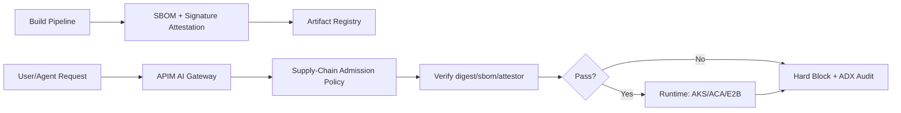

# Round 1042 / Cycle 2447 · Azure AI Agent Infra FAQ & Decision Guide (en)

> Topic: **Enterprise Agent SBOM Attestation + Supply-Chain Gate**
>
> Date (BJT): 2026-11-16  
> Evidence labels: `measured` / `synthetic` / `anonymized_reported`  
> Benchmark payload: `evidence/cycle-2447-benchmark.json`

## 1) Executive Summary

This round focuses on a critical enterprise control point that is often under-enforced: **supply-chain trust gating for agent runtimes**.  
The objective is to enforce SBOM + signed attestation for images, dependencies, tool plugins, and MCP connectors at gateway admission time, preventing untrusted artifacts from ever reaching runtime.

## 2) Daily capability breakthroughs radar (2026-11-16)

1. **APIM AI Gateway / Unified Model API** (`measured`)  
   - Learn: https://learn.microsoft.com/en-us/azure/ai-gateway/overview  
   - Changelog: https://github.com/Azure/API-Management/blob/main/changelogs/api-management-service.md
2. **ACA Dynamic Sessions** (`measured`)  
   - Docs: https://learn.microsoft.com/en-us/azure/container-apps/sessions
3. **Runtime and sandbox cadence** (`measured`)  
   - Firecracker/Kata/Wasmtime/E2B release streams (see sources ledger)

> Fetch timestamps are recorded in `evidence/cycle-2447-sources.json`.

## 3) Core architecture Q&A (SBOM gate operations)

**Q1: Why is build-time scanning alone insufficient?**  
A: Runtime may load plugin layers or remote SDKs that differ from build snapshots. Admission-time verification of attestation + SBOM hash is required.

**Q2: What are the minimum admission fields?**  
A: At least validate: `artifact_digest`, `sbom_hash`, `attestor_identity`, `policy_version`, and `tenant_id`.

**Q3: What should trigger a hard block?**  
A:  
`block_if = (critical_vuln > 0) OR (attestation_missing) OR (sbom_drift > threshold)`  
where `sbom_drift = changed_packages / total_packages`.

## 4) Mermaid architecture (supply-chain admission gate)

## 5) Decision matrix (supply-chain governance modes)

| Mode | Security | Delivery speed | Ops cost | Fit |
|---|---:|---:|---:|---|
| Build-time scanning only | Mid-low | High | Low | Low-risk PoC |
| Build scanning + deployment allowlist | Mid | Medium | Medium | Mid-scale teams |
| Build scanning + runtime attestation gate | **High** | Medium | Mid-high | **Enterprise production default** |
| End-to-end signed chain + tenant-specific policy | Highest | Mid-low | High | Regulated finance/public sector |

## 6) Production checklist (Good fit vs Not for + 5-step rollout)

### Good fit
- Strong auditability requirements for tool/plugin provenance.
- Multi-tenant platforms needing tenant-aware admission policies.
- Compliance requiring provable blocking of unsigned artifacts.

### Not for
- Temporary projects with no traceable artifact provenance.
- Experimental environments with high supply-chain risk tolerance.

### Five-step rollout
1. Emit SBOM + signed attestation in build pipelines.  
2. Bind attestation records to immutable artifact digests.  
3. Enforce attestation verification at APIM/gateway admission.  
4. Log block reasons to ADX (tenant, policy version, artifact hash).  
5. Review false-block rates and vulnerability remediation latency weekly.  
