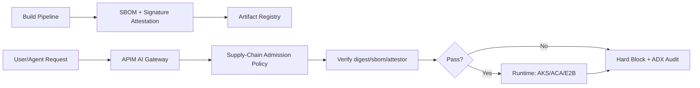

# Round 1042 / Cycle 2447 · Azure AI Agent Infra FAQ & 决策指南（zh-CN）

> Topic: **Enterprise Agent SBOM Attestation + Supply-Chain Gate**
>
> Date (BJT): 2026-11-16  
> Evidence labels: `measured` / `synthetic` / `anonymized_reported`  
> Benchmark payload: `evidence/cycle-2447-benchmark.json`

## 1) Executive Summary

本轮聚焦企业 Agent 平台上线前最关键但最常被弱化的环节：**供应链可信度门禁**。  
目标是把镜像、依赖、工具插件、MCP 连接器统一纳入 SBOM + 签名证明（attestation）链路，在 APIM/Gateway 准入时执行硬阻断，避免“运行时才发现污染依赖”。

## 2) Daily capability breakthroughs radar（2026-11-16）

1. **APIM AI Gateway / Unified Model API**（`measured`）  
   - Learn: https://learn.microsoft.com/en-us/azure/ai-gateway/overview  
   - Changelog: https://github.com/Azure/API-Management/blob/main/changelogs/api-management-service.md
2. **ACA Dynamic Sessions**（`measured`）  
   - Docs: https://learn.microsoft.com/en-us/azure/container-apps/sessions
3. **Runtime & sandbox cadence**（`measured`）  
   - Firecracker/Kata/Wasmtime/E2B release streams（见 sources ledger）

> 抓取时间见 `evidence/cycle-2447-sources.json`。

## 3) Core architecture Q&A（SBOM 门禁实战）

**Q1: 为什么“构建时扫描通过”仍会在生产出问题？**  
A: 因为运行时加载的插件、镜像层、远端工具 SDK 可能与扫描快照不一致。必须在运行时入口再次验证 attestation 与 SBOM hash。

**Q2: 准入门禁最小必需字段是什么？**  
A: 建议至少校验：`artifact_digest`, `sbom_hash`, `attestor_identity`, `policy_version`, `tenant_id`。

**Q3: 如何定义阻断阈值？**  
A:  
`block_if = (critical_vuln > 0) OR (attestation_missing) OR (sbom_drift > threshold)`  
其中 `sbom_drift = changed_packages / total_packages`。

## 4) Mermaid architecture（Supply-chain Gate）

## 5) Decision matrix（供应链治理模式）

| 模式 | 安全性 | 交付速度 | 运维成本 | 适用 |
|---|---:|---:|---:|---|
| 仅构建时扫描 | 中低 | 高 | 低 | 低风险 PoC |
| 构建扫描 + 部署白名单 | 中 | 中 | 中 | 中规模团队 |
| 构建扫描 + 运行时 attestation gate | **高** | 中 | 中高 | **企业生产推荐** |
| 全链路强制签名 + 租户差异化策略 | 最高 | 中低 | 高 | 金融/政企高合规 |

## 6) Production checklist（Good fit vs Not for + 五步落地）

### Good fit
- 需对 Agent 工具链和插件来源做强审计。
- 多租户环境，需要按租户执行差异化门禁策略。
- 合规要求“可证明未运行未签名工件”。

### Not for
- 无 CI/CD 规范、工件来源不可追溯的临时项目。
- 对供应链风险容忍度较高的实验环境。

### 五步落地
1. 在构建流水线产出 SBOM + 签名 attestation。  
2. 将证明写入可查询注册表并与 digest 绑定。  
3. 在 APIM/Gateway 准入前执行 attestation 校验。  
4. 将阻断原因写入 ADX（含租户、策略版本、工件哈希）。  
5. 按周复盘误拦截率与漏洞处置时效。  
